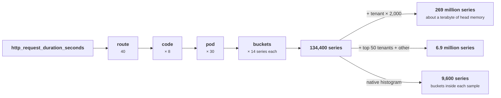
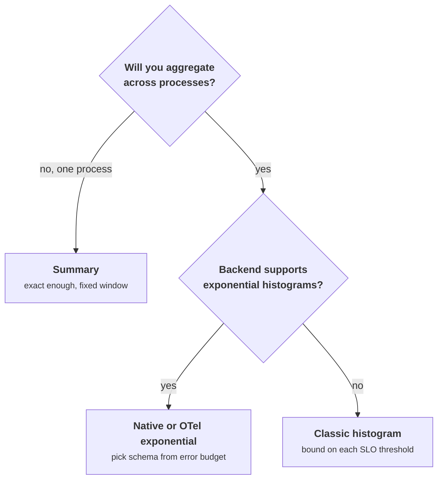

+++
title = 'Metrics, cardinality, and histograms'
description = 'A metric is a set of time series, one per label combination, and its cost is the series count. Histograms trade a bounded value error for mergeability; summaries promise a rank error and cannot be combined.'
question = 'How do metric types, label cardinality, and histogram buckets decide what a metric costs and how wrong its percentiles can be?'
weight = 1
difficulty = 3
prerequisites = ['/notes/systems-design/reliability-in-production/02-observability-signals']
date = 2026-10-30T08:05:00Z
lastmod = 2026-10-30T08:05:00Z
verified = 2026-10-30
+++

## The idea in one minute

A metrics system stores **time series**: one stream of samples per unique
combination of metric name and label values. Its memory, index, and query cost
follow the number of series, not the number of requests, so **cardinality**,
the product of the label value counts, is what decides whether a metric is
cheap or takes down the monitoring server. Churn makes it worse: every deploy
that renames pods creates a fresh set of series while the old ones are still
indexed.

Latency needs a distribution, and there are two ways to keep one. A
**summary** computes quantiles in the client. It is accurate for that one
process, but its error guarantee is about rank, not value, and quantiles from
different processes cannot be combined. A **histogram** counts observations
in buckets. It can be summed across a fleet, and its error is bounded by
bucket width. Exponential buckets, used by Prometheus native histograms,
OpenTelemetry exponential histograms, and DDSketch, make that bound a fixed
relative error everywhere on the scale. **Count series before shipping a
label, aggregate distributions as histograms, and choose bucket resolution
from the relative error you can tolerate.**

## A picture



## How it really works

### Four metric types and what each can answer

| Type | Holds | Correct operations | Common mistake |
| --- | --- | --- | --- |
| **Counter** | A monotonically increasing total, reset to zero on restart | `rate()`, `increase()` over a window | Graphing the raw value, or subtracting two samples across a restart |
| **Gauge** | A current value that goes up and down | Current value, `avg_over_time`, `max_over_time` | Taking `rate()` of a gauge; sampling a spiky gauge too rarely |
| **Histogram** | Cumulative bucket counts plus a sum and a count | Sum buckets across series, then `histogram_quantile()`; ratio of a bucket to the count | Averaging quantiles; bucket bounds that miss the SLO threshold |
| **Summary** | Client-computed quantiles plus a sum and a count | Read one process's quantile | Averaging or summing quantiles across processes |

Counters carry the most information per byte. Two samples of a counter give
the exact number of events between them, whatever happened in between, while
two samples of a gauge say nothing about the spike between them. Prefer a
counter of events, such as bytes sent or requests rejected, to a gauge of a
rate. `rate()` handles restarts by treating any decrease as a reset to zero,
and it extrapolates to the window edges, so a short window over a sparse
counter returns non-integer increases. That is expected, not a bug.

### Cardinality: the arithmetic

```text
series(metric) = Π (distinct values of each label)  ×  (bounds + 3, for a classic histogram)
```

The `+ 3` is the `+Inf` bucket, `_sum`, and `_count`. The product is a
ceiling; not every combination occurs, but plan for the ceiling, because the
combinations that do not occur today appear during an incident, when every
status code shows up on every route.

Three effects make real cardinality worse than the product of today's
labels:

- **Churn.** Labels such as pod name, container ID, or build hash take new
  values on every deploy. The head block of Prometheus's TSDB holds every
  series seen in roughly the last two to three hours, so twelve rolling deploys inside
  that window multiply the series count by thirteen, even though the number of
  live pods never changes.
- **Histograms multiply.** A classic histogram with 11 bounds turns each label
  combination into 14 series.
- **Labels from data.** Any label whose values come from requests, such as a
  raw path, a user ID, a model adapter name, or an error message, grows
  with traffic and is unbounded. Put those in traces and logs, or bound them:
  keep the top N values by name and fold the rest into `other`.

Storage on disk is cheaper than memory: the Gorilla paper reported about 1.37
bytes per sample with delta-of-delta timestamps and XOR-compressed values, and
Prometheus uses a similar encoding. Memory per active series is
backend-specific and is what fails first. Measure it as process memory divided
by `prometheus_tsdb_head_series`, and alert on the series count itself, with a
per-target `sample_limit` as a circuit breaker against one bad deploy.

### Summaries: rank error, not value error

A summary computes quantiles on the client over a sliding window, using a
streaming algorithm with a configured error per quantile. The Prometheus Go
client's documentation uses objectives such as `{0.5: 0.05, 0.9: 0.01,
0.99: 0.001}`. The guarantee is on **rank**: the value reported as the p99 is
the true value at some rank between 0.989 and 0.991. When the distribution has
a gap, such as a fast path and a slow path, a 0.2% band of rank can span both
modes, and the reported p99 can be off by a factor of two or more. A
histogram's error is on **value**, which is the error users feel.

Summaries have two other limits. They **cannot be aggregated**: there is no
operation that turns thirty processes' p99s into the fleet's p99, as
[Observability signals](/notes/systems-design/reliability-in-production/02-observability-signals/)
showed by averaging host p99s. And their window, ten minutes by default in
the Go client, is fixed at instrumentation time, not chosen at query time. Use
summaries only for one process's own quantiles, when you cannot decide on
buckets.

### Exponential buckets and a fixed relative error

If bucket i covers `(base^(i-1), base^i]`, then for any value in the bucket,
reporting the point `2·lo·hi / (lo + hi)` is off by at most

```text
relative error ≤ (base − 1) / (base + 1)
```

Prometheus native histograms set `base = 2^(2^-schema)` with schema from −4 to
8. OpenTelemetry's exponential histogram uses the same family under the name
**scale**, and its SDKs default to at most 160 buckets, lowering the scale
automatically to fit the observed range. DDSketch (Masson, Rim, and Lee,
2019) gives the same relative-error guarantee with a mergeable sketch, and
HdrHistogram fixes a number of significant decimal digits instead, at a fixed
memory cost per decade of range.

| Schema | Base | Bound | Buckets per doubling |
| --- | --- | --- | --- |
| 0 | 2 | 33.3% | 1 |
| 1 | 1.414 | 17.2% | 2 |
| 3 | 1.090 | 4.3% | 8 |
| 5 | 1.022 | 1.1% | 32 |
| 8 | 1.0027 | 0.14% | 256 |

Two properties follow from the shared boundaries. Any two histograms with
these schemas can be **merged** exactly, after reducing the finer one to the
coarser schema by combining adjacent buckets. And only **populated** buckets
cost anything, so the cost follows the spread of the data. A native histogram
is one series whose samples carry all their buckets, so it removes the bucket
multiplier from the series count. Each sample is larger than a counter's,
though, so compare backends by bytes, not by series alone. Prometheus's own
`histogram_quantile()` interpolates within the bucket rather than returning the
error-minimizing point, so its errors can approach the bucket width; the bound
above is the best any estimator can do with those buckets.

Native histograms began as an experimental feature in Prometheus 2.40 and
have been maturing through the 3.x releases. Check your version's
documentation and every hop of your remote-write path before relying on them,
and run classic and native side by side while migrating dashboards.

### Picking bucket boundaries for classic histograms

When you must use classic buckets:

1. Put a boundary **exactly at every SLO threshold** so the SLI is a ratio of
   two counters, not an interpolation.
2. Space the rest geometrically, about ×2 per bucket for dashboards and finer
   near the thresholds you alert on.
3. Cover from below your fastest response to above your timeout, so the
   `+Inf` bucket holds only timeouts.
4. Use the same boundaries in every service whose histograms you will
   aggregate together.



## Code

The program draws 200,000 latencies with a fast mode, a slow mode for about
0.85% of requests, and timeouts near 30 s for 0.2%. Part 1 shows the value
range a summary's rank guarantee allows. Part 2 buckets the data at five
exponential schemas and compares measured quantile error with the bound.
Part 3 counts series and memory for one latency histogram under different
label choices, using an assumed 4 KiB of head memory per series.

```python {title="hist.py"}
"""hist.py: summaries vs histograms, exponential bucket error, and cardinality math.

Part 1 shows why a client-side summary's rank error becomes a large value error
in the tail. Part 2 checks the error bound of exponential (native-style)
buckets across schemas against real quantiles. Part 3 counts series for a
latency histogram as labels and deploys are added. Synthetic latencies;
standard library only; deterministic.
"""

from __future__ import annotations

import math
import random

SCRAPE_S = 15
BYTES_PER_SAMPLE = 1.37  # Gorilla-style compression, per the Gorilla paper's figure
HEAD_BYTES_PER_SERIES = 4096  # a planning assumption; measure your own backend


def latencies(n: int, seed: int) -> list[float]:
    """Seconds. A fast mode, a slow mode (cache miss), and a few timeouts near 30 s."""
    rng = random.Random(seed)
    out = []
    for _ in range(n):
        u = rng.random()
        if u < 0.9895:
            out.append(rng.lognormvariate(math.log(0.045), 0.35))
        elif u < 0.998:
            out.append(rng.lognormvariate(math.log(0.9), 0.5))
        else:
            out.append(30.0 + rng.random())
    return sorted(out)


def q(sorted_xs: list[float], phi: float) -> float:
    return sorted_xs[max(0, math.ceil(phi * len(sorted_xs)) - 1)]


def part1(xs: list[float]) -> None:
    print("part 1: a summary promises rank error, not value error")
    print("  quantile   rank band (eps)        value band              width")
    for phi, eps in ((0.5, 0.05), (0.9, 0.01), (0.99, 0.001), (0.999, 0.0001)):
        lo, hi = q(xs, phi - eps), q(xs, phi + eps)
        print(f"  p{phi * 100:<6g}   {phi - eps:.4f} to {phi + eps:.4f}   "
              f"{lo * 1000:8.1f} to {hi * 1000:8.1f} ms   {(hi - lo) / q(xs, phi):6.1%} of the true value")


def exp_index(x: float, schema: int) -> int:
    """Bucket i covers (base**(i-1), base**i], base = 2**(2**-schema)."""
    return math.ceil(math.log2(x) * 2**schema)


def exp_quantile(counts: dict[int, int], schema: int, phi: float) -> float:
    base = 2 ** (2 ** -schema)
    rank, seen = phi * sum(counts.values()), 0
    for i in sorted(counts):
        seen += counts[i]
        if seen >= rank:
            lo, hi = base ** (i - 1), base**i
            return 2 * lo * hi / (lo + hi)  # the point with the smallest worst-case relative error
    raise ValueError


def part2(xs: list[float]) -> None:
    print("\npart 2: exponential buckets, error bound (base-1)/(base+1) vs measured")
    print("  schema  base     bound    buckets used   p50 err   p99 err   p99.9 err")
    for schema in (0, 1, 3, 5, 8):
        base = 2 ** (2 ** -schema)
        counts: dict[int, int] = {}
        for x in xs:
            i = exp_index(x, schema)
            counts[i] = counts.get(i, 0) + 1
        errs = [(exp_quantile(counts, schema, phi) - q(xs, phi)) / q(xs, phi) for phi in (0.5, 0.99, 0.999)]
        print(f"  {schema:>6}  {base:.4f}  {(base - 1) / (base + 1):6.2%}  {len(counts):>13}   "
              + "   ".join(f"{e:+7.2%}" for e in errs))


def part3() -> None:
    print("\npart 3: series for one latency histogram, http_request_duration_seconds")
    route, code, pods = 40, 8, 30
    classic = 11 + 3  # 11 bounds -> 12 bucket series (with +Inf), plus _sum and _count
    rows = [
        ("route x code x pod, counter", route * code * pods, 0),
        ("  as classic histogram (11 bounds)", route * code * pods * classic, 0),
        ("  as native histogram", route * code * pods, -1),
        ("classic + model (20 values)", route * code * pods * classic * 20, 0),
        ("classic + tenant (2,000 values)", route * code * pods * classic * 2_000, 0),
        ("classic + top-50 tenants + other", route * code * pods * classic * 51, 0),
        ("classic, 12 deploys in the head window", route * code * pods * classic, 12),
    ]
    print("  shape                                    active series   head series   head memory   disk/day")
    for name, active, deploys in rows:
        if deploys < 0:  # one series, but each sample carries every populated bucket
            print(f"  {name:<40} {active:>13,} {active:>13,}   {'larger samples, not comparable':>27}")
            continue
        head = active * (1 + deploys)  # every deploy brings new pod names: new series
        mem = head * HEAD_BYTES_PER_SERIES / 2**30
        disk = active * 86_400 / SCRAPE_S * BYTES_PER_SAMPLE / 2**30
        print(f"  {name:<40} {active:>13,} {head:>13,}   {mem:8.1f} GiB  {disk:6.1f} GiB")


if __name__ == "__main__":
    xs = latencies(200_000, seed=5)
    part1(xs)
    part2(xs)
    part3()
```

Run it with `python3 hist.py`:

```text
part 1: a summary promises rank error, not value error
  quantile   rank band (eps)        value band              width
  p50       0.4500 to 0.5500       43.2 to     47.2 ms     8.8% of the true value
  p90       0.8900 to 0.9100       70.3 to     73.5 ms     4.5% of the true value
  p99       0.9890 to 0.9910      137.1 to    545.3 ms   108.4% of the true value
  p99.9     0.9989 to 0.9991    30434.3 to  30537.6 ms     0.3% of the true value

part 2: exponential buckets, error bound (base-1)/(base+1) vs measured
  schema  base     bound    buckets used   p50 err   p99 err   p99.9 err
       0  2.0000  33.33%             10    -7.64%   -11.52%   -30.05%
       1  1.4142  17.16%             19   +14.77%    +9.95%   -13.07%
       3  1.0905   4.33%             70    +2.21%    -2.09%    +0.39%
       5  1.0219   1.08%            263    -0.98%    -0.94%    -0.61%
       8  1.0027   0.14%           1637    -0.03%    +0.01%    +0.07%

part 3: series for one latency histogram, http_request_duration_seconds
  shape                                    active series   head series   head memory   disk/day
  route x code x pod, counter                      9,600         9,600        0.0 GiB     0.1 GiB
    as classic histogram (11 bounds)             134,400       134,400        0.5 GiB     1.0 GiB
    as native histogram                            9,600         9,600   larger samples, not comparable
  classic + model (20 values)                  2,688,000     2,688,000       10.3 GiB    19.8 GiB
  classic + tenant (2,000 values)            268,800,000   268,800,000     1025.4 GiB  1975.5 GiB
  classic + top-50 tenants + other             6,854,400     6,854,400       26.1 GiB    50.4 GiB
  classic, 12 deploys in the head window         134,400     1,747,200        6.7 GiB     1.0 GiB
```

What it shows:

- **A small rank error can be a huge value error.** At p99, the rank band of
  0.989 to 0.991 crosses the gap between the fast and slow modes, so a summary
  meeting its 0.001 objective may report anything from 137 ms to 545 ms. At
  p99.9 the band sits inside the tight cluster of timeouts and is only 0.3%
  wide. The error depends on the shape of the data, not on the setting.
- **The exponential bound holds at every schema.** Every measured error is
  within `(base − 1)/(base + 1)`: up to 30% at schema 0, under 2.3% at schema
  3, and under 0.1% at schema 8. Resolution costs buckets roughly in
  proportion: 70 populated buckets at schema 3, 1,637 at schema 8 across a
  range of nearly four orders of magnitude.
- **One label can turn gigabytes into a terabyte.** The classic histogram costs
  134,400 series. Adding `tenant` with 2,000 values makes 269 million, about a
  terabyte of head memory at the assumed 4 KiB per series. Capping it at the
  top 50 tenants plus `other` costs 6.9 million.
- **Churn costs memory, not disk.** Twelve deploys within the head window
  multiply head series by 13 while the samples written per day stay the same.

## Where it breaks

- **Assumed per-series cost.** The 4 KiB figure is a planning assumption.
  Real memory per series varies with label lengths, sample rate, and backend.
  Measure your own before sizing.
- **Interpolation inside the backend.** The program reports the
  error-minimizing point. Backends interpolate differently, and error near the
  edges of a distribution, in the lowest and `+Inf` buckets, is unbounded for
  classic histograms.
- **Low counts.** A p99 over a minute with 200 requests is set by two of them.
  No bucket layout fixes sampling noise; show the request count next to any
  percentile.
- **Synthetic data.** Three smooth modes. Real latency has retries, timeouts
  at several values, and bimodal tails per route. The bound for exponential
  buckets holds for any data; the summary band and classic-bucket errors do
  not.
- **Cardinality limits are also a security control.** An attacker who can
  choose a label value, through a header, a path, or a model name that ends up
  in a label, can create series at will and exhaust the monitoring system.
  Labels must come from server-side, bounded sets.

## Remember this

- A metric costs one series per label combination; the product is the ceiling to plan for.
- Churning labels multiply series inside the head window even when nothing else changes.
- Counters give exact counts between any two samples; prefer them to gauges of rates.
- Summaries bound rank error, cannot be aggregated, and fix their window at instrumentation time.
- Exponential buckets bound relative error at (base − 1)/(base + 1) and merge exactly.
- Put a classic bucket boundary on every SLO threshold; never put request data in a label.

## Try it

1. Run `hist.py`. Move the slow mode's share from 0.85% to 3%. Does the p99
   summary band shrink or grow, and why?
2. Add a classic histogram with the client libraries' default bounds to part 2
   and compare its p99 and p99.9 error with schema 3.
3. Compute the series count of the busiest metric in a system you know, then
   the count after one more label with ten values. Check it against the
   system's live series count.
4. Design a per-tenant token-usage metric for 5,000 tenants that stays under
   20,000 series and still supports billing. What goes in the metric, and
   what goes in the usage log instead?

## Check yourself

1. Why is a counter better than a gauge for request rate?

   
   Any two samples of a counter give the exact number of requests between
   them, so `rate()` over any window is correct even if the scrape missed a
   spike. A gauge holding a computed rate shows only the value at each scrape
   and loses everything in between, and its averaging window is fixed in the
   client.
   

2. A summary reports p99 with an objective of 0.001. Why can the reported
   value still be far from the true p99?

   
   The objective bounds the rank of the reported value, between 0.989 and
   0.991, not its value. Where the distribution is sparse, such as the gap
   between a fast and a slow path, that rank band can cover a wide range of
   latencies, so the value can be off by a large factor.
   

3. Why can two Prometheus native histograms with different schemas be merged
   exactly?

   
   Their boundaries come from the same family, powers of `2^(2^-schema)`, so
   every bucket of the finer schema lies entirely inside one bucket of the
   coarser schema. Reducing the finer histogram by adding adjacent buckets
   produces exactly the coarser layout, and the counts then add.
   

4. A deploy adds a `model_adapter` label to a request histogram. There are 900
   adapters. What happens, and what would you do instead?

   
   Every existing series is multiplied by up to 900, more as adapters are
   added. A histogram at 134,400 series becomes up to 121 million, which will
   exhaust memory. Keep the top N adapters by traffic plus `other` in the
   label, or remove the label and record the adapter as a span attribute and
   in a separate, bounded usage metric.
   

## Sources

- Prometheus, [Metric types](https://prometheus.io/docs/concepts/metric_types/), [Histograms and summaries](https://prometheus.io/docs/practices/histograms/), and [Native histograms](https://prometheus.io/docs/specs/native_histograms/), Prometheus documentation.
- Prometheus, [client_golang: Summary and SummaryOpts](https://pkg.go.dev/github.com/prometheus/client_golang/prometheus#SummaryOpts), Go package documentation.
- OpenTelemetry, [Metrics data model: exponential histogram](https://opentelemetry.io/docs/specs/otel/metrics/data-model/#exponentialhistogram) and [Metrics SDK: base2 exponential bucket histogram aggregation](https://opentelemetry.io/docs/specs/otel/metrics/sdk/#base2-exponential-bucket-histogram-aggregation).
- T. Pelkonen et al., [Gorilla: A Fast, Scalable, In-Memory Time Series Database](https://www.vldb.org/pvldb/vol8/p1816-teller.pdf), *PVLDB* 8(12), 2015.
- C. Masson, J. Rim, H. K. Lee, [DDSketch: A Fast and Fully-Mergeable Quantile Sketch with Relative-Error Guarantees](https://arxiv.org/abs/1908.10693), *PVLDB* 12(12), 2019.
- G. Cormode, F. Korn, S. Muthukrishnan, D. Srivastava, "Effective Computation of Biased Quantiles over Data Streams", *ICDE*, 2005.
- G. Tene, [HdrHistogram](https://github.com/HdrHistogram/HdrHistogram), project documentation.
