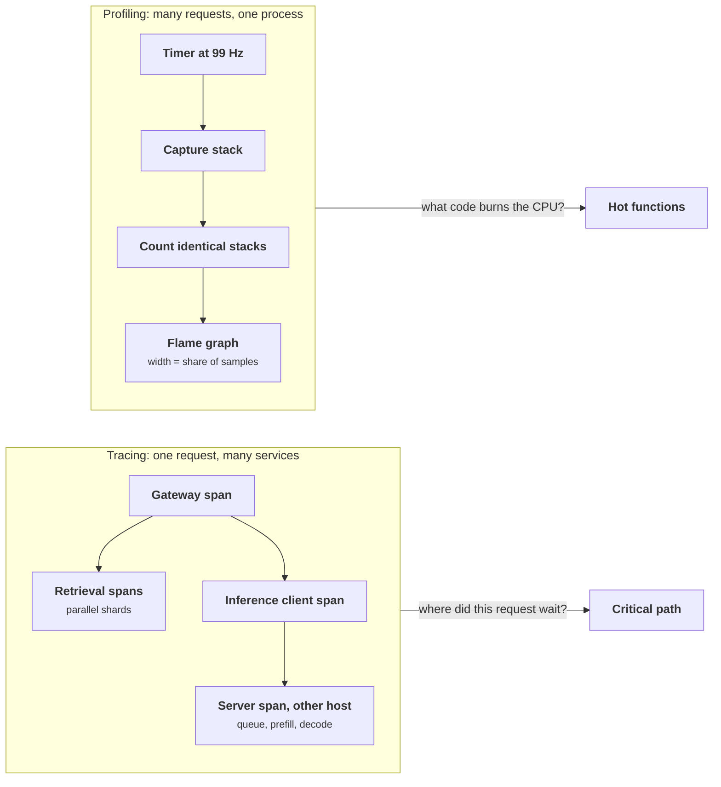
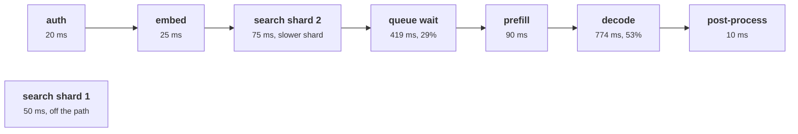

+++
title = 'Tracing and profiling'
description = 'A trace shows where one request spent its time across services; a profile shows which code used a resource across many requests. Both are statistics, and both mislead when clocks, sampling, or asynchrony are ignored.'
question = 'How do you find where a slow request spent its time, and which code is using the CPU, without being misled by the tools?'
weight = 2
difficulty = 3
prerequisites = ['/notes/systems-design/observability/01-metrics-cardinality-and-histograms', '/notes/systems-design/reliability-in-production/02-observability-signals']
date = 2026-10-30T08:10:00Z
lastmod = 2026-10-30T08:10:00Z
verified = 2026-10-30
+++

## The idea in one minute

A **trace** records one request as a tree of timed **spans**. To read it, look
at the **critical path**: walk back from the end of the request, always
following the child that finished last. Speeding up anything off that path
does not change the request's latency. Two things distort traces. Clocks on
different hosts disagree, so a server's span can appear to start before the
client called it. And context propagation breaks at thread pools, queues, and
batchers, which splits one request into unrelated fragments.

A **profile** answers a different question: which code is using the CPU,
memory, or locks, aggregated over many requests. A sampling profiler
interrupts the program at a fixed rate and records the stack. A function's
share of samples estimates its share of the resource, with a statistical
error that shrinks only with more samples. A sampling rate in lockstep with
periodic work can be badly biased. **Read traces along the critical path with
skew corrected, trust a profile's small numbers only when the sample count
supports them, and sample at a rate that does not divide the periods in your
program.**

## A picture



## How it really works

### The span model

Dapper (Sigelman et al., 2010) set the model that OpenTelemetry standardized.
A span has a trace ID shared by every span of the request, its own span ID, a
parent span ID, a name, start and end timestamps, a **kind**, a status, and
attributes:

| Kind | Meaning | Paired with |
| --- | --- | --- |
| `SERVER` | Handling an incoming synchronous request | The caller's `CLIENT` span |
| `CLIENT` | An outgoing synchronous call | The callee's `SERVER` span |
| `PRODUCER` | Sending a message to be processed later | One or more `CONSUMER` spans |
| `CONSUMER` | Processing a message | Often a **link** rather than a parent |
| `INTERNAL` | Work inside one process | Nothing |

Span **events** mark points inside a span ("first token sent"). **Links**
connect a span to spans in other traces, which is how fan-in is modeled: one
inference engine step that serves 32 sequences from 32 requests is one span
with 32 links, not a child of any one of them.

Span names must be low-cardinality (`POST /v1/chat`, not the URL with an ID),
for the same reasons as metric labels: backends index and aggregate by name.
Identifiers go in attributes.

### Propagation, in and out of process

Across services, context travels in the W3C `traceparent` header, as covered
in [Observability signals](/notes/systems-design/reliability-in-production/02-observability-signals/).
Inside a process it travels in a context object, and that is where most traces
break:

- **Thread pools and executors.** Work submitted to a pool runs without the
  submitter's context unless it is captured and restored. Python's
  `contextvars` are copied into `asyncio` tasks automatically, but not into
  threads started directly or most pool workers.
- **Queues and batchers.** A request put on an in-process queue and later
  picked up by a batch loop has lost its context. Carry it with the item, and
  use links when one operation serves many requests.
- **Message brokers.** Put the context in message headers, start a `CONSUMER`
  span on receipt, and link it to the producer's span.

A trace that ends abruptly at a service boundary, or a backend full of
single-span "root" traces from an internal service, is almost always a
propagation bug.

### Clock skew

Each span is timestamped by its own host's clock. With NTP, hosts are commonly
within a millisecond of each other, but offsets of tens of milliseconds
happen, and a span on a host whose clock runs ahead appears to start before
its parent. Dapper noted the problem and relied on the fact that a server span
must lie inside its client span: if it does not, the remote host's spans can
be shifted to center the server span within the client span. Some backends do
this automatically; others display impossible waterfalls. Durations measured
on one host, from a monotonic clock, are trustworthy; **comparisons of
timestamps across hosts are not**.

### Reading a trace: self time and the critical path

Two derived quantities do most of the work:

- **Self time** is a span's duration not covered by any child. A parent with
  large self time is doing work it did not instrument, or waiting on
  something it did not record, often a lock, a queue, or a connection pool.
- The **critical path** is the chain of spans that determined the end time.
  Walk back from the root's end; take the child that finished last before the
  cursor; recurse into it; move the cursor to its start; repeat. Parallel
  children that finished earlier are off the path.

The critical path tells you what to optimize. In the program below, the
second vector-search shard takes 75 ms and the first 50 ms; making the first
one faster saves nothing. Queue wait on the inference server is 29% of the
request; making decode 10% faster would save more, but only adding capacity or
better scheduling would remove the queue.

### Sampling profilers and their error

A sampling profiler, such as Linux `perf`, Go's pprof, py-spy, or an eBPF
agent, interrupts each thread at a fixed frequency and records the stack. If
a function is on the stack in a share p of the samples, the estimate of its
share has standard error `sqrt(p(1 − p)/n)` for n samples:

| Samples | 95% interval for a true 18% | For a true 1% |
| --- | --- | --- |
| 99 (1 s at 99 Hz) | ± 7.6 points | ± 2.0 points |
| 5,940 (1 min) | ± 1.0 point | ± 0.25 points |
| 59,400 (10 min) | ± 0.3 points | ± 0.08 points |

So a one-second profile can rank the big functions and cannot say anything
about a 1% function. Continuous profiling (Google-Wide Profiling, Ren et al.,
2010) gets its power from aggregating samples across a fleet and across time:
a function that is 1% of every process is a large, precisely measured number
across ten thousand machines.

Sampling at **99 Hz rather than 100 Hz** is common practice, as in Brendan
Gregg's examples, because periodic work in the program (timers, schedulers
that tick every 10 ms) can fall in lockstep with a 100 Hz sampler and appear
always or never. Randomized intervals avoid the problem entirely.

Which samples a profiler takes matters as much as how many:

- **On-CPU** profiles only see threads that are running. A request that is
  slow because it waits on a lock, a disk, or the network looks idle.
- **Off-CPU** and wall-clock profiles record where threads are blocked, which
  is what latency problems usually need.
- **Heap and allocation** profiles sample allocations by bytes, not by time.

**Flame graphs** (Gregg, 2016) draw the aggregated stacks with width
proportional to sample count; horizontal order is alphabetical, not time. A
**differential** flame graph between two versions is the fastest way to find
a regression.

### eBPF and the GPU boundary

eBPF lets verified programs run in the Linux kernel, attached to timers,
kernel functions, tracepoints, and user-space functions (uprobes). It powers
whole-machine profilers and instrumentation that needs no code changes: it
can time HTTP and gRPC calls and emit spans for any language. What it sees is
protocol-level: it cannot add your business attributes, and encrypted traffic
needs uprobes on the TLS library. It also needs privileges that make the agent
a high-value target: an eBPF agent can read memory of every process on the
host.

On GPU hosts a CPU profile shows the host side: Python overhead, tokenization,
scheduling, and threads waiting in the driver. CUDA kernel launches are
**asynchronous**: the CPU returns immediately and the GPU runs the kernel
later, so CPU-side timing of a model call measures the launch, not the work,
unless the code synchronizes. Device time needs device tools: NVIDIA Nsight
Systems for timelines, CUPTI-based tracers, or the PyTorch profiler, which
records CPU operators and CUDA kernels on one timeline.

## Code

Part 1 builds one request's spans as a backend would receive them, with the
inference server's host clock 40 ms ahead, corrects the skew, prints a
waterfall with self time, and computes the critical path. Part 2 simulates a
profiler sampling a program whose true CPU shares are known, at four
durations, and then a periodic flush task under samplers at 100, 99, and 97
Hz.

```python {title="traces.py"}
"""traces.py: reading a trace (clock skew, self time, critical path) and the
statistics of a sampling profiler.

Part 1 builds one request's spans as a tracing backend would receive them,
including spans from a host whose clock runs 40 ms ahead, then corrects the
skew, computes self time, and walks the critical path. Part 2 simulates a CPU
profiler sampling stacks at a fixed rate and shows how many samples it takes
to trust a number, and how a sampling rate in lockstep with periodic work
biases the profile. Synthetic data; standard library only; deterministic.
"""

from __future__ import annotations

import math
import random
from dataclasses import dataclass, field


@dataclass
class Span:
    sid: str
    parent: str | None
    name: str
    host: str
    start: float  # ms, in the host's own clock
    end: float
    children: list["Span"] = field(default_factory=list)


RAW = [  # (id, parent, name, host, start, end): what the collector receives
    ("a", None, "gateway POST /v1/chat", "gw", 0, 1450),
    ("b", "a", "auth check", "gw", 5, 25),
    ("c", "a", "embed query", "gw", 30, 55),
    ("d", "a", "vector search shard 1", "gw", 60, 110),
    ("e", "a", "vector search shard 2", "gw", 60, 135),
    ("f", "a", "client: inference call", "gw", 150, 1440),
    ("g", "f", "server: /v1/completions", "gpu7", 192, 1478),  # gpu7 clock +40 ms
    ("h", "g", "queue wait", "gpu7", 193, 612),
    ("i", "g", "prefill 6,400 tokens", "gpu7", 612, 702),
    ("j", "g", "decode 380 tokens", "gpu7", 702, 1476),
    ("k", "a", "post-process", "gw", 1440, 1450),
]


def build() -> dict[str, Span]:
    spans = {r[0]: Span(*r) for r in RAW}
    for s in spans.values():
        if s.parent:
            spans[s.parent].children.append(s)
    return spans


def fix_skew(spans: dict[str, Span]) -> None:
    """A server span must fit inside its client span. If it does not, shift the
    whole remote host by the offset that centers it (Dapper-style correction)."""
    for s in spans.values():
        p = spans.get(s.parent) if s.parent else None
        if p and p.host != s.host and (s.start < p.start or s.end > p.end):
            offset = ((p.start + p.end) - (s.start + s.end)) / 2
            print(f"  skew: '{s.name}' ends {s.end - p.end:+.0f} ms after its client span; "
                  f"shifting host {s.host} by {offset:+.0f} ms")
            for t in spans.values():
                if t.host == s.host:
                    t.start += offset
                    t.end += offset


def self_time(s: Span) -> float:
    """Span duration not covered by any child (children may overlap)."""
    covered, cursor = 0.0, s.start
    for c in sorted(s.children, key=lambda c: c.start):
        lo, hi = max(c.start, cursor), min(c.end, s.end)
        if hi > lo:
            covered += hi - lo
            cursor = hi
    return (s.end - s.start) - covered


def critical_path(s: Span) -> list[tuple[str, float]]:
    """Walk back from the span's end: the child that finished last before the
    cursor is on the path; time with no such child is the span's own."""
    path, cursor = [], s.end
    for c in sorted(s.children, key=lambda c: c.end, reverse=True):
        if c.end <= cursor + 1e-9 and c.end > s.start:
            if cursor - c.end > 0.5:
                path.append((s.name + " (self)", cursor - c.end))
            path += critical_path(c)
            cursor = c.start
    if cursor - s.start > 0.5:
        path.append((s.name + " (self)", cursor - s.start))
    return path


def waterfall(s: Span, root: Span, depth: int = 0) -> None:
    print(f"  {'  ' * depth}{s.name:<{34 - 2 * depth}} {s.start - root.start:7.0f} "
          f"{s.end - s.start:7.0f} {self_time(s):7.0f}")
    for c in sorted(s.children, key=lambda c: c.start):
        waterfall(c, root, depth + 1)


def part1() -> None:
    print("part 1: one trace")
    spans = build()
    fix_skew(spans)
    root = spans["a"]
    print(f"  {'span':<34} {'start':>7} {'dur ms':>7} {'self':>7}")
    waterfall(root, root)
    by_name: dict[str, float] = {}
    for name, ms in critical_path(root):
        by_name[name] = by_name.get(name, 0) + ms
    total = root.end - root.start
    print("  critical path, grouped by span, latest first:")
    for name, ms in by_name.items():
        print(f"    {name:<36} {ms:6.0f} ms  {ms / total:5.1%}")
    print(f"    {'sum':<36} {sum(by_name.values()):6.0f} ms")


def part2() -> None:
    print("\npart 2: a sampling CPU profiler")
    truth = {"json_encode": 0.31, "tokenize": 0.22, "regex_match": 0.18, "handler": 0.20,
             "gc": 0.08, "audit_hash": 0.01}
    names, weights = list(truth), list(truth.values())
    rng = random.Random(2)
    print("  seconds at 99 Hz   samples   regex_match (true 18%)   audit_hash (true 1%)")
    for seconds in (1, 10, 60, 600):
        n = 99 * seconds
        hits = rng.choices(names, weights, k=n)
        cells = []
        for fn in ("regex_match", "audit_hash"):
            p = hits.count(fn) / n
            ci = 1.96 * math.sqrt(max(p * (1 - p), 1e-12) / n)
            cells.append(f"{p:6.1%} +/- {ci:5.1%}")
        print(f"  {seconds:>7}           {n:>7}   {cells[0]:>20}   {cells[1]:>20}")

    print("  lockstep: a flush task runs 2 ms of every 10 ms (true share 20%)")
    for hz in (100, 99, 97):
        period = 1000 / hz
        samples = [((k * period + 0.3) % 10.0) < 2.0 for k in range(hz * 60)]
        print(f"    sampling at {hz:>3} Hz for 60 s sees the task in {sum(samples) / len(samples):6.1%} of samples")


if __name__ == "__main__":
    part1()
    part2()
```

Run it with `python3 traces.py`:

```text
part 1: one trace
  skew: 'server: /v1/completions' ends +38 ms after its client span; shifting host gpu7 by -40 ms
  span                                 start  dur ms    self
  gateway POST /v1/chat                    0    1450      30
    auth check                             5      20      20
    embed query                           30      25      25
    vector search shard 1                 60      50      50
    vector search shard 2                 60      75      75
    client: inference call               150    1290       4
      server: /v1/completions            152    1286       3
        queue wait                       153     419     419
        prefill 6,400 tokens             572      90      90
        decode 380 tokens                662     774     774
    post-process                        1440      10      10
  critical path, grouped by span, latest first:
    post-process (self)                      10 ms   0.7%
    client: inference call (self)             4 ms   0.3%
    server: /v1/completions (self)            3 ms   0.2%
    decode 380 tokens (self)                774 ms  53.4%
    prefill 6,400 tokens (self)              90 ms   6.2%
    queue wait (self)                       419 ms  28.9%
    gateway POST /v1/chat (self)             30 ms   2.1%
    vector search shard 2 (self)             75 ms   5.2%
    embed query (self)                       25 ms   1.7%
    auth check (self)                        20 ms   1.4%
    sum                                    1450 ms

part 2: a sampling CPU profiler
  seconds at 99 Hz   samples   regex_match (true 18%)   audit_hash (true 1%)
        1                99        15.2% +/-  7.1%         2.0% +/-  2.8%
       10               990        18.8% +/-  2.4%         0.7% +/-  0.5%
       60              5940        18.1% +/-  1.0%         1.2% +/-  0.3%
      600             59400        17.9% +/-  0.3%         1.0% +/-  0.1%
  lockstep: a flush task runs 2 ms of every 10 ms (true share 20%)
    sampling at 100 Hz for 60 s sees the task in 100.0% of samples
    sampling at  99 Hz for 60 s sees the task in  19.2% of samples
    sampling at  97 Hz for 60 s sees the task in  19.6% of samples
```

What it shows:

- **Skew is detectable from structure.** The server span ended 38 ms after the
  client span that waited for it, which is impossible on one clock. Shifting
  host `gpu7` by −40 ms puts all its spans inside the client span.
- **The critical path explains the latency.** Decode (53%) and queue wait
  (29%) account for over 80% of the 1,450 ms. The slower search shard is on
  the path; the faster one is not, and appears nowhere in the list. The 30 ms
  of [gateway](/notes/systems-design/building-blocks/01-gateways-and-routers/) self time is uninstrumented work between calls.
- **Short profiles are noisy.** One second of samples puts the 18% function
  at 15.2% ± 7.1 and the 1% function at 2.0% ± 2.8, which is useless. Ten
  minutes gives 17.9% ± 0.3 and 1.0% ± 0.1.
- **Lockstep sampling lies.** A task that runs 2 ms of every 10 ms is 20% of
  the time. A 100 Hz sampler that happens to land inside it sees it in 100% of
  samples; 99 Hz and 97 Hz see 19 to 20%.



## Where it breaks

- **Sampled traces miss rare paths.** A critical path computed from the traces
  you kept describes those traces. If head sampling dropped most slow
  requests, the path of a typical kept trace is not the path of a slow one;
  [the next lesson](/notes/systems-design/observability/03-sampling-cost-and-alerting/)
  covers sampling that keeps them.
- **Uninstrumented time hides as self time.** A span with large self time says
  "something here", not what. Add spans at boundaries or use a profile for the
  process at that time.
- **Skew correction is a heuristic.** Centering assumes symmetric network
  delay. It removes impossible orderings, not small errors, and cannot fix
  skew between hosts that have no client-server span pair.
- **Asynchronous work breaks both tools.** Batched GPU work, async I/O, and
  callbacks attach time to the wrong span or the wrong stack unless context
  and synchronization are handled deliberately.
- **Spans and profiles carry data.** Attributes can hold prompts, user IDs,
  and query text; stacks can include function arguments in some tools. Apply
  the same redaction and access control as for logs.
- **What the simulation leaves out.** One trace with hand-written spans, an
  ideal sampler drawing independent samples, and no off-CPU time. It shows
  the arithmetic, not a real tracer or profiler.

## Remember this

- Read a trace along its critical path; parallel work that finished earlier does not matter.
- Self time is uninstrumented work or waiting; treat it as a lead.
- Cross-host timestamps are skewed; a server span must fit inside its client span.
- Context breaks at thread pools, queues, and batchers; use links for fan-in.
- A profile's error is about sqrt(p(1 − p)/n); small shares need many samples.
- Sample at 99 Hz or randomized intervals, and time GPU work with GPU tools.

## Try it

1. Run `traces.py`. Make search shard 1 take 140 ms. What changes on the
   critical path, and by how much does the request get slower?
2. Remove the skew correction and run the critical path again. What does it
   report for the server spans?
3. In part 2, find the duration at 99 Hz at which the 1% function's 95%
   interval is narrower than ±0.2 points.
4. In a service you own, find one place where work moves to a thread pool or a
   queue. Does the trace context follow it?

## Check yourself

1. Why does speeding up a span that is not on the critical path not change
   the request's latency?

   
   The request ends when the last thing on the critical path ends. A span off
   the path, such as a parallel call that finished earlier, was already
   waiting on something slower, so finishing it sooner only increases the
   time it waits.
   

2. A server span starts 15 ms before the client span that called it. What
   happened?

   
   Clock skew. The two spans were timestamped by different hosts, and the
   server's clock is ahead. The server span must lie inside the client span,
   so the server host's timestamps can be shifted to fit, or the backend
   should display durations rather than cross-host offsets.
   

3. How should a single inference engine step that serves 32 requests appear
   in tracing?

   
   As one span with links to the spans of the 32 requests it served, not as a
   child of one of them. Each request's trace can then show that it waited on
   that step, and the step's time is not attributed to a single request.
   

4. A one-second CPU profile shows a function at 2%. What can you conclude?

   
   Very little. At 99 Hz, one second is 99 samples, and 2% is two samples; the
   95% interval is about ±2.8 points, so the true share could be anywhere from
   0 to about 5%. Profile for minutes or aggregate across processes before
   acting on small numbers.
   

5. Why can timing a PyTorch model call with `time.perf_counter()` around it be
   wrong?

   
   CUDA kernel launches are asynchronous. The call returns after queueing the
   kernels, so the measured time is the launch overhead, and the GPU work is
   charged to whatever later operation synchronizes. Synchronize before
   reading the clock, use CUDA events, or use the PyTorch profiler or Nsight
   Systems.
   

## Sources

- B. H. Sigelman et al., [Dapper, a Large-Scale Distributed Systems Tracing Infrastructure](https://research.google/pubs/pub36356/), Google Technical Report, 2010.
- OpenTelemetry, [Tracing API: SpanKind, links, events](https://opentelemetry.io/docs/specs/otel/trace/api/), OpenTelemetry specification.
- W3C, [Trace Context](https://www.w3.org/TR/trace-context/), W3C Recommendation.
- G. Ren et al., [Google-Wide Profiling: A Continuous Profiling Infrastructure for Data Centers](https://research.google/pubs/pub36575/), *IEEE Micro* 30(4), 2010.
- B. Gregg, [The Flame Graph](https://queue.acm.org/detail.cfm?id=2927301), *ACM Queue* 14(2), 2016, and [CPU Flame Graphs](https://www.brendangregg.com/FlameGraphs/cpuflamegraphs.html).
- Python Software Foundation, [contextvars](https://docs.python.org/3/library/contextvars.html), Python documentation.
- NVIDIA, [CUDA C++ Programming Guide: asynchronous concurrent execution](https://docs.nvidia.com/cuda/cuda-c-programming-guide/), and [Nsight Systems documentation](https://docs.nvidia.com/nsight-systems/).
- PyTorch, [torch.profiler](https://pytorch.org/docs/stable/profiler.html), PyTorch documentation.
