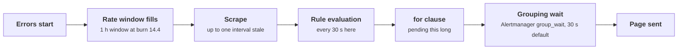

+++
title = 'Sampling, cost, and alerting'
description = 'Telemetry cost grows with traffic unless it is sampled, and sampling is only safe if counts can be reconstructed. Alerts add their own delays: rate windows, scrapes, evaluation, and grouping all sit between a failure and a page.'
question = 'How do you keep telemetry affordable without losing the events that matter, and how long does an alert really take to fire?'
weight = 3
difficulty = 3
prerequisites = ['/notes/systems-design/observability/02-tracing-and-profiling', '/notes/systems-design/reliability-in-production/01-slos-and-error-budgets']
date = 2026-10-30T08:15:00Z
lastmod = 2026-10-30T08:15:00Z
verified = 2026-10-30
+++

## The idea in one minute

Each signal has one cost driver: metrics cost per active series, logs per
byte, and traces per span. Metrics stay flat as traffic grows; logs and traces
grow with it, so at scale they are **sampled**. Head sampling decides at the
start of a request, from the trace ID so every service agrees, and is cheap
but blind: it keeps 1% of errors if it keeps 1% of traffic. Tail sampling
decides after the trace completes, keeps every error and slow request, and
pays for it in buffered memory and a stateful collector tier. Either way, a
sample is useful for counting only if each kept item records its **adjusted
count**, the inverse of the probability it was kept.

Alerting has a cost too, measured in time. Between the first failed request
and a person's phone ringing sit the alert's rate window, the scrape
interval, the rule evaluation interval, any `for` clause, and the
notification grouping delay. A burn-rate alert on a 99.9% SLO pages for a
total outage in about a minute and a half, and for a 2% error ratio in about
45 minutes. **Sample by trace ID or after the outcome is known, record
sampling probabilities, compute rates from unsampled counters, and add up
every delay in the alert path before promising a detection time.**

## A picture

```mermaid {title="Where telemetry is reduced, and what each stage must preserve"}
flowchart LR
  S["<b>Services</b><br/><small>all spans, all events</small>"] --> SM["<b>Span metrics</b><br/><small>RED from 100% of spans</small>"]
  S --> H{"<b>Head sampler</b><br/><small>trace-id ratio</small>"}
  H -->|"kept"| LB["<b>Load balancer</b><br/><small>route by trace id</small>"]
  H -->|"dropped"| X["<b>Gone</b><br/><small>costs nothing</small>"]
  LB --> TS{"<b>Tail sampler</b><br/><small>buffer until trace ends</small>"}
  TS -->|"error or slow"| ST[("<b>Trace store</b>")]
  TS -->|"1% of the rest,<br/>adjusted count 100"| ST
  SM --> MS[("<b>Metrics</b><br/><small>exact rates</small>")]
  class S compute
  class H,TS queue
  class LB io
  class ST,MS memory
  class SM good
  class X neutral
```

Rates and error ratios come from the unsampled path on the left. The sampled
store is for finding and reading individual requests.

## How it really works

### What drives the bill

| Signal | Sized by | Grows with | Lever |
| --- | --- | --- | --- |
| Metrics | Active series, samples per second | Label combinations, scrape frequency | Cardinality, as in [the metrics lesson](/notes/systems-design/observability/01-metrics-cardinality-and-histograms/) |
| Logs | Bytes ingested and retained | Requests × lines × bytes per line | Levels, sampling successes, wide events instead of many lines |
| Traces | Spans ingested and retained | Requests × spans per request | Head and tail sampling |
| Profiles | Processes × sampling rate | Fleet size | Sampling frequency, retention |

The arithmetic is worth doing before anyone builds anything:

```text
logs/day    = requests/s × lines/request × bytes/line × 86,400
traces/day  = requests/s × spans/request × bytes/span × kept fraction × 86,400
```

At 20,000 requests per second, six 500-byte spans each, keeping everything is
about 5 TB of spans per day. Keeping 2.25%, as tail sampling does in the
program below, is about 117 GB. On GPU fleets the ratio runs the other way:
one GPU-hour costs more than storing a great deal of telemetry about it, so
detail on expensive hardware is usually under-bought, not over-bought.

### Head sampling and consistency

Head sampling decides when the root span starts. OpenTelemetry's
`TraceIdRatioBased` sampler compares the trace ID against a threshold, and
the `ParentBased` wrapper makes every downstream service honor the decision
carried in the `traceparent` sampled flag. Because the decision is a function
of the trace ID, every service reaches the same answer and kept traces are
complete.

If each service flips its own coin, the result is fragments: with six
services each keeping 10% independently, almost half of all traces have at
least one span stored and almost none are complete. OpenTelemetry's
probability-sampling specification goes further and records the sampling
threshold in `tracestate`, so a backend can compute adjusted counts and
multi-stage samplers stay consistent.

### Tail sampling and its infrastructure

A tail sampler holds every span until the trace is complete, then applies
policies: keep if any span has an error status, keep if latency exceeds a
threshold, keep specific tenants or routes, keep a probabilistic baseline of
the rest. The OpenTelemetry Collector's `tail_sampling` processor waits a
configurable `decision_wait` after a trace's first span before deciding.

It has two infrastructure requirements:

- **Every span of a trace must reach the same collector instance.** A
  load-balancing tier routes spans by trace ID (the Collector's
  `loadbalancing` exporter) in front of the sampling tier.
- **Memory for the wait.** Buffered bytes are span rate × span size × wait.
  At 20,000 traces per second, six 500-byte spans each, a 10-second wait holds
  about 0.6 GiB across the tier and a 30-second wait about 1.7 GiB, before
  overhead and before a traffic spike. When the buffer overflows, the sampler
  must drop traces, and it drops them before deciding, so overload loses
  errors too.

Long-running requests, such as streaming completions and agent runs that
take minutes, outlast any practical `decision_wait`. Their late spans arrive
after the decision and are kept or dropped by a cached decision, or not at
all. Either set the policy at the root with an early signal, or let
long-running work start new linked traces per step.

### Counting from samples: adjusted counts

A sample answers "show me examples" directly. To answer "how many" it needs
weights. Each item kept with probability p represents 1/p items; this is its
**adjusted count**, the Horvitz-Thompson estimator. Counting kept items
without weights is badly biased when the sampler is selective: in a store
that keeps every error and 1% of successes, errors look 44 times more common
than they are.

Better still, do not count from samples at all. Compute RED metrics from
every span before sampling (the Collector's span-metrics connector does
this) or from the services' own counters. Use the sampled store for finding
and reading traces, and use exemplars to link a metric's spike to a kept
trace.

### Logs: cut volume before it is stored

| Technique | What it removes |
| --- | --- |
| Drop DEBUG and health-check lines at the agent | Lines nobody reads |
| One wide structured event per request instead of many lines | Repeated context in every line |
| Keep all errors, sample successes with a recorded rate | Most of the volume, safely |
| Turn a frequent log pattern into a counter | A whole category of lines |
| Tiered retention: days hot, months in object storage | Cost per byte of old data |

Sampling logs needs the same rule as traces: write the sampling rate into
each kept record, or counts derived from logs will be wrong.

### The alert path and its delays

The [SLO lesson](/notes/systems-design/reliability-in-production/01-slos-and-error-budgets/)
derived multi-window burn-rate alerts. What it did not count is the delay
added by the machinery between the error and the page:



For a burn-rate alert with threshold b over window w on an SLO with error
budget (1 − SLO), at error ratio e the window alone takes about
`(1 − SLO) × b × w / e`. A total outage fills the one-hour window at burn 14.4
in 52 seconds; a 2% error ratio takes 43 minutes. Then add half a scrape
interval and half an evaluation interval on average, the full `for`
duration, and the grouping wait. A `for` clause buys protection against
blips that the burn-rate design already provides, so on burn-rate alerts it
mostly adds delay.

Other alert-path failures to design against:

- **Absent data looks healthy.** If the target stops reporting, the error
  ratio has no samples and the alert does not fire. Alert on `up == 0` and on
  `absent()` for critical series.
- **The pipeline itself can fail.** A dead man's switch, an alert that always
  fires and is expected to arrive, proves that evaluation and notification
  work end to end.
- **Shared fate.** An alerting stack that runs in the cluster it monitors goes
  down with it. Run a minimal external prober and alerter elsewhere.
- **Noise.** Every page must be actionable and link to a runbook. Group
  related alerts, inhibit symptoms of a known root cause, and review every
  page that needed no action.

## Code

Part 1 samples 200,000 synthetic traces, 0.3% errors and 1% slow, four ways,
and computes the collector buffer for tail sampling. Part 2 estimates the
error rate from a tail-sampled store, naively and with adjusted counts. Part 3
simulates a burn-rate page with 15 s scrapes, 30 s rule evaluation, and a 30 s
grouping wait, for 500 random outage start times at each error ratio.

```python {title="sampling.py"}
"""sampling.py: what head and tail sampling keep, how to count from samples,
and how long an alert takes to reach a human.

Part 1 samples 200,000 synthetic traces four ways. Part 2 estimates the error
rate from a tail-sampled store, naively and with adjusted counts. Part 3 adds
up the delays between an outage starting and a page being sent: the rate
window, scrape and rule-evaluation intervals, a `for` clause, and alert
grouping. Standard library only; deterministic; simplified models.
"""

from __future__ import annotations

import random
import statistics
from dataclasses import dataclass

SPAN_BYTES = 500
SERVICES = 6  # spans per trace in this toy system, one per service


@dataclass
class Trace:
    tid: int
    error: bool
    ms: float


def traffic(n: int, seed: int) -> list[Trace]:
    rng = random.Random(seed)
    out = []
    for i in range(n):
        slow = rng.random() < 0.01
        ms = rng.lognormvariate(5.0, 0.4) + (rng.uniform(2_000, 6_000) if slow else 0)
        out.append(Trace(rng.getrandbits(64), rng.random() < 0.003, ms))
    return out


def head_consistent(t: Trace, p: float) -> bool:
    """Decide from the trace id, so every service reaches the same answer."""
    return t.tid < p * 2**64


def part1(traces: list[Trace]) -> None:
    rng = random.Random(9)
    errors = sum(t.error for t in traces)
    slow = sum(t.ms > 2_000 for t in traces)
    print(f"part 1: {len(traces):,} traces, {errors} errors, {slow:,} slow (>2 s), {SERVICES} spans each")
    print("  strategy                          spans kept   errors kept   slow kept   complete traces")
    rows = []
    for name, p in (("head 1%, trace-id ratio", 0.01), ("head 10%, trace-id ratio", 0.10)):
        kept = [t for t in traces if head_consistent(t, p)]
        rows.append((name, len(kept) * SERVICES, kept, len(kept)))
    # each service flips its own coin: spans of one trace are kept independently
    spans, complete, kept = 0, 0, []
    for t in traces:
        flips = [rng.random() < 0.10 for _ in range(SERVICES)]
        spans += sum(flips)
        complete += all(flips)
        if any(flips):
            kept.append(t)
    rows.append(("head 10%, independent per service", spans, kept, complete))
    tail = [t for t in traces if t.error or t.ms > 2_000 or rng.random() < 0.01]
    rows.append(("tail: errors + slow + 1% of rest", len(tail) * SERVICES, tail, len(tail)))
    for name, s, kept, complete in rows:
        e = sum(t.error for t in kept)
        sl = sum(t.ms > 2_000 for t in kept)
        print(f"  {name:<34} {s / (len(traces) * SERVICES):8.2%}   {e / errors:10.1%}   "
              f"{sl / slow:8.1%}   {complete:>9,}")

    rate = 20_000  # traces per second, a mid-sized API
    for wait in (10, 30):
        mem = rate * SERVICES * SPAN_BYTES * wait / 2**30
        print(f"  tail sampling at {rate:,} traces/s, decision_wait {wait} s: "
              f"~{mem:.1f} GiB of spans buffered across the collector tier")


def part2(traces: list[Trace]) -> None:
    rng = random.Random(4)
    stored = []  # (trace, adjusted count = 1 / probability it was kept)
    for t in traces:
        if t.error or t.ms > 2_000:
            stored.append((t, 1.0))
        elif rng.random() < 0.01:
            stored.append((t, 100.0))
    true_rate = sum(t.error for t in traces) / len(traces)
    naive = sum(t.error for t, _ in stored) / len(stored)
    weighted = sum(w for t, w in stored if t.error) / sum(w for _, w in stored)
    print("\npart 2: error rate estimated from the tail-sampled store")
    print(f"  true {true_rate:.3%}   naive count {naive:.2%}   weighted by adjusted count {weighted:.3%}")
    print(f"  estimated total requests {sum(w for _, w in stored):,.0f} (true {len(traces):,})")


def part3() -> None:
    print("\npart 3: seconds from outage start to page, 99.9% SLO, page at burn 14.4 over 1 h and 5 min")
    scrape, evaluate, group_wait = 15, 30, 30
    rng = random.Random(1)
    print("  error ratio   for clause   median   p90 (over 500 random start phases)")
    for ratio in (1.0, 0.10, 0.02):
        for for_s in (0, 120):
            delays = []
            for _ in range(500):
                start = rng.uniform(0, 60)

                def errors_at(t: float) -> float:  # cumulative error ratio-seconds since start
                    return max(0.0, t - start) * ratio

                def burn(t: float, window: float) -> float:
                    seen = (t // scrape) * scrape  # the last scrape before t
                    return (errors_at(seen) - errors_at(seen - window)) / window / 0.001

                t, pending_since = 0.0, None
                while True:
                    t += evaluate
                    firing = burn(t, 3600) > 14.4 and burn(t, 300) > 14.4
                    pending_since = (pending_since or t) if firing else None
                    if pending_since is not None and t - pending_since >= for_s:
                        delays.append(t + group_wait - start)
                        break
            delays.sort()
            print(f"  {ratio:>10.0%}   {for_s:>8} s   {statistics.median(delays):6.0f}   "
                  f"{delays[int(0.9 * len(delays))]:5.0f}")


if __name__ == "__main__":
    traces = traffic(200_000, seed=3)
    part1(traces)
    part2(traces)
    part3()
```

Run it with `python3 sampling.py`:

```text
part 1: 200,000 traces, 613 errors, 1,953 slow (>2 s), 6 spans each
  strategy                          spans kept   errors kept   slow kept   complete traces
  head 1%, trace-id ratio               0.99%         1.1%       1.3%       1,983
  head 10%, trace-id ratio              9.86%        11.1%      10.4%      19,711
  head 10%, independent per service     9.99%        47.3%      45.3%           0
  tail: errors + slow + 1% of rest      2.25%       100.0%     100.0%       4,494
  tail sampling at 20,000 traces/s, decision_wait 10 s: ~0.6 GiB of spans buffered across the collector tier
  tail sampling at 20,000 traces/s, decision_wait 30 s: ~1.7 GiB of spans buffered across the collector tier

part 2: error rate estimated from the tail-sampled store
  true 0.306%   naive count 13.53%   weighted by adjusted count 0.306%
  estimated total requests 200,056 (true 200,000)

part 3: seconds from outage start to page, 99.9% SLO, page at burn 14.4 over 1 h and 5 min
  error ratio   for clause   median   p90 (over 500 random start phases)
        100%          0 s       97     109
        100%        120 s      217     229
         10%          0 s      563     575
         10%        120 s      684     695
          2%          0 s     2636    2649
          2%        120 s     2757    2769
```

What it shows:

- **Head sampling keeps what it keeps of everything.** At 1%, it kept 1.1%
  of errors and 1.3% of slow traces. **Tail sampling kept all of both** while
  storing 2.25% of spans, less than head sampling at 10%.
- **Independent coins produce fragments.** Each service keeping 10% of its own
  spans stores some span of 47% of erroring traces and no complete trace at
  all.
- **Unweighted counts from a selective sample are wrong by 44×.** Counting
  kept traces says 13.5% of requests fail; weighting each by its adjusted
  count recovers the true 0.306% and the total request count to within 0.03%.
- **Detection time is mostly the window, plus a fixed overhead.** A total
  outage pages after a median of 97 s: about 52 s for the window and the rest
  for scrape, evaluation, and grouping. A two-minute `for` adds exactly two
  minutes. A 2% error ratio takes 44 to 46 minutes, which is why the
  6-hour and 3-day burn-rate alerts exist alongside the fast one.

## Where it breaks

- **Tail sampling is a stateful system that fails under load.** Its buffers
  fill during exactly the traffic spikes and incidents when its traces
  matter most. Size it for peak, monitor its drop counters, and decide what it
  drops first.
- **Sampling decisions can leak or be abused.** A policy that keeps every
  trace for a header value lets a client force full tracing of its requests,
  raising cost and possibly storing more of its data. Policies should use
  server-side attributes. Never let incoming `traceparent` flags from the
  internet decide sampling without validation.
- **Adjusted counts need honest probabilities.** If a stage drops data without
  recording it, such as a full buffer or a rate limiter in the pipeline, every
  estimate is biased low.
- **Low traffic breaks rate-based alerts.** With a handful of requests per
  window, one error is a huge ratio. Use minimum-event conditions, longer
  windows, or synthetic probes.
- **What the simulation leaves out.** Spans arrive at once, collectors never
  overflow, scrapes and evaluations run on perfect clocks, and notification
  delivery is instant after grouping. Real pipelines add queueing and retries
  at each hop.

## Remember this

- Metrics cost per series, logs per byte, traces per span; pull the matching lever.
- Head-sample by trace ID so every service agrees; independent coins give fragments.
- Tail sampling keeps every error at the cost of buffering and trace-ID routing.
- Record each sample's adjusted count; compute rates from unsampled counters.
- Detection time is the rate window plus scrape, evaluation, `for`, and grouping delays.
- Alert on missing data and test the alert path end to end.

## Try it

1. Run `sampling.py`. Find the cheapest tail policy, by changing the
   baseline percentage, that still lets part 2 estimate the error rate within
   ±10% of the truth.
2. Add a policy that keeps every trace of one tenant that makes 5% of traffic.
   How does storage change? Who controls that tenant's traffic?
3. In part 3, set the scrape interval to 60 s and the evaluation interval to
   60 s. How does the median page time for a total outage change?
4. For a service you run, compute its daily log and trace volume from the
   formulas above, and compare with the bill.

## Check yourself

1. Why must head sampling be decided from the trace ID rather than at random
   in each service?

   
   So every service makes the same decision for the same request. A function
   of the trace ID gives the same answer everywhere, so kept traces are
   complete. Independent random decisions keep different subsets of spans in
   each service and produce fragments that cannot be read as traces.
   

2. What does tail sampling require from the collector deployment?

   
   All spans of a trace must reach the same sampling instance, which needs a
   load-balancing tier that routes by trace ID. Each instance must buffer
   spans for the decision wait, so memory scales with span rate times wait
   time, and the tier must be sized for peak traffic.
   

3. A trace store keeps every error and 1% of successes. Someone computes the
   error rate as errors divided by stored traces. What is wrong, and how is
   it fixed?

   
   Errors were kept with probability 1 and successes with probability 0.01,
   so stored traces over-represent errors by about 100 times relative to
   successes. Weight each stored trace by its adjusted count, 1 for errors
   and 100 for successes, or better, compute the error rate from unsampled
   counters.
   

4. A burn-rate alert has a 1-hour window and a threshold of 14.4 on a 99.9%
   SLO. Roughly how long does a 10% error ratio take to page?

   
   The window needs `0.001 × 14.4 × 3600 / 0.1` ≈ 518 seconds to reach the
   threshold, then scrape, evaluation, any `for` clause, and grouping add
   their delays: about nine to ten minutes in total with the intervals used
   in the program.
   

5. Why does an alert on error ratio not fire when the service stops reporting
   metrics?

   
   With no samples, the ratio has no value, and a comparison against a
   threshold on an empty result returns nothing, so the alert is not
   triggered. Separate alerts on `up == 0` or `absent()` of the series catch
   the missing data.
   

## Sources

- OpenTelemetry, [Tracing SDK: samplers](https://opentelemetry.io/docs/specs/otel/trace/sdk/#sampling) and [TraceState: probability sampling](https://opentelemetry.io/docs/specs/otel/trace/tracestate-probability-sampling/), OpenTelemetry specification.
- OpenTelemetry Collector Contrib, [Tail sampling processor](https://github.com/open-telemetry/opentelemetry-collector-contrib/tree/main/processor/tailsamplingprocessor) and [Load-balancing exporter](https://github.com/open-telemetry/opentelemetry-collector-contrib/tree/main/exporter/loadbalancingexporter), project documentation.
- D. Horvitz, D. Thompson, "A Generalization of Sampling Without Replacement from a Finite Universe", *Journal of the American Statistical Association* 47(260), 1952.
- B. H. Sigelman et al., [Dapper, a Large-Scale Distributed Systems Tracing Infrastructure](https://research.google/pubs/pub36356/), Google Technical Report, 2010.
- B. Beyer et al. (eds.), [The Site Reliability Workbook, chapter 5: Alerting on SLOs](https://sre.google/workbook/alerting-on-slos/), O'Reilly, 2018.
- Prometheus, [Alerting rules](https://prometheus.io/docs/prometheus/latest/configuration/alerting_rules/) and [Alertmanager configuration](https://prometheus.io/docs/alerting/latest/configuration/), Prometheus documentation.
