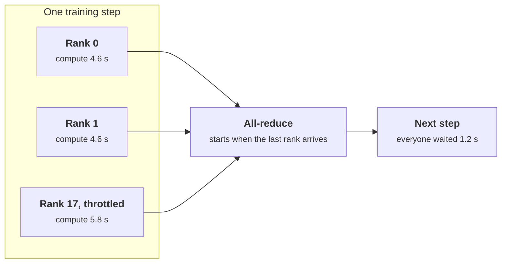

+++
title = 'Observing AI infrastructure'
description = 'GPU fleets need different signals: the utilization gauge reads 100% at batch size 1, memory is preallocated, and one slow GPU slows a whole training job. Power, profiling counters, engine metrics, and derived ratios tell the truth.'
question = 'Which signals show what a GPU fleet is really doing, and how do you derive tokens per joule, cost per token, and MFU from raw counters?'
weight = 4
difficulty = 4
prerequisites = ['/notes/systems-design/observability/03-sampling-cost-and-alerting', '/notes/systems-design/observability/01-metrics-cardinality-and-histograms']
date = 2026-10-30T08:20:00Z
lastmod = 2026-10-30T08:20:00Z
verified = 2026-10-30
+++

## The idea in one minute

The familiar GPU dashboard misleads in two ways. **"GPU utilization"** is the
share of time any kernel was running, so a server decoding for one user reads
100% while using a small fraction of the hardware. **Memory used** is near the
maximum from the first second, because inference engines preallocate their KV
cache. The honest signals are elsewhere: **power** against the board limit,
**profiling counters** for how busy the tensor cores and memory interface
are, the **engine's own metrics** (queue depth, KV-cache usage, preemptions,
time to first token, inter-token latency), and hardware **error counters**
that predict failure.

The numbers that matter to the business are ratios derived from counters:
tokens per second, tokens per joule, cost per million tokens, and for training,
**model FLOPs utilization (MFU)**. Each is a rate over a counter, so each
must handle counter resets. In synchronous training, the slowest GPU sets the
step time for all of them, so a single throttled card shows up as a
fleet-wide slowdown. **Alert on errors and saturation, plan on derived ratios,
and watch per-GPU spread, not fleet averages.**

## A picture

```mermaid {title="Where each signal comes from, and how much to trust it"}
flowchart LR
  GPU[("<b>GPU</b>")] --> NV["<b>NVML / DCGM</b><br/><small>sampling, health, profiling counters</small>"]
  NV --> EX["<b>dcgm-exporter</b><br/><small>labels: node, GPU, pod</small>"]
  GPU --> XID["<b>Kernel log</b><br/><small>Xid events</small>"]
  ENG["<b>Inference engine</b><br/><small>queue, KV cache, TTFT, ITL</small>"] --> PR[("<b>Metrics store</b>")]
  EX --> PR
  XID --> LG[("<b>Log pipeline</b>")]
  PR --> D["<b>Derived ratios</b><br/><small>tokens/J, $/Mtok, MFU</small>"]
  U["<b>GPU_UTIL</b><br/><small>any kernel running</small>"] -.->|"misleads"| D
  class GPU memory
  class NV,EX io
  class ENG compute
  class XID,LG neutral
  class PR memory
  class D good
  class U warn
```

Join every GPU metric to the pod and job using it, so hardware and engine
signals can be read side by side.

## How it really works

### The GPU signals and how far to trust them

NVIDIA's management library (NVML), which `nvidia-smi` reads, and the Data
Center GPU Manager (DCGM) built on it are the sources on NVIDIA hardware;
dcgm-exporter publishes DCGM fields to Prometheus. Other vendors expose the
same categories under other names.

| Category | DCGM field | Meaning | Trust |
| --- | --- | --- | --- |
| Activity | `DCGM_FI_DEV_GPU_UTIL` | Share of time at least one kernel ran | Low: "not idle", nothing more |
| | `DCGM_FI_PROF_SM_ACTIVE` | Share of time SMs had at least one warp resident, averaged over SMs | Better |
| | `DCGM_FI_PROF_PIPE_TENSOR_ACTIVE` | Share of cycles the tensor pipes were busy | Good signal of matrix work |
| | `DCGM_FI_PROF_DRAM_ACTIVE` | Share of cycles the memory interface was busy | Good signal of memory-bound work |
| Memory | `DCGM_FI_DEV_FB_USED` | Device memory allocated | True but uninformative under preallocation |
| Power | `DCGM_FI_DEV_POWER_USAGE` | Watts now | High: tracks real work |
| | `DCGM_FI_DEV_TOTAL_ENERGY_CONSUMPTION` | Millijoules since driver load, a counter | High: `rate()` gives average watts |
| Clocks | `DCGM_FI_DEV_SM_CLOCK` | SM clock in MHz | A drop under load means power or thermal throttling |
| Faults | `DCGM_FI_DEV_XID_ERRORS` | The last Xid error code | Alert on change; details are in the kernel log |
| Memory health | ECC and row-remap counters | Failing memory being corrected or remapped | High: rising counts precede failure |
| Links | PCIe replay and NVLink error counters | Retransmissions on host and GPU links | High: errors hurt multi-GPU jobs first |

Several of the most useful fields, including the profiling counters, some
throttling reasons, and NVLink error counters, are not in dcgm-exporter's
default counter list. Enable them deliberately; profiling counters have a
small sampling overhead and some can be collected only a few at a time.

**Xid events** are the driver's numbered error reports. The common ones to
route into alerts and node-health automation:

| Xid | Meaning | Usual response |
| --- | --- | --- |
| 13, 31 | Graphics engine exception, memory page fault | Often application bugs; investigate the workload |
| 48 | Double-bit ECC error | Drain the node; the GPU needs a reset |
| 63, 64 | Row remapping pending or failed | Reset at the next opportunity; replace if failed |
| 74 | NVLink error | Check link counters; tensor-parallel jobs suffer first |
| 79 | GPU has fallen off the bus | Reboot the node; check power and seating |
| 94, 95 | Contained or uncontained ECC error | Restart the affected process, or drain the node |

### Why "utilization" says 100% at batch size 1

LLM decoding reads every weight once per step, whatever the batch size, so
small batches are limited by memory bandwidth and leave the tensor cores
almost idle. Kernels still run back to back, so `GPU_UTIL` reads 100%. A
roofline estimate makes it concrete: an 8-billion-parameter model in BF16 is
16 GB of weights; at the H100 SXM's 3.35 TB/s, reading them takes about 4.8
ms per step, while the arithmetic for one sequence at about 2 FLOPs per
parameter takes 0.016 ms at 989 TFLOPS. The tensor cores are busy about 0.3%
of the time. Batching raises throughput almost linearly until the KV cache,
which each sequence reads every step, dominates memory traffic. Use the
engine's tokens per second and batch size, power draw, and the tensor and
DRAM activity counters to judge load, never `GPU_UTIL`.

### Engine metrics: the request's view

An inference request waits in a queue, is **prefilled** (the prompt is
processed, producing the first token), and then **decodes** one token per
step alongside the rest of the batch. Each phase has its own metric:

| Metric | Definition | Driven by |
| --- | --- | --- |
| Queue time | Arrival to scheduled | Load against capacity |
| **TTFT** | Arrival to first token | Queue plus prefill of uncached prompt tokens |
| **ITL** | Gap between consecutive tokens | Batch size, model size, prefill interference |
| **TPOT** | (Last token − first token) / (tokens − 1) | The same, averaged per request |
| KV-cache usage | Share of KV blocks allocated | Concurrency and context length |
| Preemptions | Running sequences evicted to free KV blocks | KV exhaustion: wasted recomputation |
| Prefix-cache hit rate | Cached prompt tokens / prompt tokens | Prompt stability and routing |

TPOT is an average, so it hides stalls: a stream that freezes for two seconds
in the middle can have a fine TPOT. Keep ITL as a histogram and alert on its
tail. vLLM, for example, exports these as `vllm:time_to_first_token_seconds`,
`vllm:inter_token_latency_seconds`, `vllm:num_requests_waiting`,
`vllm:kv_cache_usage_perc`, and `vllm:num_preemptions`, with names that have
changed between releases; read your version's `/metrics`. **Goodput**, the
rate of requests that meet both their TTFT and TPOT objectives, is the
capacity number to plan with, because throughput keeps rising past the point
where users stop being served well.

Label hygiene from the [metrics lesson](/notes/systems-design/observability/01-metrics-cardinality-and-histograms/)
applies with more force here: `model` and `finish_reason` are bounded and
fine; LoRA adapter names may be thousands; conversation IDs and prompts are
unbounded and belong on spans, with prompt content recorded only by opt-in,
redacted, and access-controlled. OpenTelemetry's generative-AI semantic
conventions (`gen_ai.*` attributes such as `gen_ai.usage.input_tokens`) give
those spans a common shape; as of 2026 they are still marked as in
development, so pin versions.

### Derived ratios: energy and cost

Counters become business numbers by taking rates:

```text
average watts          = rate(energy_mJ) / 1000
tokens per joule       = rate(output_tokens) / average watts
$ per million tokens   = ($ per GPU-hour) / (tokens per second × 3,600) × 10^6
```

Two corrections keep these honest. **Counters reset**: an engine restart
sets its token counter to zero, and a naive "last minus first" turns a
ten-minute window into a large negative number. Prometheus's `rate()` treats
any decrease as a reset. **Allocation is not use**: the price applies to every
hour a GPU is allocated, so cost per token divides by occupancy. A fleet sized
for a 3:1 peak-to-average ratio cannot average more than about a third of
peak throughput without batch work to fill the troughs. GPU board power is
also not facility power: servers add CPUs, fans, and power-supply losses, and
the data center's power usage effectiveness (PUE, total facility power over IT
power) adds cooling and distribution on top.

### Training: MFU and the slowest rank

**Model FLOPs utilization**, as defined in the PaLM paper (Chowdhery et al.,
2022), is the achieved model FLOPs per second divided by the hardware's
peak. For a dense transformer, training costs about 6 FLOPs per parameter per
token (Kaplan et al., 2020), ignoring attention:

```text
MFU = 6 × parameters × tokens per second / (GPUs × peak FLOPS per GPU)
```

It is computed from two numbers every job already has, tokens per step and
step time, which makes it the single best health metric for a training run.
A drop in MFU without a code change means something in the fleet changed.

In synchronous training, every step waits for every rank at the collective
operations, so **step time is set by the slowest GPU**. One card throttled by
heat or power, one with a degraded NVLink, or one host with a slow data
loader slows thousands of GPUs by the same amount. Fleet averages hide it.
Track per-rank step time or collective wait time, and compare each GPU's
clock and power with its peers in the same job. Large runs make failures
routine: the Llama 3 paper reports 466 job interruptions in a 54-day period
on up to 16,384 H100 GPUs, about 78% of the unexpected ones attributed to
confirmed or suspected hardware issues. Training observability is therefore
also failure detection: Xid events, ECC and row-remap counts, link errors, and
collective timeouts should feed automation that drains a node and restarts
from a checkpoint.



## Code

The program derives the numbers above from simulated counters and a roofline
model. Part 1 turns energy and token counters, with an engine restart in the
middle, into watts, tokens per second, tokens per joule, and cost per million
tokens at an assumed $2.50 per GPU-hour. Part 2 is the decode roofline for an
8B model on H100 SXM peak figures. Part 3 computes TTFT, TPOT, and ITL for a
stream with a stall. Part 4 computes MFU for a 70B training job on 1,024 GPUs,
healthy and with one GPU at 80% clock.

```python {title="gpu_metrics.py"}
"""gpu_metrics.py: deriving the numbers that matter on AI infrastructure from
raw counters, and the gauges that mislead.

Part 1 turns scraped counters (GPU energy in millijoules, generated tokens)
into watts, tokens per second, tokens per joule, and cost per million tokens,
handling a counter reset. Part 2 is a roofline model of decoding that shows
why "GPU utilization" reads 100% at batch size 1. Part 3 shows TPOT hiding a
stream stall that ITL reveals. Part 4 computes training MFU and the cost of
one straggler in synchronous training. Published H100 SXM peak figures;
everything else is simulated. Standard library only; deterministic.
"""

from __future__ import annotations

import random
import statistics

PEAK_BF16_FLOPS = 989e12  # H100 SXM dense BF16, NVIDIA datasheet
HBM_BYTES_PER_S = 3.35e12  # H100 SXM HBM3
GPU_HOUR_USD = 2.50  # an assumed internal price, not a quote


def rate(samples: list[tuple[float, float]]) -> float:
    """Per-second increase of a counter, treating any decrease as a reset to zero
    (the rule Prometheus rate() applies)."""
    inc = 0.0
    for (_, prev), (_, cur) in zip(samples, samples[1:]):
        inc += cur - prev if cur >= prev else cur
    return inc / (samples[-1][0] - samples[0][0])


def part1() -> None:
    print("part 1: counters to unit economics, one GPU, 10 minutes scraped every 15 s")
    rng = random.Random(7)
    energy_mj, tokens, t = 9.1e12, 4.4e9, 0.0  # counters already large since driver/engine start
    e_samples, k_samples = [], []
    for i in range(41):
        if i == 20:
            tokens = 0.0  # the engine restarts: its token counter starts again at zero
        e_samples.append((t, energy_mj))
        k_samples.append((t, tokens))
        watts = rng.uniform(560, 640)
        energy_mj += watts * 15 * 1000
        tokens += rng.uniform(2_300, 2_700) * 15
        t += 15
    naive_tokens = (k_samples[-1][1] - k_samples[0][1]) / (k_samples[-1][0] - k_samples[0][0])
    watts = rate(e_samples) / 1000
    tps = rate(k_samples)
    print(f"  average power            {watts:8.1f} W   (rate of the mJ counter / 1000)")
    print(f"  output tokens per second {tps:8.1f}     (naive last-minus-first: {naive_tokens:,.1f})")
    print(f"  output tokens per joule  {tps / watts:8.2f}     (GPU board power only, not the facility)")
    usd = GPU_HOUR_USD / (tps * 3600) * 1e6
    print(f"  cost per million output tokens at ${GPU_HOUR_USD:.2f}/GPU-hour: ${usd:.2f}")
    for occupancy in (0.6, 0.3):
        print(f"    if the GPU only does this {occupancy:.0%} of the hours it is allocated: "
              f"${usd / occupancy:.2f}")


def part2() -> None:
    print("\npart 2: decoding an 8B model (BF16) at 2,048 tokens of context, roofline model")
    weights = 8.03e9 * 2  # bytes read every step, shared by the whole batch
    kv_per_token = 32 * 8 * 128 * 2 * 2  # layers x KV heads x head dim x (K, V) x bytes
    flops_per_token = 2 * 8.03e9
    print("  batch   step ms   tokens/s   'GPU util'   tensor busy   memory busy")
    for batch in (1, 8, 32, 64, 128):  # 128 x 2,048 tokens of KV is 34 GB: still fits in 80 GB
        bytes_moved = weights + batch * 2048 * kv_per_token
        mem_s = bytes_moved / HBM_BYTES_PER_S
        compute_s = batch * flops_per_token / PEAK_BF16_FLOPS
        step = max(mem_s, compute_s)
        print(f"  {batch:>5}   {step * 1000:7.2f}   {batch / step:8,.0f}   {'100%':>10}   "
              f"{compute_s / step:11.1%}   {mem_s / step:11.1%}")
    print(f"  KV cache per token: {kv_per_token / 1024:.0f} KiB; at batch 128 the KV reads are "
          f"{128 * 2048 * kv_per_token / 1e9:.0f} GB per step vs {weights / 1e9:.0f} GB of weights")


def part3() -> None:
    print("\npart 3: one streamed response, 300 tokens, one 2 s stall at token 150")
    t, stamps = 0.42, []  # first token at 420 ms
    for i in range(300):
        stamps.append(t)
        t += 0.025 + (2.0 if i == 150 else 0.0)
    gaps = sorted(b - a for a, b in zip(stamps, stamps[1:]))
    tpot = (stamps[-1] - stamps[0]) / (len(stamps) - 1)
    print(f"  TTFT {stamps[0] * 1000:.0f} ms   TPOT {tpot * 1000:.1f} ms   "
          f"ITL p50 {statistics.median(gaps) * 1000:.0f} ms   ITL max {gaps[-1] * 1000:.0f} ms")


def part4() -> None:
    print("\npart 4: training a 70B model on 1,024 GPUs, every step waits for every rank")
    params, gpus, tokens_per_step = 70e9, 1024, 4 * 1024 * 1024  # 4M-token global batch
    rng = random.Random(3)
    for label, slow in (("healthy fleet", 1.0), ("one GPU throttled to 80% clock", 1 / 0.8)):
        steps = []
        for _ in range(50):
            compute = [rng.gauss(4.6, 0.05) for _ in range(gpus)]
            compute[17] *= slow
            steps.append(max(compute) + 0.6)  # everyone waits for the slowest, then all-reduce
        step = statistics.mean(steps)
        tps = tokens_per_step / step
        mfu = 6 * params * tps / (gpus * PEAK_BF16_FLOPS)
        print(f"  {label:<32} step {step:5.2f} s   {tps:9,.0f} tokens/s   MFU {mfu:5.1%}")


if __name__ == "__main__":
    part1()
    part2()
    part3()
    part4()
```

Run it with `python3 gpu_metrics.py`:

```text
part 1: counters to unit economics, one GPU, 10 minutes scraped every 15 s
  average power               597.3 W   (rate of the mJ counter / 1000)
  output tokens per second   2426.1     (naive last-minus-first: -7,332,069.1)
  output tokens per joule      4.06     (GPU board power only, not the facility)
  cost per million output tokens at $2.50/GPU-hour: $0.29
    if the GPU only does this 60% of the hours it is allocated: $0.48
    if the GPU only does this 30% of the hours it is allocated: $0.95

part 2: decoding an 8B model (BF16) at 2,048 tokens of context, roofline model
  batch   step ms   tokens/s   'GPU util'   tensor busy   memory busy
      1      4.87        205         100%          0.3%        100.0%
      8      5.44      1,472         100%          2.4%        100.0%
     32      7.36      4,349         100%          7.1%        100.0%
     64      9.92      6,450         100%         10.5%        100.0%
    128     15.05      8,505         100%         13.8%        100.0%
  KV cache per token: 128 KiB; at batch 128 the KV reads are 34 GB per step vs 16 GB of weights

part 3: one streamed response, 300 tokens, one 2 s stall at token 150
  TTFT 420 ms   TPOT 31.7 ms   ITL p50 25 ms   ITL max 2025 ms

part 4: training a 70B model on 1,024 GPUs, every step waits for every rank
  healthy fleet                    step  5.36 s     782,447 tokens/s   MFU 32.4%
  one GPU throttled to 80% clock   step  6.34 s     661,465 tokens/s   MFU 27.4%
```

What it shows:

- **Resets break naive arithmetic.** Last-minus-first on the token counter
  gives −7.3 million tokens per second; reset-aware rate gives 2,426. At
  597 W, that is about 4 tokens per joule of board power.
- **Occupancy is the cost lever.** $0.29 per million output tokens at full
  use becomes $0.95 if the GPU serves only 30% of the hours it is allocated.
- **The utilization gauge cannot see batching.** At batch size 1 the GPU
  delivers 205 tokens per second with the tensor cores 0.3% busy; at 128 it
  delivers 8,505 with them 13.8% busy. "GPU util" reads 100% in every row,
  while the memory interface is the binding resource throughout. Real kernels
  reach only part of the peak bandwidth, so real step times are longer.
- **TPOT hides the stall.** The stream froze for two seconds, yet TPOT is
  31.7 ms against a 25 ms median gap. The ITL maximum, 2,025 ms, shows it.
- **One GPU in a thousand costs a sixth of the job.** A single card at 80%
  clock moves every step from 5.36 s to 6.34 s and MFU from 32.4% to 27.4%.

## Where it breaks

- **Peak figures are not achievable figures.** MFU against datasheet peak is
  the convention, but sparsity figures, boost clocks, and power capping change
  the denominator. State which peak you divide by.
- **Profiling counters have limits.** They are averages over sampling
  intervals and over SMs, may need to be collected in groups, and can conflict
  with other profilers running on the same GPU. Short spikes are invisible.
- **Shared and partitioned GPUs.** With [MIG](/notes/infrastructure-security/securing-gpu-clusters/01-multi-tenant-gpu-isolation/), time-slicing, or dynamic resource
  allocation, the mapping from GPU metrics to pods may be partial or wrong.
  Verify the labels you get rather than assuming them, or tenants will be
  charged for each other's work.
- **Telemetry agents are privileged.** DCGM, eBPF profilers, and node agents
  run with access to every workload on the host. Keep them patched and
  limited to the permissions they need, and treat prompts and outputs in
  traces as sensitive data.
- **What the simulation leaves out.** A roofline with ideal bandwidth and
  no kernel overhead, attention FLOPs ignored, a training step modeled as
  normal noise plus a fixed all-reduce, and an assumed GPU price. It shows how
  the ratios are derived, not what any real system achieves.

## Remember this

- `GPU_UTIL` means a kernel was running; use tensor and DRAM activity, power, and engine throughput.
- GPU memory is preallocated; KV-cache usage and preemptions are the real memory pressure.
- Watch TTFT and the ITL distribution; TPOT averages away stalls.
- Derive tokens per joule and cost per token with reset-aware rates, divided by occupancy.
- MFU = 6 × params × tokens/s ÷ (GPUs × peak); a drop with no code change means the fleet changed.
- In synchronous training the slowest rank sets the step; watch per-GPU spread and error counters.

## Try it

1. Run `gpu_metrics.py`. In part 2, change the context length to 8,192 tokens.
   At what batch size does the KV cache stop fitting in 80 GB, and how does
   throughput at batch 32 change?
2. In part 4, make the throttled GPU 95% speed instead of 80%. What is the
   MFU cost? How would you find that GPU from per-rank metrics?
3. Write PromQL for tokens per joule per model from
   `DCGM_FI_DEV_TOTAL_ENERGY_CONSUMPTION` and an engine's generated-token
   counter, joined on pod.
4. For a GPU node you can access, list which of the fields in the table above
   your exporter actually exposes, and which are disabled.

## Check yourself

1. Why does `DCGM_FI_DEV_GPU_UTIL` read near 100% for a model decoding for
   one user?

   
   It measures the share of time at least one kernel was running. Decoding
   launches kernels continuously, so the GPU is never idle, even though each
   step is limited by reading the weights from memory and the tensor cores do
   almost no work. The gauge cannot tell busy from saturated.
   

2. Device memory on an idle inference server is 95% used. Is it under memory
   pressure?

   
   Not necessarily. Engines preallocate most free memory for the KV cache at
   startup, so device memory is high from the first second. Memory pressure
   shows in the engine's KV-cache usage, waiting requests, and preemptions.
   

3. A token counter reads 4.4 billion, then 12 million fifteen seconds later.
   What happened, and how should rates be computed?

   
   The engine restarted and its counter began again from zero. A rate that
   subtracts consecutive samples must treat any decrease as a reset, adding
   the new value rather than the negative difference, which is what
   Prometheus's `rate()` and `increase()` do.
   

4. A training job's MFU drops from 38% to 31% overnight with no code change.
   Where do you look?

   
   At the per-rank spread: step or collective wait time per rank, and SM
   clock, power, and temperature per GPU compared with peers. A single
   throttled GPU, a degraded NVLink or network link, a slow storage path for
   one data loader, or a node with rising ECC errors slows every rank in a
   synchronous job. Also check Xid events and link error counters.
   

5. Why is [goodput](/notes/inference-engineering/production-inference/01-latency-slos-and-goodput/) a better capacity number for an inference fleet than
   throughput?

   
   Throughput keeps rising as batches grow, even after queueing and slower
   steps push TTFT and inter-token latency past what users accept. Goodput
   counts only requests that met their latency objectives, so it peaks at the
   load the fleet can actually serve well, which is the number to size and
   autoscale against.
   

## Sources

- NVIDIA, [DCGM user guide: field identifiers and profiling metrics](https://docs.nvidia.com/datacenter/dcgm/latest/user-guide/feature-overview.html), and [dcgm-exporter](https://github.com/NVIDIA/dcgm-exporter), project documentation.
- NVIDIA, [Xid errors](https://docs.nvidia.com/deploy/xid-errors/index.html), GPU deployment and management documentation.
- NVIDIA, [H100 Tensor Core GPU datasheet](https://www.nvidia.com/en-us/data-center/h100/) (989 TFLOPS dense BF16 and 3.35 TB/s HBM3 for H100 SXM).
- A. Chowdhery et al., [PaLM: Scaling Language Modeling with Pathways](https://arxiv.org/abs/2204.02311), arXiv, 2022 (model FLOPs utilization).
- J. Kaplan et al., [Scaling Laws for Neural Language Models](https://arxiv.org/abs/2001.08361), arXiv, 2020 (training FLOPs ≈ 6 × parameters × tokens).
- A. Dubey et al., [The Llama 3 Herd of Models](https://arxiv.org/abs/2407.21783), arXiv, 2024 (section on training reliability and interruptions).
- Y. Zhong et al., [DistServe: Disaggregating Prefill and Decoding for Goodput-optimized Large Language Model Serving](https://arxiv.org/abs/2401.09670), *OSDI*, 2024.
- vLLM, [Production metrics](https://docs.vllm.ai/en/latest/usage/metrics.html), vLLM documentation (names vary by version).
- OpenTelemetry, [Semantic conventions for generative AI systems](https://opentelemetry.io/docs/specs/semconv/gen-ai/), OpenTelemetry documentation.
- The Green Grid, "PUE: A Comprehensive Examination of the Metric", White Paper 49, 2012.
