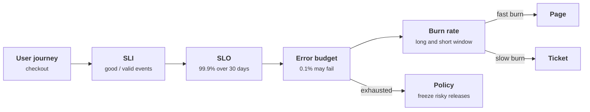
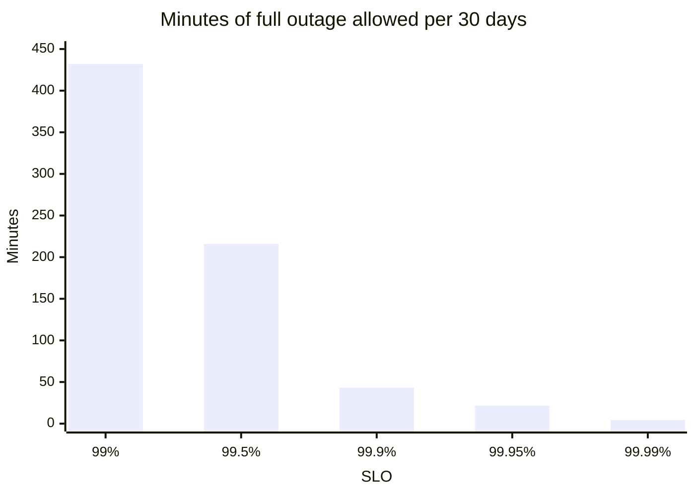
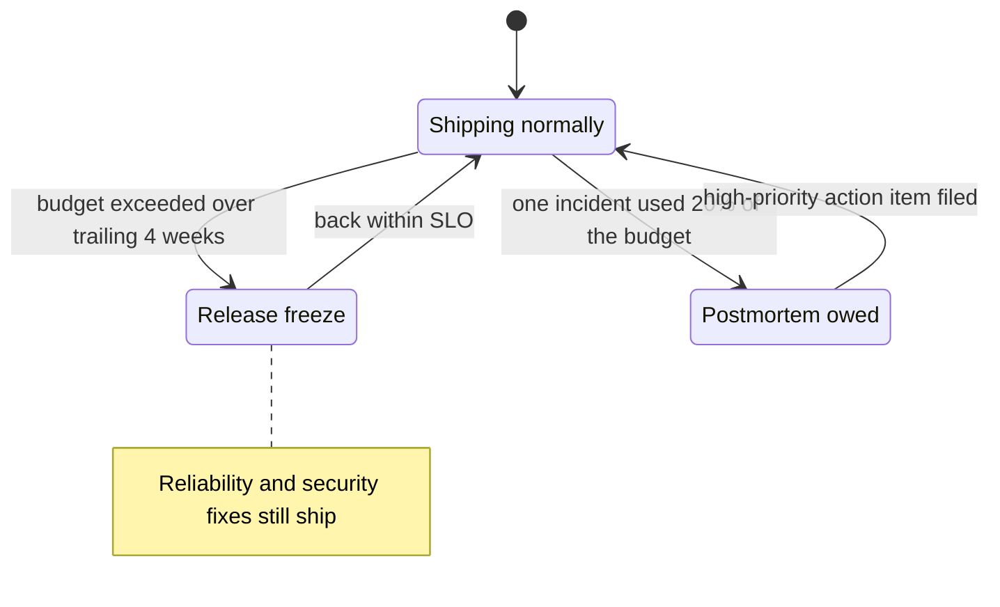
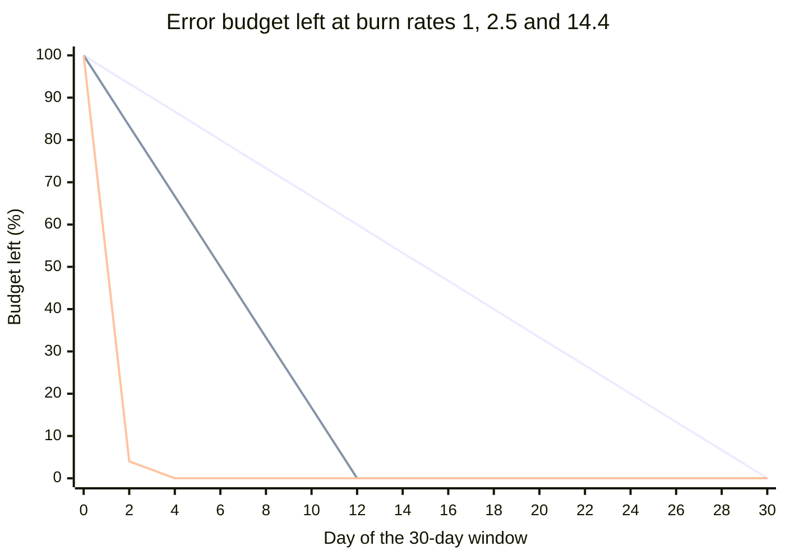
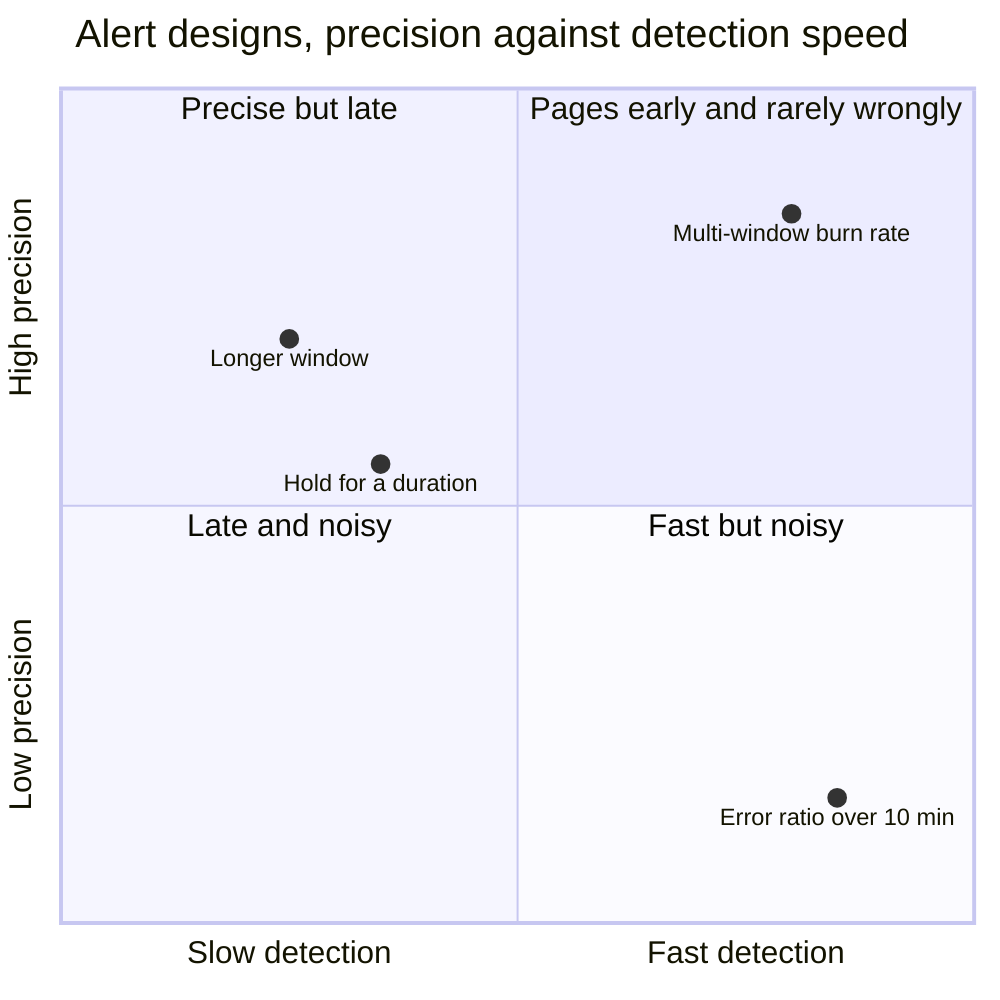

+++
title = 'SLOs and error budgets'
description = 'An SLO turns "reliable enough" into a number users would agree with; the error budget it implies decides when to ship, when to stop, and when to page someone.'
question = 'How do you decide how reliable a service must be, and when to wake someone up?'
weight = 1
difficulty = 2
prerequisites = ['/notes/systems-design/thinking-in-invariants/01-what-a-design-promises']
date = 2026-10-10
lastmod = 2026-10-30
verified = 2026-10-10
+++

## The idea in one minute

A **service level indicator** (SLI) is a measurement of what users experience,
written as a ratio: good events divided by valid events. A **service level
objective** (SLO) is a target for that ratio over a window, such as "99.9% of
checkout requests succeed, measured over 30 days". A **service level
agreement** (SLA) is a contract that says what happens, usually money, when a
looser target is missed.

The SLO is a promise of *imperfection*. If 99.9% is the target, then 0.1% of
requests may fail, and that allowance is the **error budget**. Teams spend it on
releases, experiments, and the occasional bad day. When it runs out, the error
budget policy says what changes: releases slow down or stop until reliability
work restores it.

The same budget drives alerting. Instead of paging when an error rate crosses
some threshold, you page when the budget is **burning fast enough to matter**,
measured over two windows so the alert is both sensitive and quick to clear. The
consequence to act on: **every page should mean "users are being hurt at a rate
that will break our promise", and nothing else should page.**

## A picture



## How it really works

### SLI, SLO, SLA

| Term | What it is | Who cares | Example |
| --- | --- | --- | --- |
| **SLI** | A measured ratio of good events to valid events | Engineers | Share of checkout requests that return a non-5xx response within 800 ms |
| **SLO** | A target for an SLI over a window | The team and its users | 99.9% over a rolling 30 days |
| **SLA** | A contract with consequences if a target is missed | Customers, lawyers, finance | Below 99.5% in a calendar month earns a service credit |

The SLA is always looser than the SLO. The SLO is the internal line you defend
so that the SLA, which costs money, is never in play. Many internal services
have SLOs and no SLA at all.

Writing the SLI as a ratio of **events** keeps it honest. "Uptime" measured by
a health check probing once a minute can read 100% while a third of real
requests fail, because the health check does not take the path users take.

### Choosing SLIs from user journeys

Start from what a user is trying to do, not from what is easy to measure. The
SRE Workbook calls these **critical user journeys**: sign in, search, add to
cart, pay. For each one, ask what a user would call a failure.

| Kind of service | Typical SLIs |
| --- | --- |
| Request/response API | **Availability** (share of valid requests that succeed), **latency** (share faster than a threshold) |
| Data pipeline | **Freshness** (share of data processed within N minutes of arrival), **correctness**, **coverage** |
| Storage | **Durability** (share of written objects readable later), availability of reads and writes |
| Authentication service | Share of valid sign-ins that complete; share of token validations answered within 50 ms |

Three decisions make or break an SLI:

- **Where it is measured.** Server logs miss requests that never arrived: a
  DNS failure, a broken load balancer, a crashed client. Load balancer metrics
  are a good default. Client-side measurement is closest to the user and
  noisiest. Synthetic probes catch total outages of quiet services but sample
  very few paths.
- **What counts as valid.** Exclude what is not your failure: requests with a
  malformed body that get a 400, or traffic from your own load tests. Be
  careful with the exclusions. A 429 from your own rate limiter is a success
  if it is protecting the service from one abusive client, and a failure if it
  is rejecting legitimate users because capacity is short (rate limiting itself
  is covered in [A rate limiter](/notes/systems-design/worked-designs/01-a-rate-limiter/)).
- **What counts as good.** "Non-5xx" is not enough if a handler returns 200
  with an empty result after a dependency times out. Latency thresholds should
  come from what users notice, and you should be able to count against them
  exactly, which matters for histograms (see
  [Observability signals](/notes/systems-design/reliability-in-production/02-observability-signals/)).

Follow a request from the user inward and see what each measurement point can and cannot see.

```mermaid {title="Each place you measure an SLI has a different blind spot"}
flowchart LR
  U(["User"])
  C("Client")
  N("DNS")
  LB("Load balancer")
  S("Server")
  U --> C --> N --> LB --> S
  C -.-> M1["<b>Client-side SLI</b><br/><small>closest to the user, noisiest</small>"]
  LB -.-> M2["<b>Load balancer SLI</b><br/><small>a good default</small>"]
  S -.-> M3["<b>Server-log SLI</b><br/><small>misses requests that never arrived</small>"]
  P["<b>Synthetic probe</b><br/><small>catches total outages, few paths</small>"] --> N
  class M1,P neutral
  class M2 good
  class M3 warn
```

Latency SLIs are written as "share of requests faster than X", not "average
latency below X". A ratio composes with the error budget; an average does not,
and it hides the slow requests that users complain about.

### Picking the number

The SRE book's central claim here is that **100% is the wrong target** for
almost everything. Users cannot tell 99.999% from 100% when their own Wi-Fi,
phone, and ISP are less reliable than that, and every extra nine costs more
engineering, more redundancy, and slower releases. The right target is the
lowest one users are happy with, and you check it against history: if the
service has run at 99.95% for a year and nobody complained, a 99.99% SLO is a
commitment to work nobody asked for.

Each nine shrinks the budget tenfold:

| SLO | Budget per 30 days, if every request fails during an outage |
| --- | --- |
| 99% | 7 h 12 min |
| 99.5% | 3 h 36 min |
| 99.9% | 43 min 12 s |
| 99.95% | 21 min 36 s |
| 99.99% | 4 min 19 s |

The same table as bars, in minutes of total outage allowed per 30 days: each step right is one more nine.



At 99.99%, a single slow rollback eats the month. That is a design constraint,
not a monitoring setting: four nines needs automated rollback, multiple
independent deployments, and no human in the critical path of recovery.

A dependency chain multiplies. If checkout calls five services in series and
each one meets 99.9% independently, checkout cannot promise better than 0.999
to the fifth power, about 99.5%, unless it retries, caches, or degrades
gracefully when one of them fails.

### The error budget and its policy

The error budget is `1 - SLO` of valid events in the window. For 99.9% on a
million requests a day over 30 days, that is 30,000 failed requests. A budget is
only useful if someone has agreed in advance what happens when it is spent.
That agreement is the **error budget policy**, written and signed off by the
engineering and product owners before the first incident, not during it.

The example policy in the SRE Workbook works along these lines:

- If the service has exceeded its error budget over the trailing four weeks,
  releases stop except for fixes to reliability problems and security issues,
  until the service is back within its SLO.
- If a single incident consumed a large share of the budget (the workbook uses
  20% in four weeks), it gets a postmortem with at least one high-priority
  action item.
- Disputes about the policy go to a named executive, not to whoever argues
  longest.

Read the policy as a small state machine: the budget, not an argument, moves the team between states.



The budget also works in the other direction. A team that ends every month
with most of its budget unspent is shipping too cautiously, or its SLO is
tighter than users need.

> [!IMPORTANT]
> Security fixes are exempt from release freezes for a reason: a freeze that
> blocks a patch for an exploited vulnerability trades a reliability risk for a
> breach. Write the exemption into the policy so nobody has to argue for it at
> 3 a.m.

### Burn rate

**Burn rate** is how fast the budget is being consumed relative to the rate
that would use it up exactly at the end of the window. For a 99.9% SLO:

- an error ratio of 0.1% is a burn rate of 1: the budget lasts exactly 30 days;
- an error ratio of 1.44% is a burn rate of 14.4: the budget lasts about 50 hours;
- an error ratio of 100% is a burn rate of 1,000: the budget lasts 43 minutes.

The share of the 30-day budget a burn consumes is `burn rate × duration / 30 days`.
A burn rate of 14.4 sustained for one hour consumes 14.4 / 720 = **2%** of the
month's budget.

Three burn rates against the same 30-day budget: the gentle diagonal is burn rate 1 and lands on zero exactly at day 30, the middle line is 2.5 and runs out at day 12, and the near-vertical drop is 14.4, empty in about two days.



### Why simple alerts fail

The SRE Workbook chapter "Alerting on SLOs" walks through the obvious
alerts and why each falls short. Four properties are in tension:

- **Precision**: the share of alerts that correspond to real budget threats.
- **Recall**: the share of real budget threats that alert.
- **Detection time**: how long from the start of the problem to the alert.
- **Reset time**: how long the alert keeps firing after the problem is fixed.

"Page when the error ratio over 10 minutes exceeds 0.1%" has excellent recall
and terrible precision: a two-minute blip that uses a fraction of a percent of
the budget pages someone. Lengthening the window improves precision but slows
detection and makes the alert fire for hours after the fix. Requiring the
condition to hold for some duration helps precision but delays the page for a
total outage by the same duration.

Each simple fix buys precision with detection time; the design in the next section is the one point in the top right.



### Multi-window, multi-burn-rate alerts

The workbook's recommended design combines two ideas.

**Several burn rates, each with its own window.** A fast burn over a short
window pages; a slow burn over a long window opens a ticket. For a 99.9% SLO
over 30 days, the recommended starting point is:

| Budget consumed | Long window | Short window | Burn rate | Action |
| --- | --- | --- | --- | --- |
| 2% | 1 hour | 5 minutes | 14.4 | Page |
| 5% | 6 hours | 30 minutes | 6 | Page |
| 10% | 3 days | 6 hours | 1 | Ticket |

**Two windows per alert.** The alert fires only when the burn rate exceeds the
threshold over **both** the long window and a short window, typically one
twelfth of the long one. The long window provides precision: one bad minute
cannot push an hour-long average over 14.4. The short window provides fast
reset: once the problem stops, the five-minute rate drops below the threshold
within minutes, even though the one-hour rate stays high for the rest of the
hour.

Watch the two windows through one outage: both must agree before the page, and the short one ends it.

```mermaid {title="The long window gives precision, the short window gives fast reset"}
sequenceDiagram
  autonumber
  participant S as Checkout
  participant L as 1 h window
  participant W as 5 min window
  participant P as Pager
  rect rgb(249, 226, 233)
    S->>L: outage starts, errors arrive
    S->>W: same errors
    Note over L,W: both burn rates pass 14.4
    L->>P: long AND short above threshold, page
  end
  S->>W: outage fixed, error ratio back to baseline
  Note over W: falls below 14.4 within 5 minutes
  W->>P: short window clears, alert resolves
  Note over L: stays above 14.4 for most of the hour
```

Detection time follows directly. With an error ratio *e*, a window *w*, and a
threshold burn rate *b*, the alert fires after roughly
`(1 - SLO) / e × w × b`. A total outage (e = 100%) trips the 1-hour, 14.4 alert
in about 52 seconds; an error ratio of 1.5% takes nearly an hour.

In Prometheus-style rules the fast page looks like this, assuming a recording
rule that produces the error ratio over each window:

```yaml {title="slo-alerts.yaml (fragment)"}
- alert: CheckoutErrorBudgetFastBurn
  expr: |
    job:checkout_error_ratio:rate1h > (14.4 * 0.001)
    and
    job:checkout_error_ratio:rate5m > (14.4 * 0.001)
  labels:
    severity: page
```

### Low-traffic services

Burn-rate alerts assume enough events that one failure is a small fraction of
the window. A service that gets ten requests an hour turns one failed request
into a 10% error ratio and a burn rate of 100. The workbook's options include
generating synthetic traffic so the signal is steady, combining several small
services into one monitored group, changing the service so that one failure
matters less, and lowering the SLO to what the traffic can measure. A condition
requiring a minimum number of failures before the alert fires is a common
addition.

## Code

The program builds four days of per-minute traffic for a service with a 99.9%
SLO. A normal day has a 0.02% error ratio plus occasional one-minute spikes.
Four incidents are injected: a three-minute blip, a 25-minute outage, an
eight-hour degradation, and a slow leak that is still running at the end. It
evaluates the three recommended alerts every minute, plus a variant of the fast
alert without its short window, and a naive threshold alert for comparison.

```python {title="burn.py"}
"""burn.py: multi-window, multi-burn-rate SLO alerts on a simulated request log.

A 99.9% availability SLO over 30 days, evaluated every minute against four days
of synthetic traffic. Standard library only; deterministic; offline.
"""

from __future__ import annotations

import random
from dataclasses import dataclass

SLO = 0.999
BUDGET = 1 - SLO              # allowed error ratio
RPM = 1_000                   # requests per minute
WARMUP = 3 * 1440             # three quiet days so the 3-day window is full
DAYS = 4
BASELINE = 0.0002             # 0.02% errors on a normal day (burn rate 0.2)
SPIKY = 0.004                 # chance that a quiet minute has a one-minute 0.5% spike


@dataclass(frozen=True)
class Event:
    name: str
    start: int                # minute since day 1 00:00
    minutes: int
    error_ratio: float


@dataclass(frozen=True)
class Alert:
    name: str
    long_min: int
    short_min: int
    burn: float
    action: str


EVENTS = [
    Event("blip", 0 * 1440 + 10 * 60, 3, 0.02),
    Event("outage", 1 * 1440 + 14 * 60, 25, 0.30),
    Event("degradation", 2 * 1440 + 2 * 60, 8 * 60, 0.008),
    Event("slow leak", 2 * 1440 + 12 * 60, 36 * 60, 0.0025),
]

# The three alerts recommended in the SRE Workbook, chapter "Alerting on SLOs".
ALERTS = [
    Alert("fast", 60, 5, 14.4, "page"),
    Alert("medium", 6 * 60, 30, 6.0, "page"),
    Alert("slow", 3 * 1440, 6 * 60, 1.0, "ticket"),
]


def error_ratio_at(minute: int) -> float:
    ratio = BASELINE
    for e in EVENTS:
        if e.start <= minute < e.start + e.minutes:
            ratio = max(ratio, e.error_ratio)
    return ratio


def build_log() -> list[int]:
    """Errors per minute from minute -WARMUP to the end. A carry keeps totals exact."""
    rng = random.Random(7)
    errors, carry = [], 0.0
    for m in range(-WARMUP, DAYS * 1440):
        noise = 0.005 if rng.random() < SPIKY else 0.0
        carry += RPM * max(error_ratio_at(m), noise)
        whole = int(carry)
        errors.append(whole)
        carry -= whole
    return errors


def stamp(minute: int) -> str:
    return f"day {minute // 1440 + 1} {minute % 1440 // 60:02d}:{minute % 60:02d}"


def main() -> None:
    errors = build_log()
    prefix = [0]
    for e in errors:
        prefix.append(prefix[-1] + e)

    def burn(end: int, window: int) -> float:
        """Burn rate over the `window` minutes ending at index `end` (exclusive)."""
        bad = prefix[end] - prefix[end - window]
        return bad / (window * RPM) / BUDGET

    month_budget = 30 * 1440 * RPM * BUDGET
    print(f"SLO {SLO:.1%}; budget for 30 days = {month_budget:,.0f} failed requests")
    for e in EVENTS:
        lo, hi = WARMUP + e.start, WARMUP + e.start + e.minutes
        extra = sum(errors[lo:hi]) - e.minutes * RPM * BASELINE
        print(f"  {e.name:<12} {stamp(e.start)}  {e.minutes:>5} min at {e.error_ratio:.2%}"
              f"  burn {e.error_ratio / BUDGET:>5.1f}  uses {extra / month_budget:6.2%} of budget")

    print("\nalert episodes (long AND short window above threshold):")
    for a in ALERTS + [Alert("fast, 1h only", 60, 60, 14.4, "page")]:
        firing, since = False, 0
        for m in range(DAYS * 1440):
            i = WARMUP + m + 1
            on = burn(i, a.long_min) > a.burn and burn(i, a.short_min) > a.burn
            if on and not firing:
                firing, since = True, m
            elif not on and firing:
                firing = False
                print(f"  {a.action:<6} {a.name:<14} {stamp(since)} -> {stamp(m)}")
        if firing:
            print(f"  {a.action:<6} {a.name:<14} {stamp(since)} -> still firing")

    naive = 0
    above = False
    for m in range(DAYS * 1440):
        i = WARMUP + m + 1
        now = (prefix[i] - prefix[i - 5]) / (5 * RPM) > BUDGET
        naive += now and not above
        above = now
    print(f"\nnaive 'error ratio over 5 min > {BUDGET:.1%}' alert would page {naive} times")
    total = sum(errors[WARMUP:]) / month_budget
    print(f"budget consumed in these {DAYS} days: {total:.1%}")


if __name__ == "__main__":
    main()
```

Run it with `python3 burn.py`:

```text
SLO 99.9%; budget for 30 days = 43,200 failed requests
  blip         day 1 10:00      3 min at 2.00%  burn  20.0  uses  0.14% of budget
  outage       day 2 14:00     25 min at 30.00%  burn 300.0  uses 17.35% of budget
  degradation  day 3 02:00    480 min at 0.80%  burn   8.0  uses  8.67% of budget
  slow leak    day 3 12:00   2160 min at 0.25%  burn   2.5  uses 11.55% of budget

alert episodes (long AND short window above threshold):
  page   fast           day 2 14:02 -> day 2 14:29
  page   medium         day 2 14:06 -> day 2 14:54
  page   medium         day 3 06:25 -> day 3 10:07
  ticket slow           day 2 14:11 -> day 2 20:24
  ticket slow           day 3 02:33 -> still firing
  page   fast, 1h only  day 2 14:02 -> day 2 15:22

naive 'error ratio over 5 min > 0.1%' alert would page 30 times
budget consumed in these 4 days: 40.6%
```

Read it against the table:

- The **blip** uses 0.14% of the budget. No burn-rate alert fires. The naive
  threshold alert fires on it, and on every one-minute spike: 30 pages in four
  days, most of them for nothing.
- The **outage** pages in two minutes through the fast alert. The fast alert
  clears four minutes after the outage ends because its five-minute window
  empties. Without the short window ("1h only"), the same alert keeps firing
  until 15:22, nearly an hour after recovery.
- The **degradation** at burn rate 8 never trips the 14.4 alert. The 6-hour
  alert catches it after about four and a half hours, as the detection-time
  formula predicts (6 × 6 / 8 hours, slightly less because the baseline adds
  to the burn).
- The **slow leak** at burn rate 2.5 never pages. It opens a ticket and keeps
  it open, which is right: it will exhaust the budget in 12 days, and that is a
  problem for working hours.
- Four days consumed 40% of the month's budget. Under a typical policy, the
  team is not frozen yet, but the next significant incident will freeze it.

The same four days as a timeline: one page per real threat, one ticket for the slow leak, and nothing for the blip.

```mermaid {title="Four simulated days, and which alert answered each incident"}
timeline
  title What fired in burn.py
  Day 1 : Blip, 3 min at 2% : No burn-rate alert : Naive alert pages
  Day 2 : Outage, 25 min at 30% : Fast page at T+2 min, clears 4 min after recovery : Medium page and slow ticket follow
  Day 3 : Degradation, 8 h at burn 8 : Medium page after about 4.5 h : Slow ticket opens
  Day 3 to 4 : Slow leak at burn 2.5 : Ticket still open at the end, no page
```

## Where it breaks

- **The SLI measures the wrong thing.** Everything downstream inherits its
  blind spots. If the SLI is computed from server logs, an outage that stops
  requests from arriving reads as a perfect hour, because zero failures out of
  zero requests is not a burn. Alert separately on traffic dropping to zero.
- **Averages across users.** A 99.9% SLO met overall can hide one large
  customer, one region, or one tenant at 90%. Per-tenant SLIs, or at least
  per-tenant dashboards, catch what the aggregate hides; this is the same
  argument as cells in
  [Blast radius and cells](/notes/systems-design/failure-modes/05-blast-radius-and-cells/).
- **Attackers can spend your budget.** A flood of expensive valid requests, or
  an attack that triggers errors on purpose, burns the budget like any
  incident. If you exclude attack traffic from "valid" you lose sight of a real
  outage for real users; if you include it, a determined attacker can trigger a
  release freeze. Decide in the policy, and alert on the attack itself through
  security monitoring.
- **The policy is not enforced.** An error budget nobody acts on is a
  dashboard. The policy needs a named owner and an agreement, made in advance,
  that a missed SLO changes priorities.
- **The simulation is smooth.** Traffic here is constant and errors are exact
  fractions. Real traffic has daily cycles, so the same number of failures is a
  higher error ratio at 4 a.m. than at noon, and real alerting systems evaluate
  rates over scraped samples with gaps.

## Remember this

- SLI = good events / valid events, measured where users feel it.
- SLO = target over a window; SLA = looser target with a contract attached.
- Error budget = 1 - SLO; a written policy decides what happens when it is gone.
- Burn rate 1 spends the budget exactly over the window; 14.4 for an hour spends 2%.
- Page on fast burn over a long and a short window; ticket on slow burn.
- 100% is the wrong target; every nine costs ten times the operational care.

## Try it

1. Change `SLO` to 0.9999 and rerun. Which incidents now page, and how many
   days of budget did the four days consume? What would the team's error budget
   policy say?
2. Remove the short-window condition from all three alerts and compare reset
   times. Which alert's reset time grows the most, and why?
3. Make traffic follow a daily cycle (for example 200 requests per minute at
   night, 1,800 at peak) and inject the same outage at 03:00 and at 14:00.
   Which one pages faster? Which one uses more budget?
4. Write SLIs for a sign-in service: one for availability, one for latency, and
   decide whether a request rejected for a wrong password is a valid event, a
   good event, or neither.

## Check yourself

1. Why is an SLI written as a ratio of events rather than as uptime measured by
   a health check?

   
   A health check exercises one path, rarely, from one place. Real requests take
   many paths, and a partial failure (one shard, one dependency, one region) can
   fail a large share of them while the health check passes. Counting good and
   valid events measures what users actually experienced, and the ratio plugs
   straight into an error budget.
   

2. A 99.9% SLO over 30 days. The error ratio has been 0.6% for the last six
   hours. What is the burn rate, and what share of the budget has been used?

   
   Burn rate = 0.6% / 0.1% = 6. Budget used = 6 × 6 h / 720 h = 5%. That is
   exactly the threshold of the 6-hour, burn-rate-6 page in the recommended
   table.
   

3. What does the short window in a multi-window alert buy you?

   
   Fast reset, and confirmation that the problem is still happening. The long
   window keeps precision high, but it remembers a burst for its whole length.
   Requiring the short window to exceed the threshold too means the alert stops
   within minutes of recovery instead of firing for the rest of the hour.
   

4. Why does a slow burn open a ticket instead of paging?

   
   At a burn rate of 1 to 3, the budget will last days or weeks. Nobody needs to
   act in the next ten minutes, and waking someone for it erodes trust in pages.
   It still needs fixing, which a ticket with an owner ensures.
   

5. Why must security fixes be exempt from an error-budget release freeze?

   
   A freeze exists to reduce risk from change. Leaving a known exploitable
   vulnerability in production is usually a larger risk than the change that
   fixes it. Writing the exemption into the policy avoids debating it during an
   incident.
   

## Sources

- B. Beyer, C. Jones, J. Petoff, N. R. Murphy (eds.), [Site Reliability Engineering, chapter 4: Service Level Objectives](https://sre.google/sre-book/service-level-objectives/), O'Reilly, 2016.
- B. Beyer, N. R. Murphy, D. K. Rensin, K. Kawahara, S. Thorne (eds.), [The Site Reliability Workbook, chapter 2: Implementing SLOs](https://sre.google/workbook/implementing-slos/), O'Reilly, 2018.
- The Site Reliability Workbook, [chapter 5: Alerting on SLOs](https://sre.google/workbook/alerting-on-slos/), O'Reilly, 2018.
- The Site Reliability Workbook, [Example error budget policy](https://sre.google/workbook/error-budget-policy/), O'Reilly, 2018.
- Prometheus, [Alerting rules](https://prometheus.io/docs/prometheus/latest/configuration/alerting_rules/), documentation.
