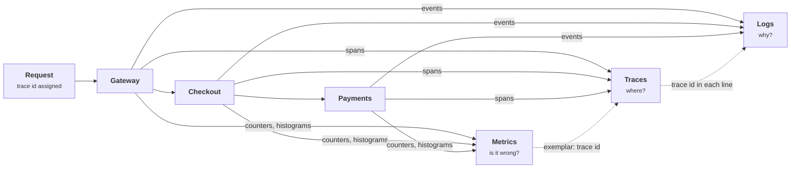
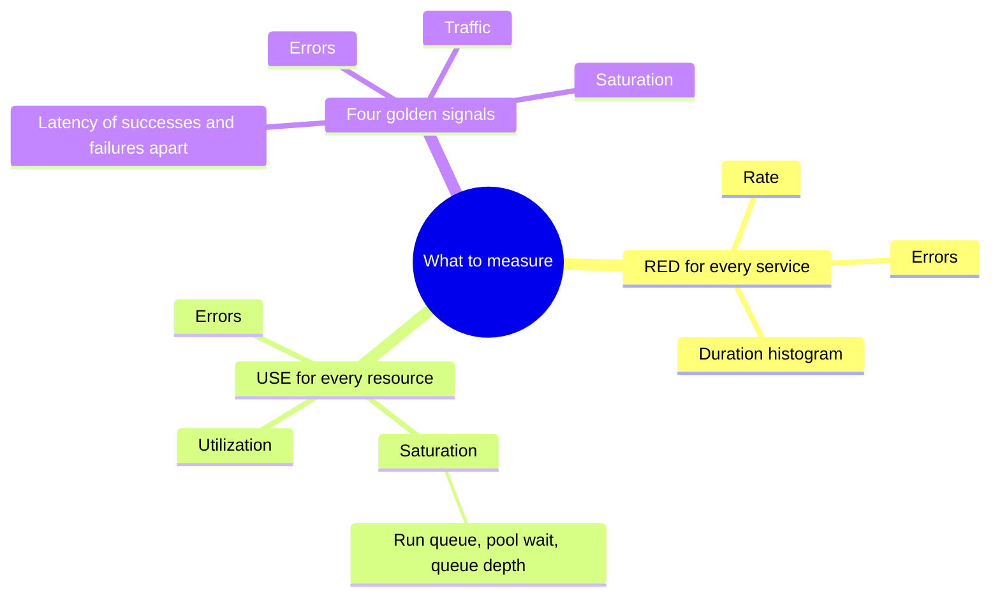
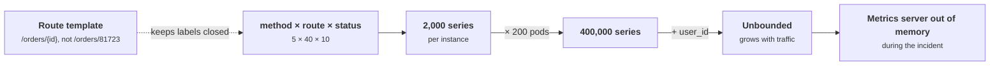
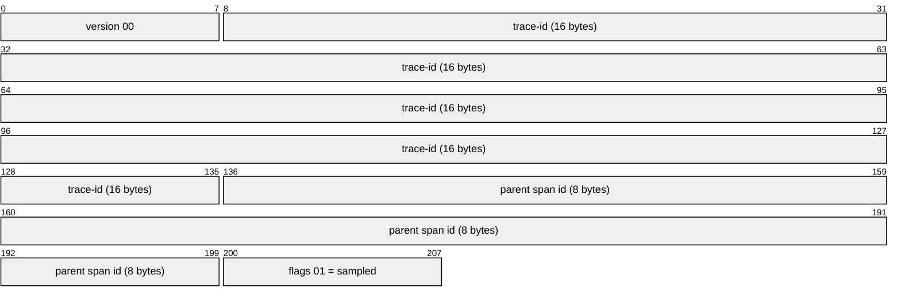
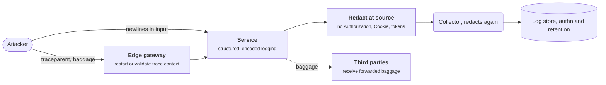
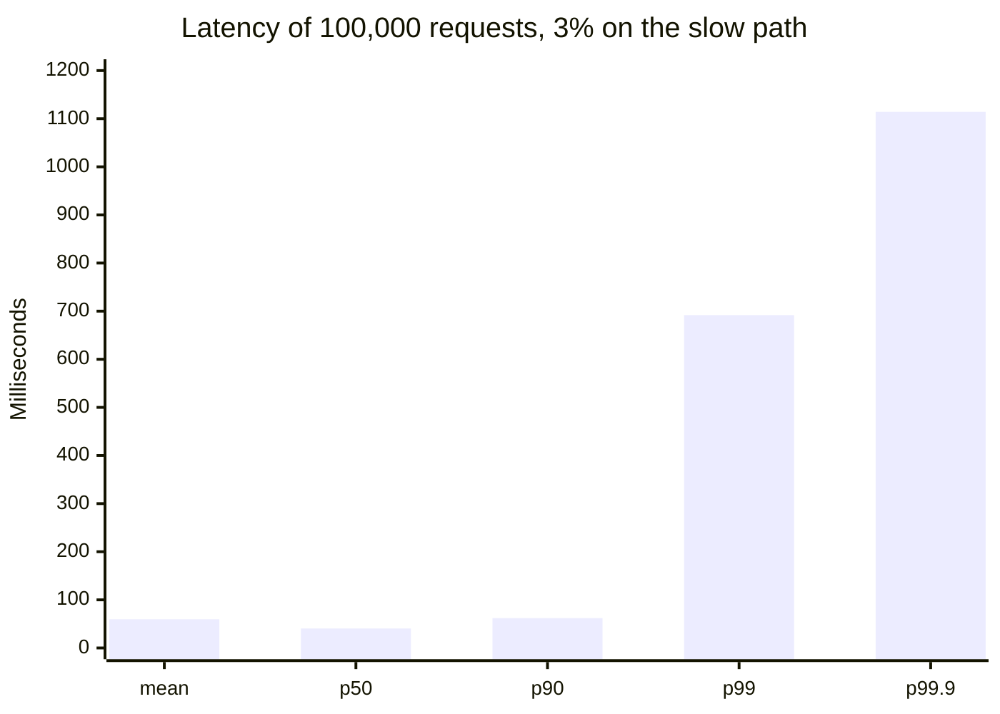

+++
title = 'Observability signals'
description = 'Metrics tell you that something is wrong, traces tell you where, and logs tell you why; each is only as good as its cardinality, its sampling, and the percentile math behind it.'
question = 'What should a service emit so you can tell what it is doing, and how do the numbers lie?'
weight = 2
difficulty = 2
prerequisites = ['/notes/systems-design/reliability-in-production/01-slos-and-error-budgets']
date = 2026-10-12
lastmod = 2026-10-12
verified = 2026-10-12
+++

## The idea in one minute

A running system answers three questions through three kinds of signal.
**Metrics** are cheap numeric aggregates that say *something is wrong*: the
error ratio rose, p99 latency doubled. **Traces** follow one request across
services and say *where*: the payment call spends 900 ms waiting on a lock.
**Logs** are detailed records of discrete events that say *why*: this query,
this user, this exception. Two simple checklists decide what to measure: **RED**
(rate, errors, duration) for every service, and **USE** (utilization,
saturation, errors) for every resource.

The numbers lie in predictable ways. An average hides the slow requests users
remember. A percentile computed from coarse histogram buckets can be off by
tens of percent. Percentiles from different hosts cannot be averaged. And one
label holding a user ID can multiply a metric into millions of time series and
take down the monitoring system itself. The consequence to act on: **measure
distributions, not averages; keep identifiers out of metric labels; and treat
telemetry as a production system with its own security boundary.**

## A picture



The links between the signals matter as much as the signals. A latency spike
on a dashboard leads, through an exemplar, to a trace of one slow request, and
the trace id leads to the log lines that explain it.

## How it really works

### Three signals, three cost models

| Signal | Unit | Cost grows with | Good at | Bad at |
| --- | --- | --- | --- | --- |
| **Metrics** | A number per time series per scrape interval | Number of distinct label combinations | Alerting, trends, SLOs, cheap long retention | Explaining one request |
| **Traces** | A tree of spans for one request | Request volume times sampling rate | Locating latency and failures across services | Rare events if sampling drops them |
| **Logs** | One structured record per event | Event volume times record size | Detail, forensics, audit | Aggregation at scale, cost control |

A metric costs the same whether the service handles ten requests or ten
million: it is a counter that goes up. That is why metrics drive alerts and
SLOs. Logs and traces cost in proportion to traffic, so at scale they are
sampled, filtered, or kept for days rather than months.

### What to measure: RED, USE, and the golden signals

**RED**, a checklist popularized by Tom Wilkie, for every request-driven
service, measured per endpoint:

- **Rate**: requests per second.
- **Errors**: failed requests per second, or the error ratio.
- **Duration**: the distribution of request latency, as a histogram.

**USE**, from Brendan Gregg, for every resource (CPU, memory, disk, network
link, connection pool, thread pool, queue):

- **Utilization**: the share of time the resource was busy.
- **Saturation**: work that is waiting because the resource is busy (run queue
  length, pool wait time, queue depth).
- **Errors**: error events for the resource (I/O errors, dropped packets,
  failed allocations).

Saturation is the one most often missing and the most useful: a connection
pool at 100% utilization is fine until requests start queueing for it, and
queue depth is what predicts the latency cliff described in
[Overload and backpressure](/notes/systems-design/failure-modes/04-overload-and-backpressure/).

The SRE book's **four golden signals** (latency, traffic, errors, saturation)
are RED plus saturation. Its one refinement worth keeping: measure the latency
of successful and failed requests separately. A dependency that fails fast
makes average latency look better during an outage.

The three checklists side by side: RED looks at services, USE looks at resources, and the golden signals are RED plus saturation.



### Metrics and cardinality

A metric with labels is not one series but one per combination of label
values. `http_requests_total{method, route, status}` with 5 methods, 40 routes,
and 10 status codes is up to 2,000 series per instance. Add `instance` across
200 pods and it is 400,000. Add `user_id` and it is unbounded.

Follow the multiplication left to right; the last label is the one that turns a fixed cost into one that grows with traffic.



Each series costs memory in the metrics backend, index space, and query time.
**Cardinality explosions** are a common way to break Prometheus-style systems:
a deploy adds a label carrying request paths with IDs in them (`/orders/81723`),
series count grows with traffic, and the monitoring server runs out of memory
during the incident you needed it for.

Rules that keep cardinality bounded:

- Label values come from **small, closed sets**: route templates
  (`/orders/{id}`), status classes, region names. Never raw URLs, user IDs,
  email addresses, trace IDs, or error messages.
- Put high-cardinality detail in **logs and traces**, which are built for it,
  and link them with exemplars and trace IDs.
- Watch the series count of the metrics system as its own SLI.

### Traces and OpenTelemetry

A **trace** is the tree of **spans** for one request. Each span records a named
operation, its start and end time, its parent, and attributes. Context
propagates between services in a header: the W3C Trace Context recommendation
defines `traceparent`, which carries a trace ID, a parent span ID, and a
sampled flag.

```text {title="a traceparent header"}
traceparent: 00-4bf92f3577b34da6a3ce929d0e0e4736-00f067aa0ba902b7-01
```

Decoded from hex, the header is four fixed-size fields; the last bit of the flags byte is the sampling decision every downstream service inherits.



**OpenTelemetry** (OTel) is the vendor-neutral standard for producing all three
signals. It defines the APIs and SDKs that instrument code, semantic conventions
for attribute names (`http.request.method`, `http.response.status_code`), the OTLP wire
protocol, and the Collector, a pipeline that receives, processes, samples, and
exports telemetry. Instrumenting against OTel means the backend can change
without touching application code.

Tracing every request is usually too expensive, so traces are sampled:

| Sampling | Decided | Keeps | Misses |
| --- | --- | --- | --- |
| **Head-based** | At the first service, before anything is known | A fixed share of all requests | Most errors and slow requests, because they are rare |
| **Tail-based** | After the trace completes, in the Collector | All errors and slow traces, plus a sample of the rest | Nothing by design, but needs every span of a trace buffered in one place |

The difference is when the decision is made: before the outcome is known, or after.

```mermaid {title="Head sampling decides blind, tail sampling decides with the outcome"}
flowchart LR
  subgraph HS["Head-based, at the first service"]
    direction LR
    R1("First service")
    D1{"<b>Sample 1%?</b>"}
    K1["<b>Kept</b><br/><small>1% of everything</small>"]
    X1["<b>Dropped</b><br/><small>99% of errors too</small>"]
    R1 --> D1
    D1 -->|"yes"| K1
    D1 -->|"no"| X1
  end
  subgraph TS["Tail-based, in the Collector"]
    direction LR
    R2("Collector buffers spans")
    D2{"<b>Error or slow?</b>"}
    K2["<b>Kept</b><br/><small>every one</small>"]
    S2["<b>Sampled</b><br/><small>share of the rest</small>"]
    R2 --> D2
    D2 -->|"yes"| K2
    D2 -->|"no"| S2
  end
  class K1,K2,S2 good
  class X1 warn
```

### Percentiles, not averages

Latency distributions in real services are skewed: most requests are fast, and
a few hit a cache miss, a lock, a garbage collection pause, or a retry. The
mean is pulled up a little by those few and says nothing about how slow they
are. The **p99** is the latency that 99% of requests beat; the slowest 1% are
worse.

The tail matters more than its share suggests because of **fan-out**. Dean and
Barroso's "The Tail at Scale" makes the point with arithmetic: if a user
request waits on 100 backend calls, each with a 1% chance of being slow, about
63% of user requests include at least one slow call. The backend's p99 becomes
the user's median experience.

The curve is `1 - 0.99^N`: each extra backend call is another chance to hit a 1% slow path.

```mermaid {title="Fan-out turns a backend p99 into a common user experience"}
xychart-beta
  title "User requests that wait on at least one slow call"
  x-axis "Backend calls per user request" [1, 5, 10, 20, 50, 100]
  y-axis "Share of user requests (%)" 0 --> 70
  line [1.0, 4.9, 9.6, 18.2, 39.5, 63.4]
```

Two traps in percentile math:

- **Percentiles do not average.** The mean of four hosts' p99s is not the p99
  of the fleet. You need the underlying distribution: merge histograms, then
  compute the percentile.
- **Load generators can hide the tail.** A load test that waits for each
  response before sending the next stops sending exactly when the system
  stalls, so the stall appears as one slow sample instead of the hundreds of
  requests that real users would have queued up behind it. This is often called
  **coordinated omission**; open-loop load generators that send on a fixed
  schedule avoid it.

### Histograms and their buckets

A Prometheus histogram stores a cumulative count per bucket upper bound (`le`),
plus a sum and a count. `histogram_quantile()` finds the bucket containing the
requested rank and **interpolates linearly** inside it, assuming observations
are spread evenly between the bounds. The estimate can be anywhere in the
bucket, so its error is bounded by the bucket's width.

That makes bucket choice a measurement decision:

- With the client libraries' default buckets, everything between 500 ms and
  1 s is one bucket. A p99 estimated inside it can be off by hundreds of
  milliseconds.
- A latency SLI of "share of requests under 300 ms" cannot be counted exactly
  unless 300 ms is a bucket boundary. Put a boundary on every SLO threshold.
- Histograms are mergeable: summing bucket counts across hosts gives the fleet
  histogram. Pre-computed quantiles from a client-side **summary** are not
  mergeable, which is why histograms are preferred for anything aggregated.

**Exponential histograms**, OpenTelemetry's base-2 exponential histogram and
Prometheus native histograms, choose bucket boundaries as powers of a base close
to 1. Relative error is bounded everywhere on the scale, from microseconds to
minutes, without hand-picking bounds.

### Logs worth having

- **Structured**: JSON or key-value records with consistent field names, not
  free text to be parsed with regular expressions later.
- **Correlated**: every line carries the trace ID and span ID, so a trace leads
  to its logs and back.
- **Leveled and budgeted**: debug logs off in production by default, with a way
  to turn them on for one tenant or one request.
- **About events, not states**: "payment 8841 declined: insufficient funds" is
  a log; "queue depth is 40" is a metric.

### Security-relevant telemetry

Observability data is security data, in both directions.

**What to record for security.** Authentication successes and failures,
authorization denials, privilege changes, administrative actions, changes to
security configuration, and access to sensitive records, each with who, what,
when, where from, and the outcome. These are the events an investigation needs
and the inputs to detection (covered in
[Audit logs and detection](/notes/infrastructure-security/delivery-and-operations/03-audit-logs-and-detection/)).
A spike in authorization denials is as much an operational signal as a spike in
5xx responses.

**What never to record.** Passwords, session tokens, API keys, full card
numbers, and other secrets; personal data beyond what the purpose needs. Request
logging middleware that dumps headers will log `Authorization` and `Cookie`
unless told not to. Redact at the source, and again in the Collector.

**Telemetry as an attack surface.**

- **Log injection** (CWE-117): user input containing newlines or control
  characters forges log entries or breaks parsers. Structured logging with
  proper encoding prevents most of it.
- **Logging code runs on attacker input.** Log4Shell (CVE-2021-44228) let a
  string in a logged field trigger a remote lookup and code execution inside
  the logging library.
- **Context propagation crosses trust boundaries.** Incoming `traceparent` and
  `baggage` headers from the internet are attacker-controlled. Restart traces at
  the edge or validate them, and never put sensitive data in baggage, which is
  forwarded to every downstream service, including third parties.
- **Telemetry pipelines concentrate data.** The Collector and log store see
  everything. They need authentication, encryption in transit, access control,
  and retention limits like any other sensitive store.

Trace each attacker-controlled input to the control that stops it, and note that the pipeline itself is a store worth stealing.



## Code

The program draws 100,000 synthetic latencies where 3% take a slow path. It
computes exact percentiles, then estimates p99 from two histogram layouts with
the same interpolation `histogram_quantile()` uses, checks whether a 300 ms SLI
can be counted from default buckets, compares averaging per-host p99s with
merging histograms, and computes the fan-out probabilities.

```python {title="tails.py"}
"""tails.py: why averages hide the tail, and how histogram buckets bias p99.

Synthetic request latencies: most requests are fast, a few hit a slow path.
Standard library only; seeded, so every run prints the same numbers.
"""

from __future__ import annotations

import bisect
import math
import random

# Upper bounds in seconds; these match the Prometheus client libraries' defaults.
DEFAULT_BUCKETS = [0.005, 0.01, 0.025, 0.05, 0.1, 0.25, 0.5, 1.0, 2.5, 5.0, 10.0]
# Exponential buckets growing by 2**(1/8), about 9% per bucket, from 1 ms.
FINE_BUCKETS = [0.001 * 2 ** (i / 8) for i in range(8 * 14)]


def latencies(n: int, slow_share: float, seed: int) -> list[float]:
    rng = random.Random(seed)
    out = []
    for _ in range(n):
        if rng.random() < slow_share:  # cache miss, lock wait, GC pause
            out.append(rng.lognormvariate(math.log(0.600), 0.35))
        else:
            out.append(rng.lognormvariate(math.log(0.040), 0.30))
    return out


def quantile(sorted_xs: list[float], q: float) -> float:
    """Nearest-rank quantile on raw samples: the ground truth."""
    return sorted_xs[max(0, math.ceil(q * len(sorted_xs)) - 1)]


def bucketize(xs: list[float], bounds: list[float]) -> list[int]:
    """Cumulative counts per upper bound, like a Prometheus histogram (+Inf last)."""
    counts = [0] * (len(bounds) + 1)
    for x in xs:
        counts[bisect.bisect_left(bounds, x)] += 1
    cumulative, total = [], 0
    for c in counts:
        total += c
        cumulative.append(total)
    return cumulative


def bucket_quantile(q: float, bounds: list[float], cum: list[int]) -> float:
    """Linear interpolation inside the bucket, the way histogram_quantile() does it."""
    rank = q * cum[-1]
    i = bisect.bisect_left(cum, rank)
    if i == len(bounds):
        return bounds[-1]  # the rank falls in +Inf; the best you can say is "above"
    lower = bounds[i - 1] if i > 0 else 0.0
    below = cum[i - 1] if i > 0 else 0
    return lower + (bounds[i] - lower) * (rank - below) / (cum[i] - below)


def ms(seconds: float) -> str:
    return f"{seconds * 1000:7.1f} ms"


def main() -> None:
    xs = latencies(100_000, slow_share=0.03, seed=11)
    s = sorted(xs)
    print("one service, 100,000 requests, 3% take the slow path")
    print(f"  mean   {ms(sum(xs) / len(xs))}")
    for q in (0.50, 0.90, 0.99, 0.999):
        print(f"  p{q * 100:g}".ljust(9) + ms(quantile(s, q)))

    print("\np99 estimated from histogram buckets")
    for name, bounds in (("default buckets", DEFAULT_BUCKETS), ("fine buckets", FINE_BUCKETS)):
        cum = bucketize(xs, bounds)
        est = bucket_quantile(0.99, bounds, cum)
        err = (est - quantile(s, 0.99)) / quantile(s, 0.99)
        print(f"  {name:<16} {len(bounds):>3} buckets  p99 {ms(est)}  error {err:+6.1%}")

    print("\nlatency SLI: share of requests under 300 ms")
    cum = bucketize(xs, DEFAULT_BUCKETS)
    lo, hi = cum[DEFAULT_BUCKETS.index(0.25)], cum[DEFAULT_BUCKETS.index(0.5)]
    print(f"  exact from raw samples     {bisect.bisect_right(s, 0.300) / len(s):.3%}")
    print(f"  default buckets can say    between {lo / len(xs):.3%} and {hi / len(xs):.3%}")

    print("\naveraging percentiles across four hosts (objective: p99 under 500 ms)")
    hosts = [latencies(30_000, slow_share=0.002, seed=20 + i) for i in range(3)]
    hosts.append(latencies(10_000, slow_share=0.20, seed=29))  # one host on a bad disk
    p99s = [quantile(sorted(h), 0.99) for h in hosts]
    merged = sorted(x for h in hosts for x in h)
    print("  host p99s " + ", ".join(ms(p).strip() for p in p99s))
    print(f"  mean of host p99s     {ms(sum(p99s) / len(p99s))}")
    print(f"  true p99 of all calls {ms(quantile(merged, 0.99))}")
    hist = [sum(col) for col in zip(*(bucketize(h, FINE_BUCKETS) for h in hosts))]
    print(f"  p99 from summed hists {ms(bucket_quantile(0.99, FINE_BUCKETS, hist))}")

    print("\nfan-out: one user request waits for the slowest of N backend calls")
    for n in (1, 10, 100):
        print(f"  N={n:<4} chance at least one call is beyond its p99: {1 - 0.99 ** n:6.1%}")


if __name__ == "__main__":
    main()
```

Run it with `python3 tails.py`:

```text
one service, 100,000 requests, 3% take the slow path
  mean      59.6 ms
  p50       40.5 ms
  p90       62.0 ms
  p99      691.7 ms
  p99.9   1114.2 ms

p99 estimated from histogram buckets
  default buckets   11 buckets  p99   791.1 ms  error +14.4%
  fine buckets     112 buckets  p99   694.2 ms  error  +0.4%

latency SLI: share of requests under 300 ms
  exact from raw samples     97.087%
  default buckets can say    between 97.022% and 97.880%

averaging percentiles across four hosts (objective: p99 under 500 ms)
  host p99s 82.9 ms, 82.2 ms, 82.2 ms, 1062.3 ms
  mean of host p99s       327.4 ms
  true p99 of all calls   622.9 ms
  p99 from summed hists   619.5 ms

fan-out: one user request waits for the slowest of N backend calls
  N=1    chance at least one call is beyond its p99:   1.0%
  N=10   chance at least one call is beyond its p99:   9.6%
  N=100  chance at least one call is beyond its p99:  63.4%
```

What it shows:

- The **mean** is 60 ms, only 50% above the median. The p99 is more than ten
  times the mean. A dashboard showing averages would show a healthy service.
- With **default buckets**, p99 lands in the 500 ms to 1 s bucket and the
  estimate is 14% high. With exponential buckets about 9% wide, it is within
  half a percent. The error is a property of the bucket layout, not of the data.
- The **300 ms SLI** cannot be computed from default buckets: they can only say
  the true value (97.087%) lies somewhere between 97.02% and 97.88%. Against a
  97.5% objective, you would not know whether you were meeting it.
- One sick host takes 10% of traffic. The **mean of host p99s** is 327 ms,
  comfortably under the 500 ms objective. The **true p99** is 623 ms, a breach.
  Summing histograms first gets it right.
- **Fan-out** turns a 1% tail into a 63% chance per user request at N = 100.

The first block of output as bars: the mean sits beside the median, and the p99 is an order of magnitude away from both.



## Where it breaks

- **Synthetic distributions.** The program's latencies come from two smooth
  lognormal curves. Real latency has multiple modes, timeouts that pile up at
  one value, and retries. Interpolation error depends on the actual shape, which
  is why boundaries at the thresholds you alert on matter more than general
  precision.
- **Percentiles of what population.** A p99 over all endpoints mixes a 5 ms
  health check with a 2 s report export. Break latency out by route, and
  remember that p99 over one minute at low traffic may be computed from a
  handful of requests.
- **Sampling hides rare failures.** Head-based sampling at 1% keeps one in a
  hundred of the errors you most want to see. Tail sampling fixes that at the
  price of buffering and a stateful Collector tier that can itself fail or
  overload.
- **Observability that shares fate.** If the metrics system runs on the same
  cluster, network, or identity provider as the service, the outage that takes
  down one takes down the other. The monitoring for a system should survive
  that system's worst failure.
- **More telemetry is not more understanding.** Dashboards with hundreds of
  panels slow incident response. Start from the SLO, then RED and USE, and add
  signals when an incident shows a blind spot.

## Remember this

- Metrics say that, traces say where, logs say why; link them with trace IDs.
- RED for every service, USE for every resource; saturation predicts the cliff.
- Never average percentiles; merge histograms and compute from the merge.
- Put a histogram bucket boundary on every latency threshold you alert on.
- Label values come from small closed sets; IDs go in logs and traces.
- Telemetry carries secrets and attacker input; redact, encode, and restrict it.

## Try it

1. In `tails.py`, add bucket boundaries at 0.3 s and 0.75 s to
   `DEFAULT_BUCKETS`. How much does the p99 estimate improve, and can the
   300 ms SLI now be counted exactly?
2. Change `slow_share` from 3% to 0.5%. What happens to the gap between mean
   and p99? Does p99 still see the slow path, and does p99.9?
3. Estimate the series count of a metric you own: multiply the number of values
   of each label, then multiply by the number of instances. Which label
   dominates? Could it be a route template or a status class instead?
4. Take one service's request logging configuration and check whether it can
   log `Authorization`, `Cookie`, or `Set-Cookie` headers, or request bodies
   containing passwords.

## Check yourself

1. Why do metrics drive alerting and SLOs while logs and traces drive
   investigation?

   
   A metric's cost is fixed by its series count, not by traffic, so it can be
   kept complete, cheap, and fast to query for every request and for months. Logs
   and traces cost in proportion to traffic, so they are sampled or retained
   briefly, but they carry the per-request detail needed to explain a problem.
   

2. Four hosts report p99s of 80, 80, 80, and 1,000 ms. Can you compute the
   fleet's p99 from these numbers?

   
   No. Percentiles do not average, and the result depends on how much traffic
   each host served and on the shape of each distribution. If the slow host
   serves 10% of traffic and a fifth of its requests are slow, the fleet p99 sits
   in the slow mode, far above the mean of the four p99s. Merge the histograms,
   then compute the percentile.
   

3. What is wrong with a metric label holding the request path?

   
   Paths often contain IDs (`/orders/81723`), so the number of distinct label
   values grows with traffic. Each value creates a new time series, and the
   metrics backend's memory and index grow without bound. Use the route template
   (`/orders/{id}`) as the label and put the concrete path in logs and spans.
   

4. Why does head-based trace sampling at 1% fit poorly with debugging errors?

   
   The decision is made at the start of the request, before anyone knows it will
   fail, so only 1% of failing requests are kept, the same as for successes.
   Tail-based sampling decides after the trace completes and can keep every
   error and every slow trace.
   

5. Name two ways telemetry creates security risk.

   
   It can capture secrets and personal data (logged authorization headers,
   cookies, or request bodies), concentrating them in a store with weaker
   controls than the original system. And it processes attacker input: log
   injection forges entries, logging libraries can have vulnerabilities such as
   Log4Shell, and incoming trace context and baggage headers are attacker
   controlled.
   

## Sources

- B. Beyer et al. (eds.), [Site Reliability Engineering, chapter 6: Monitoring Distributed Systems](https://sre.google/sre-book/monitoring-distributed-systems/), O'Reilly, 2016.
- J. Dean, L. A. Barroso, [The Tail at Scale](https://doi.org/10.1145/2408776.2408794), Communications of the ACM 56(2), February 2013.
- B. Gregg, [The USE Method](https://www.brendangregg.com/usemethod.html), and "Thinking Methodically about Performance", ACM Queue, 2012.
- B. H. Sigelman et al., [Dapper, a Large-Scale Distributed Systems Tracing Infrastructure](https://research.google/pubs/pub36356/), Google Technical Report, 2010.
- W3C, [Trace Context](https://www.w3.org/TR/trace-context/), W3C Recommendation.
- OpenTelemetry, [Specification](https://opentelemetry.io/docs/specs/otel/) and [Semantic conventions](https://opentelemetry.io/docs/specs/semconv/).
- Prometheus, [Histograms and summaries](https://prometheus.io/docs/practices/histograms/) and [Instrumentation](https://prometheus.io/docs/practices/instrumentation/), documentation.
- OWASP, [Logging Cheat Sheet](https://cheatsheetseries.owasp.org/cheatsheets/Logging_Cheat_Sheet.html).
- MITRE, [CWE-117: Improper Output Neutralization for Logs](https://cwe.mitre.org/data/definitions/117.html).
- NIST, [CVE-2021-44228 detail](https://nvd.nist.gov/vuln/detail/CVE-2021-44228), National Vulnerability Database.
