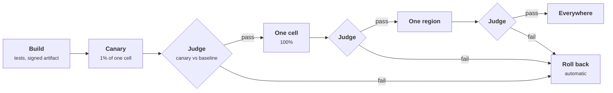
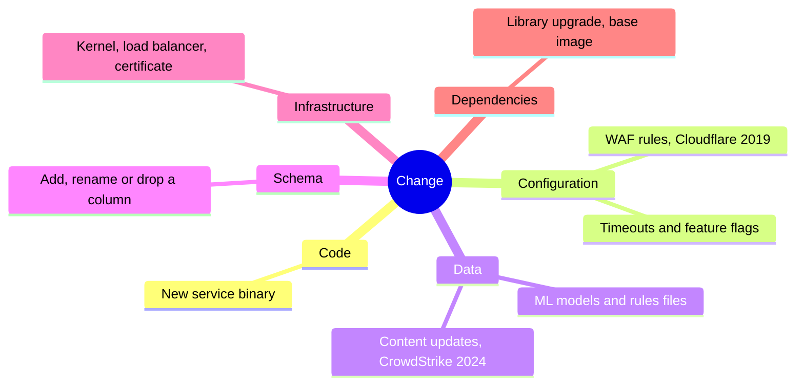
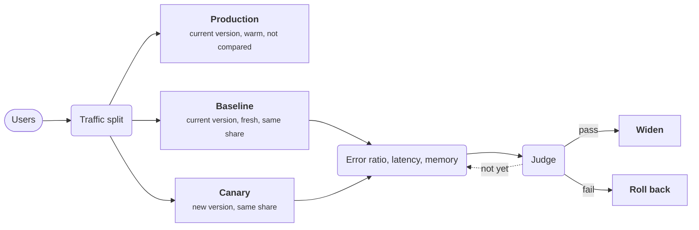
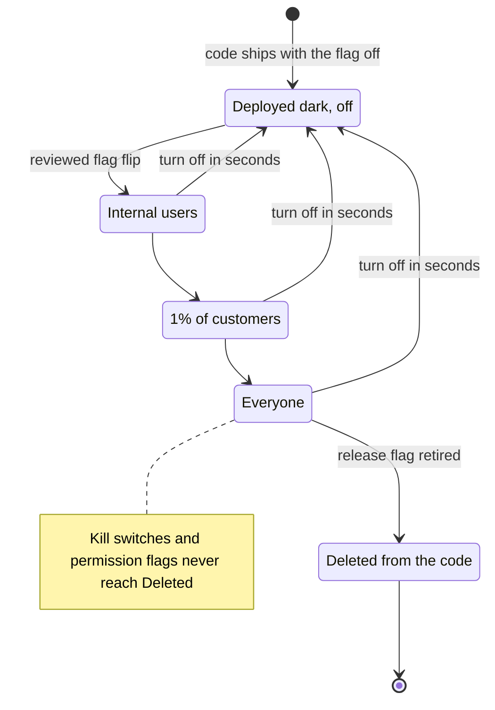
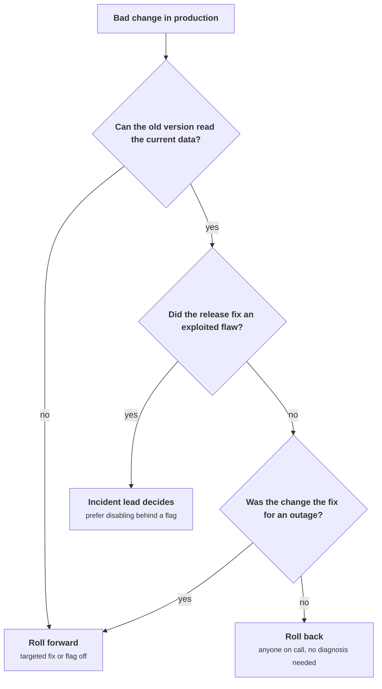
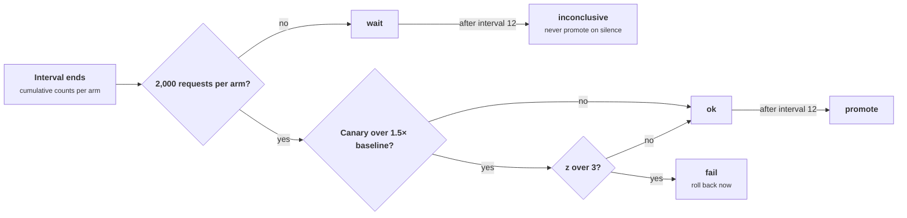

+++
title = 'Safe change'
description = 'Most outages start with a change; progressive delivery, automated canary analysis, flags, and reversible migrations turn each change into a small, observable, undoable experiment.'
question = 'How do you ship changes every day without each one being a bet on the whole system?'
weight = 3
difficulty = 3
prerequisites = ['/notes/systems-design/reliability-in-production/01-slos-and-error-budgets', '/notes/systems-design/reliability-in-production/02-observability-signals', '/notes/systems-design/failure-modes/05-blast-radius-and-cells']
date = 2026-10-14
lastmod = 2026-10-14
verified = 2026-10-14
+++

## The idea in one minute

Systems rarely break while nobody is touching them. The SRE book reports that
roughly 70% of outages at Google came from changes to a live system: new
binaries, new configuration, new data, new infrastructure. So the most
effective reliability work is making change safe, not making it rare.

Safe change has three properties. It is **progressive**: it reaches a small
slice of traffic first, then more, so a bad change hurts a few users instead of
all of them. It is **observed**: at each step, an automated judge compares the
new version against the old on the signals that matter and stops the rollout
when they diverge. And it is **reversible**: rollback is fast, rehearsed, and
possible, which means database schemas change in steps that both versions can
run against.

The consequence to act on: **every change, including configuration and data,
goes through the same staged rollout with an automated gate and a tested way
back**. The changes that skip the pipeline because they are "just config" are
the ones that take everything down at once.

## A picture



Each stage widens the blast radius only after the previous one has produced
enough evidence. Bake time between stages lets slow failures, such as memory
leaks and daily batch jobs, show up before the next widening.

## How it really works

### What counts as a change

| Change | Example | Why it is risky |
| --- | --- | --- |
| **Code** | A new service binary | The familiar case, usually the best protected |
| **Configuration** | A timeout, a feature flag, a WAF rule, a routing table | Often bypasses the build pipeline and takes effect everywhere in seconds |
| **Data** | A new ML model, a rules file, a GeoIP database, a content update | Treated as "not code", yet parsed and executed by code |
| **Schema** | Adding, renaming, or dropping a column | Hard or impossible to roll back once data is rewritten |
| **Infrastructure** | A new kernel, a load balancer setting, a certificate | Shared by many services at once |
| **Dependencies** | A library upgrade, a base image | Changes behavior without a single line of your code changing |

Only one branch of this map is "a deploy" in the usual sense; the other five reach production too, often faster.



Two well-documented incidents show why configuration and data deserve the same
care as code. In July 2019 Cloudflare deployed a new WAF managed rule containing
a regular expression that backtracked catastrophically; it was pushed to the
whole edge at once, drove CPU to 100% on machines serving HTTP traffic, and
caused a global outage. In July 2024 a CrowdStrike content update for the
Falcon sensor, a configuration-like file rather than a new sensor binary,
reached Windows hosts worldwide and crashed them; the company's root cause
analysis committed to staged deployment of such content. In both cases a
canary on a small fraction of machines would have shown the failure.

### Progressive delivery

Rollout stages follow the failure domains you already have: a canary inside
one cell, the whole cell, one region, then the rest. The structure of
[Blast radius and cells](/notes/systems-design/failure-modes/05-blast-radius-and-cells/)
pays off here: a cell is a natural unit of rollout because its failure is
contained by design.

| Technique | How traffic moves | Rollback | Cost |
| --- | --- | --- | --- |
| **Rolling update** | Replace instances a batch at a time | Roll forward the old version, batch by batch | Cheap; mixed versions during rollout |
| **Blue/green** | Stand up a full new fleet, switch traffic at once | Switch back | Double capacity; one big switch |
| **Canary** | Send a small share of traffic to the new version, compare, widen | Shift traffic away | Needs traffic splitting and analysis |
| **Feature flag rollout** | Code is deployed dark; behavior enabled for a growing share of users | Turn the flag off | Flag complexity in the code |

Canaries and flags are complementary. The canary protects against a bad
deployment: the binary crashes, leaks, or regresses latency. The flag protects
against a bad feature: it works as built, but the behavior is wrong for users.

### Automated canary analysis

A human watching dashboards during a rollout is slow, inconsistent, and tired
at 4 p.m. on a Friday. Automated analysis replaces the human with a judge that,
at each interval, compares the canary against a baseline on a fixed set of
metrics and returns pass, fail, or not yet.

Design choices that make the judge trustworthy:

- **Compare against a fresh baseline.** Deploy a small baseline group running
  the current version at the same time as the canary, with the same size and
  traffic share. Comparing a new canary against long-running production
  conflates the change with process age, warm caches, and hardware differences.
  The SRE Workbook's chapter on canarying and Netflix and Google's open-source
  judge, Kayenta, both use a canary and baseline pair.
- **Choose a few metrics that reflect users.** Error ratio and latency
  percentiles from the SLIs, plus resource signals that predict trouble (memory
  growth, crash loops, saturation). Hundreds of metrics guarantee that some
  will differ by chance.
- **Test for significance and for size.** A difference must be unlikely to be
  noise (statistical significance) and large enough to matter (practical
  significance). A gate that fails on any measurable difference rolls back good
  releases; a gate that ignores small differences lets slow regressions
  through.
- **Require enough data.** Below a minimum sample size, the only honest verdict
  is "not yet". A canary at 1% of a quiet service may need hours to say
  anything.

The judge compares two small groups that differ only in version; long-running production is deliberately left out of the comparison.



For error ratios, a **two-proportion z-test** asks how many standard errors
apart the canary and baseline rates are, assuming they share one true rate.
For latency, which is skewed, nonparametric tests that compare whole
distributions are a better fit; Kayenta's judge uses the Mann-Whitney U test.

### Peeking

A rollout checks the data every few minutes and stops at the first bad
result. Each look is another chance for noise to cross the threshold, so the
false-alarm rate over a whole rollout is much higher than the per-test
significance level suggests. This is the **peeking problem** familiar from A/B
testing. Remedies range from simple (a stricter threshold, such as z > 3
instead of the usual 1.96, and a minimum sample before any verdict) to
principled (sequential tests designed for continuous monitoring, such as the
always-valid p-values described by Johari, Pekelis, and Walsh).

### Feature flags

A **feature flag** separates deploying code from releasing behavior. The code
ships turned off; a flag service turns it on for internal users, then 1% of
customers, then everyone. Turning it off is a configuration change that takes
seconds, not a redeploy.

Flags come in kinds with different lifetimes:

| Kind | Lifetime | Example |
| --- | --- | --- |
| **Release flag** | Days to weeks, then deleted | New checkout page behind a percentage rollout |
| **Experiment flag** | The length of the experiment | A/B test of two ranking functions |
| **Operational flag (kill switch)** | Permanent | Disable recommendations when the recommender is overloaded |
| **Permission flag** | Permanent | Beta features for opted-in tenants |

A release flag's life, from dark deploy to deletion; the way back to off is one flip from any stage.



Flags have costs. Each one doubles the number of code paths, stale flags
accumulate, and a flag flip is a production change that deserves the same
review and staged rollout as a deploy. From a security angle: flags must be
evaluated on the server for anything that guards access (a flag evaluated in
the browser is a suggestion the user can change), the flag service is a
control plane that can switch on unreviewed code paths across the fleet, and
its write access belongs with the same people and controls as deploy access.

### Configuration as code

Configuration that lives in a repository gets review, history, tests, and the
deployment pipeline. Configuration edited live in a console gets none of
these. Treating configuration as code means:

- **Validate before deploy**: schema checks, semantic checks (does this
  timeout exceed the caller's deadline?), and, for rules engines and regular
  expressions, tests against real traffic samples and worst-case inputs.
- **Roll out progressively**, exactly like code. A flag or rule that takes
  effect everywhere at once is an unstaged deploy.
- **Keep the last known good** and make reverting to it one action.
- **Fail safe on bad config**: a process that cannot parse a new config should
  keep running on the old one and alert, not crash. A fleet that crashes on
  the same bad file all at once is a correlated failure.

### Roll back or roll forward

**Rollback** restores the previous version. It is the default response to a bad
change because it is fast, well understood, and does not need diagnosis.
**Roll forward** ships a fix on top. It is appropriate when rollback is
impossible or worse: the new version has already written data the old version
cannot read, the old version has a vulnerability that is being exploited, or
the change was itself the fix for an outage.

The questions below are the exceptions; if none of them applies, roll back.



Make rollback cheap and boring:

- Keep the previous artifact and configuration deployable at all times.
- Rehearse rollback; an untested rollback path is a hypothesis.
- Make every release compatible with its predecessor in both directions: wire
  formats, cache entries, queue messages, and database schema.
- Decide in advance who may roll back without asking. The answer should be
  anyone on call.

> [!WARNING]
> Rolling back a security fix reopens the vulnerability. If a release fixed an
> exploited flaw, rolling back to the previous version is a decision for the
> incident lead, not an automated default; prefer disabling the broken part
> behind a flag. Where versions carry security significance, such as firmware
> or update metadata, systems often enforce **anti-rollback** so an attacker
> cannot reinstall an old vulnerable version.

### Schema migrations: expand and contract

A schema change cannot be rolled back by redeploying code if it destroyed or
rewrote data. The **expand and contract** pattern (also called parallel change)
splits a breaking change into compatible steps, each one deployable and
reversible on its own. Renaming `users.name` to `users.full_name`:

| Step | Schema | Application | Reversible? |
| --- | --- | --- | --- |
| 1. Expand | Add nullable `full_name` | Unchanged | Yes: drop the empty column |
| 2. Dual write | Both columns | Writes both, reads `name` | Yes: deploy previous version |
| 3. Backfill | Both columns | Batch job copies `name` to `full_name` | Yes: the old column is untouched |
| 4. Switch reads | Both columns | Reads `full_name`, still writes both | Yes: switch reads back |
| 5. Stop old writes | Both columns | Writes only `full_name` | Yes, with a re-backfill |
| 6. Contract | Drop `name` | Unchanged | **No**: do it only after a bake period |

The same six steps in order: five reversible ones, then a single irreversible step at the end.

```mermaid {title="Expand and contract isolates the one step you cannot undo"}
timeline
  title Renaming users.name to users.full_name
  section Reversible
    Step 1 Expand : add nullable full_name
    Step 2 Dual write : write both, read name
    Step 3 Backfill : throttled batches copy name to full_name
    Step 4 Switch reads : read full_name, still write both
    Step 5 Stop old writes : write only full_name
  section Irreversible
    Step 6 Contract : drop name after a bake period and a backup
```

At every step before the last, the previous application version still works
against the current schema, so a rollback never meets a schema it cannot read.
The irreversible step is isolated, small, and taken last, after the backup
discussed in
[Backup and disaster recovery](/notes/systems-design/reliability-in-production/04-backup-and-disaster-recovery/).
Large backfills run in throttled batches, because a migration that saturates
the database is itself an outage.

## Code

The program runs a canary and a baseline side by side for twelve analysis
intervals. Each interval, both arms serve requests with a given error rate,
and a gate applies a minimum sample size, a practical-significance ratio, and a
one-sided two-proportion z-test with a strict threshold. It then runs 200
healthy and 200 bad canaries through the gate and through a naive judge that
fails whenever the canary's error rate is higher than the baseline's.

The gate checks three things in order each interval, and only the last interval's verdict decides between promote and inconclusive.



```python {title="canary.py"}
"""canary.py: automated canary analysis with a simple statistical gate.

Control and canary each serve a slice of traffic. Every interval the gate
compares cumulative error rates with a one-sided two-proportion z-test and
decides: keep going, roll back, or promote. Standard library only; seeded.
"""

from __future__ import annotations

import math
import random
from dataclasses import dataclass

INTERVALS = 12           # e.g. twelve 5-minute analysis windows
Z_FAIL = 3.0             # strict, because the gate looks at the data 12 times
MIN_REQUESTS = 2_000     # per arm, before any verdict but "too early"
MAX_RATIO = 1.5          # practical significance: ignore differences under 1.5x


@dataclass
class Arm:
    requests: int = 0
    errors: int = 0

    def serve(self, n: int, error_rate: float, rng: random.Random) -> None:
        self.requests += n
        self.errors += sum(rng.random() < error_rate for _ in range(n))

    @property
    def rate(self) -> float:
        return self.errors / self.requests if self.requests else 0.0


def z_score(control: Arm, canary: Arm) -> float:
    """Positive when the canary is worse. Pooled two-proportion z-test."""
    pooled = (control.errors + canary.errors) / (control.requests + canary.requests)
    se = math.sqrt(pooled * (1 - pooled) * (1 / control.requests + 1 / canary.requests))
    return (canary.rate - control.rate) / se if se else 0.0


def gate(control: Arm, canary: Arm) -> str:
    if min(control.requests, canary.requests) < MIN_REQUESTS:
        return "wait"
    worse = canary.rate > MAX_RATIO * max(control.rate, 1e-9)
    return "fail" if worse and z_score(control, canary) > Z_FAIL else "ok"


def naive(control: Arm, canary: Arm) -> str:
    return "fail" if canary.rate > control.rate else "ok"


def run(base: float, canary_rate: float, per_interval: int, seed: int,
        judge=gate, verbose: bool = False) -> str:
    rng = random.Random(seed)
    control, canary = Arm(), Arm()
    for step in range(1, INTERVALS + 1):
        control.serve(per_interval, base, rng)
        canary.serve(per_interval, canary_rate, rng)
        verdict = judge(control, canary)
        if verbose:
            print(f"    t={step:>2}  control {control.errors:>3}/{control.requests:<5}"
                  f" canary {canary.errors:>3}/{canary.requests:<5}"
                  f" z={z_score(control, canary):+5.2f}  {verdict}")
        if verdict == "fail":
            return f"roll back at interval {step}"
    return "promote" if verdict == "ok" else "inconclusive: not enough traffic"


def main() -> None:
    base = 0.005  # 0.5% errors on the current version
    print("canary with a real regression (0.5% -> 1.5% errors), 1,000 requests per arm per interval")
    print("  " + run(base, 0.015, 1_000, seed=1, verbose=True))

    print("\nsame regression, canary arm too small (100 requests per interval)")
    print("  " + run(base, 0.015, 100, seed=2))

    print("\nsubtle regression (0.5% -> 0.6%), 1,000 requests per interval")
    print("  " + run(base, 0.006, 1_000, seed=3))

    trials = 200
    print(f"\n{trials} healthy canaries (identical error rates): how often is each judge wrong?")
    for name, judge in (("naive 'canary > control'", naive), ("z-test gate", gate)):
        wrong = sum(run(base, base, 1_000, seed=100 + t, judge=judge).startswith("roll back")
                    for t in range(trials))
        print(f"  {name:<26} rolled back {wrong:>3} good releases")

    print(f"\n{trials} bad canaries (0.5% -> 1.5%): how often is each judge right?")
    for name, judge in (("naive 'canary > control'", naive), ("z-test gate", gate)):
        caught = sum(run(base, 0.015, 1_000, seed=500 + t, judge=judge).startswith("roll back")
                     for t in range(trials))
        print(f"  {name:<26} caught {caught:>3} bad releases")


if __name__ == "__main__":
    main()
```

Run it with `python3 canary.py`:

```text
canary with a real regression (0.5% -> 1.5% errors), 1,000 requests per arm per interval
    t= 1  control   5/1000  canary  21/1000  z=+3.16  wait
    t= 2  control   8/2000  canary  40/2000  z=+4.65  fail
  roll back at interval 2

same regression, canary arm too small (100 requests per interval)
  inconclusive: not enough traffic

subtle regression (0.5% -> 0.6%), 1,000 requests per interval
  promote

200 healthy canaries (identical error rates): how often is each judge wrong?
  naive 'canary > control'   rolled back 161 good releases
  z-test gate                rolled back   2 good releases

200 bad canaries (0.5% -> 1.5%): how often is each judge right?
  naive 'canary > control'   caught 200 bad releases
  z-test gate                caught 200 bad releases
```

Read the results:

- The **real regression** (3x the error rate) waits at interval 1 even though
  z = 3.16, because only 1,000 requests per arm have been seen. It rolls back
  at interval 2.
- The **small canary** never collects 2,000 requests, so the gate refuses to
  promote and reports the rollout as inconclusive. Promoting on silence is how
  bad changes pass small canaries.
- The **subtle regression** (0.5% to 0.6%) is promoted. It is below the 1.5x
  practical-significance ratio and too small to detect with 12,000 requests per
  arm. Catching it needs more traffic or a longer bake, or the SLO's slow-burn
  alert after release.
- The **naive judge** rolls back 161 of 200 good releases. Noise alone makes the
  canary look worse at some interval most of the time. The gate rolls back 2,
  about 1%: the residual cost of peeking twelve times.
- Both judges catch all 200 large regressions. The difference between them is
  entirely in how often they stop good work.

That difference, from the output, as bars: both judges caught all 200 bad releases, so this is the whole cost of the naive one.

```mermaid {title="Peeking without a strict gate rolls back most good releases"}
xychart-beta
  title "Healthy canaries wrongly rolled back, out of 200"
  x-axis ["naive canary over control", "z-test gate"]
  y-axis "Good releases rolled back" 0 --> 200
  bar [161, 2]
```

## Where it breaks

- **Failures the canary cannot see.** A change that corrupts data slowly,
  breaks a nightly job, or fails only at month end passes every short canary.
  Bake times, data validation, and the slow-burn alerts from
  [SLOs and error budgets](/notes/systems-design/reliability-in-production/01-slos-and-error-budgets/)
  are the backstop.
- **Shared state defeats isolation.** A canary that writes a new format to a
  shared database or cache can break the baseline and the rest of the fleet.
  The comparison then shows no difference because everyone is broken. Isolate
  writes or make formats compatible both ways first.
- **Global changes have no canary.** DNS, certificates, identity provider
  configuration, and control-plane settings often apply everywhere at once. If
  a change cannot be staged, stage the *system*: split the global thing into
  per-region instances so it can be.
- **The judge's metrics are wrong.** A gate that watches only server error
  rate will pass a release that returns 200 with empty results. Gate on the
  same SLIs users are promised.
- **Statistics assume independence.** The z-test treats requests as
  independent coin flips. Real errors cluster: one bad host, one bad tenant,
  one retry storm. Clustering inflates the real variance, so the gate is more
  confident than it should be.
- **The pipeline is a target.** Whoever controls the deployment pipeline or the
  flag service controls production. Signed artifacts, protected branches, and
  admission control (covered in
  [CI/CD and build provenance](/notes/infrastructure-security/delivery-and-operations/01-ci-cd-and-build-provenance/))
  matter as much as canaries.

## Remember this

- Most outages follow a change; config and data changes are changes.
- Roll out by failure domain: canary, cell, region, everywhere, with bake time.
- Judge canary against a fresh baseline, with minimum samples and a strict threshold.
- Flags separate deploy from release; guard access on the server; delete stale ones.
- Every release must run against the previous schema; expand, migrate, then contract.
- Rollback is the default; rolling back a security fix is a deliberate decision.

## Try it

1. In `canary.py`, lower `Z_FAIL` to 1.96 and rerun the 200 healthy canaries.
   How many good releases are rolled back now? Change `INTERVALS` to 24 and
   repeat. Explain the trend.
2. Find the smallest canary error rate the gate catches in at least 180 of 200
   trials at 1,000 requests per interval. What traffic would it take to catch
   0.5% to 0.6% reliably?
3. Make the canary's errors clustered: in each interval, with 10% probability,
   the canary arm's error rate is 5% and otherwise matches the baseline. Does
   the gate behave as the z-test assumes?
4. Write the expand and contract steps for splitting a `address` text column
   into `street`, `city`, and `postal_code`. Mark the step that cannot be rolled
   back.

## Check yourself

1. Why should a canary be compared against a fresh baseline rather than the
   rest of production?

   
   Long-running production instances differ from new ones in ways unrelated to
   the change: warm caches, process age, memory fragmentation, accumulated
   connections, sometimes hardware. A baseline deployed at the same time, at the
   same size and traffic share, differs from the canary only in the version, so
   any difference is attributable to the change.
   

2. Why does a canary gate that checks every five minutes need a stricter
   threshold than a one-off test?

   
   Each check is another opportunity for random noise to cross the threshold.
   Over many checks, the probability that at least one crosses it is far higher
   than the per-check significance level, so a 5% threshold applied twelve times
   rolls back many healthy releases. A stricter threshold, a minimum sample, or a
   sequential test designed for repeated looks keeps the overall false-alarm
   rate low.
   

3. When is rolling forward better than rolling back?

   
   When the old version cannot run against the current state (it cannot read
   data the new version wrote, or the schema has been contracted), when the old
   version contains a vulnerability under active exploitation, or when the
   change being reverted was itself the fix for an outage. In those cases a
   targeted fix, or disabling the faulty path behind a flag, is safer.
   

4. In an expand and contract migration, why is dropping the old column the last
   step and separated by a bake period?

   
   It is the only irreversible step. Until then, the previous application
   version still works against the schema, so any release can be rolled back.
   Waiting until the new code has run in production long enough, and taking a
   backup first, means the drop happens only once nobody could need the old
   column.
   

5. What makes a feature flag a security concern?

   
   Flags change production behavior without a deploy, so the flag service is a
   control plane: compromising it, or misusing write access to it, can enable
   unreviewed code paths fleet-wide. Flags evaluated on the client can be flipped
   by the user, so they must never be the only thing guarding access to a
   feature or data.
   

## Sources

- B. Beyer et al. (eds.), [Site Reliability Engineering, chapter 1: Introduction](https://sre.google/sre-book/introduction/), O'Reilly, 2016.
- B. Beyer et al. (eds.), [The Site Reliability Workbook, chapter 16: Canarying Releases](https://sre.google/workbook/canarying-releases/), O'Reilly, 2018.
- M. Graham-Cumming, [Details of the Cloudflare outage on July 2, 2019](https://blog.cloudflare.com/details-of-the-cloudflare-outage-on-july-2-2019/), Cloudflare, July 2019.
- CrowdStrike, [External Technical Root Cause Analysis: Channel File 291](https://www.crowdstrike.com/wp-content/uploads/2024/08/Channel-File-291-Incident-Root-Cause-Analysis-08.06.2024.pdf), August 2024.
- Spinnaker project, [Canary overview](https://spinnaker.io/docs/guides/user/canary/canary-overview/), documentation for the Kayenta canary judge.
- P. Hodgson, [Feature Toggles (aka Feature Flags)](https://martinfowler.com/articles/feature-toggles.html), 2017.
- D. Sato, [Parallel Change](https://martinfowler.com/bliki/ParallelChange.html), 2014.
- R. Johari, L. Pekelis, D. Walsh, [Always Valid Inference: Bringing Sequential Analysis to A/B Testing](https://arxiv.org/abs/1512.04922), arXiv, 2015.
