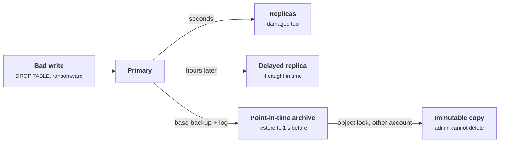
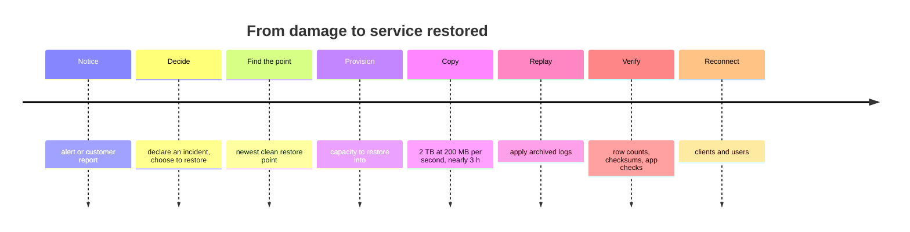

+++
title = 'Backup and disaster recovery'
description = 'Replication protects against losing a machine; only point-in-time copies the attacker cannot touch protect against losing the data. RPO and RTO make that difference measurable.'
question = 'After a deletion, a ransomware attack, or a lost region, how much data do you lose and how long are you down?'
weight = 4
difficulty = 3
prerequisites = ['/notes/systems-design/concurrency-and-consistency/04-replication-and-quorums', '/notes/systems-design/reliability-in-production/03-safe-change']
date = 2026-10-16
lastmod = 2026-10-16
verified = 2026-10-16
+++

## The idea in one minute

Two numbers describe recovery. The **recovery point objective** (RPO) is how
much data you can afford to lose, measured as time: an RPO of five minutes
means that after recovery, at most the last five minutes of writes are gone.
The **recovery time objective** (RTO) is how long the service may be down
before it is back. Every dataset and every service should have both, agreed
with the people who own the business consequences.

Replication and backup answer different threats. A **replica** is a live copy
that follows the primary within seconds. It survives a dead disk, machine, or
data center. It does not survive a bad `DELETE`, a buggy migration, or
ransomware, because it faithfully copies those too. A **backup** is a copy of
the data as it was at some moment in the past. Only backups, kept somewhere the
damage cannot reach and long enough to predate it, survive mistakes and
attacks.

The consequence to act on: **for each dataset, name the copy you would restore
from after a destructive event, prove that an administrator's stolen credentials
cannot delete it, and restore from it on a schedule.** A backup that has never
been restored is a hope.

## A picture



## How it really works

### RPO, RTO, and what sets them

NIST SP 800-34 defines RPO as the point in time to which data must be
recovered, and RTO as the time a system may remain unavailable before the
impact becomes unacceptable. Both are business decisions expressed as
engineering requirements:

| Objective | Set by | Achieved by | Typical evidence |
| --- | --- | --- | --- |
| **RPO** | Cost of lost writes: orders, payments, messages, audit records | Frequency of copies: snapshot interval, log archive delay, replication lag | Measured age of the newest restorable point |
| **RTO** | Cost of downtime per hour | Restore throughput, automation, standby capacity, people | Timed restore and failover drills |

Achieved RTO is almost always longer than the restore of the bytes. It
includes noticing the problem, deciding to restore, finding the right point,
provisioning capacity, restoring, replaying logs, verifying the result, and
reconnecting clients. A 2 TB database restored at 200 MB/s needs nearly three
hours for the copy alone.

Read left to right: the copy of the bytes is one step of eight, and every other step costs time too.



Detection time matters for a third number. If a bug corrupts data on Monday
and someone notices on Thursday, the restore point must be before Monday. So
**backup retention must exceed the time it takes to notice damage**, and for
quiet corruption that can be weeks.

This is the third scenario from the code below: corruption starts on day 3 and is noticed on day 6, and each bar is the window a copy's retention still covers at detection. Only a bar that starts before the red one holds a clean point.

```mermaid {title="Only retention longer than detection time reaches a clean point"}
gantt
  title Corruption unnoticed for 3 days
  dateFormat YYYY-MM-DD HH:mm
  axisFormat Day %e
  section Damage
    Rows corrupted, nobody notices :crit, dmg, 2026-01-03 14:47, 2026-01-06 14:47
  section Restorable at detection
    Hourly snapshots, keep 2 d :hourly, 2026-01-04 14:47, 2026-01-06 14:47
    Nightly snapshots, keep 3 d :nightly, 2026-01-03 14:47, 2026-01-06 14:47
    PITR, keep 7 d :done, pitr, 2026-01-01 00:00, 2026-01-06 14:42
```

### Replication is not backup

| Copy | Survives a dead machine or zone | Survives a bad write or delete | Survives a stolen admin credential | RPO for a disk failure |
| --- | --- | --- | --- | --- |
| **Synchronous replica** | Yes | No | No | Zero |
| **Asynchronous replica** | Yes | No | No | Replication lag |
| **Delayed replica** | Yes | Only if noticed within the delay | No | The delay, if you fail over to it |
| **Snapshots in the same account** | Usually | Yes, back to the oldest kept | No | Snapshot interval |
| **Point-in-time recovery** (base backup + archived log) | Yes | Yes, to any second in retention | Only if the archive is protected | Log archive delay |
| **Immutable or offline copy** | Yes | Yes | Yes | Copy interval |

The table's last two columns as a map: moving right needs history, moving up needs a copy the stolen credentials cannot reach.

```mermaid {title="Which copies survive mistakes, and which survive attackers"}
quadrantChart
  title Copies by threat survived
  x-axis Holds only the present --> Reaches back before the damage
  y-axis Admin can delete it --> Beyond stolen admin credentials
  quadrant-1 Survives mistakes and attackers
  quadrant-2 Protected but no history
  quadrant-3 Availability only
  quadrant-4 Survives mistakes, not attackers
  Synchronous replica: [0.08, 0.1]
  Async replica: [0.15, 0.15]
  Delayed replica: [0.35, 0.2]
  Same-account snapshots: [0.65, 0.12]
  PITR in same account: [0.88, 0.22]
  Immutable or offline copy: [0.65, 0.82]
  Object-locked PITR: [0.9, 0.9]
```

Replication's job is availability; the replication lesson,
[Replication and quorums](/notes/systems-design/concurrency-and-consistency/04-replication-and-quorums/),
covers how replicas stay consistent. Consistency is precisely the problem here:
a replica that is perfectly consistent with a primary that just ran
`DROP TABLE orders` has no orders either. RAID, erasure coding, multi-zone
storage, and cross-region replication all fall in the same category: they keep
the bytes available, including the wrong ones.

A **delayed replica** (MySQL supports a configured replication delay, for
example) is a useful middle ground for operator mistakes: if someone notices a
bad statement within the delay, you stop replication and recover from the
delayed copy. It does nothing for damage noticed after the delay.

### Point-in-time recovery

Databases with a write-ahead log can restore to an arbitrary moment. PostgreSQL's
continuous archiving is the standard example: take a periodic **base backup**
of the data files, and continuously archive every completed WAL segment. To
recover, restore the base backup and replay the archived WAL up to a target
time, transaction, or named restore point, stopping just before the bad
statement.

The archive is filled continuously; recovery replays it from the base backup and stops one step short of the damage.

```mermaid {title="Point-in-time recovery replays the log up to just before the damage"}
sequenceDiagram
  autonumber
  participant DB as Primary database
  participant A as WAL archive
  participant R as Restore host
  DB->>A: periodic base backup of the data files
  loop every completed WAL segment
    DB->>A: archive the segment
  end
  Note over DB: time T, a bad DROP TABLE runs
  R->>A: fetch the base backup
  R->>A: fetch every WAL segment since it
  R->>R: replay WAL up to target time T minus 1 s
  Note over R: stops just before the bad statement
```

PITR gives the best RPO for mistakes (seconds before the damage) and needs:

- an archive delay small enough for your RPO (a WAL segment is archived when it
  fills or when a timeout forces a switch);
- retention covering both the base backup and every log segment since it;
- the base backup schedule tuned to RTO, because replaying a week of log takes
  far longer than replaying an hour.

Writes that arrived after the damage are a separate problem. Restoring to a
moment before a bad migration throws away the good writes since then; teams
recover them by replaying the log selectively or by reconciling from other
systems, and plan the work before they need it.

### 3-2-1 and copies the attacker cannot reach

The **3-2-1 rule**, popularized by photographer Peter Krogh, asks for three
copies of the data, on two different kinds of storage, with one copy off site.
It is a good floor for accidents and site loss. Ransomware changed what "off
site" has to mean: attackers who gain administrator access to the
infrastructure routinely delete snapshots and backups before encrypting
production, because that is what forces payment. CISA's ransomware guide
recommends keeping offline, encrypted backups of critical data and testing
them regularly.

A copy resists a stolen administrator credential when:

- **It is immutable for its retention period.** Object storage with a
  write-once lock, such as S3 Object Lock in compliance mode, refuses deletes
  and overwrites from every user, including the account's root user, until the
  retention date passes. Governance mode, by contrast, can be overridden by a
  user holding a special permission, which an attacker with full admin rights
  may also hold.
- **It lives in a separate security domain.** A different account or
  subscription, with different administrators and credentials, ideally
  federated from a different identity provider. If one set of credentials can
  reach production and the backup vault, it is one copy for this threat.
- **Or it is offline.** Tape or disks physically disconnected cannot be
  reached over a network at all, at the cost of slow restores.
- **Its keys survive the attack.** Backups encrypted with a key in the same
  compromised key management account are deleted in effect when that key is
  scheduled for deletion. Protect the backup keys as carefully as the backups
  (key hierarchies are covered in
  [KMS and key hierarchies](/notes/infrastructure-security/secrets/03-kms-and-key-hierarchies/)).

The stolen credential reaches everything in the production account, including its snapshots and keys; the copy that survives sits in a different account, with its own identity and its own keys.

```mermaid {title="The surviving copy lives in a separate security domain"}
flowchart TB
  n_attacker["Stolen admin credential"]
  subgraph g_prod["Production account"]
    n_db[("Database")]
    n_snaps["Snapshots"]
    n_pkms["Production keys"]
  end
  subgraph g_vault["Backup account"]
    n_locked[("Object Lock compliance")]
    n_vkms["Backup keys"]
    n_idp["Separate identity"]
  end
  n_attacker --> n_db
  n_db --> n_snaps
  n_db --> n_pkms
  n_db --> n_locked
  n_locked --> n_vkms
  n_idp --> n_locked
```

Some extend the rule to 3-2-1-1-0: one of the copies immutable or offline, and
zero errors in the last restore test.

> [!IMPORTANT]
> Backups are also a confidentiality risk. A backup is a complete copy of the
> data outside the access controls of the application that normally guards it.
> Encrypt it, restrict who can restore it, and log every restore.

### Restore testing

The SRE book's chapter on data integrity makes the point bluntly: nobody wants
backups; what they want is restores. Backups fail silently in ordinary ways: a
job that has errored for months with alerts going to an unread mailbox, a
dump tool incompatible with the database version, a missing table added after
the backup configuration was written, an encryption key nobody can find. In
GitLab.com's January 2017 database incident, an operator mistake deleted the
primary's data, the team then discovered that several of its backup mechanisms
had not been working, and it restored from a copy about six hours old.

A restore test that means something:

- **Restores into a clean environment** from the copy you would actually use,
  using the documented procedure, by someone other than its author.
- **Verifies content**, not just that the process exited zero: row counts,
  checksums, application-level checks, the newest record's timestamp compared
  with the RPO.
- **Is timed**, so the measured RTO is a number, not a guess.
- **Runs on a schedule and alerts on failure**, ideally continuously and
  automatically for the most critical datasets.

### Region failover

Losing a region is the case that replication does handle, with its own
engineering. AWS's disaster recovery guidance names four strategies in
increasing cost and decreasing RTO:

| Strategy | Standby in the second region | RTO | RPO |
| --- | --- | --- | --- |
| **Backup and restore** | Backups only | Hours to a day | Backup interval |
| **Pilot light** | Data replicated; compute off or minimal | Tens of minutes to hours | Replication lag |
| **Warm standby** | A scaled-down but running copy | Minutes | Replication lag |
| **Multi-site active/active** | Full capacity serving traffic | Near zero | Near zero to replication lag |

What makes failover work in practice:

- **Capacity.** The surviving region must absorb the failed region's load,
  which means paying for headroom or accepting degradation. If every customer
  fails over at once, cloud capacity in the target region may be contested.
- **Static stability.** The failover path should not depend on the failed
  region or on control-plane actions that may be impaired during a large
  event. Pre-provision what you need; prefer data-plane mechanisms such as
  health-checked DNS or anycast over runbooks that call APIs.
- **One primary at a time.** With asynchronous replication, the old primary may
  still accept writes after the new one is promoted. Fencing, described in
  [Locks, leases, and fencing](/notes/systems-design/concurrency-and-consistency/02-locks-leases-and-fencing/),
  prevents split brain; failing back later is a planned migration, not a
  reversal.
- **The lost writes are real.** Asynchronous cross-region replication means the
  RPO of a region failure equals the replication lag at the moment of failure.
  Measure lag as an SLI and alert on it.
- **Practice.** Failover that has not been exercised recently will find the
  dependency nobody listed: a secret stored in one region, a hard-coded
  endpoint, a certificate, a quota.

A failover in states: the order matters, because promoting the standby before the old primary is fenced is how split brain starts.

```mermaid {title="Fence first, then promote, and fail back as a planned migration"}
stateDiagram-v2
  state "Region A primary" as A
  state "Region A lost" as Lost
  state "Old primary fenced" as Fenced
  state "Region B serving" as B
  state "Planned fail back" as Back
  [*] --> A
  A --> Lost: region failure, writes inside the replication lag are lost
  Lost --> Fenced: revoke access or use fencing tokens
  Fenced --> B: promote standby, health-checked DNS moves traffic
  B --> Back: migration, not a reversal
  Back --> A
  note right of Lost
    Promoting B before fencing A risks two primaries
  end note
```

## Code

The program models a primary database taking writes on a daily cycle for six
days, protected by seven strategies. Each strategy defines which past moments
can still be reconstructed when the damage is detected. Three scenarios
follow: a bad migration noticed in 20 minutes, ransomware run with stolen
administrator credentials, and a bug that silently corrupts rows for three days.
For each, the program restores from the newest clean point and counts the
acknowledged writes lost before the damage.

```python {title="recovery.py"}
"""recovery.py: what each copy of the data is worth after a destructive event.

A primary database takes writes for six days. Each protection strategy keeps
some set of recovery points. When damage is detected we restore from the newest
point that predates the damage and count the acknowledged writes lost.
Standard library only; deterministic; offline.
"""

from __future__ import annotations

import math
from dataclasses import dataclass

DAY = 1440  # minutes


def writes_in(start: int, end: int) -> int:
    """Acknowledged writes in [start, end): a daily cycle, 20 to 180 per minute."""
    return sum(round(100 - 80 * math.cos(2 * math.pi * (m % DAY) / DAY))
               for m in range(start, end))


@dataclass(frozen=True)
class Strategy:
    name: str
    kind: str              # "replica", "snapshots" or "pitr"
    lag: int = 0           # replica delay, or log-archive delay for PITR
    every: int = DAY       # snapshot interval
    retention: int = 0     # how far back points are kept
    deletable: bool = True # can the attacker's credentials delete or encrypt it?


@dataclass(frozen=True)
class Scenario:
    name: str
    damage_at: int         # first bad write, in minutes since start
    detected_at: int
    attacker_has_admin: bool = False


def recovery_points(s: Strategy, sc: Scenario) -> list[int]:
    """Moments whose state can still be reconstructed at detection time."""
    now = sc.detected_at
    if sc.attacker_has_admin and s.deletable:
        return []          # the attacker deleted it or encrypted it with the primary
    if s.kind == "replica":
        return [now - s.lag]  # a replica only holds one moment: now, minus its lag
    if s.kind == "snapshots":
        return [t for t in range(0, now + 1, s.every) if t >= now - s.retention]
    if s.kind == "pitr":   # any minute between the oldest kept base backup and the log tip
        return list(range(max(0, now - s.retention), now - s.lag + 1))
    raise ValueError(s.kind)


def stamp(m: int) -> str:
    return f"day {m // DAY + 1} {m % DAY // 60:02d}:{m % 60:02d}"


STRATEGIES = [
    Strategy("synchronous replica", "replica"),
    Strategy("async replica, 30 s lag", "replica", lag=1),
    Strategy("delayed replica, 4 h", "replica", lag=240),
    Strategy("nightly snapshot, keep 3 d", "snapshots", retention=3 * DAY),
    Strategy("hourly snapshot, keep 2 d", "snapshots", every=60, retention=2 * DAY),
    Strategy("PITR, keep 7 d, same account", "pitr", lag=5, retention=7 * DAY),
    Strategy("PITR, keep 7 d, object lock", "pitr", lag=5, retention=7 * DAY, deletable=False),
]

T = 5 * DAY + 14 * 60 + 47  # day 6, 14:47
SCENARIOS = [
    Scenario("bad migration drops a table, noticed in 20 min", T, T + 20),
    Scenario("ransomware with admin credentials", T, T + 10, attacker_has_admin=True),
    Scenario("bug corrupts rows for 3 days before anyone notices", T - 3 * DAY, T),
]


def main() -> None:
    for sc in SCENARIOS:
        print(f"{sc.name}\n  damage starts {stamp(sc.damage_at)}, detected {stamp(sc.detected_at)};"
              f" {writes_in(sc.damage_at, sc.detected_at):,} writes arrived after it")
        for s in STRATEGIES:
            clean = [p for p in recovery_points(s, sc) if p <= sc.damage_at]
            if not clean:
                print(f"    {s.name:<30} NO CLEAN COPY")
                continue
            point = max(clean)
            lost = writes_in(point, sc.damage_at)
            print(f"    {s.name:<30} restore to {stamp(point)}  lose {lost:>7,} writes")
        print()


if __name__ == "__main__":
    main()
```

Run it with `python3 recovery.py`:

```text
bad migration drops a table, noticed in 20 min
  damage starts day 6 14:47, detected day 6 15:07; 3,149 writes arrived after it
    synchronous replica            NO CLEAN COPY
    async replica, 30 s lag        NO CLEAN COPY
    delayed replica, 4 h           restore to day 6 11:07  lose  38,426 writes
    nightly snapshot, keep 3 d     restore to day 6 00:00  lose 100,843 writes
    hourly snapshot, keep 2 d      restore to day 6 14:00  lose   7,747 writes
    PITR, keep 7 d, same account   restore to day 6 14:47  lose       0 writes
    PITR, keep 7 d, object lock    restore to day 6 14:47  lose       0 writes

ransomware with admin credentials
  damage starts day 6 14:47, detected day 6 14:57; 1,587 writes arrived after it
    synchronous replica            NO CLEAN COPY
    async replica, 30 s lag        NO CLEAN COPY
    delayed replica, 4 h           NO CLEAN COPY
    nightly snapshot, keep 3 d     NO CLEAN COPY
    hourly snapshot, keep 2 d      NO CLEAN COPY
    PITR, keep 7 d, same account   NO CLEAN COPY
    PITR, keep 7 d, object lock    restore to day 6 14:47  lose       0 writes

bug corrupts rows for 3 days before anyone notices
  damage starts day 3 14:47, detected day 6 14:47; 432,000 writes arrived after it
    synchronous replica            NO CLEAN COPY
    async replica, 30 s lag        NO CLEAN COPY
    delayed replica, 4 h           NO CLEAN COPY
    nightly snapshot, keep 3 d     NO CLEAN COPY
    hourly snapshot, keep 2 d      NO CLEAN COPY
    PITR, keep 7 d, same account   restore to day 3 14:47  lose       0 writes
    PITR, keep 7 d, object lock    restore to day 3 14:47  lose       0 writes
```

What the three scenarios show:

- **Bad migration.** Both live replicas applied the drop within a minute, so
  neither has a clean copy. The 4-hour delayed replica, stopped on detection,
  holds data from 11:07 and loses 3 h 40 min of writes. The nightly snapshot
  loses nearly fifteen hours of writes; the hourly one loses 47 minutes. PITR
  restores to the minute before the drop.
- **Ransomware with admin credentials.** Every copy that the stolen credentials
  can delete or encrypt is gone, including the snapshots and the PITR archive
  in the same account. Only the object-locked archive survives, and because it
  is a PITR archive, it loses nothing before the attack.
- **Silent corruption for three days.** Every replica holds corrupted data, and
  every snapshot within the 2-day and 3-day retention windows was taken after
  the corruption began. Only the 7-day PITR archive reaches back far enough.
  Even then, 432,000 writes made since the corruption began have to be
  replayed or reconciled, because restoring to day 3 alone would discard three
  days of mostly good data.

The bad-migration scenario as bars; the two live replicas are missing because they had no clean copy at all.

```mermaid {title="After a bad migration, the copy decides how many writes are lost"}
xychart-beta
  title "Writes lost after the bad migration"
  x-axis ["Delayed replica 4 h", "Nightly snapshot", "Hourly snapshot", "PITR"]
  y-axis "Acknowledged writes lost" 0 --> 110000
  bar [38426, 100843, 7747, 0]
```

## Where it breaks

- **The model is generous.** It assumes every recovery point restores
  perfectly, that the log archive has no gaps, and that restoring takes no time.
  Real restores fail for mundane reasons, and an hour of RPO can come with a
  day of RTO. The restore test is what turns these numbers into evidence.
- **Immutability has edges.** Object lock protects objects, not the account:
  an attacker who cannot delete backups may still cut off access, delete the
  encryption key, or wait out a short retention period. Retention must outlast
  both detection time and an attacker's patience.
- **Dependencies are data too.** A restored database is useless without the
  schema version its application expects, the secrets to connect to it, the
  configuration, and the identity provider that lets anyone log in to restore
  it. Back up and test the full recovery path, not one store.
- **Data outside the database.** Object stores, search indexes, queues, caches
  that are actually primary storage, and SaaS systems each need their own
  answer. A consistent restore across several stores, to the same moment, is
  hard and needs planning.
- **Backups preserve what should be gone.** Data subject to deletion requests
  or retention limits persists in backups. Know how long backups keep personal
  data and how deletion is honored, for example by expiring backups on a fixed
  schedule or encrypting per-tenant data with keys that can be destroyed.

## Remember this

- RPO is how much data you lose; RTO is how long you are down; agree both per dataset.
- Replicas copy deletes, corruption, and ransomware; they protect availability, not data.
- Point-in-time recovery restores to just before the damage, within its retention.
- At least one copy must be immutable or offline, in a separate security domain.
- Retention must exceed how long damage can go unnoticed.
- An untested backup is a hope; restore on a schedule, verify content, time it.

## Try it

1. In `recovery.py`, change the corruption scenario so it is detected after 36
   hours. Which strategies now have a clean copy, and what do they lose?
2. Add a strategy "daily copy to tape, kept 30 days, offline" (`deletable=False`)
   and run all three scenarios. Where does it beat the immutable PITR archive,
   and where does it lose?
3. Add an RTO estimate to each strategy: a fixed provisioning time plus restore
   at 200 MB/s for a 2 TB database, plus log replay at 10 times real time from
   the base backup. Which strategy has the best RPO but a poor RTO?
4. For one system you operate, write down the copy you would restore from
   after ransomware, who can delete it, how old the newest restorable point is,
   and when it was last restored.

## Check yourself

1. Why does a synchronous replica, with an RPO of zero for a disk failure, have
   no useful RPO for an accidental `DELETE`?

   
   It applies every write the primary commits, including the delete, at the same
   moment. After the mistake, the replica is a perfect copy of the damaged data.
   RPO is only meaningful for a threat; replication sets it for losing a machine,
   not for losing data through a valid but wrong write.
   

2. Snapshots are taken hourly and kept for two days. Corruption started three
   days before detection. What can you restore?

   
   Nothing clean. Every snapshot still kept was taken after the corruption began.
   Retention must exceed the time it takes to notice damage, and you need another
   copy (a longer-retention archive or point-in-time recovery) or a repair
   procedure that fixes the corrupted rows in place.
   

3. What makes a backup survive an attacker who holds the cloud account's
   administrator credentials?

   
   It must be beyond those credentials: locked immutable for its retention period
   in a mode no user can override (such as S3 Object Lock compliance mode), held
   in a separate account with different administrators and identity, or kept
   offline. The keys that decrypt it must also be out of the attacker's reach.
   

4. Why is achieved RTO usually much longer than the time to copy the data back?

   
   Recovery includes detection, the decision to restore, choosing the restore
   point, provisioning capacity, copying, replaying logs, verifying the data,
   and reconnecting applications and users. Each step can take longer than the
   copy, especially if the procedure has not been rehearsed.
   

5. During a region failover with asynchronous replication, what must happen to
   the old primary, and why?

   
   It must be fenced so it can no longer accept writes, for example by revoking
   its access or using fencing tokens that storage checks. Otherwise, if it is
   still reachable by some clients, both regions accept writes and the data
   diverges (split brain), which is far harder to repair than the replication
   lag lost in the failover.
   

## Sources

- M. Swanson et al., [NIST SP 800-34 Rev. 1: Contingency Planning Guide for Federal Information Systems](https://csrc.nist.gov/pubs/sp/800/34/r1/upd1/final), NIST, May 2010 (updated November 2010).
- B. Beyer et al. (eds.), [Site Reliability Engineering, chapter 26: Data Integrity: What You Read Is What You Wrote](https://sre.google/sre-book/data-integrity/), O'Reilly, 2016.
- PostgreSQL Global Development Group, [Continuous Archiving and Point-in-Time Recovery (PITR)](https://www.postgresql.org/docs/current/continuous-archiving.html), documentation.
- Oracle, [MySQL 8.4 Reference Manual: Delayed Replication](https://dev.mysql.com/doc/refman/8.4/en/replication-delayed.html).
- Amazon Web Services, [Locking objects with Object Lock](https://docs.aws.amazon.com/AmazonS3/latest/userguide/object-lock.html), Amazon S3 User Guide.
- Amazon Web Services, [Disaster Recovery of Workloads on AWS: Recovery in the Cloud](https://docs.aws.amazon.com/whitepapers/latest/disaster-recovery-workloads-on-aws/disaster-recovery-workloads-on-aws.html), whitepaper.
- B. Weiss, M. Furr, [Static stability using Availability Zones](https://aws.amazon.com/builders-library/static-stability-using-availability-zones/), Amazon Builders' Library.
- CISA, [#StopRansomware Guide](https://www.cisa.gov/stopransomware/ransomware-guide), 2023.
- GitLab, [Postmortem of database outage of January 31](https://about.gitlab.com/blog/2017/02/10/postmortem-of-database-outage-of-january-31/), February 2017.
