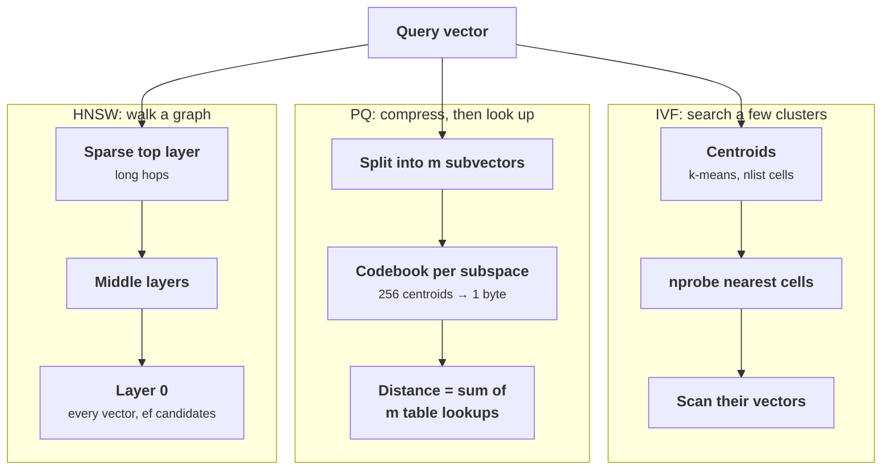

+++
title = 'Embeddings and ANN search'
description = 'An embedding turns text into a vector whose distance tracks relevance. Exact search over millions of vectors is a full scan, so production systems use approximate indexes (IVF, product quantization, HNSW) that trade recall for latency and memory in ways you can measure and tune.'
question = 'How does vector search find neighbors among millions of embeddings, and what do you give up for speed?'
weight = 1
difficulty = 4
prerequisites = ['/notes/systems-design/model-interfaces/01-tokens-context-and-cost']
date = 2026-10-30T11:05:00Z
lastmod = 2026-10-30T11:05:00Z
verified = 2026-10-30
+++

## The idea in one minute

An **embedding model** maps a passage to a fixed-length vector, trained so that
a query and the passages that answer it land close together. Searching is then
a nearest-neighbor problem. Exact search compares the query with every vector:
at 100 million 768-dimensional vectors that is 77 billion multiply-adds and 307
GB of memory read per query.

**Approximate nearest-neighbor (ANN)** indexes avoid the full scan. **IVF**
clusters the vectors and searches only the clusters nearest the query. **Product
[quantization](/notes/inference-engineering/making-it-cheaper/01-quantization/) (PQ)** compresses each vector to a few dozen bytes and computes
distances from lookup tables. **HNSW** builds a layered proximity graph and
walks it greedily toward the query. Each has a knob (`nprobe`, code size,
`ef_search`) that trades **recall** (the share of true nearest neighbors
returned) for work per query, and each has a memory footprint that decides how
many machines you need. The consequence to act on: **choose the index from a
recall target and a memory budget, measure recall against exact search on your
own vectors, and tune the knob, never assume the defaults**.

## A picture



IVF and PQ are usually combined (IVF-PQ): cells pick where to look, codes make
each look cheap. HNSW keeps full vectors and adds graph links.

## How it really works

### Embeddings in one page

Retrieval embeddings are usually **bi-encoders**: one transformer encodes the
query, the same or a sibling encodes each passage, independently, and relevance
is the dot product or cosine of the two vectors. Because passages are encoded
without seeing the query, they can be embedded once at ingestion. The model is
trained contrastively on pairs of queries and relevant passages, so "close"
means "relevant in the training data's sense". Choose one by measuring on your
own queries; leaderboards such as MTEB rank general ability across many tasks
and are a shortlist, not a decision.

Facts that matter to the system:

- **Normalize, then the metrics agree.** For unit vectors, cosine similarity,
  dot product, and Euclidean distance give the same ranking
  (`‖a − b‖² = 2 − 2 a·b`). Use whatever the model was trained with.
- **Dimensions are storage.** 768 float32 dimensions are 3 KB per vector.
  Matryoshka-trained models let you truncate to a prefix of the dimensions with
  a modest quality loss; scalar quantization to int8 cuts storage 4×.
- **The model and the index are versioned together.** Vectors from two models
  are not comparable. Changing the embedding model means re-embedding the corpus
  and rebuilding the index, so record the model version with every vector.

### The cost of exact search

```text
100 M vectors × 768 dims × 4 bytes       = 307 GB of float32
one query, brute force                    = 7.7 × 10^10 multiply-adds
memory read per query                     = 307 GB
  at ~3.35 TB/s (one H100's HBM)          ≈ 92 ms, if it all fit, which it does not
  at ~200 GB/s (a CPU socket)             ≈ 1.5 s
```

Brute force is fine up to perhaps a few hundred thousand vectors, and it is the
ground truth you measure every ANN index against.

### IVF: inverted file

Train k-means on a sample to get `nlist` centroids. Assign each vector to its
nearest centroid, storing a list per centroid. At query time, compare the query
with all centroids, pick the `nprobe` nearest, and scan only their lists. Work
per query is about `nlist + nprobe × N / nlist` distance computations. The Faiss
documentation suggests `nlist` on the order of 4√N to 16√N; for 100 million
vectors that is tens of thousands of cells, with 65,536 a common choice.

The failure mode is the **boundary**: a query near the edge of its cell has true
neighbors in the next cell. Raising `nprobe` fixes it at linear cost. In the
program, `nprobe = 1` finds 94% of the true top 10 on tightly clustered data and
only 54% on diffuse data, because diffuse data puts more neighbors across
boundaries.

### PQ: product quantization

Jégou, Douze, and Schmid's **product quantization** splits each *D*-dimensional
vector into *m* subvectors and runs k-means separately in each subspace,
usually with 256 centroids so each subvector becomes one byte. A 768-dimensional
float32 vector (3,072 bytes) with `m = 96` becomes 96 bytes, a 32× reduction.

Search uses **asymmetric distance computation**: the query stays uncompressed.
For each subspace, compute the distance from the query's subvector to all 256
centroids once (a table of `m × 256` entries); then the distance to any stored
vector is the sum of *m* table lookups indexed by its code. In IVF-PQ the codes
encode the **residual** (vector minus its cell centroid), which is smaller and
quantizes better.

Compression costs recall, because distances are approximate and close
candidates get reordered. The standard fix is to **rerank**: take the top few
dozen or hundred by PQ distance and recompute exact distances from full vectors
kept on SSD or in a cheaper tier. In the program, 4-byte codes alone reach only
54–64% recall@10; reranking the top 40 by exact distance lifts it to 87–99%.

### HNSW: a navigable small-world graph

Malkov and Yashunin's **HNSW** links each vector to about `M` near neighbors
(`2M` on the bottom layer). Each vector is also assigned a random maximum layer
with exponentially decreasing probability, so upper layers are sparse and act
like express lanes. A search starts at the top, greedily moves to the closest
neighbor until no neighbor is closer, drops a layer, and repeats. On layer 0 it
keeps a candidate list of size `ef_search` and returns the best *k*.

| Knob | Effect |
| --- | --- |
| `M` | More links: higher recall, more memory (about `2M × 4` bytes per vector at layer 0), slower build |
| `ef_construction` | Larger candidate list while inserting: better graph, slower build |
| `ef_search` | Larger candidate list per query: higher recall, more distance computations; set per query |

The paper's **neighbor-selection heuristic** matters on clustered data: a
candidate is linked only if it is closer to the new node than to any neighbor
already chosen. That keeps some links pointing between clusters instead of
spending all `M` on one dense cluster. In the program, on clustered data,
linking simply the closest neighbors reaches 81% recall at `ef = 20`; the
heuristic reaches 99.6% at similar cost. On diffuse data the two are nearly
equal.

HNSW's costs are memory and mutation. It needs full vectors in RAM plus links,
inserts take a graph search each, and deletes are usually tombstones followed by
periodic rebuilds. For indexes larger than RAM, **DiskANN** (Vamana graph) keeps
compressed vectors in memory and the graph and full vectors on SSD.

### Sizing at 100 million vectors

| Index | Bytes per vector | Memory for 100 M | Typical role |
| --- | --- | --- | --- |
| Flat float32, 768 d | 3,072 | 307 GB | Ground truth, small corpora |
| Flat float16 | 1,536 | 154 GB | Same, halved |
| HNSW, M = 32, float32 | 3,072 + ~256 links | ~333 GB | Highest recall at low latency, if RAM allows |
| HNSW over int8 vectors | 768 + ~256 | ~102 GB | Common compromise |
| IVF-PQ, m = 96, 8-bit codes + 8-byte ID | ~104 | ~10.4 GB | Billion-scale, rerank from SSD |

These counts exclude allocator overhead, metadata, and replicas, which can add
a large fraction. At `nlist = 65,536` and `nprobe = 64`, IVF-PQ scans about
98,000 codes per query (64/65,536 of 100 million), each costing 96 table
lookups: about 9.4 million additions, milliseconds on one core.

### Filters

Real queries carry filters: tenant, permissions, date, language. **Post-filtering**
(search, then drop disallowed results) can return too few results when the
filter is selective: if 1% of vectors match, the top 100 may contain one.
**Pre-filtering** (restrict the candidates, then search) is exact but can break
graph navigation when few nodes qualify. Engines handle this with
filter-aware traversal, separate indexes per large tenant, or falling back to
brute force over the filtered set when it is small. Permission filters must be
applied inside the search, never only after it, or a leak becomes a recall bug
and a recall bug becomes a leak.

## Code

The program builds a flat index, IVF-Flat, IVF-PQ (8 subvectors of 4 bits) with
and without exact reranking, and HNSW with and without the neighbor heuristic,
on 4,000 vectors in 24 dimensions. It reports recall@10 against brute force and
distance computations per query, on tightly clustered and on diffuse data. Pure
Python limits the size; the ratios carry over, the absolute numbers do not.

```python {title="ann.py"}
"""ann.py: exact search versus IVF, IVF-PQ and HNSW on the same vectors.

4,000 vectors in 24 dimensions drawn around 100 centers, once tightly clustered and
once diffuse; 200 queries each; ground truth by brute force.
For each index the program reports recall@10, distance computations per query
(the cost that matters on a CPU) and bytes per vector. Pure Python, so the sizes are
small; the shape of each tradeoff is what carries over. Standard library only.
"""

from __future__ import annotations

import heapq
import math
import random
from bisect import insort

DIM, N, NQ, K = 24, 4000, 200, 10
Vec = list[float]


def dist(a: Vec, b: Vec) -> float:
    return sum((x - y) * (x - y) for x, y in zip(a, b))


def make_data(rng: random.Random, spread: float) -> tuple[list[Vec], list[Vec]]:
    centers = [[rng.gauss(0, 1) for _ in range(DIM)] for _ in range(100)]

    def point() -> Vec:
        c = rng.choice(centers)
        return [x + rng.gauss(0, spread) for x in c]
    return [point() for _ in range(N)], [point() for _ in range(NQ)]


def kmeans(data: list[Vec], k: int, rng: random.Random, iters: int = 8) -> list[Vec]:
    cents = [list(v) for v in rng.sample(data, k)]
    for _ in range(iters):
        sums = [[0.0] * len(data[0]) for _ in range(k)]
        counts = [0] * k
        for v in data:
            j = min(range(k), key=lambda c: dist(v, cents[c]))
            counts[j] += 1
            sums[j] = [s + x for s, x in zip(sums[j], v)]
        for j in range(k):
            if counts[j]:
                cents[j] = [s / counts[j] for s in sums[j]]
    return cents


def recall(found: list[int], truth: list[int]) -> float:
    return len(set(found) & set(truth)) / len(truth)


class IVF:
    """Inverted file: k-means cells; search only the nprobe nearest cells."""

    def __init__(self, data: list[Vec], nlist: int, rng: random.Random):
        self.data, self.cents = data, kmeans(data, nlist, rng)
        self.lists: list[list[int]] = [[] for _ in range(nlist)]
        for i, v in enumerate(data):
            self.lists[min(range(nlist), key=lambda c: dist(v, self.cents[c]))].append(i)

    def cells(self, q: Vec, nprobe: int) -> list[int]:
        return sorted(range(len(self.cents)), key=lambda c: dist(q, self.cents[c]))[:nprobe]

    def search(self, q: Vec, nprobe: int) -> tuple[list[int], int]:
        cand = [i for c in self.cells(q, nprobe) for i in self.lists[c]]
        top = heapq.nsmallest(K, cand, key=lambda i: dist(q, self.data[i]))
        return top, len(self.cents) + len(cand)


class IVFPQ(IVF):
    """IVF whose vectors are stored as product-quantized codes of the residuals."""

    def __init__(self, data: list[Vec], nlist: int, m: int, ks: int, rng: random.Random):
        super().__init__(data, nlist, rng)
        self.m, self.sub = m, DIM // m
        owner = {i: c for c, lst in enumerate(self.lists) for i in lst}
        resid = [[x - y for x, y in zip(v, self.cents[owner[i]])] for i, v in enumerate(data)]
        self.books = [kmeans([r[j * self.sub:(j + 1) * self.sub] for r in resid], ks, rng, 6)
                      for j in range(m)]
        self.codes = [[min(range(ks), key=lambda c: dist(r[j * self.sub:(j + 1) * self.sub],
                                                          self.books[j][c]))
                       for j in range(m)] for r in resid]

    def search_pq(self, q: Vec, nprobe: int, rerank: int = 0) -> tuple[list[int], int]:
        scored, comps = [], len(self.cents)
        for c in self.cells(q, nprobe):
            r = [x - y for x, y in zip(q, self.cents[c])]
            # Asymmetric distance: one small table per subspace, then lookups only.
            table = [[dist(r[j * self.sub:(j + 1) * self.sub], cw) for cw in self.books[j]]
                     for j in range(self.m)]
            comps += self.m * len(self.books[0]) * self.sub / DIM   # in full-vector units
            for i in self.lists[c]:
                scored.append((sum(table[j][code] for j, code in enumerate(self.codes[i])), i))
        approx = [i for _, i in heapq.nsmallest(max(K, rerank), scored)]
        if rerank:
            comps += len(approx)
            approx = heapq.nsmallest(K, approx, key=lambda i: dist(q, self.data[i]))
        return approx[:K], int(comps)


class HNSW:
    """Hierarchical navigable small world graph (Malkov and Yashunin), simplified pruning."""

    def __init__(self, data: list[Vec], m: int, ef_construction: int, rng: random.Random,
                 heuristic: bool = True):
        self.data, self.m, self.m0, self.heuristic = data, m, 2 * m, heuristic
        self.graph: list[dict[int, list[int]]] = []     # level -> node -> neighbors
        self.entry, self.top = -1, -1
        ml = 1 / math.log(m)
        for i in range(len(data)):
            self.insert(i, int(-math.log(1 - rng.random()) * ml), ef_construction)

    def layer_search(self, q: Vec, entries: list[int], ef: int, level: int) -> list[tuple[float, int]]:
        seen = set(entries)
        cand = [(dist(q, self.data[e]), e) for e in entries]
        self.comps += len(cand)
        heapq.heapify(cand)
        best = sorted(cand)
        while cand:
            d, n = heapq.heappop(cand)
            if d > best[-1][0] and len(best) >= ef:
                break
            for nb in self.graph[level].get(n, []):
                if nb in seen:
                    continue
                seen.add(nb)
                dn = dist(q, self.data[nb])
                self.comps += 1
                if len(best) < ef or dn < best[-1][0]:
                    heapq.heappush(cand, (dn, nb))
                    insort(best, (dn, nb))
                    if len(best) > ef:
                        best.pop()
        return best

    def select(self, base: int, cands: list[int], cap: int) -> list[int]:
        """Closest-first; the heuristic skips a candidate that is nearer to an already
        chosen neighbor than to the base node, which keeps links between clusters."""
        ordered = sorted(cands, key=lambda x: dist(self.data[base], self.data[x]))
        if not self.heuristic:
            return ordered[:cap]
        out: list[int] = []
        for c in ordered:
            dc = dist(self.data[base], self.data[c])
            if all(dc < dist(self.data[c], self.data[r]) for r in out):
                out.append(c)
                if len(out) == cap:
                    break
        return out

    def insert(self, i: int, level: int, ef: int) -> None:
        self.comps = 0
        while len(self.graph) <= level:
            self.graph.append({})
        for l in range(level + 1):
            self.graph[l][i] = []
        if self.entry < 0:
            self.entry, self.top = i, level
            return
        q, ep = self.data[i], [self.entry]
        for l in range(self.top, level, -1):
            ep = [self.layer_search(q, ep, 1, l)[0][1]]
        for l in range(min(level, self.top), -1, -1):
            found = self.layer_search(q, ep, ef, l)
            cap = self.m0 if l == 0 else self.m
            self.graph[l][i] = self.select(i, [n for _, n in found], self.m)
            for n in self.graph[l][i]:
                nbrs = self.graph[l][n] + [i]
                if len(nbrs) > cap:
                    nbrs = self.select(n, nbrs, cap)
                self.graph[l][n] = nbrs
            ep = [n for _, n in found]
        if level > self.top:
            self.entry, self.top = i, level

    def search(self, q: Vec, ef: int) -> tuple[list[int], int]:
        self.comps, ep = 0, [self.entry]
        for l in range(self.top, 0, -1):
            ep = [self.layer_search(q, ep, 1, l)[0][1]]
        found = self.layer_search(q, ep, max(ef, K), 0)
        return [n for _, n in found[:K]], self.comps


def evaluate(spread: float) -> list[tuple[str, float, float, float]]:
    rng = random.Random(5)
    data, queries = make_data(rng, spread)
    truth = [heapq.nsmallest(K, range(N), key=lambda i: dist(q, data[i])) for q in queries]
    rows = [("flat (exact)", 1.0, float(N), DIM * 4)]

    def report(name: str, fn, bytes_per: float) -> None:
        r = c = 0.0
        for q, t in zip(queries, truth):
            found, comps = fn(q)
            r += recall(found, t)
            c += comps
        rows.append((name, r / NQ, c / NQ, bytes_per))

    ivf = IVF(data, 64, rng)
    for nprobe in (1, 4, 16):
        report(f"IVF-Flat nlist=64 nprobe={nprobe}", lambda q, p=nprobe: ivf.search(q, p), DIM * 4 + 4)
    pq = IVFPQ(data, 64, 8, 16, rng)
    report("IVF-PQ 8x4-bit nprobe=16", lambda q: pq.search_pq(q, 16), 4 + 4)
    report("  + exact rerank of top 40", lambda q: pq.search_pq(q, 16, 40), 4 + 4)
    for heuristic in (False, True):
        hnsw = HNSW(data, 8, 64, random.Random(9), heuristic)
        links = sum(len(v) for lvl in hnsw.graph for v in lvl.values()) * 4 / N
        tag = "heuristic" if heuristic else "closest"
        for ef in (20, 80):
            report(f"HNSW M=8 {tag} ef={ef}", lambda q, e=ef: hnsw.search(q, e), DIM * 4 + links)
    return rows


def main() -> None:
    tight, diffuse = evaluate(0.6), evaluate(1.0)
    print(f"{N} vectors, {DIM} dims, {NQ} queries, recall@{K} against brute force")
    print(f"{'':<32}{'-- clustered --':>20}{'--- diffuse ---':>20}")
    print(f"  {'index':<30}{'recall':>9}{'dist/q':>11}{'recall':>9}{'dist/q':>11}{'bytes/vec':>11}")
    for a, b in zip(tight, diffuse):
        print(f"  {a[0]:<30}{a[1]:>9.3f}{a[2]:>11,.0f}{b[1]:>9.3f}{b[2]:>11,.0f}{b[3]:>11.0f}")


if __name__ == "__main__":
    main()
```

Run it with `python3 ann.py` (about 30 seconds):

```text
4000 vectors, 24 dims, 200 queries, recall@10 against brute force
                                     -- clustered --     --- diffuse ---
  index                            recall     dist/q   recall     dist/q  bytes/vec
  flat (exact)                      1.000      4,000    1.000      4,000         96
  IVF-Flat nlist=64 nprobe=1        0.936        152    0.544        135        100
  IVF-Flat nlist=64 nprobe=4        0.993        431    0.790        344        100
  IVF-Flat nlist=64 nprobe=16       0.999      1,444    0.959      1,187        100
  IVF-PQ 8x4-bit nprobe=16          0.642        320    0.540        320          8
    + exact rerank of top 40        0.994        360    0.875        360          8
  HNSW M=8 closest ef=20            0.806        118    0.889        211        149
  HNSW M=8 closest ef=80            0.928        318    0.984        576        149
  HNSW M=8 heuristic ef=20          0.996        156    0.893        230        143
  HNSW M=8 heuristic ef=80          1.000        471    0.989        646        143
```

The approximate indexes here do between a third and a thirtieth of the work of
brute force. IVF's recall depends heavily on the data's structure, PQ alone
loses a third or more of the true neighbors and reranking recovers most of them,
and HNSW reaches 98–100% recall for about 470–650 distance computations once
`ef_search` is large enough. The cheapest setting that meets your recall target
depends on your vectors, which is the reason to run this measurement on them.

## Where it breaks

- **ANN recall is not relevance.** Recall here means agreement with exact search
  in embedding space. If the embedding ranks the wrong passage first, a perfect
  index returns the wrong passage perfectly. Measure both; the next lessons do.
- **Distributions drift.** IVF centroids and PQ codebooks are trained on a
  sample. If new documents differ (a new product line, a new language), cells
  become unbalanced and recall falls. Retrain periodically and monitor recall on
  a held-out query set.
- **Updates and deletes are expensive.** HNSW inserts cost a search each and
  deletes leave tombstones; IVF lists grow unevenly. Plan rebuilds, and for
  heavy churn consider segment-based indexes that merge in the background.
- **Low dimensions flatter the program.** In 24 dimensions everything is easier
  than in 768. Real embeddings need larger `ef_search` or `nprobe` for the same
  recall, and PQ needs more subvectors.
- **Tail latency follows the hardest queries.** Queries in sparse regions of the
  space visit more nodes or cells. Look at p99 latency and recall, not only the
  averages.

## Remember this

- Exact search reads every vector; at 100 M × 768 floats that is 307 GB per query.
- IVF searches `nprobe` of `nlist` cells; boundaries cost recall.
- PQ shrinks vectors 32× or more; rerank the top candidates with exact distances.
- HNSW gives high recall at low latency, paid for in RAM and slow updates.
- Tune `nprobe` or `ef_search` from a measured recall target on your data.
- Filters belong inside the search; post-filtering starves selective queries.

## Try it

1. Run `ann.py`. Change `nlist` from 64 to 16 and to 256. How do recall and
   distance computations at `nprobe = 4` change, and why?
2. Change PQ to 12 subvectors of 2 dimensions each. What happens to recall
   without reranking, and to bytes per vector?
3. Raise HNSW `M` from 8 to 16. What does recall at `ef = 20` gain, and what does
   it cost in bytes per vector and build time?
4. Size an index for 500 million 1,024-dimensional vectors under a 256 GB RAM
   budget per node. Which index type fits on how many nodes?

## Check yourself

1. Why do cosine similarity, dot product, and Euclidean distance rank unit
   vectors identically?

   
   For unit vectors, cosine equals the dot product, and the squared Euclidean
   distance is 2 − 2 × dot product, a decreasing function of it. Ranking by any
   of them gives the same order.
   

2. A query's true nearest neighbor sits just across the boundary of its IVF
   cell. What happens at `nprobe = 1`, and what are the fixes?

   
   The neighbor is never scanned and is missed. Raising `nprobe` scans adjacent
   cells at linear cost; more training data or a different `nlist` changes the
   boundaries; some systems assign boundary vectors to several cells.
   

3. How does asymmetric distance computation make PQ search fast?

   
   For each query, compute the distance from each query subvector to every
   centroid of its subspace once, giving m small tables. The distance to any
   stored vector is then the sum of m lookups indexed by its code bytes, with no
   floating-point work on the full vector.
   

4. What does HNSW's neighbor-selection heuristic do, and when does it matter?

   
   It links a candidate only if the candidate is closer to the new node than to
   any neighbor already selected. That spreads links in different directions and
   keeps connections between clusters. It matters on clustered data, where
   linking only the closest points spends every link inside one cluster and
   searches get stuck.
   

5. 100 million vectors, 768 dimensions, a 64 GB RAM budget. Which index types
   fit?

   
   Flat float32 (307 GB) and HNSW over float32 or int8 vectors (over 100 GB) do
   not. IVF-PQ with 96-byte codes (about 10 GB plus overhead) fits, with full
   vectors kept on SSD for reranking. DiskANN-style indexes are the other option.
   

## Sources

- Y. A. Malkov, D. A. Yashunin, [Efficient and Robust Approximate Nearest Neighbor Search Using Hierarchical Navigable Small World Graphs](https://arxiv.org/abs/1603.09320), *IEEE TPAMI* 42(4), 2020.
- H. Jégou, M. Douze, C. Schmid, "Product Quantization for Nearest Neighbor Search", *IEEE TPAMI* 33(1), 2011.
- J. Johnson, M. Douze, H. Jégou, [Billion-scale similarity search with GPUs](https://arxiv.org/abs/1702.08734), *IEEE Transactions on Big Data*, 2019.
- M. Douze et al., [The Faiss library](https://arxiv.org/abs/2401.08281), 2024; Faiss wiki, [Guidelines to choose an index](https://github.com/facebookresearch/faiss/wiki/Guidelines-to-choose-an-index).
- S. J. Subramanya et al., "DiskANN: Fast Accurate Billion-point Nearest Neighbor Search on a Single Node", NeurIPS 2019.
- R. Guo et al., [Accelerating Large-Scale Inference with Anisotropic Vector Quantization](https://arxiv.org/abs/1908.10396), ICML 2020 (ScaNN).
- M. Aumüller, E. Bernhardsson, A. Faithfull, [ANN-Benchmarks: A benchmarking tool for approximate nearest neighbor algorithms](https://arxiv.org/abs/1807.05614), *Information Systems* 87, 2020.
- A. Kusupati et al., [Matryoshka Representation Learning](https://arxiv.org/abs/2205.13147), NeurIPS 2022.
- N. Muennighoff et al., [MTEB: Massive Text Embedding Benchmark](https://arxiv.org/abs/2210.07316), EACL 2023.
- V. Karpukhin et al., [Dense Passage Retrieval for Open-Domain Question Answering](https://arxiv.org/abs/2004.04906), EMNLP 2020.
