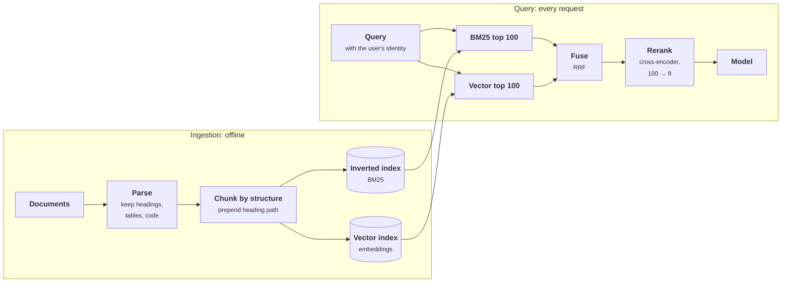

+++
title = 'Chunking and hybrid search'
description = 'Retrieval quality is set before the index: chunks must make sense alone and carry their context. Keyword search finds exact terms, vector search finds paraphrases, fusion combines them without comparable scores, and a cross-encoder reranker fixes the order of the few that matter.'
question = 'How should documents be cut into chunks, and how do keyword search, vector search, fusion, and reranking fit together?'
weight = 2
difficulty = 3
prerequisites = ['/notes/systems-design/retrieval/01-embeddings-and-ann-search']
date = 2026-10-30T11:10:00Z
lastmod = 2026-10-30T11:10:00Z
verified = 2026-10-30
+++

## The idea in one minute

A retriever returns chunks, and the model sees each chunk alone. A chunk that
splits an answer in half, or that lost the heading telling you which policy it
belongs to, cannot be rescued by any search algorithm. **Chunk along the
document's own structure and carry the heading path with each chunk.**

Then search two ways. **Keyword search** (BM25) matches exact terms and is
strong on identifiers, names, error codes, and versions. **Vector search**
matches meaning and is strong on paraphrase ("dads" for "fathers", "stipend"
for "allowance"). Each fails where the other succeeds, so run both and merge
the rankings with **reciprocal rank fusion**, which needs no score calibration.
Finally, a **reranker** reads the query and each of the top candidates
together and reorders them; it is too slow for the whole corpus and fine for a
hundred candidates. The consequence to act on: **hybrid retrieval plus a
reranker over structure-aware chunks is the baseline to beat**, and the
cheapest improvements are usually in chunking, not in the model.

## A picture



Both indexes carry the same chunk IDs and the same access-control labels, and
both searches apply the user's permission filter.

## How it really works

### Chunking

The chunk is the unit of retrieval and of citation. Its size trades two
failures: too small and it lacks the context to be understood or matched; too
large and its embedding averages several topics, it wastes context budget, and
it dilutes the passage the model needs.

| Strategy | How | Good for | Weakness |
| --- | --- | --- | --- |
| Fixed windows | Every *n* tokens, often with 10–20% overlap | Unstructured text, a quick baseline | Cuts sentences and sections; loses headings |
| Recursive splitting | Split on headings, then paragraphs, then sentences until under a size limit | Most documents | Needs parseable structure |
| **Structure-aware** | One chunk per section or subsection, with its heading path | Handbooks, docs, policies, code | Uneven sizes; very long sections need splitting |
| Parent–child | Index small chunks, return their larger parent section | Precise matching with enough context | Two sizes to tune |
| Contextual | Prepend a generated sentence situating the chunk in its document | Chunks that are ambiguous alone | One model call per chunk at ingestion |

Keep the **heading path** ("Purchasing > Travel: …") in the chunk text that is
embedded and indexed. A sentence that says "Trips over 5,000 dollars need
sign-off" means nothing to a reader who does not know which policy it is in,
and the same holds for an embedding model. Anthropic's write-up on **contextual
retrieval** reported that prepending generated context to each chunk cut
top-20 retrieval failures by 35% with embeddings alone, 49% when combined with
contextual BM25, and 67% with reranking added, on their evaluation sets.

Parsing comes first. A table flattened into one line of text, a PDF with
two-column layout read across the columns, or a scanned page with no text layer
produces chunks no retriever can use. Inspect parsed output on real documents
before tuning anything downstream.

### Keyword search: BM25

BM25 scores a chunk *d* for a query *q* by summing over query terms *t*:

```text
score(d, q) = Σ  IDF(t) × f(t, d) × (k1 + 1) / ( f(t, d) + k1 × (1 − b + b × |d| / avgdl) )

IDF(t) = ln(1 + (N − n_t + 0.5) / (n_t + 0.5))
```

where *f(t, d)* is the term's frequency in the chunk, *|d|* the chunk length,
*avgdl* the average length, *N* the number of chunks, and *n_t* the number
containing *t*. `k1` (typically 1.2–2.0) saturates repeated terms; `b`
(typically 0.75) normalizes for length. Rare terms get high IDF, which is
exactly why BM25 finds `E4012` or `GlobalConnect 6.1` reliably: an identifier
that appears in one chunk dominates that chunk's score.

BM25 cannot match a paraphrase. "How long is parental leave for new dads"
shares only "leave" with a chunk about "paternity leave for fathers". On the
BEIR benchmark, BM25 remained a strong zero-shot baseline that many dense
retrievers of the time failed to beat outside their training domain, which is
a reason to keep it rather than replace it.

### Vector search

Embedding similarity matches meaning, so paraphrases and synonyms work. It is
weaker on terms the embedding model saw rarely in training (product names,
codes, version numbers, new jargon), which it maps to vectors that carry
little of their identity, so "E4011" and "E4013" can look nearly the same. It
also cannot express "must contain this exact term". **Learned sparse** models
such as SPLADE sit between the two: they produce term weights like BM25 but
expand terms with related vocabulary, and they run on an inverted index.

### Fusion

BM25 scores and cosine similarities live on different scales, so adding them
needs normalization and tuning. **Reciprocal rank fusion** sidesteps this by
using ranks only:

```text
RRF(d) = Σ over rankings r   1 / (k + rank_r(d))        with k = 60
```

Cormack, Clarke, and Büttcher found it outperformed the individual systems and
several score-based fusion methods, with `k = 60` working well across
collections. A document near the top of either list gets a strong score; a
document that both lists like gets the strongest. Bruch and colleagues later
showed that a **convex combination** of normalized scores, with its weight
tuned on a small labeled set, can beat RRF; RRF remains the good untuned
default.

### Reranking

A **cross-encoder** reranker concatenates the query and one candidate and runs
a transformer over the pair, so every query token can attend to every passage
token. That is far more accurate than comparing two independently computed
vectors and far more expensive, because nothing can be precomputed. Nogueira and
Cho's BERT reranker on MS MARCO was an early large demonstration of the gain.

The latency arithmetic decides how many candidates to rerank:

```text
100 candidates × (32 query + 256 passage tokens)       = 28,800 tokens per query
a ~22M-parameter reranker:  2 × 2.2e7 × 28,800         ≈ 1.3 × 10^12 FLOPs  → milliseconds on a GPU
a ~300M-parameter reranker: 2 × 3.0e8 × 28,800         ≈ 1.7 × 10^13 FLOPs  → tens to a hundred ms
an LLM reranker over the same text                     → a full model call, hundreds of ms or more
```

The output of reranking is **fewer, better chunks**, which also cuts the input
tokens of the answering call. Sending 8 well-ranked chunks instead of 20
loosely ranked ones often improves the answer and pays for the reranker.
**Late-interaction** models such as ColBERT keep one vector per token and score
with cheap maximum-similarity sums, a middle ground between bi-encoders and
cross-encoders in both cost and accuracy.

### Before search: rewriting the query

In a conversation, "what about for contractors?" retrieves nothing useful on
its own. A small model rewrites it into a standalone query using the history,
and can split a multi-part question into several searches. It costs a model
call before the first token, so measure whether it helps on your traffic.

## Code

The program chunks a small handbook two ways (30-word windows, and sections with
their heading path), then runs eleven questions through BM25, a dense stand-in,
and RRF hybrid. A hit means a retrieved chunk contains the whole answer phrase.
The dense stand-in maps words to concepts through a synonym table, as an
embedding would learn from data, and knows only words seen often in its
training (here, at least twice in the handbook, without digits), so it is blind
to rare names, versions, and codes.

```python {title="hybrid.py"}
"""hybrid.py: chunking, BM25, a dense stand-in and reciprocal rank fusion.

A small handbook is chunked two ways (fixed 30-word windows, or by section with the
heading path prepended). Eight questions each have an answer phrase; a hit means a
retrieved chunk contains the whole phrase. The "dense" retriever is a stand-in for an
embedding model: it maps words to concepts through a synonym table, so paraphrases
match, but it knows only words seen often in training (here: at least twice in the
handbook, no digits), so rare names, versions and error codes carry no signal.
Standard library only; all text is invented.
"""

from __future__ import annotations

import math
import re
from collections import Counter

HANDBOOK = """
# Leave
## Paternity leave
Employees who become fathers through birth or adoption receive 12 weeks of paid paternity leave, to be taken within the first year.
## Maternity leave
Birth mothers receive 20 weeks of paid maternity leave. Parents may also request four weeks of unpaid leave after any paid parental leave ends.
## Sick leave
Sick days do not need approval for absences up to three days. Longer absences need a note from a doctor.
## Bereavement leave
Employees may take five days of paid leave after the death of a close family member.
# Remote work
## Remote work allowance
Full-time employees receive a remote work allowance of 500 dollars per year for desks, chairs and monitors. Contractors are not eligible for the remote work allowance.
## Contractor onboarding
Contractors receive a laptop and a badge from their agency manager. Contractors can claim expenses only through their agency.
## Home office safety
Keep cables tidy and use a chair with lumbar support when working from home.
## VPN
Install GlobalConnect 6.2 on macOS and GlobalConnect 6.1 on Windows. Older clients are blocked from the network.
## VPN troubleshooting
If the VPN client will not connect on a Mac, restart the client, then check that the system clock is correct.
# Reporting
## Export error E4011
Error E4011 means the export timed out; try again outside business hours.
## Export error E4012
Error E4012 means the export exceeded 100,000 rows; split the date range and export again.
## Export error E4013
Error E4013 means the export template is missing a required column; open the template editor and add the column.
## Export formats
Reports can be exported as CSV, Excel or PDF. Exports larger than 50 megabytes are delivered by email.
## Scheduling
Reports can be scheduled daily or weekly. A scheduled report that fails three times in a row is paused and its owner is notified.
# Accounts
## Credentials
To change your credentials, open Settings then Security and choose a new passphrase. You will be signed out of other devices.
## Service account passwords
Service account passwords are rotated every 90 days by the platform team and must never be shared in chat.
## Account lockout
After five failed sign-in attempts your account is locked for 15 minutes.
# Purchasing
## Travel
Trips costing more than 5,000 dollars need sign-off from a vice president before booking.
## Travel booking
Book flights through the travel portal at least 14 days before departure to get the negotiated fares.
## Returns
Damaged goods can be returned within 30 days of delivery for a full refund.
## Refund processing
Refunds are paid to the original card and usually appear within five business days.
"""

QUERIES = [
    ("error E4012 when exporting a report", "split the date range"),
    ("E4013 fix", "add the column"),
    ("what does E4011 mean", "try again outside business hours"),
    ("how long is parental leave for new dads", "12 weeks of paid paternity leave"),
    ("can contractors claim the home office stipend", "Contractors are not eligible"),
    ("how do I reset my password", "choose a new passphrase"),
    ("which VPN client version for Mac", "GlobalConnect 6.2 on macOS"),
    ("refund window for broken items", "returned within 30 days"),
    ("who approves expensive trips", "sign-off from a vice president"),
    ("is GlobalConnect 6.1 still supported", "GlobalConnect 6.1 on Windows"),
    ("lumbar support", "lumbar support"),
]

SYNONYMS = {  # word -> concept: what an embedding model learns from data, in miniature
    "father": "parent", "fathers": "parent", "dads": "parent", "dad": "parent", "parental": "parent",
    "paternity": "parent", "leave": "leave", "weeks": "duration", "long": "duration",
    "contractors": "contractor", "allowance": "stipend", "stipend": "stipend",
    "home": "remote", "remote": "remote", "office": "remote", "password": "credential",
    "passphrase": "credential", "credentials": "credential", "reset": "change", "change": "change",
    "vpn": "vpn", "globalconnect": "vpn", "mac": "macos", "macos": "macos", "client": "vpn",
    "refund": "refund", "returned": "refund", "returns": "refund", "broken": "damaged",
    "damaged": "damaged", "window": "duration", "days": "duration", "trips": "travel",
    "travel": "travel", "expensive": "cost", "costing": "cost", "approves": "approve",
    "sign-off": "approve", "approval": "approve", "export": "export", "exporting": "export",
    "error": "error", "errors": "error", "fix": "fix", "split": "fix", "add": "fix",
    "report": "report", "reports": "report", "version": "version",
}
STOP = set("a an the of to for is on and or be in it my do i how can who which when what your "
           "you are that with within from its per by not need needs".split())


def words(text: str) -> list[str]:
    return [w for w in re.findall(r"[a-z0-9][a-z0-9\-.,]*[a-z0-9]|[a-z0-9]", text.lower())
            if w not in STOP]


def chunk_fixed(text: str, size: int = 30) -> list[str]:
    body = [w for line in text.splitlines() if line and not line.startswith("#") for w in line.split()]
    return [" ".join(body[i:i + size]) for i in range(0, len(body), size)]


def chunk_sections(text: str) -> list[str]:
    out, h1, h2 = [], "", ""
    for line in text.strip().splitlines():
        if line.startswith("## "):
            h2 = line[3:]
        elif line.startswith("# "):
            h1 = line[2:]
        elif line:
            out.append(f"{h1} > {h2}: {line}")
    return out


def bm25(chunks: list[str], k1: float = 1.2, b: float = 0.75):
    docs = [Counter(words(c)) for c in chunks]
    avg = sum(sum(d.values()) for d in docs) / len(docs)
    df = Counter(t for d in docs for t in d)
    n = len(docs)

    def score(query: str) -> list[int]:
        s = []
        for i, d in enumerate(docs):
            length, total = sum(d.values()), 0.0
            for t in words(query):
                if t in d:
                    idf = math.log(1 + (n - df[t] + 0.5) / (df[t] + 0.5))
                    total += idf * d[t] * (k1 + 1) / (d[t] + k1 * (1 - b + b * length / avg))
            s.append((total, i))
        return [i for sc, i in sorted(s, key=lambda x: (-x[0], x[1])) if sc > 0]
    return score


COUNTS = Counter(words(HANDBOOK))
KNOWN = {w for w, n in COUNTS.items() if n >= 2 and not re.search(r"\d", w)} | set(SYNONYMS)


def concepts(text: str) -> Counter[str]:
    """Bag of concepts; words outside the stand-in model's vocabulary are dropped."""
    return Counter(SYNONYMS.get(w, w) for w in words(text) if w in KNOWN)


def dense(chunks: list[str]):
    vecs = [concepts(c) for c in chunks]

    def cos(a: Counter[str], b: Counter[str]) -> float:
        dot = sum(a[t] * b[t] for t in a)
        return dot / (math.sqrt(sum(v * v for v in a.values())) * math.sqrt(sum(v * v for v in b.values())) or 1)

    def score(query: str) -> list[int]:
        q = concepts(query)
        return sorted(range(len(chunks)), key=lambda i: (-cos(q, vecs[i]), i))
    return score


def rrf(*rankings: list[int], k: int = 60) -> list[int]:
    """Cormack, Clarke and Buettcher (2009): sum 1 / (k + rank) over the lists."""
    score: Counter[int] = Counter()
    for r in rankings:
        for rank, i in enumerate(r, 1):
            score[i] += 1 / (k + rank)
    return sorted(score, key=lambda i: (-score[i], i))


def main() -> None:
    for name, chunks in (("fixed 30-word windows", chunk_fixed(HANDBOOK)),
                         ("sections with heading path", chunk_sections(HANDBOOK))):
        kw, de = bm25(chunks), dense(chunks)
        methods = {
            "BM25": lambda q: kw(q),
            "dense": lambda q: de(q),
            "hybrid (RRF)": lambda q: rrf(kw(q), de(q)),
        }
        print(f"{name}: {len(chunks)} chunks")
        print(f"  {'method':<17}{'hit@1':>6}{'hit@3':>6}{'MRR':>7}   misses at 3")
        for m, fn in methods.items():
            h1 = h3 = mrr = 0.0
            miss = []
            for qi, (q, phrase) in enumerate(QUERIES, 1):
                ranked = fn(q)
                pos = next((r for r, i in enumerate(ranked, 1) if phrase in chunks[i]), None)
                h1 += pos == 1
                h3 += pos is not None and pos <= 3
                mrr += 1 / pos if pos else 0
                if not pos or pos > 3:
                    miss.append(f"q{qi}")
            n = len(QUERIES)
            print(f"  {m:<17}{h1 / n:>6.2f}{h3 / n:>6.2f}{mrr / n:>7.2f}   {' '.join(miss) or '-'}")
        print()


if __name__ == "__main__":
    main()
```

Run it with `python3 hybrid.py`:

```text
fixed 30-word windows: 13 chunks
  method            hit@1 hit@3    MRR   misses at 3
  BM25               0.27  0.36   0.34   q2 q4 q6 q7 q8 q9 q10
  dense              0.45  0.64   0.58   q3 q9 q10 q11
  hybrid (RRF)       0.45  0.82   0.64   q9 q10

sections with heading path: 21 chunks
  method            hit@1 hit@3    MRR   misses at 3
  BM25               0.64  0.82   0.73   q4 q6
  dense              0.55  0.82   0.70   q3 q11
  hybrid (RRF)       0.82  1.00   0.91   -
```

With section chunks, BM25 misses the two paraphrase questions (q4 "new dads",
q6 "reset my password"), and the dense stand-in misses the two rare-term
questions (q3 "E4011", q11 "lumbar"). Neither reaches the top 3 for every
question. Fusion gets all eleven into the top 3, because each question's
answer is near the top of at least one list. With 30-word windows, every method
gets worse, and two questions (q9 and q10) fail for all of them, because both
answer phrases were cut across window boundaries ("sign-off from a vice |
president", "GlobalConnect 6.1 on | Windows"). The windows also mix topics:
one holds the end of contractor onboarding, home office safety, and the VPN
versions. No ranking method can
recover an answer the chunker destroyed.

## Where it breaks

- **The stand-ins are not models.** The dense retriever here is a synonym
  table; real embeddings fail in less predictable ways and succeed on
  paraphrases nobody listed. The program shows the complementary failure
  pattern, not the size of the gains.
- **Fusion can promote noise.** If one retriever is much worse on a query type,
  RRF still gives its top results weight. Weighted fusion, or routing by query
  type (an identifier pattern goes to keyword search first), helps.
- **Rerankers have a context limit and a domain.** Long chunks are truncated to
  the reranker's maximum length, and a reranker trained on web search may
  misjudge legal or code passages. Evaluate it on your data like any model.
- **Chunk size interacts with everything.** Changing the chunker changes the
  corpus, so the embeddings, the BM25 statistics, and every evaluation result
  must be redone. Version the chunker with the index.
- **Permissions must be applied in both searches.** Filtering only one list, or
  filtering after fusion, can leak a chunk or starve results.

## Remember this

- The chunker sets the ceiling: chunk by structure and keep the heading path.
- BM25 finds exact rare terms; vectors find paraphrases. Use both.
- RRF fuses ranks with no score calibration; `k = 60` is the usual default.
- Rerank the top 50–100 with a cross-encoder; send fewer, better chunks.
- Inspect parsed documents before tuning retrieval.
- Apply permission filters inside every search.

## Try it

1. Run `hybrid.py`. Change the fixed window to 60 words. Which misses go away,
   which new ones appear, and why?
2. Set RRF's `k` to 1. How does the hybrid ranking change, and why does a larger
   `k` make fusion more forgiving of one list's noise?
3. Add a question that combines an identifier and a paraphrase ("my export
   failed with E4012, what should my dad do"). Which retriever finds it?
4. Pick a document set you know and chunk ten documents by hand. How many chunks
   would be meaningless without their heading path?

## Check yourself

1. Why is hybrid search the default rather than vector search alone?

   
   Vector search handles paraphrase but is weak on rare exact terms (codes,
   names, versions) that the embedding model barely saw. BM25 is strong exactly
   there and weak on paraphrase. Their failures are complementary, so fusing the
   two rankings is more robust than either.
   

2. Why does RRF work without normalizing BM25 and cosine scores?

   
   It uses only each document's rank in each list, `1 / (k + rank)`, so the
   scales of the original scores never matter. The constant k damps the
   difference between the very top ranks so that agreement between lists counts.
   

3. What does a cross-encoder do that a bi-encoder cannot, and why is it not the
   first stage?

   
   It reads the query and passage together, so every query token attends to
   every passage token, which scores relevance much more accurately. Because the
   pair must be processed together at query time, nothing is precomputed, and
   running it over millions of chunks per query is far too slow; it is used on
   the top 50–100 candidates.
   

4. An answer phrase is split across two fixed-size chunks. What fixes it?

   
   Chunk along the document's structure (sections, paragraphs) so the sentence
   stays whole, add overlap between windows, or index small chunks but return
   their parent section. Better ranking cannot fix it, because no single chunk
   contains the answer.
   

## Sources

- S. Robertson, H. Zaragoza, "The Probabilistic Relevance Framework: BM25 and Beyond", *Foundations and Trends in Information Retrieval* 3(4), 2009.
- G. V. Cormack, C. L. A. Clarke, S. Büttcher, "Reciprocal Rank Fusion Outperforms Condorcet and Individual Rank Learning Methods", SIGIR 2009.
- S. Bruch, S. Gai, A. Ingber, [An Analysis of Fusion Functions for Hybrid Retrieval](https://arxiv.org/abs/2210.11934), *ACM TOIS* 42(1), 2023.
- N. Thakur et al., [BEIR: A Heterogeneous Benchmark for Zero-shot Evaluation of Information Retrieval Models](https://arxiv.org/abs/2104.08663), NeurIPS Datasets and Benchmarks 2021.
- R. Nogueira, K. Cho, [Passage Re-ranking with BERT](https://arxiv.org/abs/1901.04085), 2019.
- O. Khattab, M. Zaharia, [ColBERT: Efficient and Effective Passage Search via Contextualized Late Interaction over BERT](https://arxiv.org/abs/2004.12832), SIGIR 2020.
- T. Formal, B. Piwowarski, S. Clinchant, [SPLADE: Sparse Lexical and Expansion Model for First Stage Ranking](https://arxiv.org/abs/2107.05720), SIGIR 2021.
- Anthropic, [Introducing Contextual Retrieval](https://www.anthropic.com/news/contextual-retrieval), September 2024.
