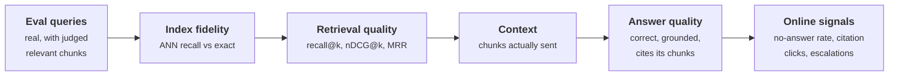

+++
title = 'Evaluating retrieval'
description = 'Measure retrieval separately from generation, on real queries with graded judgments. Recall@k bounds what the model can answer, nDCG measures ordering, and a paired test over enough queries tells you whether a change helped. Incomplete judgments quietly penalize anything new.'
question = 'How do you prove that a retrieval change made answers better, not just different?'
weight = 3
difficulty = 3
prerequisites = ['/notes/systems-design/retrieval/02-chunking-and-hybrid-search', '/notes/systems-design/model-interfaces/03-prompts-as-versioned-code']
date = 2026-10-30T11:15:00Z
lastmod = 2026-10-30T11:15:00Z
verified = 2026-10-30
+++

## The idea in one minute

A retrieval-augmented answer can only be as good as what was retrieved. If the
passage containing the answer is in the top *k* chunks sent to the model 75% of
the time, answer accuracy will sit near 75% times the model's accuracy given the
passage, whatever model you buy. So **measure retrieval on its own**, with a set
of real queries and judgments of which chunks are relevant, before and
alongside measuring answers.

Three metrics cover most needs. **Recall@k**: of the relevant chunks, how many
are in the top *k*? It bounds the answer. **MRR**: how high is the first
relevant chunk? **nDCG@k**: does the ranking put the most relevant chunks
first, with graded relevance? Each is an average over queries, so it has an
interval, and comparing two retrievers needs a **paired** test over enough
queries. One trap is specific to retrieval: judgments are collected only for
documents some system retrieved, so a new system that finds relevant documents
nobody judged is scored as if they were irrelevant. The consequence to act on:
**gate retrieval changes on recall@k and nDCG with confidence intervals, and
judge the new system's top results before believing a drop**.

## A picture



Each stage has its own metric so a drop can be located: a fall in ANN recall is
an index problem, a fall in nDCG with ANN recall unchanged is a ranking or
chunking problem, and a fall in answers with retrieval unchanged is a prompt or
model problem.

## How it really works

### Two kinds of recall

**ANN recall** compares an approximate index with exact search in the same
embedding space, as in
[embeddings and ANN search](/notes/systems-design/retrieval/01-embeddings-and-ann-search/).
It needs no human labels and measures the index. **Retrieval recall** compares
results with human (or carefully validated model) judgments of relevance and
measures the whole retriever: chunking, embedding, fusion, reranking. A system
can have 99% ANN recall and 60% retrieval recall. Report both, and do not
confuse a vector database's benchmark recall with whether your users get the
right passage.

### The metrics

For one query with a ranked list and a set of judged-relevant chunks:

| Metric | Definition | Use it for |
| --- | --- | --- |
| **Recall@k** | relevant in top k ÷ all relevant | Whether the answer can be in the context; set k to what you send |
| Precision@k | relevant in top k ÷ k | How much of the context is noise |
| Hit rate@k | 1 if any relevant in top k | Single-answer questions |
| **MRR** | 1 ÷ rank of the first relevant | Questions answered by one passage |
| **nDCG@k** | DCG ÷ ideal DCG, with graded gain | Ordering with graded relevance |

Discounted cumulative gain, from Järvelin and Kekäläinen, adds each result's
gain discounted by its position; normalizing by the best possible ordering gives
a number between 0 and 1:

```text
DCG@k  = Σ_{i=1..k}  (2^grade_i − 1) / log2(i + 1)
nDCG@k = DCG@k / DCG@k of the ideal ordering
```

Worked for the example in the program: four relevant chunks graded 3, 2, 2, 1;
the system put the grade-2 chunk second and the grade-3 chunk fourth:

```text
DCG   = (2² − 1)/log2(3) + (2³ − 1)/log2(5)       = 1.893 + 3.015 = 4.908
ideal = 7/1 + 3/log2(3) + 3/log2(4) + 1/log2(5)   = 7 + 1.893 + 1.5 + 0.431 = 10.824
nDCG@10 = 4.908 / 10.824                           = 0.453
```

Moving the grade-3 chunk to first place, with nothing else changed, raises it
to 0.822. nDCG rewards putting the best evidence first, which matters because
models use the beginning of a long context more reliably than the middle.

### Building the evaluation set

- **Queries come from real traffic**, sampled across the types users ask
  (lookups, how-to, comparisons, identifiers, multi-part), plus the slices that
  matter (other languages, new document types). Synthetic queries generated from
  chunks are useful for coverage but tend to reuse the chunk's own words, which
  flatters keyword search.
- **Judgments are graded** (for example 0 to 3) and made per query–chunk pair.
  Graded labels let nDCG distinguish "the answer" from "related background".
- **Pooling** decides what gets judged. TREC-style evaluation judges the union
  of the top results of several systems; everything outside the pool is assumed
  irrelevant.
- **Model judges** can scale labeling. Thomas and colleagues found model
  relevance labels could match the quality of crowd labels for search with a
  carefully built prompt; validate any [model judge](/notes/systems-design/evaluation-in-production/02-model-graders/) against a human-labeled sample
  from your own domain before trusting it, and version it like a prompt.

### Incomplete judgments

Pooling makes the test set favor the systems that built the pool. A new
retriever that surfaces relevant chunks the old systems never returned gets no
credit for them; they are unjudged, so they count as irrelevant. Buckley and
Voorhees studied this bias and proposed measures robust to it. The practical
rule is cheaper than any metric: **report the share of each system's top k that
is judged, and judge the unjudged results of the new system before deciding**.
In the program, a method that genuinely finds more relevant documents scores
0.688 against the baseline's 0.751 under the old judgments, and 0.776 once its
own results are judged; only 24% of its top 10 had been judged.

### How many queries

Per-query metrics vary enormously (one query scores 1.0, the next 0.2), so the
mean needs many queries. Compare systems **paired**, on the same queries, and
report a confidence interval of the difference: a paired bootstrap resamples
queries with replacement and recomputes the mean difference each time. Smucker,
Allan, and Carterette compared significance tests for retrieval and found the
randomization (permutation) test, the bootstrap, and the t-test largely agreed,
while the sign and Wilcoxon tests were less reliable. In the program, 30 queries
estimate an improvement of +0.153 nDCG; 300 queries put the same change at
+0.047. Small samples are not only noisy; the ones that look impressive are the
ones that get shipped.

### From retrieval to answers

Answer quality is measured separately, on the same queries: is the answer
correct, is every claim **supported by the chunks it cites** (faithfulness, or
groundedness), and does the system say "I don't know" when retrieval found
nothing? Frameworks such as RAGAS define model-graded versions of context
precision, context recall, and faithfulness; they are model judges and need the
same validation. When answers get worse, check retrieval first: if recall@k
fell, fix retrieval; if recall held and faithfulness fell, look at the prompt or
the model.

Online, measure what can be measured without labels: the rate of empty or
low-score retrievals, the "no answer" rate, citation clicks, follow-up
rephrasings (a sign the first answer missed), and escalations to humans.

## Code

The program computes the metrics by hand for one query, simulates 300 queries
with graded judgments to compare a baseline A with a tuned variant B by paired
bootstrap at three sample sizes, shows the pooling bias for a method C that
finds unjudged relevant documents, and shows answer accuracy following
retrieval recall.

```python {title="retrieval_eval.py"}
"""retrieval_eval.py: retrieval metrics, their confidence, and their blind spots.

Part 1 computes recall@k, precision@k, MRR and nDCG@10 by hand for one ranked list.
Part 2 simulates 300 queries with graded judgments and two retrievers, and uses a
paired bootstrap to ask whether B is really better than A. Part 3 shows what happens
when a new method C finds relevant documents nobody judged. Part 4 shows retrieval recall capping
answer accuracy. Standard library only; the retrievers are simulated.
"""

from __future__ import annotations

import math
import random

Qrels = dict[str, int]          # doc id -> grade (0 none, 1 partial, 2 relevant, 3 perfect)


def recall_at(ranked: list[str], qrels: Qrels, k: int) -> float:
    rel = {d for d, g in qrels.items() if g > 0}
    return len(rel & set(ranked[:k])) / len(rel) if rel else 0.0


def precision_at(ranked: list[str], qrels: Qrels, k: int) -> float:
    return sum(1 for d in ranked[:k] if qrels.get(d, 0) > 0) / k


def mrr(ranked: list[str], qrels: Qrels) -> float:
    return next((1 / r for r, d in enumerate(ranked, 1) if qrels.get(d, 0) > 0), 0.0)


def ndcg_at(ranked: list[str], qrels: Qrels, k: int) -> float:
    """Graded gain 2^g - 1, log2 position discount (Jarvelin and Kekalainen, 2002)."""
    dcg = sum((2 ** qrels.get(d, 0) - 1) / math.log2(r + 1) for r, d in enumerate(ranked[:k], 1))
    ideal = sorted(qrels.values(), reverse=True)[:k]
    idcg = sum((2 ** g - 1) / math.log2(r + 1) for r, g in enumerate(ideal, 1))
    return dcg / idcg if idcg else 0.0


def part1() -> None:
    qrels = {"d3": 3, "d7": 2, "d9": 1, "d12": 2}
    ranked = ["d1", "d7", "d4", "d3", "d8", "d5", "d2", "d6", "d10", "d11"]
    print("Part 1: one query, 4 judged-relevant docs; the system ranked d7 2nd and d3 4th")
    for k in (1, 3, 5, 10):
        print(f"  k={k:<3} recall {recall_at(ranked, qrels, k):.2f}  "
              f"precision {precision_at(ranked, qrels, k):.2f}")
    print(f"  MRR {mrr(ranked, qrels):.2f}   nDCG@10 {ndcg_at(ranked, qrels, 10):.3f}")
    print(f"  same docs, d3 moved to 1st: nDCG@10 "
          f"{ndcg_at(['d3', 'd7'] + [d for d in ranked if d not in ('d3', 'd7')], qrels, 10):.3f}")


def make_query(rng: random.Random) -> tuple[Qrels, set[str]]:
    """Graded relevant docs, plus a few relevant docs the judges never saw."""
    rel = {f"r{i}": rng.choice((1, 2, 2, 3)) for i in range(rng.randint(1, 5))}
    hidden = {f"h{i}" for i in range(rng.randint(0, 3))}
    return rel, hidden


def retrieve(rng: random.Random, rel: Qrels, hidden: set[str], skill: float,
             finds_hidden: bool, n_docs: int = 200) -> list[str]:
    """Rank by a noisy score; higher skill separates relevant from non-relevant better.
    Only a retriever that `finds_hidden` (say, a dense one finding paraphrases that the
    keyword baseline misses) scores the hidden docs as relevant."""
    docs = list(rel) + sorted(hidden) + [f"n{i}" for i in range(n_docs)]
    def true_grade(d: str) -> int:
        return rel.get(d, 2 if d in hidden and finds_hidden else 0)
    score = {d: rng.gauss(skill * true_grade(d) / 3, 1) for d in docs}
    return sorted(docs, key=lambda d: -score[d])


def paired_bootstrap(a: list[float], b: list[float], rng: random.Random, n: int = 2000) -> tuple[float, float]:
    diffs = []
    for _ in range(n):
        idx = [rng.randrange(len(a)) for _ in a]
        diffs.append(sum(b[i] - a[i] for i in idx) / len(idx))
    diffs.sort()
    return diffs[int(0.025 * n)], diffs[int(0.975 * n)]


def part2_3() -> None:
    rng = random.Random(21)
    nq = 300
    a_s, b_s, c_meas, c_full, c_judged = [], [], [], [], []
    for _ in range(nq):
        rel, hidden = make_query(rng)
        ra = retrieve(rng, rel, hidden, 4.0, False)        # baseline, used to build the pool
        rb = retrieve(rng, rel, hidden, 4.3, False)        # a tuned variant of the baseline
        rc = retrieve(rng, rel, hidden, 4.0, True)         # a different method
        a_s.append(ndcg_at(ra, rel, 10))
        b_s.append(ndcg_at(rb, rel, 10))
        judged = set(ra[:10]) | set(rel)                   # pooled from A only
        c_meas.append(ndcg_at(rc, rel, 10))
        c_full.append(ndcg_at(rc, rel | {h: 2 for h in hidden}, 10))
        c_judged.append(sum(1 for d in rc[:10] if d in judged) / 10)
    mean = lambda xs: sum(xs) / len(xs)
    print(f"\nPart 2: nDCG@10 for baseline A and variant B, paired bootstrap 95% CI of B - A")
    for n in (30, 100, 300):
        lo, hi = paired_bootstrap(a_s[:n], b_s[:n], random.Random(1))
        print(f"  {n:>3} queries: A {mean(a_s[:n]):.3f}  B {mean(b_s[:n]):.3f}  "
              f"B - A {mean(b_s[:n]) - mean(a_s[:n]):+.3f}  CI [{lo:+.3f}, {hi:+.3f}]")
    print(f"\nPart 3: method C finds relevant docs that A never retrieved; judgments pooled from A")
    print(f"  share of C's top 10 that was judged:          {mean(c_judged):.0%}")
    print(f"  C nDCG@10, unjudged counted as irrelevant:     {mean(c_meas):.3f}  (A: {mean(a_s):.3f})")
    print(f"  C nDCG@10 after judging C's top 10 as well:    {mean(c_full):.3f}")


def part4() -> None:
    rng = random.Random(4)
    print("\nPart 4: answer accuracy given retrieval recall@5 (generator right 92% with the")
    print("        passage, 20% without it, from memory or luck)")
    for recall in (0.6, 0.75, 0.9, 0.97):
        n, right = 10000, 0
        for _ in range(n):
            found = rng.random() < recall
            right += rng.random() < (0.92 if found else 0.20)
        print(f"  recall {recall:.0%}: answer accuracy {right / n:.1%}"
              f"   (expected {recall:.2f} x 92% + {1 - recall:.2f} x 20% = {recall * 0.92 + (1 - recall) * 0.20:.1%})")


if __name__ == "__main__":
    part1()
    part2_3()
    part4()
```

Run it with `python3 retrieval_eval.py`:

```text
Part 1: one query, 4 judged-relevant docs; the system ranked d7 2nd and d3 4th
  k=1   recall 0.00  precision 0.00
  k=3   recall 0.25  precision 0.33
  k=5   recall 0.50  precision 0.40
  k=10  recall 0.50  precision 0.20
  MRR 0.50   nDCG@10 0.453
  same docs, d3 moved to 1st: nDCG@10 0.822

Part 2: nDCG@10 for baseline A and variant B, paired bootstrap 95% CI of B - A
   30 queries: A 0.710  B 0.863  B - A +0.153  CI [+0.053, +0.269]
  100 queries: A 0.744  B 0.805  B - A +0.061  CI [+0.004, +0.120]
  300 queries: A 0.751  B 0.798  B - A +0.047  CI [+0.012, +0.081]

Part 3: method C finds relevant docs that A never retrieved; judgments pooled from A
  share of C's top 10 that was judged:          24%
  C nDCG@10, unjudged counted as irrelevant:     0.688  (A: 0.751)
  C nDCG@10 after judging C's top 10 as well:    0.776

Part 4: answer accuracy given retrieval recall@5 (generator right 92% with the
        passage, 20% without it, from memory or luck)
  recall 60%: answer accuracy 63.4%   (expected 0.60 x 92% + 0.40 x 20% = 63.2%)
  recall 75%: answer accuracy 74.1%   (expected 0.75 x 92% + 0.25 x 20% = 74.0%)
  recall 90%: answer accuracy 84.2%   (expected 0.90 x 92% + 0.10 x 20% = 84.8%)
  recall 97%: answer accuracy 90.1%   (expected 0.97 x 92% + 0.03 x 20% = 89.8%)
```

Part 1 matches the worked arithmetic. Part 2 shows the interval narrowing as
queries grow, and the 30-query estimate is three times the 300-query one.
Part 3 shows a better method scoring worse than the baseline until its own
results are judged. Part 4 shows answer accuracy tracking `recall × 92% +
(1 − recall) × 20%` within sampling noise: past a point, a better model cannot
buy what retrieval did not deliver.

## Where it breaks

- **Relevance is not usefulness.** A chunk can be on topic and still not contain
  the fact needed. Grade for "answers the question", not "is about the topic".
- **Recall needs the full relevant set.** For broad questions the relevant set
  is unknown and recall is estimated. Hit rate and nDCG are more stable there.
- **The simulation is kind.** Simulated queries are independent and identically
  distributed. Real query sets have clusters of similar queries, so the effective
  sample size is smaller than the count; sample across query types.
- **Model judges drift with the model.** A judge model update changes every
  score. Pin its version and re-validate it against human labels on each change.
- **Offline gains do not always appear online.** An offline improvement on a
  stale query set can be invisible on today's traffic. Confirm with online
  signals on a canary.

## Remember this

- Retrieval recall@k bounds answer accuracy; measure it on its own.
- ANN recall measures the index; retrieval recall measures the whole retriever.
- nDCG rewards putting the best evidence first; use graded judgments.
- Compare systems paired on the same queries, with a bootstrap interval.
- Report how much of each system's top k was judged; judge before concluding.
- When answers drop, check retrieval first, then faithfulness.

## Try it

1. Run `retrieval_eval.py`. Change B's skill from 4.3 to 4.1. How many queries
   does the interval need before it excludes zero?
2. In part 3, judge the top 10 of A, B, and C together (pool all three). Does C
   still score below A?
3. Implement MAP (mean average precision) and compare its ranking of A and B
   with nDCG@10's.
4. Collect 30 real questions for a document set you know, find the relevant
   passages by hand, and compute recall@5 for the search you use today.

## Check yourself

1. Retrieval recall@5 on your test set is 65%. What is the most an answer
   accuracy can plausibly be, and what do you fix first?

   
   Around 65% times the model's accuracy given the passage, plus whatever it
   gets right without it, which is usually little. Fix retrieval first: parsing,
   chunking, hybrid search, reranking. A better generator cannot answer from a
   passage it never sees.
   

2. A vector database reports 99% recall. Why might your users still get the
   wrong passage?

   
   That figure is ANN recall: agreement with exact search in the same embedding
   space. If the embedding, the chunking, or the lack of keyword matching ranks
   the wrong passage first, exact search returns it too. Retrieval recall
   against relevance judgments measures what users experience.
   

3. A new retriever scores lower nDCG than the old one on your judged set. What
   do you check before rejecting it?

   
   How much of its top k was judged. If the judgments were pooled from the old
   system, the new one's novel results are unjudged and counted as irrelevant.
   Judge its unjudged top results, then recompute.
   

4. Why is a paired comparison better than comparing two means with their own
   intervals?

   
   Per-query difficulty varies far more than the difference between systems. A
   paired comparison computes the difference per query, removing the shared
   difficulty, so its interval is much narrower for the same number of queries.
   

## Sources

- K. Järvelin, J. Kekäläinen, "Cumulated Gain-based Evaluation of IR Techniques", *ACM TOIS* 20(4), 2002.
- C. Buckley, E. M. Voorhees, "Retrieval Evaluation with Incomplete Information", SIGIR 2004.
- E. M. Voorhees, D. K. Harman (eds.), *TREC: Experiment and Evaluation in Information Retrieval*, MIT Press, 2005 (pooling).
- M. D. Smucker, J. Allan, B. Carterette, "A Comparison of Statistical Significance Tests for Information Retrieval Evaluation", CIKM 2007.
- T. Sakai, "Evaluating Evaluation Metrics Based on the Bootstrap", SIGIR 2006.
- P. Thomas, S. Spielman, N. Craswell, B. Mitra, [Large Language Models Can Accurately Predict Searcher Preferences](https://arxiv.org/abs/2309.10621), SIGIR 2024.
- S. Es, J. James, L. Espinosa-Anke, S. Schockaert, [RAGAS: Automated Evaluation of Retrieval Augmented Generation](https://arxiv.org/abs/2309.15217), EACL 2024 (demo).
- N. Thakur et al., [BEIR: A Heterogeneous Benchmark for Zero-shot Evaluation of Information Retrieval Models](https://arxiv.org/abs/2104.08663), NeurIPS Datasets and Benchmarks 2021.
