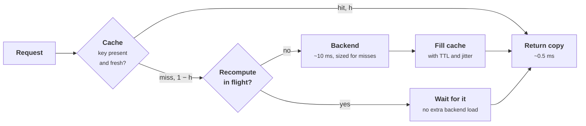

+++
title = 'Caching'
description = 'A cache trades memory and staleness for latency and backend load. The hit ratio decides both, popularity skew decides the hit ratio, and the failures come from expiry, invalidation, cold starts, and keys that are too hot for one node.'
question = 'How large a cache do you need, what does each point of hit ratio buy, and how do caches cause outages and stale data?'
weight = 2
difficulty = 3
prerequisites = ['/notes/systems-design/scale-and-performance/01-queueing-and-littles-law', '/notes/systems-design/concurrency-and-consistency/03-consistency-models']
date = 2026-10-30T06:10:00Z
lastmod = 2026-10-30T06:10:00Z
verified = 2026-10-30
+++

## The idea in one minute

A cache keeps copies of results so that most requests skip the expensive
path. Its value is one number, the **hit ratio** h, and the number that
matters for capacity is the miss ratio: the backend sees (1 − h) of the
traffic. Going from 90% to 99% hits cuts backend load tenfold, so the last
few points of hit ratio are worth more than the first fifty.

The hit ratio depends on how skewed popularity is and on cache size, and it
grows slowly: under typical skew, each doubling of the cache adds a roughly
constant number of points. A cache also changes how the system fails. When a
hot key expires, every concurrent request recomputes it at once. When the
cache is flushed or restarted, the backend receives the full load it was never
sized for. When a write races a refill, the cache serves stale data until the
next expiry.

The consequence to act on: **size the backend for the miss traffic you will
actually see after a cold start, coalesce recomputation of hot keys, and
decide explicitly how stale each cached value may be**.

## A picture



The coalescing check is what keeps a popular key's expiry from turning into
hundreds of identical backend calls.

## How it really works

### The arithmetic of a hit ratio

With hit latency t_hit and miss latency t_miss, mean latency is
h × t_hit + (1 − h) × t_miss, and backend load is (1 − h) × λ. For a service
at 50,000 reads per second, a 0.5 ms hit, and a 10 ms miss:

| Hit ratio | Mean latency | Backend reads per second |
| --- | --- | --- |
| 50% | 5.25 ms | 25,000 |
| 90% | 1.45 ms | 5,000 |
| 99% | 0.60 ms | 500 |
| 99.9% | 0.51 ms | 50 |

Three consequences follow.

- **The cache is part of capacity.** If the database was sized for 5,000
  reads per second because the cache hits 90%, then losing the cache sends it
  50,000, ten times its capacity. That is not a degraded mode; it is the
  overload in [overload and backpressure](/notes/systems-design/failure-modes/04-overload-and-backpressure/),
  and slow misses mean callers time out and retry, which keeps the cache from
  refilling. Bronson and colleagues use a look-aside cache as one of their
  examples of a metastable failure for this reason.
- **Misses are the tail.** The mean improves smoothly with h, but every miss
  pays t_miss in full. A page that makes 100 cache lookups at 99% hits sees at
  least one miss on 1 − 0.99¹⁰⁰ ≈ 63% of loads, the fan-out arithmetic from
  [back-of-the-envelope capacity](/notes/systems-design/thinking-in-invariants/03-back-of-the-envelope-capacity/).
- **Measure the right ratio.** Object hit ratio counts requests; byte hit
  ratio counts bytes. A CDN that hits on small thumbnails and misses on large
  videos can show 95% object hits and 40% byte hits, and egress cost follows
  the bytes.

### Popularity, size, and the optimum

Request popularity in many workloads is roughly **Zipf-like**: the i-th most
popular key is requested with probability proportional to 1 / i^α. Breslau and
colleagues (1999) measured α between about 0.64 and 0.83 on web proxy traces.
Under Zipf, a small cache captures the head and the long tail stays expensive.
From the simulation below, 100,000 keys at α = 0.9:

| Cache size | LRU | Che approximation | FIFO | Belady (optimal) |
| --- | --- | --- | --- | --- |
| 0.1% of keys | 15.6% | 15.6% | 13.2% | 33.4% |
| 1% | 34.2% | 34.2% | 30.6% | 53.2% |
| 5% | 51.4% | 51.5% | 47.3% | 69.3% |
| 10% | 60.3% | 60.5% | 56.2% | 76.5% |
| 25% | 73.6% | 74.3% | 69.9% | 85.2% |

```mermaid {title="Hit ratio against cache size, 100,000 Zipf keys: LRU and the offline optimum"}
xychart-beta
  x-axis "Cache size, share of all keys" ["0.1%", "1%", "5%", "10%", "25%"]
  y-axis "Hit ratio (%)" 0 --> 100
  line [15.6, 34.2, 51.4, 60.3, 73.6]
  line [33.4, 53.2, 69.3, 76.5, 85.2]
```

The lower line is LRU; the upper is Belady's algorithm, which evicts the key
whose next use is furthest in the future. Belady (1966) needs the future, so
it cannot be deployed; it is the ceiling that shows how much a better policy
could gain.

Three tools for sizing without guessing:

- **The Che approximation.** For LRU with independent requests, there is a
  characteristic time T such that a key stays cached if it is requested again
  within T. Solve Σ(1 − e^(−pᵢT)) = cache size for T; the hit ratio is then
  Σ pᵢ(1 − e^(−pᵢT)). It matched the simulated LRU to within a point above,
  and it needs only a popularity estimate, not a trace replay.
- **Miss-ratio curves from traces.** Replay a day of real keys through
  candidate sizes and policies, as the program does. Real traces have
  correlations and churn that a Zipf model lacks, so a replay is the number to
  plan with.
- **Better policies than LRU.** LRU is fooled by scans, because one pass over
  cold keys evicts the hot ones. ARC (Megiddo and Modha, 2003) balances recency
  and frequency; W-TinyLFU (Einziger, Friedman, and Manes, 2017) admits a new
  key only if a compact frequency sketch says it is more popular than the
  victim; S3-FIFO (Yang and colleagues, 2023) uses a small probationary FIFO
  queue to drop one-hit wonders quickly. Each paper reports lower miss ratios
  than LRU on many production traces. Replay your own trace before switching.

TTL caps the hit ratio independently of size. A key requested as a Poisson
stream at rate r, with a TTL of T and no eviction, sees one miss per TTL period
followed on average by rT hits, so h = rT / (1 + rT). A key read once a minute
with a 60 s TTL hits 50% of the time however much memory there is. The long
tail of rarely read keys is expensive under any cache size.

### Where the cache sits and who writes it

| Pattern | Read path | Write path | Main risk |
| --- | --- | --- | --- |
| **Cache-aside** | App reads cache; on miss reads the store and fills | App writes the store, then deletes or updates the cache key | Stale data from races between refill and invalidation |
| **Read-through** | Cache library loads from the store on miss | As cache-aside | Same, but one place to add coalescing |
| **Write-through** | Reads hit a cache that is always written | Each write goes to cache and store synchronously | Write latency is the sum of both; cache filled with keys never read |
| **Write-back** | As write-through | Writes go to cache, flushed to the store later | Data loss if the cache fails before the flush |
| **Write-around** | As cache-aside | Writes go only to the store | First read after each write misses |

Cache-aside with delete-on-write is the most common pattern, and it has a
well-known race. A reader misses, reads the old value from the store, and
pauses. A writer updates the store and deletes the cache key. The reader
resumes and writes its old value into the cache. Nothing expires it until the
TTL.

```mermaid {title="The stale-set race in cache-aside, and the lease that stops it"}
sequenceDiagram
  autonumber
  participant R as Reader
  participant C as Cache
  participant D as Store
  participant W as Writer
  R->>C: get k
  C-->>R: miss, lease token 17
  R->>D: read k
  D-->>R: v1
  W->>D: write k = v2
  W->>C: delete k, invalidates lease 17
  rect rgb(249, 226, 233)
    Note over R,C: without leases the reader would now cache v1 until the TTL
  end
  R->>C: set k = v1 with lease 17
  rect rgb(226, 239, 216)
    C-->>R: rejected, lease no longer valid
  end
```

Facebook's memcache paper (Nishtala and colleagues, 2013) describes this fix:
on a miss the cache hands out a **lease** token, a delete invalidates
outstanding leases, and a set with an invalidated token is refused. The same
leases rate-limit refills of one key, which also addresses stampedes. Where
deletes must reach many cache regions reliably, publish invalidations from the
database's change log rather than from the application, so a crash between
the write and the delete cannot skip it; that is the pattern in
[exactly-once and the outbox](/notes/systems-design/concurrency-and-consistency/05-exactly-once-and-the-outbox/).

Every cache is a replica with its own staleness bound. State it per kind of
data: product descriptions may be an hour stale, a price in a cart perhaps a
minute, and a permission decision should be measured in seconds, as
[consistency models](/notes/systems-design/concurrency-and-consistency/03-consistency-models/)
argues for authorization caches.

### Stampedes and probabilistic early refresh

When a popular key expires, every request that arrives before the new value
is written also misses. At 2,000 requests per second and a 200 ms
recomputation, that is about 400 identical backend calls per expiry, all
started within the same 200 ms. Three controls, usually combined:

- **Single flight (request coalescing).** The first miss starts the
  recomputation; later misses for the same key wait for its result. Within one
  process this is a lock or a future per key. Across a fleet of N processes it
  still allows N recomputations unless the cache itself grants one lease per
  key.
- **Serve stale while revalidating.** Keep the expired value and return it
  while one request refreshes in the background. HTTP standardizes this as the
  `stale-while-revalidate` cache directive (RFC 5861). Callers never wait, at
  the cost of a bounded extra staleness.
- **Probabilistic early expiration.** Vattani, Chierichetti, and Lowenstein
  (2015) showed that each request can decide independently to refresh early:
  recompute if `now − δ × β × ln(rand()) ≥ expiry`, where δ is the time a
  recomputation takes, β ≥ 1 tunes eagerness, and `rand()` is uniform on
  (0, 1]. Because −ln(rand()) is exponentially distributed, refreshes cluster
  shortly before expiry, the chance that two requests both refresh is small,
  and no coordination is needed. They call the algorithm XFetch and prove it
  optimal in a precise sense among such schemes.

From the simulation, one hot key over ten minutes with a 60 s TTL:

| Policy | Recomputations | Peak concurrent | Requests that waited |
| --- | --- | --- | --- |
| Naive | 3,555 | 413 | 3,555 |
| Single flight | 9 | 1 | 3,543 |
| Probabilistic early | 10 | 1 | 0 |

Single flight removes the duplicate work but every request in the 200 ms gap
still waits. Early refresh removes both, at the cost of one extra refresh in
ten minutes because each refresh lands a little before expiry.

Mass expiry is the same problem across many keys. If a bulk load writes a
million keys with the same TTL, they all expire together. Add **jitter** to
TTLs, for example ±10%, so expiries spread out.

### Cold caches and restarts

A new or flushed cache node has a hit ratio of zero. Precautions that keep a
restart from becoming an outage:

- **Warm before serving**: replay recent keys, copy from a peer, or ramp
  traffic onto the new node over minutes.
- **Spread keys with consistent hashing**, so adding or replacing one node
  cools only its share of keys rather than remapping almost everything; the
  arithmetic is in
  [partitioning and sharding](/notes/systems-design/scale-and-performance/03-partitioning-and-sharding/).
- **Hold failover capacity for misses.** The memcache paper describes a small
  pool of "gutter" servers that take over a failed node's keys with short
  TTLs, so its load does not fall straight on the database.
- **Shed at the backend**: when the miss path saturates, reject quickly
  rather than queueing, so the cache can refill from the requests that do
  succeed.

### Hot keys

One key can be more popular than one cache node can serve: a celebrity's
profile, a global configuration blob, the system prompt shared by every
request to a model. Consistent hashing puts each key on one node, so that
node saturates while the rest are idle. Fixes, cheapest first: an in-process
cache with a TTL of a second or two in front of the shared cache; replicating
known hot keys under several names (`k#0` … `k#7`) and reading a random one;
and coalescing so that one process makes one remote fetch per key at a time.
Detect hot keys by sampling requests per key on the cache nodes; you cannot
fix what the per-node averages hide.

### Caches and security

A cache returns one caller's response to another caller whenever their cache
keys match. Every input that changes the response must be in the key: tenant,
user or authorization scope, locale, content negotiation headers, and the API
version.

- **Web cache poisoning** (Kettle, 2018) uses inputs that change the response
  but are not part of the key, such as an unkeyed header reflected into the
  page, so an attacker's response is cached and served to everyone.
- **Web cache deception** (Gil, 2017; measured at scale by Mirheidari and
  colleagues, 2020) tricks a shared cache into storing a victim's private page
  under a URL that looks static, such as `/account/settings/x.css`.
- **Cached authorization** means revocation takes up to a TTL to apply. Keep
  those TTLs short, or invalidate on change.
- **Shared caches leak through timing.** A hit is faster than a miss, so a
  caller can test whether someone else recently requested a value. Model
  serving makes this concrete: prefix caches shared across tenants reveal
  whether another tenant sent the same prompt prefix, which is why
  [the multi-tenant inference gateway](/notes/systems-design/worked-designs/04-a-multi-tenant-inference-gateway/)
  scopes them per tenant.

> [!WARNING]
> A cache whose key omits the tenant or the caller's authorization scope is a
> data leak waiting for the first two callers to collide. Build the key from a
> function that takes the authenticated principal as an argument, so it cannot
> be forgotten.

## Code

The program has two parts. Part 1 replays one million Zipf-distributed
requests over 100,000 keys through LRU, FIFO, and Belady's optimum at five
cache sizes, and compares LRU with the Che approximation. Part 2 simulates one
hot key at 2,000 requests per second, with a 200 ms recomputation and a 60 s
TTL, under the three refresh policies.

```python {title="caching.py"}
"""caching.py: hit ratio against cache size, and what happens when a hot key expires.

Part 1 replays one Zipf-distributed request stream through LRU, FIFO, and
Belady's offline optimum (evict the key used furthest in the future) at several
cache sizes, and compares LRU with the Che approximation.
Part 2 simulates one hot key at 2,000 requests per second whose value takes
200 ms to recompute, with a 60 s TTL, under three refresh policies.
Standard library only; seeded; runs offline in about ten seconds.
"""

from __future__ import annotations

import heapq
import math
import random
from collections import OrderedDict

CATALOG = 100_000  # distinct keys
REQUESTS = 1_000_000
ALPHA = 0.9  # Zipf exponent; Breslau et al. (1999) measured 0.64 to 0.83 on web proxy traces


def zipf_stream(seed: int) -> tuple[list[int], list[float]]:
    weights = [1 / (rank ** ALPHA) for rank in range(1, CATALOG + 1)]
    total = sum(weights)
    probs = [w / total for w in weights]
    rng = random.Random(seed)
    return rng.choices(range(CATALOG), weights=weights, k=REQUESTS), probs


def lru(stream: list[int], size: int) -> float:
    cache: OrderedDict[int, None] = OrderedDict()
    hits = 0
    for key in stream:
        if key in cache:
            hits += 1
            cache.move_to_end(key)
        else:
            cache[key] = None
            if len(cache) > size:
                cache.popitem(last=False)  # least recently used
    return hits / len(stream)


def fifo(stream: list[int], size: int) -> float:
    cache: OrderedDict[int, None] = OrderedDict()
    hits = 0
    for key in stream:
        if key in cache:
            hits += 1  # a hit does not change the eviction order
        else:
            cache[key] = None
            if len(cache) > size:
                cache.popitem(last=False)  # oldest insertion
    return hits / len(stream)


def belady(stream: list[int], size: int) -> float:
    """Offline optimum: needs the future, so it is a ceiling, not a policy."""
    nxt = [0] * len(stream)
    seen: dict[int, int] = {}
    for i in range(len(stream) - 1, -1, -1):
        nxt[i] = seen.get(stream[i], math.inf)
        seen[stream[i]] = i
    cache: dict[int, float] = {}  # key -> next use
    heap: list[tuple[float, int]] = []  # (-next use, key), stale entries skipped
    hits = 0
    for i, key in enumerate(stream):
        if key in cache:
            hits += 1
        elif len(cache) >= size:
            while True:
                neg, victim = heapq.heappop(heap)
                if cache.get(victim) == -neg:
                    del cache[victim]
                    break
        cache[key] = nxt[i]
        heapq.heappush(heap, (-nxt[i], key))
    return hits / len(stream)


def che(probs: list[float], size: int) -> float:
    """Che approximation: find T with sum(1 - exp(-p T)) = size, hit = sum p (1 - exp(-p T))."""
    lo, hi = 0.0, 1e12
    for _ in range(200):
        t = (lo + hi) / 2
        if sum(1 - math.exp(-p * t) for p in probs) < size:
            lo = t
        else:
            hi = t
    return sum(p * (1 - math.exp(-p * t)) for p in probs)


def stampede(policy: str, seed: int = 7) -> tuple[int, int, int]:
    """Returns (recomputations, peak concurrent recomputations, requests that waited)."""
    rate, delta, ttl, horizon, beta = 2_000.0, 0.200, 60.0, 600.0, 1.0
    rng = random.Random(seed)
    expiry = ttl  # the value starts cached
    in_flight: list[float] = []  # finish times of running recomputations
    recomputes = peak = waited = 0
    t = 0.0
    while t < horizon:
        t += rng.expovariate(rate)
        while in_flight and in_flight[0] <= t:  # finished: the value is fresh again
            expiry = max(expiry, heapq.heappop(in_flight) + ttl)
        if t < expiry:
            early = policy == "probabilistic early" and not in_flight and \
                t - delta * beta * math.log(rng.random()) >= expiry
            if not early:
                continue  # an ordinary hit
        else:
            waited += 1  # expired: this caller waits for a fresh value
            if policy == "single flight" and in_flight:
                continue  # join the recomputation already running
        recomputes += 1
        heapq.heappush(in_flight, t + delta)
        peak = max(peak, len(in_flight))
    return recomputes, peak, waited


def main() -> None:
    stream, probs = zipf_stream(seed=1)
    print(f"Part 1: {REQUESTS:,} requests over {CATALOG:,} keys, Zipf alpha = {ALPHA}")
    print("cache size        |   LRU   Che(LRU)   FIFO   Belady | backend reads per 1,000")
    for frac in [0.001, 0.01, 0.05, 0.10, 0.25]:
        size = int(CATALOG * frac)
        h_lru = lru(stream, size)
        print(f"{size:>6} keys ({frac:5.1%}) | {h_lru:5.1%}    {che(probs, size):5.1%}  "
              f"{fifo(stream, size):5.1%}  {belady(stream, size):5.1%}  | {1000 * (1 - h_lru):6.0f}")

    print("\nPart 2: one hot key, 2,000 req/s, 200 ms to recompute, 60 s TTL, 10 minutes")
    print("policy               recomputations  peak concurrent  requests that waited")
    for policy in ["naive", "single flight", "probabilistic early"]:
        r, p, w = stampede(policy)
        print(f"{policy:<20} {r:>14} {p:>16} {w:>21}")


if __name__ == "__main__":
    main()
```

Run it with `python3 caching.py` (about ten seconds):

```text
Part 1: 1,000,000 requests over 100,000 keys, Zipf alpha = 0.9
cache size        |   LRU   Che(LRU)   FIFO   Belady | backend reads per 1,000
   100 keys ( 0.1%) | 15.6%    15.6%  13.2%  33.4%  |    844
  1000 keys ( 1.0%) | 34.2%    34.2%  30.6%  53.2%  |    658
  5000 keys ( 5.0%) | 51.4%    51.5%  47.3%  69.3%  |    486
 10000 keys (10.0%) | 60.3%    60.5%  56.2%  76.5%  |    397
 25000 keys (25.0%) | 73.6%    74.3%  69.9%  85.2%  |    264

Part 2: one hot key, 2,000 req/s, 200 ms to recompute, 60 s TTL, 10 minutes
policy               recomputations  peak concurrent  requests that waited
naive                          3555              413                  3555
single flight                     9                1                  3543
probabilistic early              10                1                     0
```

What to read from it:

- **Growth is slow.** Going from 1% to 10% of the keys, ten times the memory,
  takes LRU from 34% to 60% hits and cuts backend reads from 658 to 397 per
  thousand: well under a halving. Size from a miss-ratio curve, not intuition.
- **Che is good enough to plan with** under independent requests: within 0.7
  points of the simulated LRU at every size.
- **The optimum is far above LRU** at small sizes (33% against 16% at 0.1%),
  which is the room that frequency-aware admission policies try to claim.
- **The stampede is real and cheap to stop.** 413 concurrent recomputations
  of one key becomes one.

## Where it breaks

- **Popularity is not stationary.** The model draws every request from one
  fixed Zipf distribution. Real popularity shifts by hour, and new content
  arrives hot. Replay traces covering a full daily cycle.
- **Objects are not the same size.** The simulation counts keys, not bytes.
  With variable sizes, a policy that favors many small objects raises the
  object hit ratio and can lower the byte hit ratio.
- **Writes are missing.** The program never updates a key, so it shows no
  invalidation traffic and no stale reads. Write-heavy keys have lower hit
  ratios and more races than the table suggests.
- **Single flight is per process.** In a fleet of 200 application servers, a
  per-process lock still allows 200 recomputations per expiry. Fleet-wide
  coalescing needs the cache to grant leases, or an early refresh that makes
  collisions unlikely.
- **Early refresh needs δ.** XFetch scales its window by the recomputation
  time. Record δ with each value; if recomputation suddenly gets slower, the
  window is too small until the next refresh records the new δ.
- **A cache hides capacity problems.** A healthy hit ratio can mask a backend
  that could not survive a cache restart. Test the miss path at full load
  before you need it.

## Remember this

- Backend load is (1 − h) × λ: 90% to 99% hits is a tenfold reduction.
- A cache the backend depends on is capacity; plan for its cold start.
- Under Zipf skew the hit ratio grows slowly with size; size from a replayed
  trace or the Che approximation.
- Cache-aside with delete-on-write can cache stale data; leases or change-log
  invalidation close the race.
- Stop stampedes with single flight, stale-while-revalidate, or probabilistic
  early refresh, and jitter TTLs.
- The cache key must include tenant and authorization scope.

## Try it

1. Run `caching.py`. Change `ALPHA` to 0.6 and to 1.2. How much cache does LRU
   need to reach 50% hits in each case?
2. Insert a scan into the request stream: after every 10,000 requests, read
   5,000 keys that are never read again. How much does LRU's hit ratio drop,
   and how much does FIFO's?
3. In `stampede`, run 50 independent processes, each with its own single-flight
   lock, sharing one cache. How many recomputations happen per expiry? Then
   add early refresh to each process and count again.
4. Add a TTL to the LRU simulation and compare the measured hit ratio of a key
   requested once per minute with the formula rT / (1 + rT).
5. For a cache you operate, find out what happens to the backend's request
   rate when the cache is restarted. Is that rate inside the backend's tested
   capacity?

## Check yourself

1. A read path serves 20,000 requests per second with a 95% hit ratio. A
   product change raises the hit ratio to 98%. What happens to backend load?

   
   Backend load goes from 0.05 × 20,000 = 1,000 to 0.02 × 20,000 = 400 reads
   per second, a 60% reduction from three points of hit ratio.
   

2. Why does a cache flush cause more than a temporary slowdown in a system
   whose database was sized for the miss traffic?

   
   With a hit ratio near zero the database receives the full read load, many
   times its capacity. Queries slow down, callers time out and retry, and
   the cache refills only from requests that succeed, so the overload can
   sustain itself (a metastable failure) until load is shed or the cache is
   warmed.
   

3. Describe the race that leaves stale data in a cache-aside cache with
   delete-on-write, and one fix.

   
   A reader misses and reads the old value from the store; a writer then
   updates the store and deletes the key; the reader writes the old value
   into the cache, where it stays until the TTL. Leases fix it: the miss
   returns a token, the delete invalidates it, and the stale set is refused.
   Short TTLs bound the damage but do not remove it.
   

4. How does probabilistic early expiration avoid a stampede without any lock?

   
   Each request independently refreshes the value early with a probability that
   rises sharply as expiry approaches, scaled by how long recomputation takes.
   With many requests per second, one of them almost always refreshes shortly
   before expiry, while the chance that two do so at once is small, so the
   value never expires under load.
   

5. A page cache keys entries on the URL path only. Which two attacks does that
   make possible?

   
   Web cache poisoning, where an attacker sends an input outside the key (such
   as a header) that changes the response, and the poisoned response is served
   to everyone requesting that path. And cross-user leakage such as web cache
   deception, where a private, per-user response is stored under a path that
   any other user can request.
   

## Sources

- L. A. Belady, "A Study of Replacement Algorithms for a Virtual-Storage
  Computer", *IBM Systems Journal* 5(2), 1966.
- H. Che, Y. Tung, Z. Wang, "Hierarchical Web Caching Systems: Modeling,
  Design and Experimental Results", *IEEE Journal on Selected Areas in
  Communications* 20(7), 2002.
- L. Breslau, P. Cao, L. Fan, G. Phillips, S. Shenker, "Web Caching and
  Zipf-like Distributions: Evidence and Implications", IEEE INFOCOM, 1999.
- R. Nishtala et al., [Scaling Memcache at
  Facebook](https://www.usenix.org/conference/nsdi13/technical-sessions/presentation/nishtala),
  USENIX NSDI, 2013.
- A. Vattani, F. Chierichetti, K. Lowenstein, "Optimal Probabilistic Cache
  Stampede Prevention", *Proceedings of the VLDB Endowment* 8(8), 2015.
- M. Nottingham, [RFC 5861: HTTP Cache-Control Extensions for Stale
  Content](https://www.rfc-editor.org/rfc/rfc5861), IETF, May 2010.
- N. Megiddo, D. S. Modha, "ARC: A Self-Tuning, Low Overhead Replacement
  Cache", USENIX FAST, 2003.
- G. Einziger, R. Friedman, B. Manes, "TinyLFU: A Highly Efficient Cache
  Admission Policy", *ACM Transactions on Storage* 13(4), 2017.
- J. Yang, Y. Zhang, Z. Qiu, Y. Yue, R. Vinayak, "FIFO Queues are All You Need
  for Cache Eviction", ACM SOSP, 2023.
- N. Bronson, A. Aghayev, A. Charapko, T. Zhu, "Metastable Failures in
  Distributed Systems", HotOS, 2021.
- J. Kettle, [Practical Web Cache
  Poisoning](https://portswigger.net/research/practical-web-cache-poisoning),
  PortSwigger Research, August 2018.
- O. Gil, "Web Cache Deception Attack", Black Hat USA, 2017.
- S. A. Mirheidari et al., "Cached and Confused: Web Cache Deception in the
  Wild", USENIX Security Symposium, 2020.
