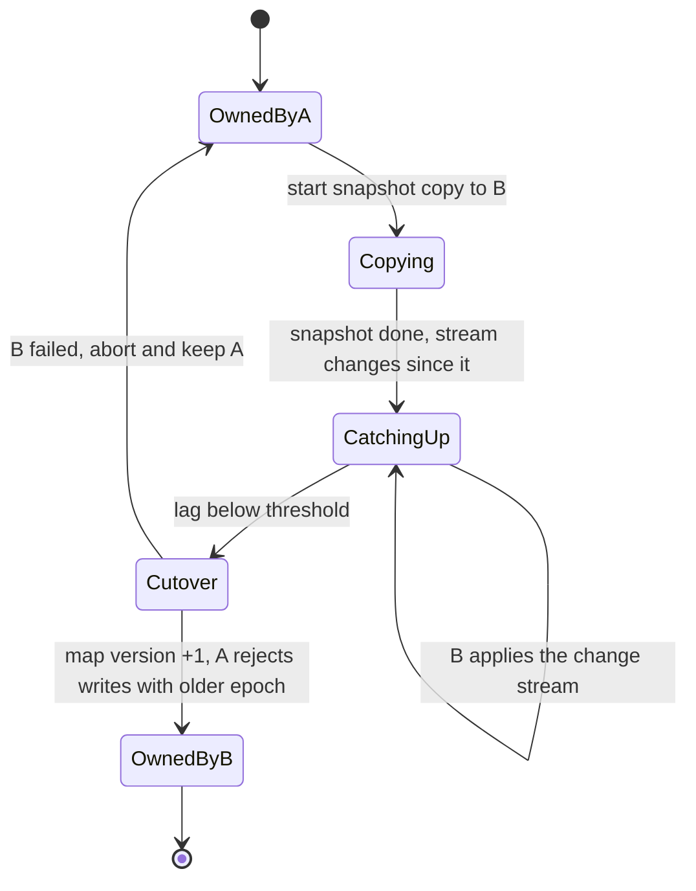

+++
title = 'Partitioning and sharding'
description = 'Partitioning spreads data and load across machines. The partition key decides which queries stay on one node, the placement scheme decides how much data moves when the cluster changes, and neither one fixes a key that is simply too hot.'
question = 'How do you split data across machines so that load stays even, queries stay local, and adding a node does not move everything?'
weight = 3
difficulty = 3
prerequisites = ['/notes/systems-design/scale-and-performance/02-caching', '/notes/systems-design/concurrency-and-consistency/04-replication-and-quorums']
date = 2026-10-30T06:15:00Z
lastmod = 2026-10-30T06:15:00Z
verified = 2026-10-30
+++

## The idea in one minute

When one machine cannot hold the data or serve the load, split the keys into
**partitions** (also called shards) and give each node a share. Two separate
decisions follow, and most sharding trouble comes from mixing them up:

1. **Key to partition.** Range partitioning keeps keys sorted, so range scans
   stay on one partition, but sequential keys pile onto the last partition.
   Hash partitioning spreads keys evenly and gives up range scans. Whatever the
   scheme, a query that does not include the partition key must ask every
   partition.
2. **Partition to node.** `hash(key) mod N` is balanced but moves about
   N / (N + 1) of all keys when one node joins: 91% for ten nodes. Consistent
   hashing, rendezvous hashing, and a fixed set of many partitions all move
   close to the minimum, 1 / (N + 1).

Hashing spreads keys, not load. One key that receives a fifth of the traffic
lands on one node whatever the scheme. The consequence to act on: **choose the
partition key from the queries you must serve, place partitions so that
rebalancing moves only the share that has to move, and plan separately for hot
keys**.

## A picture

```mermaid {title="Two mappings: key to partition, then partition to node"}
flowchart LR
  K["<b>Key</b><br/><small>tenant 42, order 9001</small>"] --> P["<b>Partition function</b><br/><small>hash or range</small>"]
  P --> T["<b>Partition 717</b><br/><small>of 1,024, fixed</small>"]
  T --> M["<b>Partition map</b><br/><small>versioned, in a<br/>coordination service</small>"]
  M --> N1["<b>Node 3</b><br/><small>primary</small>"]
  M --> N2["<b>Node 9</b><br/><small>replica, other zone</small>"]
  Q["<b>Query without<br/>partition key</b>"] -.->|"scatter to all 1,024"| M
  class K io
  class P,T neutral
  class M good
  class N1,N2 memory
  class Q warn
```

Rebalancing changes only the map. The key-to-partition function never changes,
so adding a node moves whole partitions and no key is rehashed.

## How it really works

### What the partition key decides

| Scheme | How keys map | Good at | Weak at | Seen in |
| --- | --- | --- | --- | --- |
| **Range** | Sorted key ranges, split when a range grows | Range scans, ordered iteration | Hot spots on sequential keys such as timestamps and auto-increment IDs | Bigtable tablets, HBase regions, Spanner splits |
| **Hash** | Hash of the key picks the partition | Even spread of keys | Range queries scatter to every partition | Dynamo-style stores, Redis Cluster |
| **Compound** | Hash on the first part, sorted on the rest | Even spread across tenants, ordered within one | Large single tenants | Cassandra partition and clustering keys, DynamoDB partition and sort keys |

The partition key should be the attribute that almost every query names. A
user-facing store keyed by `user_id` can answer "this user's orders" from one
partition. The same store asked for "all orders over $1,000 today" must send
the query to every partition and merge the results, which makes every such
query as slow as the slowest partition, the fan-out problem in
[load balancing and tail latency](/notes/systems-design/scale-and-performance/04-load-balancing-and-tail-latency/).

Secondary indexes force the same choice again. A **local index** lives with
each partition and indexes only its rows: writes stay on one partition, and
reads by the indexed attribute scatter to all of them. A **global index** is
itself partitioned by the indexed value: reads go to one index partition, and
each write must update a partition elsewhere, usually asynchronously, so the
index lags the data.

### Hash mod N, and why it fails on resize

`hash(key) mod N` gives each node an even share. A key stays put when N
becomes N + 1 only if its hash gives the same remainder for both, which happens
for about 1 / (N + 1) of keys. So about N / (N + 1) of all keys move: 90.9% for
ten nodes growing to eleven. For a cache, that is a near-total cold start; for
a database, it is a migration of almost every byte.

The arithmetic for a 20-node store holding 2 TB per node, growing to 25 nodes:

| Scheme | Data that must move | At 500 MB/s total migration bandwidth |
| --- | --- | --- |
| Minimum: 5 / 25 of 40 TB | 8 TB | 16,000 s, about 4.4 hours |
| Hash mod N: about 20 / 25 of 40 TB | 32 TB | 64,000 s, about 18 hours |

Migration bandwidth competes with serving traffic, so in practice it is
throttled further.

### Consistent hashing and virtual nodes

Karger and colleagues (1997) put nodes and keys on the same circle of hash
values. A key belongs to the first node clockwise from its hash. When a node
joins, it takes over the arc between its predecessor and itself, and keys move
only from one existing node to the new one. The expected share moved is the
minimum, 1 / (N + 1).

With one point per node the arcs are uneven: the largest of N random arcs is
about ln N times the average, and the simulation's busiest node holds 2.5
times the mean on ten nodes. **Virtual nodes** fix this: each physical node is
placed at v points, and its share becomes a sum of v arcs, whose relative
spread shrinks roughly as 1 / √v. Virtual nodes also mean that when a node
fails, its keys spread over many successors instead of doubling the load on a
single neighbor. Giving a larger machine more points gives it a proportionally
larger share.

| Scheme | Keys moved, 10 → 11 nodes | All moved keys went to the new node? | Busiest node / mean, 11 nodes |
| --- | --- | --- | --- |
| Hash mod N | 90.9% | No | 1.01 |
| Ring, 1 point per node | 13.0% | Yes | 2.74 |
| Ring, 10 points | 8.6% | Yes | 1.93 |
| Ring, 100 points | 7.6% | Yes | 1.23 |
| Ring, 1,000 points | 9.3% | Yes | 1.03 |
| Rendezvous (HRW) | 9.1% | Yes | 1.02 |
| Jump consistent hash | 9.1% | Yes | 1.01 |
| Ring, 100 points, bounded load 1.10 | 8.5% | No | 1.10 |

The ring with 100 points moved fewer keys than the ideal 9.1%: the new node's
points happened to cover less than its share of the circle, which is the same
imbalance the last column measures.

### Alternatives to the ring

- **Rendezvous hashing** (highest random weight; Thaler and Ravishankar,
  1998). Score every node with `hash(node, key)` and pick the highest. It
  moves the minimum, balances as well as the hash function, needs no ring, and
  gives a natural replica list: the top three scores. The cost is O(N) hashes
  per lookup, which is fine for tens or hundreds of nodes and can be made
  hierarchical for more.
- **Jump consistent hash** (Lamping and Veach, 2014). A few lines of
  arithmetic map a key to one of N numbered buckets in O(ln N) time with no
  memory and near-perfect balance. Buckets can only be added or removed at the
  end of the numbering, which suits numbered storage shards and does not suit
  a pool of servers that fail individually.
- **Maglev hashing** (Eisenbud and colleagues, 2016). Each backend fills a
  fixed-size lookup table in its own pseudo-random order; lookups are one array
  index. Google's software network load balancer uses it so that every
  balancer maps a connection to the same backend with near-even load and
  little disruption when backends change.
- **Consistent hashing with bounded loads** (Mirrokni, Thorup, and
  Zadimoghaddam, 2018). Cap each node at c times the average load; a key whose
  node is full moves clockwise to the next node with room. The cap holds by
  construction (1.10 in the table), at the price of extra movement: some keys
  shift between existing nodes when the cluster changes. HAProxy exposes the
  idea as `hash-balance-factor`.

### Many fixed partitions instead of moving keys

A simpler design avoids rehashing altogether: create many more partitions than
nodes when the system is built, and move whole partitions. Redis Cluster
divides keys into 16,384 hash slots and assigns slots to nodes; a client that
asks the wrong node is told which node owns the slot. Elasticsearch sets the
number of primary shards when an index is created; changing it later means a
split, a shrink, or a reindex. The partition count is the
one decision that is hard to change later: Kafka, for example, routes keyed
messages by hash modulo the partition count, so adding partitions to a topic
changes which partition each key goes to.

Range-partitioned systems split instead. Bigtable splits a tablet when it
grows past a size threshold, and Spanner also splits and moves ranges by load.
Splitting adapts to skew in the data, which hashing cannot, but the split
points have to be found and moved while traffic continues.

### Moving a partition safely

Changing the map is instant; moving the data is not. A safe move has phases:



- **Copy, then catch up.** B loads a snapshot while A keeps serving, then
  applies the change log from the snapshot point until it is nearly current.
- **Cut over with an epoch.** The new map version carries a higher epoch, and
  the old owner refuses writes stamped with an older one. This is a
  [fencing token](/notes/systems-design/concurrency-and-consistency/02-locks-leases-and-fencing/)
  for partitions, and it is what stops a paused node A from accepting writes
  after B has taken over.
- **Let routers catch up lazily.** Clients and routers with an old map send
  some requests to A, which redirects them; Redis Cluster's `MOVED` reply works
  this way.
- **Throttle the copy** so migration does not starve serving traffic, and move
  a few partitions at a time so a failed move can be abandoned cheaply.

### Hot keys and skewed partitions

Every placement scheme above balances keys. None balances a workload where
one key is much hotter than the others. Options, in rough order of cost:

- **Cache the hot reads** in front of the partition, as in
  [caching](/notes/systems-design/scale-and-performance/02-caching/).
- **Salt the key for writes.** Append a suffix 0 … k−1 chosen at random, so
  writes to one logical key spread over k partitions; reads must then gather
  all k and combine them. Counters and append-only event streams suit this.
- **Split or isolate.** Split a hot range, or give a very large tenant its
  own partitions or its own cell, as in
  [blast radius and cells](/notes/systems-design/failure-modes/05-blast-radius-and-cells/).
- **Limit per key.** Rate-limit or queue requests per key so one key cannot
  saturate a shared partition.

Measure per-partition load, not just per-node load, and alert on the ratio of
the busiest partition to the mean.

### Partitioning in AI systems

- **Vector indexes.** Sharding by document gives each shard a subset of the
  corpus; every query searches every shard and merges the top results, so
  latency is the slowest shard's. Sharding by cluster of similar vectors lets
  a query probe only a few shards, at the cost of hot clusters and lower
  recall when the right cluster is not probed.
- **KV cache affinity.** A model replica that already holds a conversation's
  prefix in its KV cache can skip most of the [prefill](/notes/inference-engineering/inference-mechanics/01-prefill-and-decode/) work. Routing each
  session by a consistent hash of its ID keeps it on the same replica, and
  adding a replica remaps only about 1 / (N + 1) of sessions instead of nearly
  all of them. A bounded-load variant keeps a popular shared prefix from
  overloading the one replica it hashes to.

> [!IMPORTANT]
> The number of partitions and the partition key are the two decisions that
> are expensive to change later. Choose the key from the queries you must
> answer from one partition, and create enough partitions for the largest
> cluster you expect to run.

## Code

The program places 100,000 keys on ten nodes with each scheme from the table,
adds an eleventh node, and reports the share of keys that changed owner,
whether every moved key went to the new node, and the busiest node's load
relative to the mean before and after. All hashing uses BLAKE2b, so the
results are deterministic.

```python {title="hashing.py"}
"""hashing.py: how many keys move when a node joins, and how even the load is.

Places 100,000 keys on 10 nodes with six schemes, adds an 11th node, and
reports the share of keys that changed owner (the ideal is 1/11 = 9.1%), whether
every moved key went to the new node, and the busiest node's load relative to
the mean. Standard library only; deterministic; runs offline.
"""

from __future__ import annotations

import bisect
import hashlib
import math
from collections import Counter
from typing import Callable

KEYS = [f"user:{i}" for i in range(100_000)]


def h64(text: str) -> int:
    return int.from_bytes(hashlib.blake2b(text.encode(), digest_size=8).digest(), "big")


def mod_n(nodes: list[str]) -> Callable[[str], str]:
    return lambda key: nodes[h64(key) % len(nodes)]


def ring(vnodes: int) -> Callable[[list[str]], Callable[[str], str]]:
    def build(nodes: list[str]) -> Callable[[str], str]:
        points = sorted((h64(f"{n}#{v}"), n) for n in nodes for v in range(vnodes))
        hashes = [p for p, _ in points]

        def owner(key: str) -> str:  # first point clockwise from the key's hash
            i = bisect.bisect(hashes, h64(key)) % len(points)
            return points[i][1]
        return owner
    return build


def rendezvous(nodes: list[str]) -> Callable[[str], str]:
    return lambda key: max(nodes, key=lambda n: h64(f"{n}|{key}"))  # highest random weight


def jump(nodes: list[str]) -> Callable[[str], str]:
    """Lamping and Veach's jump consistent hash; nodes must be numbered 0..n-1."""
    def owner(key: str) -> str:
        k, b, j = h64(key), -1, 0
        while j < len(nodes):
            b = j
            k = (k * 2862933555777941757 + 1) % 2**64
            j = int((b + 1) * (2**31 / ((k >> 33) + 1)))
        return nodes[b]
    return owner


def bounded_ring(nodes: list[str], c: float = 1.10, vnodes: int = 100) -> Callable[[str], str]:
    """Consistent hashing with bounded loads: skip any node already at c x the mean."""
    points = sorted((h64(f"{n}#{v}"), n) for n in nodes for v in range(vnodes))
    hashes = [p for p, _ in points]
    cap = math.ceil(c * len(KEYS) / len(nodes))
    load: Counter[str] = Counter()
    placed: dict[str, str] = {}
    for key in KEYS:  # keys arrive in a fixed order
        i = bisect.bisect(hashes, h64(key))
        while load[points[i % len(points)][1]] >= cap:
            i += 1
        placed[key] = points[i % len(points)][1]
        load[placed[key]] += 1
    return placed.__getitem__


def measure(build: Callable[[list[str]], Callable[[str], str]]) -> tuple[float, bool, float, float]:
    before_nodes = [str(i) for i in range(10)]
    after_nodes = before_nodes + ["10"]
    before, after = build(before_nodes), build(after_nodes)
    owners_before = [before(k) for k in KEYS]
    owners_after = [after(k) for k in KEYS]
    moved = [(a, b) for a, b in zip(owners_before, owners_after) if a != b]
    only_to_new = all(b == "10" for _, b in moved)
    def peak(owners: list[str], n: int) -> float:
        return max(Counter(owners).values()) / (len(KEYS) / n)
    return len(moved) / len(KEYS), only_to_new, peak(owners_before, 10), peak(owners_after, 11)


def main() -> None:
    schemes = [
        ("hash mod N", mod_n),
        ("ring, 1 point per node", ring(1)),
        ("ring, 10 points per node", ring(10)),
        ("ring, 100 points per node", ring(100)),
        ("ring, 1,000 points per node", ring(1000)),
        ("rendezvous (HRW)", rendezvous),
        ("jump consistent hash", jump),
        ("ring 100 + bounded load 1.10", bounded_ring),
    ]
    print("100,000 keys; 10 nodes, then an 11th joins. Ideal share moved: 9.1%")
    print(f"{'scheme':<30}{'moved':>8}  {'all to new?':>11}  {'max/mean (10)':>13}  {'max/mean (11)':>13}")
    for name, build in schemes:
        moved, only_new, p10, p11 = measure(build)
        print(f"{name:<30}{moved:>8.1%}  {'yes' if only_new else 'no':>11}  {p10:>13.2f}  {p11:>13.2f}")


if __name__ == "__main__":
    main()
```

Run it with `python3 hashing.py`:

```text
100,000 keys; 10 nodes, then an 11th joins. Ideal share moved: 9.1%
scheme                           moved  all to new?  max/mean (10)  max/mean (11)
hash mod N                       90.9%           no           1.01           1.01
ring, 1 point per node           13.0%          yes           2.49           2.74
ring, 10 points per node          8.6%          yes           1.76           1.93
ring, 100 points per node         7.6%          yes           1.20           1.23
ring, 1,000 points per node       9.3%          yes           1.03           1.03
rendezvous (HRW)                  9.1%          yes           1.02           1.02
jump consistent hash              9.1%          yes           1.01           1.01
ring 100 + bounded load 1.10      8.5%           no           1.10           1.10
```

What to read from it:

- **Mod N is perfectly balanced and terrible to resize.** Ten of every eleven
  keys move, most of them between old nodes.
- **A ring needs many points per node.** With one point the busiest node holds
  2.5 to 2.7 times its share, so its capacity, not the average, sets the fleet
  size. With 1,000 points the imbalance is 3%.
- **Rendezvous and jump hashing are balanced and minimal** without any
  tuning; their limits are lookup cost and the numbering constraint.
- **Bounded loads trade movement for a hard cap.** The busiest node is held at
  1.10 times the mean, and some keys move between existing nodes.

## Where it breaks

- **Keys are not load.** The program counts keys, each equally popular and
  equally large. Real keys differ by orders of magnitude in size and request
  rate, so a balanced key count can still leave a hot node. Balance on
  measured load, and handle hot keys separately.
- **Everyone must agree on the map.** Two routers with different membership
  views send the same key to different nodes. Version the partition map, keep
  it in one authoritative place, and let nodes reject requests for partitions
  they do not own.
- **Replicas must land in different failure domains.** Walking the ring to the
  next few points can pick two virtual nodes of the same machine, or two
  machines in the same zone. Replica placement must skip duplicates by host
  and by zone.
- **Rebalancing is a data copy.** The mapping says which keys move; the bytes
  still have to cross the network while the system serves traffic. Throttle
  it, and budget the hours.
- **Cross-partition operations are expensive.** Transactions and joins that
  span partitions need coordination, which the module on distributed data
  covers. Choose the partition key so that the common transaction stays on one
  partition.

## Remember this

- Key to partition and partition to node are separate decisions.
- The partition key should appear in almost every query; anything else
  scatters to every partition.
- `hash mod N` moves N / (N + 1) of keys on resize; consistent, rendezvous,
  and jump hashing move about 1 / (N + 1).
- A ring needs hundreds of virtual nodes per server to stay within about 20%
  of even.
- Many fixed partitions with a versioned map make rebalancing a move, not a
  rehash.
- Hot keys need caching, salting, or isolation; no hash fixes them.

## Try it

1. Run `hashing.py`. Remove node 3 instead of adding a node. For the ring with
   one point per node, where do node 3's keys go, and what is the new busiest
   node's load?
2. Give one node twice the points of the others on the 100-point ring. Does it
   receive twice the keys?
3. Make 1% of keys receive 100 times the traffic of the rest and measure the
   busiest node's request load (not key count) under rendezvous hashing. What
   would salting the hottest keys into four sub-keys change?
4. Implement replica placement on the 100-point ring: walk clockwise and take
   the next two distinct physical nodes. Then assign nodes to three zones and
   require distinct zones. How often does the zone constraint change the choice?
5. For a sharded store you operate, find the partition count and how it was
   chosen. How many nodes can the cluster grow to before partitions must split?

## Check yourself

1. A cache cluster of 12 nodes uses `hash(key) mod N`. One node is added. What
   share of the cache is effectively lost, and what would consistent hashing
   lose?

   
   With mod N about 12 / 13 ≈ 92% of keys map to a different node, so almost
   the whole cache is cold at once. With consistent hashing about 1 / 13 ≈ 8%
   of keys move, all to the new node.
   

2. Why does a consistent-hash ring with one point per node give uneven load,
   and what fixes it?

   
   Each node owns the arc before its single point, and random arcs vary
   widely: the largest of N is about ln N times the average. Placing each node
   at many virtual points makes its share the sum of many arcs, whose relative
   variation shrinks roughly as one over the square root of the number of
   points.
   

3. An events table is range-partitioned by timestamp. Writes are slow and one
   node is at 100% CPU while the others are idle. Why, and what are two fixes?

   
   Every new event has the latest timestamp, so all writes go to the last
   range. Fixes: partition by a hash of a source or tenant identifier first and
   by time within it (a compound key), or prefix the key with a small salt so
   writes spread over several ranges, at the cost of reading all of them for a
   time-range query.
   

4. Why must a partition move include an epoch or fencing check at cutover?

   
   The old owner may be paused or partitioned and not yet know it has lost the
   partition. Without a check it could accept writes after the new owner took
   over, and those writes would be lost or would diverge. Stamping the new map
   with a higher epoch and rejecting writes from older epochs stops this.
   

5. When is jump consistent hash a poor choice?

   
   When nodes leave from the middle of the set, as servers in a pool do when
   they fail. Jump hash maps to buckets numbered 0 to N − 1 and only supports
   adding or removing the highest-numbered bucket, so it suits numbered
   storage shards behind a separate shard-to-server map.
   

## Sources

- D. Karger, E. Lehman, T. Leighton, R. Panigrahy, M. Levine, D. Lewin,
  "Consistent Hashing and Random Trees: Distributed Caching Protocols for
  Relieving Hot Spots on the World Wide Web", ACM STOC, 1997.
- D. G. Thaler, C. V. Ravishankar, "Using Name-Based Mappings to Increase Hit
  Rates", *IEEE/ACM Transactions on Networking* 6(1), February 1998.
- J. Lamping, E. Veach, [A Fast, Minimal Memory, Consistent Hash
  Algorithm](https://arxiv.org/abs/1406.2294), arXiv:1406.2294, 2014.
- D. E. Eisenbud et al., [Maglev: A Fast and Reliable Software Network Load
  Balancer](https://www.usenix.org/conference/nsdi16/technical-sessions/presentation/eisenbud),
  USENIX NSDI, 2016.
- V. Mirrokni, M. Thorup, M. Zadimoghaddam, [Consistent Hashing with Bounded
  Loads](https://arxiv.org/abs/1608.01350), ACM-SIAM SODA, 2018.
- G. DeCandia et al., "Dynamo: Amazon's Highly Available Key-value Store", ACM
  SOSP, 2007.
- F. Chang et al., "Bigtable: A Distributed Storage System for Structured
  Data", USENIX OSDI, 2006.
- J. C. Corbett et al., "Spanner: Google's Globally-Distributed Database",
  USENIX OSDI, 2012.
- Redis, [Redis cluster specification](https://redis.io/docs/latest/operate/oss_and_stack/reference/cluster-spec/).
- Apache Kafka, [Documentation](https://kafka.apache.org/documentation/)
  (topic partitions and keyed message routing).
- M. Kleppmann, *Designing Data-Intensive Applications*, O'Reilly, 2017,
  chapter 6.
