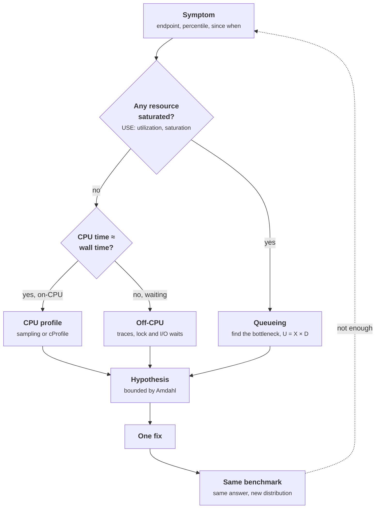

+++
title = 'Profiling a slow service'
description = 'Profiling works when it answers a question you have already narrowed down: which endpoint, which percentile, which resource. Then a profiler shows where the time goes, Amdahl’s law says what a fix can buy, and a repeated measurement shows whether it did.'
question = 'When a service is slow, how do you find the code responsible and prove that a fix worked?'
weight = 5
difficulty = 3
prerequisites = ['/notes/systems-design/scale-and-performance/01-queueing-and-littles-law', '/notes/systems-design/reliability-in-production/02-observability-signals']
date = 2026-10-30T06:25:00Z
lastmod = 2026-10-30T06:25:00Z
verified = 2026-10-30
+++

## The idea in one minute

"The service is slow" is not yet a question a [profiler](/notes/systems-design/observability/02-tracing-and-profiling/) can answer. First
narrow it: which endpoint, which percentile, since when, and whether any
resource is saturated. A saturated resource is a queueing problem, solved with
the bottleneck arithmetic in
[queueing and Little's law](/notes/systems-design/scale-and-performance/01-queueing-and-littles-law/).
If nothing is saturated, compare a request's **CPU time with its wall time**.
If they are close, a CPU profiler will show where the time goes. If wall time
is much larger, the request is waiting on a lock, a pool, the disk, or another
service, and a CPU profiler will mislead you.

Once a profile points at a function, **Amdahl's law** bounds the gain: making
a part that takes a fraction p of the time infinitely fast speeds the whole up
by at most 1 / (1 − p). Then fix one thing, rerun the same measurement, check
that the answer did not change, and compare distributions, not single runs.

The consequence to act on: **measure before profiling, profile before
changing code, and keep the benchmark that proves the change**.

## A picture



## How it really works

### Start from the symptom

The questions that narrow a slowdown, in order:

- **Which requests?** One endpoint, one tenant, one request size, or all of
  them. The RED metrics from
  [observability signals](/notes/systems-design/reliability-in-production/02-observability-signals/)
  answer this per route.
- **Which percentile?** A median regression usually means more work on the
  common path, often a code change. A p99 regression with a flat median is
  more often queueing, garbage collection, lock contention, a slow dependency,
  or a rare large input.
- **Since when?** Line the start up against deploys, configuration changes,
  traffic growth, and dependency changes. Most regressions have a date.
- **Is anything saturated?** CPU run queue, connection pool waits, thread pool
  queue depth, disk queue, accelerator memory. Saturation means requests are
  waiting for a resource, and making the code faster is only one of the fixes.

### On-CPU or off-CPU

Record two clocks for a request: wall time (`time.perf_counter()`) and CPU
time of the thread that served it (`time.thread_time()`). A request that takes
200 ms of wall time and 5 ms of CPU spent 195 ms waiting. A CPU profiler will
show those 5 ms in detail and say nothing about the 195. Waiting time is
found with distributed traces (which span is long), lock and pool wait
metrics, and **off-CPU analysis**, which records where threads block and for
how long. Brendan Gregg's *Systems Performance* describes both views; most
slow services need both at some point.

Python adds one waiting place of its own: the global interpreter lock. CPU-bound
Python threads in the standard build do not run Python code in parallel, so a
thread can be runnable and still wait. PEP 703 introduced a free-threaded
build without the lock, and as of October 2026 it is an officially supported
build option in Python 3.14, though most deployments still use the default
build.

### Amdahl's law

If a fraction p of the time is spent in the part you speed up by a factor s,
the whole speeds up by

**1 / ((1 − p) + p / s)**, which is at most **1 / (1 − p)**.

| Share of time in the part you fix | Best possible speedup |
| --- | --- |
| 10% | 1.11× |
| 25% | 1.33× |
| 50% | 2× |
| 81% | 5.3× |
| 95% | 20× |

The law is a filter for proposals. Rewriting the JSON layer that takes 15% of
a request cannot make it more than 1.18 times faster. For concurrent and
multi-stage code it is optimistic: a function that is not on the critical path
can be made faster with no effect on latency. Curtsinger and Berger's **causal
profiling** (Coz, 2015) measures what speeding up a line would do by slowing
everything else down instead, which captures that effect.

### Deterministic and sampling profilers

| Kind | How it works | Strengths | Limits |
| --- | --- | --- | --- |
| **Deterministic** (`cProfile`) | Hooks every function call and return | Exact call counts; per-function own and cumulative time; in the standard library | Overhead grows with the number of calls; cannot see work done inline in a function body; development use |
| **Sampling** (py-spy, Linux `perf`) | Records the stack many times a second | Low overhead; attaches to a running process; production use | Statistical; short functions may be missed; needs symbol and frame information |
| **Tracing** (OpenTelemetry spans) | Times named operations per request | Breaks one request down across services | Only sees what was instrumented |
| **Continuous profiling** | Samples the whole fleet all the time | Finds fleet-wide costs and regressions over time | Storage and aggregation cost |

Python 3.12 added support for the Linux `perf` profiler, so `perf` can show
Python function names alongside native frames (enable it with `-X perf` or
`PYTHONPERFSUPPORT=1`). py-spy reads a running interpreter's stacks from
outside the process without changing its code; its `--idle` option includes
threads that are waiting, which matters for servers. Google's fleet-wide
profiling (Ren and colleagues, 2010) showed how continuous sampling across
thousands of machines finds costs no single-host profile reveals.

### Reading a profile

A `cProfile` report gives, per function:

- `ncalls`, the number of calls. Exact and the most underused column. A
  function called once per item when it should run once per request shows up
  here before it shows up in time.
- `tottime`, the function's own time, excluding the functions it called.
- `cumtime`, its time including everything it called.

Work that is not a function call, such as `x in some_list`, arithmetic, or
attribute access, is charged to the `tottime` of the function whose body runs
it. **A large `tottime` in a function with cheap callees means the cost is in
its own loops.** To see which line, move the suspect expression into a small
function and profile again, or use a sampling profiler that reports line
numbers.

**Flame graphs** (Gregg, 2016) draw sampled stacks with width proportional to
the share of samples. The horizontal axis is sorted by function name, not by
time, so position means nothing and width means everything. Look for wide
frames at the top edge: those are where the CPU was when sampled. A
**differential** flame graph, before against after, shows what a regression
added.

### Complexity hides in plain sight

Many slow services are fast on test data and quadratic in production. Time the
code at doubling input sizes: linear work doubles; quadratic work roughly
quadruples. In the program below, the slow handler goes from 81 ms to 255 ms
to 887 ms to 3,169 ms as the batch doubles, ratios of 3.1, 3.5, and 3.6,
approaching 4. The fixed handler roughly doubles.

### Measuring the fix

- **Same input, same answer.** Check the output is identical before and after;
  a fast wrong answer is a new bug.
- **Repeat and compare distributions.** For a microbenchmark, the `timeit`
  documentation recommends looking at the minimum of several repeats, because
  higher values usually come from other processes interfering. For a service,
  rerun the same open-loop load test and compare the p50 and p99, since the
  change may move the tail differently from the median.
- **Control the machine.** CPU frequency scaling, other tenants, and a cold
  cache all change timings by more than many fixes do.
- **Keep the benchmark.** A benchmark in continuous integration with a
  threshold, or a regression alert from continuous profiling, stops the same
  slowdown from returning.

### Profiling model-serving hosts

Accelerators are fast enough that the host can become the bottleneck. Between
decoding steps, a [serving engine](/notes/inference-engineering/serving-systems/01-anatomy-of-a-serving-engine/) schedules requests, builds input tensors,
launches kernels, and detokenizes and streams output, mostly in Python. When
that work takes longer than the step itself, accelerator utilization falls
while host CPU sits at 100% on one core. Profile the Python side with a
sampling profiler and look at the CPU and accelerator timeline together with
the PyTorch profiler or NVIDIA Nsight Systems; reducing host overhead was one
stated goal of the vLLM V1 engine rework. Kernel-level profiling on the
accelerator itself is a separate discipline, covered in the machine learning
systems course.

> [!TIP]
> Before profiling, write down what you expect to see. A profile that
> contradicts the expectation is the most valuable one, and without the
> expectation you will not notice the contradiction.

## Code

The handler summarizes a batch of audit events: it drops duplicate event IDs,
attaches a policy label to each event, and reports the ten most active actors.
It is slow in two ordinary ways: duplicate checks scan a growing list, and the
policy is serialized to JSON and hashed again for every event although there
are only three distinct labels. The program times it, profiles it with
`cProfile`, then times a fixed version, checks the answers match, and repeats
both at doubling batch sizes. Timings vary by machine and run; the call counts
do not.

```python {title="slow_service.py"}
"""slow_service.py: profile a deliberately slow request handler, fix it, and measure.

The handler summarizes a batch of audit events for one tenant: drop duplicate
event IDs, attach a per-event policy label, and report the ten actors with the
most events. It is slow in two ordinary ways. The program times it, profiles
it with cProfile, then times a fixed version and checks both give the same answer.
Standard library only; seeded input; runs offline. Timings vary by machine.
"""

from __future__ import annotations

import cProfile
import hashlib
import io
import json
import pstats
import random
import time
from collections import Counter

POLICY = {"tenant": "t-42", "rules": [f"rule-{i}" for i in range(200)], "version": 7}


def make_events(n: int, seed: int = 1) -> list[dict]:
    rng = random.Random(seed)
    return [{"id": rng.randrange(n * 9 // 10), "actor": f"user-{rng.randrange(500)}",
             "action": rng.choice(["read", "write", "delete"])} for _ in range(n)]


def policy_label(policy: dict, action: str) -> str:
    blob = json.dumps(policy, sort_keys=True) + action  # re-serializes the policy every call
    return hashlib.sha256(blob.encode()).hexdigest()[:8]


def summarize_slow(events: list[dict]) -> tuple[int, list[tuple[str, int]], str]:
    seen: list[int] = []
    counts: dict[str, int] = {}
    labels = []
    for event in events:
        if event["id"] in seen:  # linear scan of a growing list: quadratic overall
            continue
        seen.append(event["id"])
        labels.append(policy_label(POLICY, event["action"]))
        counts[event["actor"]] = counts.get(event["actor"], 0) + 1
    top = sorted(counts.items(), key=lambda kv: (-kv[1], kv[0]))[:10]
    return len(seen), top, hashlib.sha256("".join(labels).encode()).hexdigest()[:12]


def summarize_fast(events: list[dict]) -> tuple[int, list[tuple[str, int]], str]:
    seen: set[int] = set()  # constant-time membership
    counts: Counter[str] = Counter()
    prefix = json.dumps(POLICY, sort_keys=True)  # serialize once per request
    label_for = {a: hashlib.sha256((prefix + a).encode()).hexdigest()[:8]
                 for a in ("read", "write", "delete")}  # three distinct answers: compute them once
    labels = []
    for event in events:
        if event["id"] in seen:
            continue
        seen.add(event["id"])
        labels.append(label_for[event["action"]])
        counts[event["actor"]] += 1
    top = sorted(counts.items(), key=lambda kv: (-kv[1], kv[0]))[:10]
    return len(seen), top, hashlib.sha256("".join(labels).encode()).hexdigest()[:12]


def timed(fn, events: list[dict]) -> tuple[float, tuple]:
    start = time.perf_counter()
    result = fn(events)
    return time.perf_counter() - start, result


def main() -> None:
    events = make_events(20_000)
    slow_s, slow_result = timed(summarize_slow, events)
    print(f"slow handler, {len(events):,} events: {slow_s * 1000:,.0f} ms")

    profiler = cProfile.Profile()
    profiler.enable()
    summarize_slow(events)
    profiler.disable()
    out = io.StringIO()
    stats = pstats.Stats(profiler, stream=out).strip_dirs().sort_stats("tottime")
    stats.print_stats(6)
    lines = out.getvalue().splitlines()
    start = next(i for i, line in enumerate(lines) if "ncalls" in line)
    print("\ncProfile, sorted by own time (tottime), top 6:")
    print("\n".join(line.rstrip() for line in [lines[0].strip(), lines[2]] + lines[start:start + 7]))

    fast_s, fast_result = timed(summarize_fast, events)
    print(f"\nfast handler: {fast_s * 1000:,.1f} ms  ({slow_s / fast_s:,.0f}x faster)")
    print(f"same answer: {fast_result == slow_result}  "
          f"(unique events {fast_result[0]:,}, top actor {fast_result[1][0]})")

    print("\nscaling: time per call as the batch grows")
    for n in [5_000, 10_000, 20_000, 40_000]:
        batch = make_events(n, seed=n)
        s, _ = timed(summarize_slow, batch)
        f, _ = timed(summarize_fast, batch)
        print(f"  {n:>6,} events  slow {s * 1000:>8,.0f} ms   fast {f * 1000:>6.1f} ms")


if __name__ == "__main__":
    main()
```

Run it with `python3 slow_service.py` (Python 3.14.8 on a laptop for
the run below):

```text
slow handler, 20,000 events: 954 ms

cProfile, sorted by own time (tottime), top 6:
169041 function calls in 0.882 seconds
   Ordered by: internal time
   ncalls  tottime  percall  cumtime  percall filename:lineno(function)
        1    0.712    0.712    0.882    0.882 slow_service.py:35(summarize_slow)
    12038    0.115    0.000    0.115    0.000 encoder.py:207(iterencode)
    12039    0.013    0.000    0.013    0.000 {built-in method _hashlib.openssl_sha256}
    12038    0.011    0.000    0.166    0.000 slow_service.py:30(policy_label)
    12038    0.009    0.000    0.136    0.000 __init__.py:185(dumps)
    12038    0.007    0.000    0.126    0.000 encoder.py:185(encode)

fast handler: 2.6 ms  (362x faster)
same answer: True  (unique events 12,038, top actor ('user-49', 38))

scaling: time per call as the batch grows
   5,000 events  slow       81 ms   fast    0.9 ms
  10,000 events  slow      255 ms   fast    1.6 ms
  20,000 events  slow      887 ms   fast    2.8 ms
  40,000 events  slow    3,169 ms   fast    5.7 ms
```

Where the profiled 882 ms went:

```mermaid {title="The slow handler's profile: most time is the handler's own loop"}
pie showData
  "summarize_slow own time (list scans)" : 712
  "json.dumps inside policy_label" : 136
  "hashing and the rest of policy_label" : 30
  "everything else" : 4
```

How to read it:

- **The top line is the handler itself.** `summarize_slow` has 0.712 s of own
  time and only 0.166 s in its callees. No function call is slow; the
  `event["id"] in seen` scan runs inline in its body, so the profiler charges
  it to the handler. That is the signature of an inline cost.
- **The call counts tell the second story.** `json.dumps` ran 12,038 times,
  once per unique event, to produce one of three possible labels. Work that
  belongs once per request is running once per item.
- **Amdahl sets expectations.** The list scan is 81% of the profile, so fixing
  it alone could give at most about 5.3 times; fixing the per-event JSON alone
  at most about 1.2 times. Fixing both removed nearly all the work, which is
  why the total gain is far larger than either bound.
- **The scaling table confirms the diagnosis.** The slow handler's time grows
  about 3.5 times per doubling, close to quadratic; the fast one doubles.
- **Profiling overhead was small here** because the slow code makes few
  function calls. Code with many tiny functions is distorted much more by a
  deterministic profiler, and that is when a sampling profiler is the better
  tool.

## Where it breaks

- **A CPU profile cannot see waiting.** The example is pure computation. A
  service waiting on a database shows a quiet CPU profile; use traces, pool
  wait metrics, and off-CPU analysis.
- **Profilers disagree and distort.** Mytkowicz and colleagues (2010) found
  that four Java profilers often disagreed about the hottest method on the same
  program, because of where they were able to take samples. Deterministic
  profilers inflate code with many small calls. Treat a profile as a
  hypothesis and confirm it with a measured fix.
- **The input decides the profile.** This handler is fast with 500 events and
  slow with 40,000. Profile with production-sized and production-shaped data,
  or profile production itself with a sampling profiler.
- **A faster function is not a faster request.** If the function is off the
  critical path, or the request is waiting on something else, latency does not
  move. Measure end-to-end latency after the fix, not only the function.
- **One run is not a measurement.** The first line of the output and the
  profiled run differ by about 8% on the same input. Repeat runs and compare
  distributions before claiming a small gain.

## Remember this

- Narrow the symptom first: endpoint, percentile, start time, saturated
  resources.
- Compare CPU time with wall time; a CPU profiler only explains the CPU part.
- Amdahl's law: fixing a fraction p gives at most 1 / (1 − p).
- In `cProfile`, read `ncalls` for work done too often and large `tottime`
  with cheap callees for inline costs.
- Time at doubling sizes to spot quadratic code.
- Keep the benchmark that proved the fix, and check the answer did not change.

## Try it

1. Run `slow_service.py`. Move the `event["id"] in seen` check into its own
   function, `is_duplicate(seen, event_id)`, and profile again. Does the
   profile now name the cost directly, and how much did the extra calls add?
2. Fix only the list scan, keeping the per-event JSON. Compare the measured
   speedup with the Amdahl bound computed from the original profile.
3. Wrap the slow handler in a function that also sleeps 50 ms to simulate a
   database call. Record `time.perf_counter()` and `time.thread_time()` around
   it. What does `cProfile` say about the sleep?
4. Use `timeit.repeat` to time both handlers on the 20,000-event batch with five
   repeats. How large is the spread between the minimum and the maximum?
5. For a service you run, find the slowest endpoint by p99 and record wall time
   and CPU time for a sample of its requests. Is it on-CPU or off-CPU?

## Check yourself

1. A request takes 300 ms of wall time and 12 ms of CPU time. What does a CPU
   profile of the server tell you about it?

   
   Only where the 12 ms of CPU went. The other 288 ms were spent waiting: on a
   lock, a connection or thread pool, I/O, or another service. Distributed
   traces, wait metrics, or an off-CPU profile will find that time.
   

2. Serialization takes 20% of a request's time. What is the most a perfect
   serializer can achieve?

   
   1 / (1 − 0.2) = 1.25 times faster, and only if serialization is on the
   critical path of the request.
   

3. In a `cProfile` report, a function has a large `tottime` but its callees
   are cheap. Where is the time?

   
   In the function's own body: loops, comparisons, membership tests on lists,
   arithmetic, and attribute access, which the profiler does not record as
   calls. Look at its loops, or move suspect expressions into small functions
   to make them visible.
   

4. Doubling a batch size makes a handler 3.8 times slower. What does that
   suggest?

   
   Work that grows roughly with the square of the input, such as a nested loop
   or a linear search inside a loop. Linear work would roughly double.
   

5. Why compare the output of the old and new code as part of a performance
   fix?

   
   Many speedups change behavior: a different ordering, a skipped edge case, a
   cache that returns stale data. A benchmark that only measures time would
   reward a fast wrong answer. Checking that the outputs match on the same
   input is the cheapest guard against that.
   

## Sources

- G. M. Amdahl, "Validity of the Single Processor Approach to Achieving Large
  Scale Computing Capabilities", AFIPS Spring Joint Computer Conference, 1967.
- Python documentation, [The Python
  Profilers](https://docs.python.org/3/library/profile.html), [timeit](https://docs.python.org/3/library/timeit.html),
  and [Python support for the Linux perf
  profiler](https://docs.python.org/3/howto/perf_profiling.html).
- B. Gregg, "The Flame Graph", *Communications of the ACM* 59(6), June 2016.
- B. Gregg, *Systems Performance: Enterprise and the Cloud*, 2nd edition,
  Addison-Wesley, 2020.
- C. Curtsinger, E. D. Berger, "Coz: Finding Code that Counts with Causal
  Profiling", ACM SOSP, 2015.
- T. Mytkowicz, A. Diwan, M. Hauswirth, P. F. Sweeney, "Evaluating the
  Accuracy of Java Profilers", ACM PLDI, 2010.
- G. Ren et al., "Google-Wide Profiling: A Continuous Profiling Infrastructure
  for Data Centers", *IEEE Micro* 30(4), 2010.
- B. Frederickson, [py-spy: Sampling profiler for Python
  programs](https://github.com/benfred/py-spy).
- S. Gross, [PEP 703: Making the Global Interpreter Lock Optional in
  CPython](https://peps.python.org/pep-0703/), 2023.
- vLLM team, [vLLM V1: A Major Upgrade to vLLM's Core
  Architecture](https://blog.vllm.ai/2025/01/27/v1-alpha-release.html),
  January 2025.
