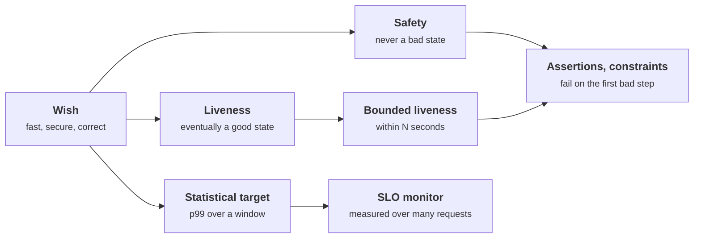
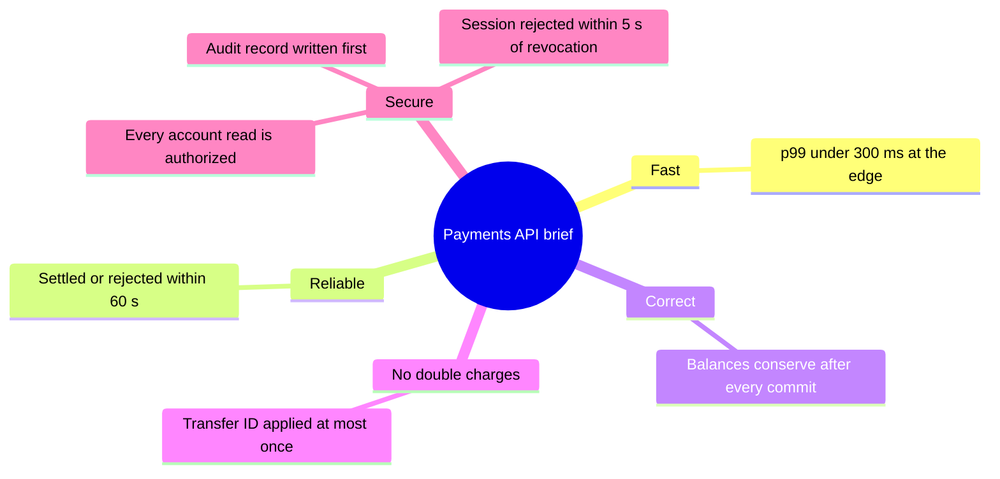
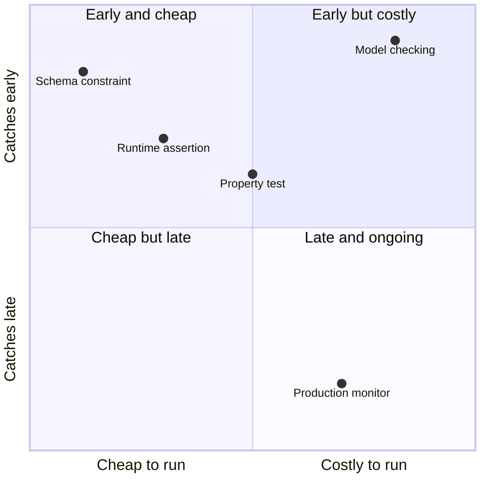
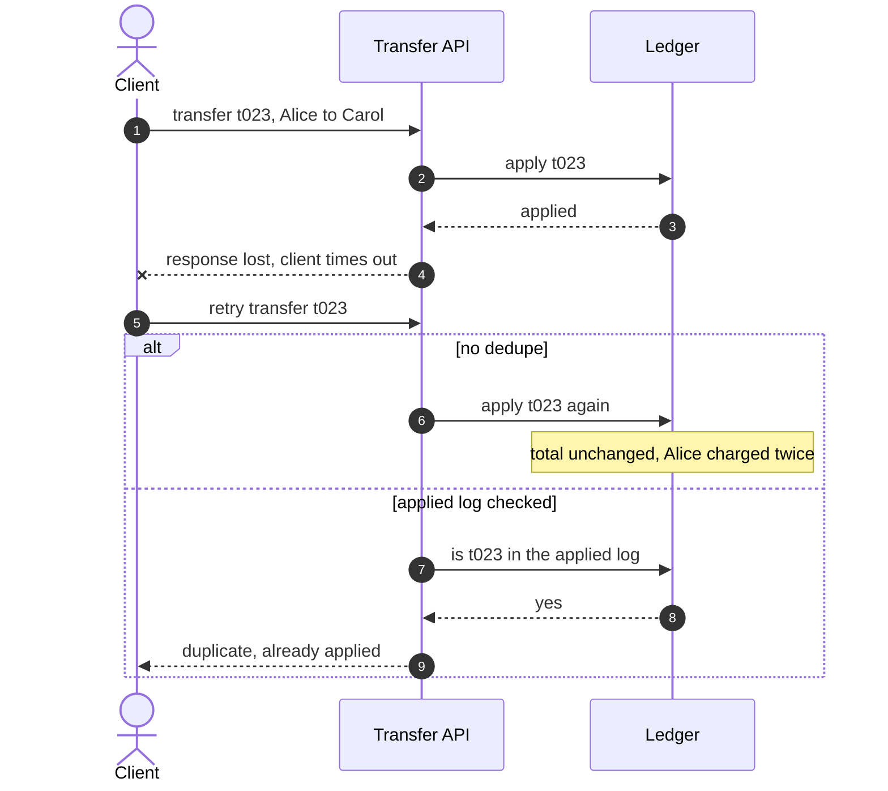

+++
title = 'What a design promises'
description = 'A requirement you cannot check is a wish. Rewrite each one as an invariant: a safety property no state may break, or a liveness property that something good eventually happens.'
question = 'How do you turn vague requirements into promises a system can be checked against?'
weight = 1
difficulty = 1
date = 2026-09-12
lastmod = 2026-09-12
verified = 2026-09-12
+++

## The idea in one minute

Every system makes promises, whether or not anyone wrote them down. A ledger
promises that money is neither created nor destroyed. A login service promises
that a revoked session stops working. A queue promises that an accepted job is
eventually processed. Design is the work of choosing those promises and then
keeping them while requests overlap, processes crash, and clients retry.

A promise is useful only if it can be checked. "It should be fast and secure"
cannot be checked; "every transfer is applied at most once" and "99% of
requests complete within 300 ms over each 28-day window" can. Promises
come in two shapes. A **safety property** says that something bad never
happens, and a single bad state proves it broken. A **liveness property**
says that something good eventually happens, and no finite observation proves
it broken; you can only give up waiting. Most real requirements are one, the
other, or a statistical target over a population of requests.

The consequence to act on: **before drawing any architecture, write the
invariants as statements a program could evaluate against a state or a
history**, then design so that the state needed to evaluate them exists.

## A picture



Bounded liveness ("within 30 seconds") turns a promise you can never refute
into one you can, which is why it feeds back into the same assertion machinery
as safety.

## How it really works

### A requirement is a claim about every state

Think of a running system as a sequence of states: the contents of its
databases, queues, and caches after each step. A requirement is a claim about
**every** such sequence the system can produce, not about the happy path you
demoed. "Balances never go negative" claims that no reachable state contains a
negative balance. "A password reset link works once" claims that no history
contains two successful uses of the same link.

Picture a run as a chain of states: a client retry adds a branch the demo never showed, and the claim covers it too.

```mermaid {title="A requirement is a claim about every state, including the retry branch"}
flowchart LR
  U(["Client"])
  K("Checker")
  S0["<b>State 0</b><br/><small>opening balances</small>"] --> S1["<b>State 1</b><br/><small>t023 applied</small>"]
  S1 --> S2["<b>State 2</b><br/><small>t024 applied</small>"]
  S1 -->|"client retries t023"| S3["<b>State 2b</b><br/><small>t023 applied twice</small>"]
  U -.->|submits| S0
  K -.-> S1
  K -.-> S2
  K -.-> S3
  class S0,S1,S2 neutral
  class S3 warn
```

That framing has two immediate consequences. First, the claim must be
expressible in terms of things the system actually records. If the ledger keeps
only current balances, you cannot check "each transfer applied at most once",
because nothing remembers which transfers were applied. The invariant dictates
part of the data model. Second, the claim must hold under every interleaving,
retry, and crash the environment can produce, so the environment, including
clients that time out and retry, is part of the specification.

### Safety and liveness

Leslie Lamport introduced the terms in 1977: a safety property asserts that
something bad does not happen, and a liveness property asserts that something
good eventually does. Alpern and Schneider made the distinction precise in
1985 and proved that every property of executions is the intersection of a
safety property and a liveness property. That result is why the split is
worth learning: any requirement you write decomposes into the two.

| Property | Kind | What refutes it |
| --- | --- | --- |
| The sum of all balances equals the sum of deposits minus withdrawals | Safety | One state where the sums differ |
| No session token is accepted after logout | Safety | One accepted request with a revoked token |
| An authorization code is redeemed at most once | Safety | Two successful redemptions in the history |
| Every accepted payment is eventually settled or refunded | Liveness | Nothing finite; you can only wait |
| A crashed leader is eventually replaced | Liveness | Nothing finite |
| Every accepted payment is settled or refunded within 24 hours | Safety (bounded liveness) | One payment still open after 24 hours |

Two practical rules follow. Safety violations have a **first bad step**, so a
checker that runs after every step can point at the exact operation that broke
the promise. Liveness violations have no such step, so in practice you
monitor a bounded version: a deadline after which you declare the promise
broken. The bound is a design decision, not a fact about the system, and
choosing it badly produces either false alarms or alarms that fire after
customers have already noticed.

Watch where each kind of promise gets its verdict: safety at one specific step, liveness only when a deadline you chose runs out.

```mermaid {title="Safety fails at a step, liveness fails only at a deadline you choose"}
sequenceDiagram
  autonumber
  participant Sys as System
  participant Chk as Checker
  rect rgb(243, 241, 234)
  Note over Sys,Chk: Safety, checked after every step
  Sys->>Chk: step 136, state OK
  Sys->>Chk: step 137, state OK
  Sys->>Chk: step 138, total is 47189
  Chk-->>Sys: violated at step 138, the first bad step
  end
  rect rgb(243, 241, 234)
  Note over Sys,Chk: Liveness, request t035 is pending
  loop every step
    Sys->>Chk: t035 still pending
    Chk-->>Sys: not refuted, it could still finish
  end
  Note over Chk: the 50-step bound passes
  Chk-->>Sys: bounded liveness violated
  end
```

Systems trade the two against each other constantly. A lock that is never
released keeps mutual exclusion (safety) and loses progress (liveness). A
consensus protocol that refuses writes during a network partition keeps
agreement and gives up availability until the partition heals. Recognizing
which kind of promise you are weakening is half of every tradeoff discussion in
[the lesson on tradeoffs](/notes/systems-design/thinking-in-invariants/04-tradeoffs-and-decision-records/).

### Statistical targets are a third shape

"Fast" is usually neither safety nor liveness. One slow request does not break
a reasonable performance requirement, and no single request can prove it holds.
Performance promises are claims about a **population** of requests over a
**window**: a service level objective such as "99% of checkout requests over
each rolling 28 days complete in under 300 ms, measured at the load balancer".
Every part of that sentence matters: which requests, which percentile, which
window, which threshold, measured where. Leaving out the measurement point is
the most common gap, because latency measured inside the server excludes queueing
in front of it, which is exactly where overload shows up. SLOs and error budgets
get their own lesson,
[SLOs and error budgets](/notes/systems-design/reliability-in-production/01-slos-and-error-budgets/).

Follow one request from the user to the server: only the timer at the edge includes the time it spent queued.

```mermaid {title="Where you measure latency decides whether queueing counts"}
flowchart LR
  U(["User"])
  LB("Load balancer")
  Q@{ shape: das, label: "Queue in front of the server" }
  S("Server")
  E["<b>Edge timer</b><br/><small>queue wait plus service</small>"]
  I["<b>Server timer</b><br/><small>service only, misses overload</small>"]
  U --> LB --> Q --> S
  E -.-> LB
  I -.-> S
  class Q queue
  class E good
  class I warn
```

### Rewriting "fast and secure"

Here is a typical brief for a payments API, rewritten into checkable promises.
The left column is what the product document says; the rest is what an engineer
can test.

| Wish | Checkable promise | Shape | Where it is checked |
| --- | --- | --- | --- |
| "Fast" | 99% of `POST /transfers` complete in under 300 ms over each 28 days, measured at the edge | Statistical | SLO monitor on edge logs |
| "Reliable" | An accepted transfer reaches `settled` or `rejected` within 60 s | Bounded liveness | Sweeper job that alerts on overdue rows |
| "Correct" | The sum of balances equals deposits minus withdrawals, after every committed transaction | Safety | Assertion in tests; nightly reconciliation in production |
| "No double charges" | A transfer ID is applied at most once, however many times it is submitted | Safety | Unique constraint on the ID; property test with retries |
| "Secure" | Every read of an account row is preceded by an authorization decision for that caller and that account | Safety | Data-access layer that cannot be bypassed; tests that try |
| "Secure" | No balance-changing action takes effect without an audit record written first | Safety | Same transaction writes both; reconciler compares |
| "Secure" | A session is rejected within 5 s of logout or revocation | Bounded liveness | Revocation test against every service that accepts sessions |

Notice what the rewrite forces. "Secure" turned into three promises with
different mechanisms, and the first is Saltzer and Schroeder's **complete
mediation** principle from 1975: every access to every object is checked for
authority. "No double charges" required a transfer ID chosen by the client,
which changes the API. "Rejected within 5 s of revocation" exposed a tradeoff
with token caching that would otherwise stay implicit until an incident. The
rewrite is where the design decisions show up.

Read the map from the centre outward: one vague brief becomes seven checkable promises, and "secure" alone becomes three.



> [!IMPORTANT]
> An invariant you cannot evaluate is not an invariant. If checking it needs
> data the system does not keep, either keep that data or admit the promise is
> unenforced.

### Where invariants live

The same promise can be enforced or detected at several layers, and the
cheapest layer that can express it usually wins.

| Layer | Example | Catches | Cost |
| --- | --- | --- | --- |
| Type or schema | `CHECK (balance >= 0)`, `UNIQUE (transfer_id)` | Every write, at commit | Very low; limited expressiveness |
| Runtime assertion | `assert total == expected` after each operation in tests | The first bad step in a run | Low in tests; often too slow in production |
| Property test or simulation | Random workloads with retries and crashes, checked after every step | Bugs a human did not think to write a test for | Moderate; depends on the workload generator |
| Model checking | A TLA+ model of the protocol, explored exhaustively | Design bugs before code exists | Higher; needs a model that matches the code |
| Production monitor | Nightly reconciliation; overdue-row sweeper; SLO alerts | Bugs that escaped everything else, and drift | Ongoing; detects after the fact |

The same table as a map. Positions are rough judgments, not measurements: start with the cheap layers that catch early, and keep a monitor for what escapes.



Database constraints are underrated. A unique index on a transfer ID enforces
at-most-once application for every code path that writes the table, including
the ones written next year by someone who has never read the design document.
PostgreSQL's documentation covers `CHECK`, `UNIQUE`, and exclusion
constraints; most relational databases have equivalents.

At the other end, model checking finds the bugs that need a specific
interleaving of many steps. Engineers at Amazon Web Services reported in 2015
that writing TLA+ specifications for systems including DynamoDB and S3 found
subtle bugs that review and testing had missed, and that the exercise of
stating invariants precisely was valuable even before running the checker.
[The next lesson](/notes/systems-design/thinking-in-invariants/02-state-machines-and-transitions/)
builds a small exhaustive checker of that kind.

### Choosing the set of invariants

A single invariant rarely captures what you mean. The ledger in the code below
shows why. Conservation of money is the obvious invariant, and it is not enough:
a client retries a transfer after a timeout, the server applies it twice, and
money moves from Alice to Carol twice. The total is unchanged, every balance is
non-negative, and Alice has been charged twice. Only an invariant about the
**history**, "each transfer ID appears at most once in the applied log",
catches it.

Step through the retry: the response is lost, not the transfer, so the client's second attempt is where the double charge comes from.



A useful habit is to ask, for each entity, three questions:

1. **What must always be true of its state?** Ranges, sums, relationships
   between fields, such as refunded never exceeding captured.
2. **What must be true of its history?** At-most-once, ordering, no step
   backwards out of a terminal state.
3. **What must eventually happen to it, and by when?** Every request gets an
   answer; every lease expires; every pending row is resolved.

Security invariants come from the same questions asked by someone hostile.
An attacker's goal is almost always a state your invariants forbid: a balance
that grew without a matching debit, a token used twice, a row read across a
tenant boundary. If the invariant is written down and checked, the attack is
a detected bug rather than a silent loss.

## Code

A transfer service with four implementations runs the same seeded workload.
Five percent of requests are retried with the same ID, as a client would after
a timeout, and three percent target a frozen account. After every step a
checker evaluates three safety invariants: conservation, non-negative
balances, and at-most-once application. At the end it evaluates one bounded
liveness promise: every request gets a final answer within 50 steps.

```python {title="ledger.py"}
"""ledger.py: check a ledger's promises after every step of a simulated workload.

Three implementations of the same transfer service run the same seeded
workload. A checker evaluates safety invariants after every step and a bounded
liveness promise at the end. Standard library only; runs offline.
"""

from __future__ import annotations

import random
from dataclasses import dataclass, field

ACCOUNTS = ["alice", "bob", "carol", "dave", "mallory"]
OPENING = 10_000  # cents per account


@dataclass
class Bank:
    balances: dict[str, int] = field(default_factory=lambda: {a: OPENING for a in ACCOUNTS})
    applied: list[str] = field(default_factory=list)  # transfer ids, in order applied
    pending: dict[str, int] = field(default_factory=dict)  # id -> step submitted
    frozen: set[str] = field(default_factory=lambda: {"mallory"})


def transfer(bank: Bank, tid: str, src: str, dst: str, cents: int, *,
             dedupe: bool = True, crash: bool = False, park_frozen: bool = False,
             step: int = 0) -> str:
    if dedupe and tid in bank.applied:
        return "duplicate"
    if dst in bank.frozen or src in bank.frozen:
        if park_frozen:
            bank.pending[tid] = step  # "an operator will look at it"
            return "parked"
        return "rejected: frozen"
    if bank.balances[src] < cents:
        return "rejected: funds"
    bank.balances[src] -= cents
    if crash:  # the process dies between the two writes
        return "crashed"
    bank.balances[dst] += cents
    bank.applied.append(tid)
    return "ok"


def check_safety(bank: Bank) -> list[str]:
    """Properties that must hold in every state. A violation has a first bad step."""
    problems = []
    total = sum(bank.balances.values())
    if total != OPENING * len(ACCOUNTS):
        problems.append(f"conservation: total is {total}, expected {OPENING * len(ACCOUNTS)}")
    for acct, bal in bank.balances.items():
        if bal < 0:
            problems.append(f"non-negative: {acct} has {bal}")
    seen = set()
    for tid in bank.applied:
        if tid in seen:
            problems.append(f"at-most-once: {tid} applied twice")
        seen.add(tid)
    return problems


def check_liveness(bank: Bank, now: int, bound: int) -> list[str]:
    """Bounded liveness: every request reaches a final answer within `bound` steps."""
    return [f"bounded liveness: {tid} pending for {now - t} steps"
            for tid, t in bank.pending.items() if now - t > bound]


def workload(seed: int, n: int) -> list[tuple[str, str, str, int]]:
    rng = random.Random(seed)
    ops = []
    for i in range(n):
        src, dst = rng.sample(ACCOUNTS[:4], 2)
        if rng.random() < 0.03:
            dst = "mallory"  # a frozen account: the request must still get an answer
        op = (f"t{i:03d}", src, dst, rng.randrange(100, 3_000))
        ops.append(op)
        if rng.random() < 0.05:  # the client timed out and retried
            ops.append(op)
    return ops


def run(name: str, ops, crash_at: int | None = None, **opts) -> None:
    bank = Bank()
    crashed = False
    for step, (tid, src, dst, cents) in enumerate(ops):
        crash = crash_at is not None and step >= crash_at and not crashed
        result = transfer(bank, tid, src, dst, cents, crash=crash, step=step, **opts)
        crashed = crashed or result == "crashed"
        problems = check_safety(bank)
        if problems:
            print(f"{name:<12} SAFETY VIOLATED at step {step} ({tid} {src}->{dst} {cents}c)")
            for p in problems:
                print(f"{'':<12}   {p}")
            return
    late = check_liveness(bank, now=len(ops), bound=50)
    if late:
        print(f"{name:<12} safety held over {len(ops)} steps; LIVENESS VIOLATED")
        for p in late[:2]:
            print(f"{'':<12}   {p}")
        print(f"{'':<12}   ... {len(late)} requests in total")
        return
    print(f"{name:<12} all invariants held over {len(ops)} steps, "
          f"{len(bank.applied)} transfers applied")


if __name__ == "__main__":
    ops = workload(seed=7, n=400)
    print(f"workload: {len(ops)} requests, {len(ops) - len({o[0] for o in ops})} retries\n")
    run("correct", ops)
    run("no-dedupe", ops, dedupe=False)
    run("torn-write", ops, crash_at=137)
    run("parking", ops, park_frozen=True)
```

Run it with `python3 ledger.py`:

```text
workload: 427 requests, 27 retries

correct      all invariants held over 427 steps, 344 transfers applied
no-dedupe    SAFETY VIOLATED at step 24 (t023 bob->alice 1055c)
               at-most-once: t023 applied twice
torn-write   SAFETY VIOLATED at step 138 (t130 carol->alice 2811c)
               conservation: total is 47189, expected 50000
parking      safety held over 427 steps; LIVENESS VIOLATED
               bounded liveness: t035 pending for 390 steps
               bounded liveness: t041 pending for 384 steps
               ... 13 requests in total
```

Each implementation fails a different promise, and each is caught by exactly
one invariant:

- **no-dedupe** skips the check for a repeated transfer ID. Money is conserved
  and no balance is negative, so the two obvious invariants pass. Only the
  history invariant catches the double charge, at the very first retry.
- **torn-write** debits the source and then "crashes" before crediting the
  destination. Conservation catches it on that step: 2,811 cents left the
  system. In a real service, the fix is putting both writes in one transaction,
  not a better checker.
- **parking** never breaks a safety invariant. It quietly parks requests for
  the frozen account and never answers them. Only the bounded liveness check
  notices, and only because someone chose a bound.

The map pairs each faulty implementation with the one invariant that caught it; the non-negative check caught none of them in this workload.

```mermaid {title="Each faulty implementation is caught by exactly one invariant"}
flowchart LR
  N["<b>no-dedupe</b><br/><small>step 24</small>"] --> I1["<b>At most once</b><br/><small>history</small>"]
  T["<b>torn-write</b><br/><small>step 138</small>"] --> I2["<b>Conservation</b><br/><small>state</small>"]
  P["<b>parking</b><br/><small>13 requests late</small>"] --> I3["<b>Answer within 50 steps</b><br/><small>bounded liveness</small>"]
  C["<b>correct</b><br/><small>427 steps</small>"] --> OK["<b>All invariants held</b>"]
  I4["<b>Non-negative</b><br/><small>state</small>"]
  class N,T,P warn
  class C,OK good
  class I1,I2,I3,I4 neutral
```

The correct implementation rejects transfers to the frozen account, which
is an answer, so it keeps the liveness promise too.

## Where it breaks

- **A checker sees only what the workload exercises.** The seeded workload has
  no concurrent requests, so a check-then-act race between two transfers from
  the same account cannot appear. Races and their fixes are the subject of
  [the lesson on races and check-then-act](/notes/systems-design/concurrency-and-consistency/01-races-and-check-then-act/).
- **The invariants can be wrong.** If the specification omits at-most-once, no
  amount of checking finds the double charge. Invariants are reviewed like
  code, ideally by someone who did not write the implementation.
- **Checking every step is too expensive in production.** Summing all balances
  after each transfer works on four accounts, not forty million. Production
  systems check cheap invariants inline (constraints, per-row assertions) and
  expensive ones periodically, which means violations are detected late.
- **Detection is not prevention.** The checker tells you that money vanished
  at step 138. The money is still gone. Enforcement belongs in the write path:
  transactions, constraints, idempotency keys, covered in
  [the lesson on retries and idempotency](/notes/systems-design/failure-modes/02-retries-and-idempotency/).
- **A checker in the same process shares its fate.** If the bug corrupts the
  data the checker reads, both agree that everything is fine. Reconciliation
  against an independent record, such as a bank statement or an append-only
  log, is stronger.
- **The liveness bound is arbitrary.** Fifty steps is a number someone chose.
  Too short and the alarm fires on normal slow paths; too long and the alarm
  is useless. Derive it from what the user was promised.

## Remember this

- A requirement is a claim about every state and history the system can reach.
- Safety: nothing bad ever happens; one bad state refutes it.
- Liveness: something good eventually happens; monitor it with a bound.
- Performance promises are statistical: percentile, window, threshold, and
  where it is measured.
- Choose invariants about history as well as state; conservation alone misses
  double application.
- Design the data model so every invariant can be evaluated.

## Try it

1. Run `ledger.py`. The crash is armed at step 137, yet the violation is
   reported at step 138. Print what `transfer` returned at step 137 and explain
   the gap. What does it tell you about fault injection that targets a step
   rather than an operation?
2. Add an invariant: "the frozen account's balance never changes". Which
   implementation, if any, breaks it? Write a fifth implementation that does.
3. Make `check_safety` cheaper: keep a running total updated on each transfer
   instead of summing every balance. What class of bug can the cheaper check no
   longer catch?
4. Take a service you know and write its promises in the table form above:
   wish, checkable promise, shape, where checked. Which promise has no check
   today?

## Check yourself

1. Why can a liveness property never be refuted by a finite observation?

   
   Liveness says something good eventually happens. However long you have
   waited without seeing it, it could still happen after you stop watching, so
   no finite prefix of a run contradicts it. That is why operational systems
   monitor a bounded version ("within 60 seconds"), which is a safety property
   with a first bad moment.
   

2. A ledger checks conservation after every transfer. Name a bug it cannot
   catch, and the invariant that would.

   
   Applying a retried transfer twice. Money moves from one account to another
   twice, so the total is unchanged and conservation holds. An invariant about
   history, "each transfer ID is applied at most once", catches it, and it
   requires the system to record applied IDs.
   

3. Rewrite "the API must be fast" as a checkable promise. What are the parts?

   
   For example: "99% of `POST /transfers` requests complete in under 300 ms
   over each rolling 28 days, measured at the load balancer." The parts are the
   population (which requests), the percentile, the threshold, the window, and
   the measurement point. Missing any one makes it unenforceable or easy to
   game.
   

4. Why is "every read of an account row is preceded by an authorization
   decision" a safety property, and what principle does it express?

   
   A single unauthorized read is a bad event that refutes it, at a specific
   step. It expresses complete mediation, from Saltzer and Schroeder (1975):
   every access to every object must be checked for authority, not just the
   first access or the obvious entry points.
   

5. Where would you enforce "a transfer ID is applied at most once", and why
   there?

   
   As a unique constraint on the transfer ID in the same transaction that moves
   the money. The database enforces it for every code path that writes the
   table, including future ones, and it holds under concurrency, which a check
   in application code does not unless it is done carefully.
   

## Sources

- L. Lamport, "Proving the Correctness of Multiprocess Programs", *IEEE
  Transactions on Software Engineering* SE-3(2), March 1977.
- B. Alpern and F. B. Schneider, "Defining Liveness", *Information Processing
  Letters* 21(4), 1985.
- J. H. Saltzer and M. D. Schroeder, "The Protection of Information in Computer
  Systems", *Proceedings of the IEEE* 63(9), September 1975.
- C. Newcombe, T. Rath, F. Zhang, B. Munteanu, M. Brooker, M. Deardeuff, "How
  Amazon Web Services Uses Formal Methods", *Communications of the ACM* 58(4),
  April 2015.
- B. Beyer, C. Jones, J. Petoff, N. R. Murphy (eds.), [Site Reliability
  Engineering, chapter 4: Service Level Objectives](https://sre.google/sre-book/service-level-objectives/),
  O'Reilly, 2016.
- PostgreSQL Global Development Group, [Constraints](https://www.postgresql.org/docs/current/ddl-constraints.html),
  PostgreSQL documentation.
