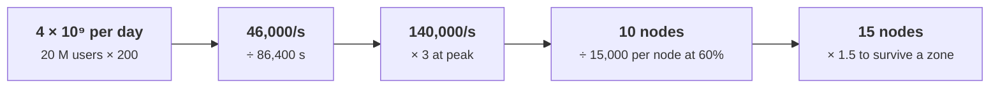
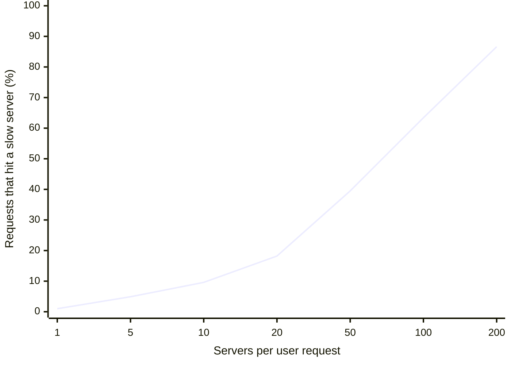

+++
title = 'Back-of-the-envelope capacity'
description = "Most designs fail on arithmetic before they fail on architecture. A handful of latency numbers, Little's law, and one queueing formula tell you whether a design can work before you build it."
question = 'How do you estimate load, storage, and latency before building, and why does a busy server get slow so suddenly?'
weight = 3
difficulty = 2
prerequisites = ['/notes/systems-design/thinking-in-invariants/01-what-a-design-promises']
date = 2026-09-16
lastmod = 2026-09-16
verified = 2026-09-16
+++

## The idea in one minute

Before choosing a database or drawing a single box, estimate three numbers:
how many requests per second at peak, how many bytes stored and moved, and how
long each request spends waiting rather than working. The arithmetic takes
minutes and needs only a few memorized latencies and two formulas. It regularly
rules out designs that look fine on a whiteboard: the cross-region call on
every request that blows the latency budget, the "small" log that grows by
hundreds of terabytes a year, the server sized for average load that falls
over at peak.

The two formulas are **Little's law**, L = λW, which links throughput,
latency, and the number of requests in flight in any stable system, and the
**M/M/1 queue**, whose mean time in system W = S / (1 − ρ) explains why
latency explodes as utilization ρ approaches 100%. At 50% busy a request takes
twice its service time; at 90% it takes ten times; at 99% it takes a hundred
times.

The consequence to act on: **size for peak, not average, and plan to run
components well below saturation**, because the last 20% of utilization is
paid for in latency.

## A picture

```mermaid {title="One server, one queue, and the three quantities in Little's law"}
flowchart LR
  A["<b>Arrivals</b><br/><small>rate λ per second</small>"] --> Q["<b>Queue</b><br/><small>waiting requests</small>"]
  Q --> S["<b>Server</b><br/><small>rate μ, service time S = 1/μ</small>"]
  S --> D["<b>Departures</b><br/><small>rate λ when stable</small>"]
  L["<b>L</b>: requests in the system<br/><small>queue plus server</small>"] -.-> Q
  W["<b>W</b>: time in the system<br/><small>wait plus service</small>"] -.-> S
  class A io
  class Q queue
  class S compute
  class D io
  class L,W neutral
```

Utilization is ρ = λ / μ: the fraction of time the server is busy. When ρ
reaches 1, the queue grows without bound.

## How it really works

### Numbers to carry around

You do not need exact latencies; you need the right **order of magnitude**,
because design decisions turn on factors of ten. The list below follows the
spirit of the latency table Jeff Dean popularized in talks around 2009. The
specific values drift with hardware, so treat them as rough guides for current
server hardware (as of October 2026), and measure your own.

| Operation | Rough latency | What it means for design |
| --- | --- | --- |
| CPU cache reference | ~1 ns | Free at request scale |
| Main memory reference | ~100 ns | A million lookups per core per second is plausible |
| Read 1 MB sequentially from memory | ~10–50 µs | Scanning in-memory data is cheap |
| Random 4 KB read from an NVMe SSD | ~10–100 µs | Thousands of random reads per request are not |
| Round trip within one datacenter | ~0.1–0.5 ms | A request with 20 sequential internal calls has spent milliseconds on the network |
| Read 1 MB sequentially from an NVMe SSD | ~0.2–1 ms | Bulk reads are bandwidth-bound |
| Seek on a spinning disk | ~5–10 ms | Random access to disk-backed data is slow |
| Round trip between regions on one continent | ~10–60 ms | One cross-region call can consume a whole latency budget |
| Round trip across an ocean | ~70–200 ms | Synchronous replication across oceans is felt by every write |

The table on a log scale: each step up the axis is a factor of ten, and the bars use rough midpoints of the ranges above.

```mermaid {title="From a cache hit to an ocean crossing is eight orders of magnitude"}
xychart-beta
  x-axis ["Cache", "Memory", "1 MB RAM", "SSD 4 KB", "DC trip", "1 MB SSD", "Disk seek", "Continent", "Ocean"]
  y-axis "log10 of latency in nanoseconds" 0 --> 9
  bar [0, 2, 4.3, 4.5, 5.3, 5.7, 6.85, 7.4, 8.1]
```

One number is physics rather than hardware: light in optical fiber travels at
roughly 200,000 km per second, about two thirds of its speed in vacuum. That
is 5 µs per kilometer one way, or **1 ms of round trip per 100 km of fiber
path**. Fiber paths are longer than great-circle distances, and routers add
delay, so measured round trips are higher. No protocol optimization beats
this floor; it is why consistent writes across continents cost tens to
hundreds of milliseconds, a fact that comes back in
[the lesson on tradeoffs](/notes/systems-design/thinking-in-invariants/04-tradeoffs-and-decision-records/).

Two more constants make the arithmetic fast: a day has 86,400 seconds (call it
10^5 for estimates; you will be within 16%), and a year has about 3.15 × 10^7
seconds.

### Worked example: a session validation service

Every authenticated request in a product calls a service that validates the
session token. Assume 20 million daily active users, each making 200
authenticated requests per day, and a peak hour carrying three times the
average rate. Each assumption is a number someone can challenge, which is the
point of writing it down.

| Quantity | Arithmetic | Result |
| --- | --- | --- |
| Validations per day | 20 × 10^6 users × 200 | 4 × 10^9 |
| Average rate | 4 × 10^9 / 86,400 s | ≈ 46,000 per second |
| Peak rate | 46,000 × 3 | ≈ 140,000 per second |
| Live sessions | 20 × 10^6 × 1.5 sessions per user | 3 × 10^7 |
| Session storage | 3 × 10^7 × 500 bytes | 15 GB; 45 GB with three replicas |
| Network at peak | 140,000 × 1 KB request and response | 140 MB/s ≈ 1.1 Gbit/s |

The storage line settles the architecture question: 15 GB fits in memory on a
single machine, so this is a replicated in-memory store, not a sharded database
project. The rate line sizes the fleet. Suppose a load test shows one node
handles 25,000 validations per second before latency degrades. Running nodes at
60% of that leaves 15,000 per node, so the peak needs 140,000 / 15,000 ≈ 10
nodes. If the fleet spans three availability zones and must survive losing one,
the remaining two thirds must carry the peak: 10 × 1.5 = 15 nodes.

The fleet-size arithmetic as a chain; each arrow is one assumption someone can challenge.



Laid out as a deployment: five validators per zone, and a full in-memory copy of the 15 GB session set in each zone, so losing any one zone leaves ten nodes and two copies.

```mermaid {title="Fifteen nodes in three zones, so losing one still leaves ten"}
flowchart TB
  subgraph g_region["Region"]
    subgraph g_za["Zone A"]
      n_va["5 validators"]
      n_sa["Sessions 15 GB"]
    end
    subgraph g_zb["Zone B"]
      n_vb["5 validators"]
      n_sb["Sessions 15 GB"]
    end
    subgraph g_zc["Zone C"]
      n_vc["5 validators"]
      n_sc["Sessions 15 GB"]
    end
    n_lb["Load balancer"]
  end
  n_app["Product requests"]
  n_app --> n_lb
  n_lb --> n_va
  n_lb --> n_vb
  n_lb --> n_vc
  n_va --> n_sa
  n_vb --> n_sb
  n_vc --> n_sc
```

Notice which inputs dominate. The answer scales linearly with requests per user
and with the peak factor, so those are the numbers to get from real traffic
before spending money. The bytes per session barely matter.

### Worked example: an audit log

A security team wants every privileged action logged: 5,000 events per second
on average, 1 KB per event, kept for one year.

| Quantity | Arithmetic | Result |
| --- | --- | --- |
| Ingest bandwidth | 5,000 × 1 KB | 5 MB/s |
| Per day | 5 MB/s × 86,400 s | 432 GB |
| Per year | 432 GB × 365 | ≈ 158 TB raw |
| With three replicas | 158 TB × 3 | ≈ 470 TB |

Five megabytes per second sounds trivial; 470 TB a year does not. The estimate
immediately raises the real design questions: how well the events compress
(structured logs often compress several times over, but measure yours), which
tier holds data older than 30 days, and whether three full replicas are needed
for data that is rarely read. A tamper-evident version of this log is designed
in [the worked design of a tamper-evident audit log](/notes/systems-design/worked-designs/03-a-tamper-evident-audit-log/).

### Little's law

John Little proved in 1961 that for any queueing system in steady state, the
long-run average number of items in the system equals the long-run arrival rate
times the average time each item spends in it:

**L = λ × W**

The result needs no assumption about arrival patterns, service-time
distributions, scheduling order, or the number of servers. It holds for a single
thread, a connection pool, a whole service, or a warehouse. That generality
makes it the most useful formula in capacity planning, because you usually know
two of the three quantities and need the third.

- **Sizing a pool.** A service receives 2,000 requests per second and each
  holds a database connection for 15 ms on average. Connections in use:
  2,000 × 0.015 = 30. A pool of 50 has headroom; a pool of 20 queues.
- **Predicting an outage.** The same service makes a downstream call with a
  mean latency of 150 ms, so 2,000 × 0.15 = 300 requests are in flight. If the
  downstream slows to 2 s, in-flight requests rise to 4,000. If the worker pool
  holds 500, the service is now refusing or queueing almost everything, though
  nothing in it is broken. This is how slowness propagates upstream, and it is
  the motivation for the timeouts in
  [the lesson on partial failure and timeouts](/notes/systems-design/failure-modes/01-partial-failure-and-timeouts/).
- **Checking a benchmark.** A load test reports 10,000 requests per second at
  50 ms with 64 concurrent clients. Little's law says 64 clients at 50 ms can
  produce at most 64 / 0.05 = 1,280 requests per second. One of the numbers is
  wrong.

The outage example as a chart: bars are L = λW at a steady 2,000 requests per second, and the line is a 500-worker pool. Nothing breaks except the downstream's speed.

```mermaid {title="Same traffic, slower downstream: in-flight requests outgrow the pool"}
xychart-beta
  x-axis "Downstream mean latency" ["150 ms", "250 ms", "500 ms", "1 s", "2 s"]
  y-axis "Requests in flight" 0 --> 4500
  bar [300, 500, 1000, 2000, 4000]
  line [500, 500, 500, 500, 500]
```

### Utilization and the queueing knee

Little's law relates the quantities; it does not say what W will be. For that
you need a model. The simplest useful one is **M/M/1**: arrivals form a Poisson
process at rate λ, service times are exponential with mean S = 1/μ, and one
server works first come, first served. Its mean time in system is

**W = 1 / (μ − λ) = S / (1 − ρ)**

and its time in system is exponentially distributed, so the 99th percentile is
ln(100) × W ≈ 4.6 W.

| Utilization ρ | Mean time in system | Mean requests in system | p99 time in system |
| --- | --- | --- | --- |
| 50% | 2 S | 1 | 9.2 S |
| 80% | 5 S | 4 | 23 S |
| 90% | 10 S | 9 | 46 S |
| 95% | 20 S | 19 | 92 S |
| 99% | 100 S | 99 | 460 S |

The curve is flat on the left and nearly vertical on the right. Going from 50%
to 80% busy multiplies mean latency by 2.5; going from 80% to 90% doubles it
again; from 90% to 95% doubles it once more. This is why 80% is a common
ceiling for latency-sensitive components: above it, a modest traffic spike or a
slightly slower dependency moves you onto the steep part of the curve.

Here is that curve from W = S / (1 − ρ): the lower line is the mean and the upper line the p99 (4.6 times the mean), both in multiples of the bare service time.

```mermaid {title="The queueing knee: latency is flat until about 80% busy, then climbs steeply"}
xychart-beta
  x-axis "Utilization" ["50%", "55%", "60%", "65%", "70%", "75%", "80%", "85%", "90%", "95%"]
  y-axis "Time in system, multiples of S" 0 --> 100
  line [2, 2.2, 2.5, 2.9, 3.3, 4, 5, 6.7, 10, 20]
  line [9.2, 10.2, 11.5, 13.2, 15.4, 18.4, 23, 30.7, 46.1, 92.1]
```

Real services are often worse than M/M/1, because service times are more
variable than exponential (cache misses, garbage collection, large requests
among small ones). For a single server with Poisson arrivals and general
service times (M/G/1), the Pollaczek–Khinchine formula gives the mean wait in
queue as

**Wq = S × ρ / (1 − ρ) × (1 + Cs²) / 2**

where Cs is the coefficient of variation of service time (standard deviation
divided by mean). Exponential service has Cs = 1. Doubling Cs to 2 makes the
wait 2.5 times longer at the same utilization. Reducing variability is
therefore as valuable as adding capacity.

The formula at a fixed 80% utilization: the same load and the same mean service time, with only the variability changing.

```mermaid {title="At the same utilization, more variable service times mean longer waits"}
xychart-beta
  x-axis "Coefficient of variation of service time" ["Cs = 0", "Cs = 0.5", "Cs = 1", "Cs = 1.5", "Cs = 2"]
  y-axis "Mean queue wait at 80% busy, multiples of S" 0 --> 11
  bar [2, 2.5, 4, 6.5, 10]
```

Two refinements matter in practice. **Pooling helps**: c servers sharing one
queue wait far less than c servers with separate queues at the same
utilization, which is why large pools can safely run hotter than small ones.
**Fan-out hurts**: Dean and Barroso's "The Tail at Scale" observes that if a
user request fans out to 100 servers, each of which is slow on 1 request in
100, then 1 − 0.99^100 ≈ 63% of user requests hit at least one slow server. The
tail of each component becomes the median of the whole. What happens past
ρ = 1, when the queue grows without bound, is the subject of
[the lesson on overload and backpressure](/notes/systems-design/failure-modes/04-overload-and-backpressure/).

The fan-out arithmetic, 1 − 0.99ⁿ: the chance that a user request touches at least one slow server when each server is slow 1% of the time.



> [!TIP]
> When an estimate depends on a utilization target, state it. "Ten nodes at
> 60%" and "six nodes at 100%" are the same throughput and very different
> latencies.

## Code

A simulation of one server at 100 requests per second (10 ms mean service
time) under Poisson arrivals at five utilizations. For each, it measures L by
integrating the number of requests in the system over time, measures W from
each request's arrival and departure, and compares λW with L and the measured W
and p99 with the M/M/1 formulas. Lindley's recursion computes each departure:
a request starts when it arrives or when the previous one finishes, whichever
is later.

```python {title="queueing.py"}
"""queueing.py: Little's law and the M/M/1 queue, simulated and compared to formulas.

One server, Poisson arrivals, exponential service times, first come first
served. For each utilization the program measures the mean number in the
system (L), the arrival rate (lambda), and the mean and p99 time in the system
(W), then checks L = lambda * W and compares with the closed forms.
Standard library only; seeded, so every run prints the same numbers.
"""

from __future__ import annotations

import math
import random

MU = 100.0  # service rate: the server finishes 100 requests per second (10 ms each)
N = 1_000_000  # requests per run
WARMUP = 100_000  # discarded so the empty starting queue does not flatter the result


def simulate(lam: float, seed: int) -> tuple[float, float, float, float]:
    """Return (measured lambda, time-averaged L, mean W, p99 W) in seconds."""
    rng = random.Random(seed)
    t = free_at = 0.0
    arrivals, departures = [], []
    for _ in range(N):
        t += rng.expovariate(lam)  # next arrival
        start = max(t, free_at)  # wait if the server is busy
        free_at = start + rng.expovariate(MU)  # Lindley's recursion
        arrivals.append(t)
        departures.append(free_at)
    arrivals, departures = arrivals[WARMUP:], departures[WARMUP:]
    begin, end = arrivals[0], arrivals[-1]
    # L measured directly: integrate "requests in the system" over the window.
    events = sorted([(a, 1) for a in arrivals] + [(d, -1) for d in departures if d <= end])
    area, inside, last = 0.0, 0, begin
    for when, delta in events:
        area += inside * (when - last)
        inside, last = inside + delta, when
    L = area / (end - begin)
    sojourn = sorted(d - a for a, d in zip(arrivals, departures))
    W = sum(sojourn) / len(sojourn)
    p99 = sojourn[int(0.99 * len(sojourn))]
    lam_hat = (len(arrivals) - 1) / (end - begin)
    return lam_hat, L, W, p99


def main() -> None:
    print(f"server: mu = {MU:.0f} req/s (mean service 10.0 ms), {N - WARMUP} requests per row")
    print()
    print(" rho | L sim  lam*W | W sim   W=1/(mu-lam) | p99 sim  p99 formula")
    print("-----+--------------+----------------------+---------------------")
    for i, rho in enumerate([0.50, 0.70, 0.80, 0.90, 0.95]):
        lam = rho * MU
        lam_hat, L, W, p99 = simulate(lam, seed=42 + i)
        W_formula = 1 / (MU - lam)
        p99_formula = math.log(100) / (MU - lam)  # sojourn time is exponential
        print(f"{rho:.2f} | {L:5.2f}  {lam_hat * W:5.2f} | "
              f"{W * 1000:6.1f}  {W_formula * 1000:6.1f} ms     | "
              f"{p99 * 1000:6.1f}  {p99_formula * 1000:6.1f} ms")
    print()
    print("Mean time in system as a multiple of the bare 10 ms service time:")
    for rho in [0.50, 0.80, 0.90, 0.95, 0.99]:
        print(f"  at {rho:.0%} busy: {1 / (1 - rho):5.1f}x")


if __name__ == "__main__":
    main()
```

Run it with `python3 queueing.py` (a few seconds):

```text
server: mu = 100 req/s (mean service 10.0 ms), 900000 requests per row

 rho | L sim  lam*W | W sim   W=1/(mu-lam) | p99 sim  p99 formula
-----+--------------+----------------------+---------------------
0.50 |  1.00   1.00 |   20.0    20.0 ms     |   92.0    92.1 ms
0.70 |  2.31   2.31 |   33.1    33.3 ms     |  152.6   153.5 ms
0.80 |  4.07   4.07 |   50.9    50.0 ms     |  240.7   230.3 ms
0.90 |  9.04   9.04 |  100.4   100.0 ms     |  454.7   460.5 ms
0.95 | 17.98  17.98 |  189.7   200.0 ms     |  871.6   921.0 ms

Mean time in system as a multiple of the bare 10 ms service time:
  at 50% busy:   2.0x
  at 80% busy:   5.0x
  at 90% busy:  10.0x
  at 95% busy:  20.0x
  at 99% busy: 100.0x
```

Three things to read from the output:

- **L and λW agree** in every row, to the precision shown. Little's law is not
  an approximation that the simulation happens to confirm; it is an identity
  over any long enough window of a stable system, which makes it a good check
  on measurements and on simulators themselves.
- **The M/M/1 formula fits** at moderate utilization and drifts at 95%, where
  the simulated mean is about 5% under the formula even with 900,000 requests.
  Near saturation, queue length is highly correlated over time, so simulations
  and real measurements converge slowly. Short load tests near capacity are
  noisy for the same reason.
- **The tail grows with the mean.** At 90% busy, the p99 is about 450 ms for a
  10 ms operation. A latency SLO of 200 ms at p99 is impossible for this server
  at that load, however fast its code is.

## Where it breaks

- **Steady state is an assumption.** Little's law and the queueing formulas
  describe long-run averages of a stable system. During a traffic spike, a
  deploy, or a failover, the system is not in steady state, and the queue can
  be far longer than the formula predicts.
- **Real traffic is burstier than Poisson.** Retries, batch jobs, and
  synchronized clients produce correlated arrivals. Burstiness raises waiting
  times at every utilization, and the formulas above underestimate them.
- **One server is a simplification.** A service is a network of queues: load
  balancer, threads, connection pool, database, disk. The bottleneck is
  whichever saturates first, and it moves as load changes.
- **The inputs are guesses.** A peak factor of 3 or 200 requests per user is
  an assumption. Write each assumption next to the estimate, and replace it
  with a measurement as soon as one exists.
- **Averages hide the tail.** Mean latency can look healthy while p99 is
  unacceptable, especially with fan-out. Estimate the percentile your promise
  is written in, not the mean.
- **Utilization measured over a minute hides seconds of saturation.** A server
  at 60% average utilization over a minute may spend several seconds at 100%,
  and the queue builds during those seconds.

## Remember this

- Carry orders of magnitude: memory ~100 ns, datacenter round trip ~0.5 ms,
  cross-continent ~100 ms; 1 ms of round trip per 100 km of fiber.
- Size for peak with failure headroom: peak rate ÷ (node capacity × target
  utilization), then add the zone you must survive losing.
- Little's law, L = λW, holds for any stable system; use it to size pools and
  to sanity-check benchmarks.
- M/M/1: W = S / (1 − ρ); at 80% busy a request takes five times its service
  time, at 90% ten times.
- Service-time variability and fan-out both make tails worse.
- Write every assumption next to the estimate.

## Try it

1. Run `queueing.py`. Replace `rng.expovariate(MU)` with a constant service
   time of `1 / MU` (an M/D/1 queue). How much does the mean wait drop at 90%,
   and does it match the Pollaczek–Khinchine formula with Cs = 0?
2. Add a second server sharing the queue (track two "free at" times and send
   each request to the one free first), with λ doubled so utilization per server
   is unchanged. Compare W with the single-server rows.
3. Redo the session-service estimate for a peak factor of 10 instead of 3. How
   many nodes, and does the storage answer change?
4. Take a service you run. From its dashboards, read the request rate and mean
   latency, compute L with Little's law, and compare with the measured
   concurrency or thread-pool usage. If they disagree, find out why.

## Check yourself

1. A service handles 800 requests per second with a mean latency of 250 ms.
   How many requests are in flight on average?

   
   L = λW = 800 × 0.25 = 200 requests. This holds whatever the latency
   distribution or concurrency model, as long as the system is stable over the
   period measured.
   

2. A single-server component with a 4 ms mean service time runs at 75%
   utilization. Under M/M/1, what is the mean time in system, and what happens
   if load rises by 20%?

   
   W = S / (1 − ρ) = 4 / 0.25 = 16 ms. A 20% rise takes ρ to 0.9, so W = 4 /
   0.1 = 40 ms: latency multiplies by 2.5 for a 20% increase in load.
   

3. Why must consistent writes replicated between Europe and the US west coast
   take tens of milliseconds at least?

   
   Waiting for acknowledgment from the other side requires at least one round
   trip, and light in fiber covers about 100 km of path per millisecond of round
   trip. With a fiber path of several thousand kilometers, physics alone sets a
   floor of tens of milliseconds, and real routes and routers add more.
   

4. A benchmark claims 50,000 requests per second at 20 ms mean latency using
   100 concurrent connections, each sending one request at a time. Is it
   plausible?

   
   No. By Little's law, 100 connections with 20 ms per request can sustain at
   most 100 / 0.02 = 5,000 requests per second. Either the latency, the
   concurrency, or the throughput figure is wrong, for example because
   requests are pipelined or latency was measured somewhere else.
   

5. Why do teams set a utilization ceiling such as 70–80% instead of planning
   to run at 95%?

   
   Queueing delay grows as 1 / (1 − ρ). Between 80% and 95% the mean time in
   system quadruples, so a small spike in traffic or a slower dependency causes
   a large latency increase. The headroom also absorbs the loss of a node or
   zone and bursts that averages hide.
   

## Sources

- J. D. C. Little, "A Proof for the Queuing Formula: L = λW", *Operations
  Research* 9(3), 1961.
- L. Kleinrock, *Queueing Systems, Volume 1: Theory*, Wiley, 1975.
- M. Harchol-Balter, *Performance Modeling and Design of Computer Systems:
  Queueing Theory in Action*, Cambridge University Press, 2013.
- J. Dean and L. A. Barroso, "The Tail at Scale", *Communications of the ACM*
  56(2), February 2013.
- J. Dean, "Designs, Lessons and Advice from Building Large Distributed
  Systems", keynote, LADIS workshop, 2009.
