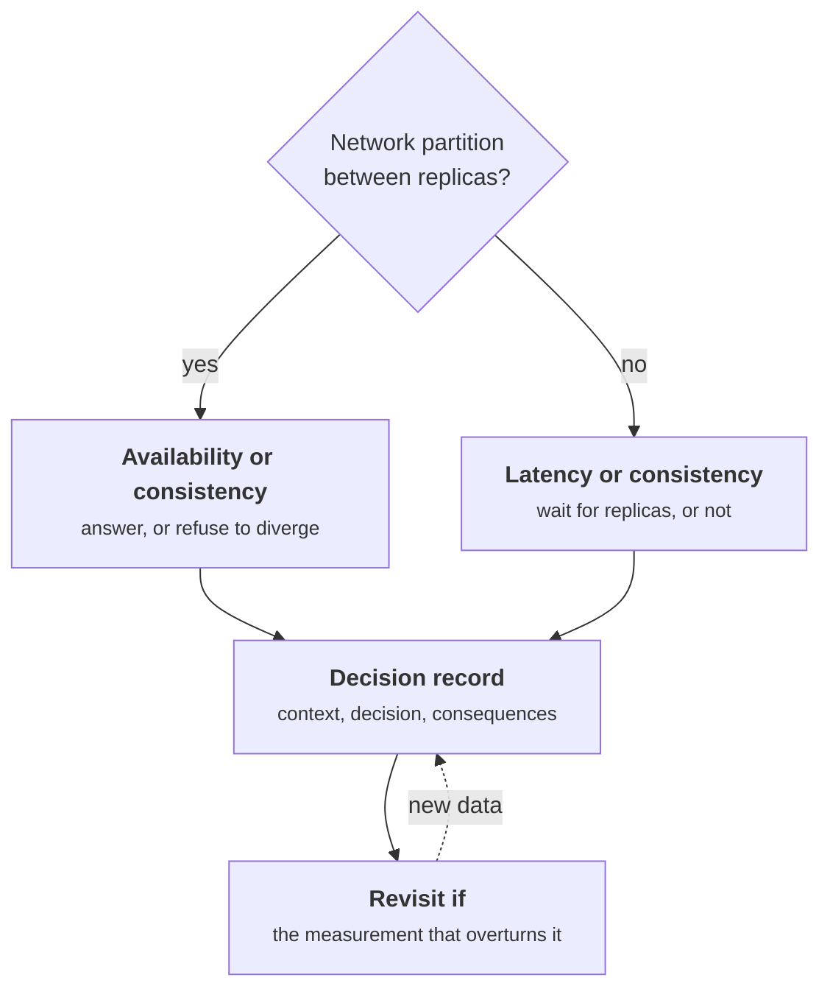
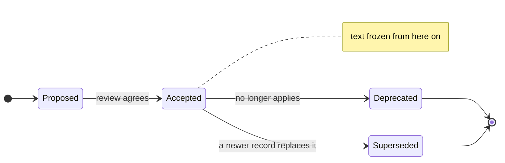
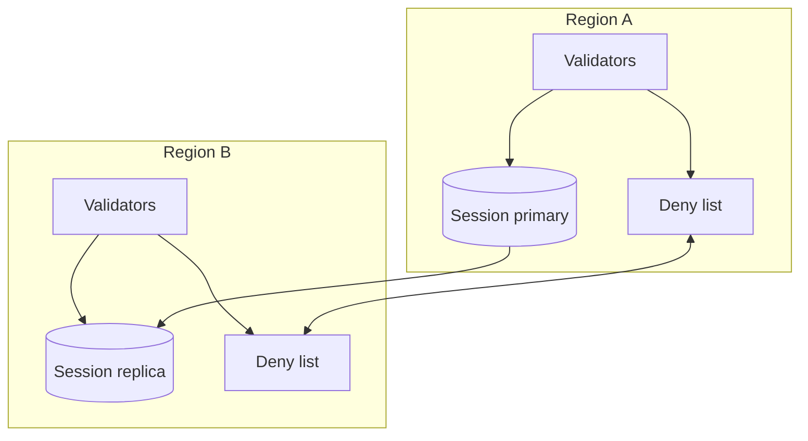
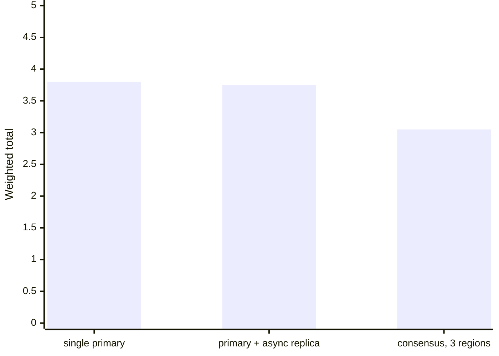

+++
title = 'Tradeoffs and decision records'
description = 'Every design weakens some promise to keep another. Name which one, under what conditions, at what cost, write it down as a decision record, and say which measurement would change your mind.'
question = 'How do you reason about tradeoffs honestly, and record a decision so it can be revisited?'
weight = 4
difficulty = 2
prerequisites = ['/notes/systems-design/thinking-in-invariants/01-what-a-design-promises', '/notes/systems-design/thinking-in-invariants/03-back-of-the-envelope-capacity']
date = 2026-09-18
lastmod = 2026-09-18
verified = 2026-09-18
+++

## The idea in one minute

No design keeps every promise under every condition. Replicating data across
regions buys survival of a regional outage and costs either latency on every
write or the risk of losing recent writes. Caching authorization decisions buys
speed and costs the time it takes for a revocation to take effect. An honest
tradeoff names **which promise weakens, under which conditions, and by how
much**, in the terms of [the first lesson](/notes/systems-design/thinking-in-invariants/01-what-a-design-promises/): a safety property relaxed, a liveness bound
lengthened, a latency percentile moved.

Two frames help. **CAP** says that during a network partition, a replicated
system cannot both answer every request and stay linearizable. **PACELC** adds
the part that matters every day: when there is no partition, you still trade
latency against consistency. Neither tells you what to build; both tell you
which questions to ask.

The consequence to act on: **write each significant decision down as an
architecture decision record**, with its context, the alternatives, the
consequences you accept, whether it is reversible, and the measurement that
would overturn it.

## A picture



The partition branch is rare and dramatic. The no-partition branch is paid on
every request, which is why it usually deserves more of the discussion.

## How it really works

### CAP, stated precisely

Eric Brewer presented the CAP conjecture in a keynote at PODC in 2000. Seth
Gilbert and Nancy Lynch proved a formal version in 2002, and their definitions
are narrower than the slogan:

| Letter | Meaning in the theorem | Common misreading |
| --- | --- | --- |
| **C**onsistency | Linearizability: every operation appears to take effect atomically at a single point between its start and end, in an order consistent with real time | "The data is correct" or "transactions are ACID" |
| **A**vailability | Every request received by a non-failing node eventually gets a non-error response | "99.99% uptime" |
| **P**artition tolerance | The system keeps its guarantees when the network loses arbitrary messages between nodes | An optional feature |

The theorem: if the network can partition, a system cannot guarantee both C and
A. The intuition takes one sentence. If two replicas cannot talk and a client
writes to one, a read at the other must either return the old value (not
linearizable) or wait or fail (not available).

The one-sentence intuition, drawn: once the replication message is lost, replica B has only two possible answers, and each gives up one letter.

```mermaid {title="During a partition, a replica must give up availability or linearizability"}
sequenceDiagram
  autonumber
  actor C1 as Client 1
  participant A as Replica A
  participant B as Replica B
  actor C2 as Client 2
  Note over A,B: network partition
  C1->>A: write x = 2
  A-xB: replicate x = 2, message lost
  C2->>B: read x
  alt answer anyway
    B-->>C2: x = 1, available but not linearizable
  else refuse to diverge
    B-->>C2: error or wait, linearizable but not available
  end
```

Three consequences follow, each a common error:

1. **"Pick two of three" is wrong.** Partitions are not something you opt out
   of on a real network. The choice is what to give up *while* a partition
   lasts.
2. **CAP says nothing when the network is healthy.** A system can be
   linearizable and fast during normal operation and still be classed as
   "CP".
3. **Most real systems are neither.** Martin Kleppmann's 2015 critique points
   out that many databases provide neither linearizability nor CAP's strict
   availability, so labeling them "CP" or "AP" conveys little. Describe the
   actual guarantees instead: which consistency model, and what happens to
   reads and writes on each side of a partition.

Brewer's own 2012 retrospective makes a more useful point: the choice can be
made per operation and per moment. A system can keep accepting low-risk
operations during a partition, refuse high-risk ones, and reconcile afterwards.
The consistency models themselves get a full lesson in
[the lesson on consistency models](/notes/systems-design/concurrency-and-consistency/03-consistency-models/).

### PACELC: the everyday tradeoff

Daniel Abadi argued in 2012 that CAP's focus on partitions hides the tradeoff
designers face continuously. His formulation, PACELC: if there is a
**P**artition, choose **A**vailability or **C**onsistency; **E**lse, choose
**L**atency or **C**onsistency.

The "else" branch is arithmetic from
[back-of-the-envelope capacity](/notes/systems-design/thinking-in-invariants/03-back-of-the-envelope-capacity/).
If a write is acknowledged only after a replica in another region confirms it,
every write pays at least one inter-region round trip, partition or not. With
regions 70 ms apart, that is 70 ms added to every write's latency, forever. A
system that acknowledges after the local write and replicates in the background
avoids the cost, and accepts that a failover may lose whatever had not yet
replicated.

Compare where the acknowledgment happens in the two halves: before the round trip, or after it.

```mermaid {title="PACELC without a partition: synchronous pays a round trip, asynchronous risks a loss"}
sequenceDiagram
  autonumber
  actor C as Client
  participant P as Primary in region A
  participant R as Replica in region B
  rect rgb(243, 241, 234)
  Note over C,R: synchronous, ack after the replica confirms
  C->>P: write
  P->>R: replicate
  Note over P,R: one inter-region round trip, about 70 ms
  R-->>P: confirmed
  P-->>C: ack
  end
  rect rgb(243, 241, 234)
  Note over C,R: asynchronous, ack after the local write
  C->>P: write
  P-->>C: ack
  P--)R: replicate later
  Note over R: lost if region A fails first
  end
```

| Replication choice | Write latency | Reads | On losing the primary region |
| --- | --- | --- | --- |
| Synchronous to another region | Local work + inter-region round trip | Consistent from either region, if routed carefully | No acknowledged write lost |
| Asynchronous to another region | Local work only | Remote replica may be stale | Writes not yet replicated are lost |
| Consensus across three regions | Local work + round trip to the nearest majority | Consistent through the leader or with leases | No acknowledged write lost; survives one region |

Quorum mechanics, and what "the nearest majority" costs, are in
[the lesson on replication and quorums](/notes/systems-design/concurrency-and-consistency/04-replication-and-quorums/).

### Tradeoffs are about promises, not technologies

The frames become useful when tied to a specific invariant. Take a session
store for a service running in two regions, with three promises from earlier
lessons:

- **Validation latency**: 99% of validations complete in under 20 ms.
- **Revocation**: a revoked session is rejected everywhere within 5 seconds.
- **Durability of revocation**: a revocation, once acknowledged, is never
  undone.

Now evaluate the options against the promises rather than in general:

| Option | Latency promise | Revocation within 5 s | Revocation never undone |
| --- | --- | --- | --- |
| Single primary in region A | Broken for region B users: every validation crosses regions | Kept | Kept, unless region A's data is lost |
| Primary in A, async replica in B | Kept: B reads locally | Kept while replication lag stays under 5 s; needs a lag alarm | **At risk**: a failover can lose a recent revocation, and the session comes back |
| Consensus across three regions | Depends on read path: leader reads cross regions, lease reads do not | Kept | Kept |

The asynchronous row shows why tradeoffs must be argued from invariants. In
general terms, "async replication loses a few seconds of writes on failover" sounds
acceptable. In terms of the revocation promise, it means a stolen session that
was revoked minutes before an outage can become valid again afterwards. A
design that keeps async replication might route revocations through a
synchronous path or record them in a separate, synchronously replicated deny
list. Either way, the decision is now about the promise, not about the
database.

> [!IMPORTANT]
> A hard requirement is a filter, not a weight. If "a revocation is never
> undone" is non-negotiable, options that break it are out before any scoring
> starts.

Applied to the session store: two options pass the filter, and the one at risk only comes back after a redesign that fixes the revocation path.

```mermaid {title="A hard requirement filters options before anything is scored"}
flowchart LR
  O1["<b>Single primary in A</b>"]
  O2["<b>Primary in A, async replica in B</b>"]
  O3["<b>Consensus, three regions</b>"]
  subgraph H["Filter: a revocation is never undone"]
    K["kept"]
    X["at risk on failover"]
  end
  O1 --> K
  O3 --> K
  O2 --> X
  X --> Fix["<b>Redesign</b><br/><small>synchronous deny list for revocations</small>"]
  K --> S["<b>Scored</b><br/><small>latency, cost, operations</small>"]
  Fix --> S
  class O1,O2,O3 neutral
  class X warn
  class K,Fix good
  class S compute
```

### Architecture decision records

Michael Nygard proposed architecture decision records in a 2011 blog post: a
short document per significant decision, numbered, kept in the repository next
to the code, with five parts: **title**, **context** (the forces at play,
stated neutrally), **decision** (in active voice: "we will..."), **status**
(proposed, accepted, deprecated, superseded), and **consequences** (everything
that follows, good and bad). Records are not edited after acceptance; a changed
decision gets a new record that supersedes the old one, so the history of
reasoning survives.

A record's life in Nygard's four statuses: once accepted it is never edited, only deprecated or superseded by a newer record.



Two additions make records more useful for the kind of design this course
teaches: a line stating whether the decision is reversible and at what cost,
and a **revisit-if** line naming the measurement that would overturn it.

```markdown {title="docs/adr/0007-session-store-replication.md"}
# 7. Session store: single primary with a synchronous revocation list

Status: accepted (2026-10-29)

## Context
Users in two regions. Promises: p99 validation < 20 ms; revocation effective
everywhere within 5 s and never undone. Measured inter-region round trip
p99: 68 ms. Peak 140,000 validations/s (see capacity note 3).

## Decision
We will keep sessions in a single primary in region A with an asynchronous
read replica in region B. Revocations are written to a deny list replicated
synchronously to both regions; validators check the deny list on every request.

## Consequences
- Region B validations are local reads (meets the latency promise).
- Revocations cost one inter-region round trip; they are rare.
- A failover to B may lose recently created sessions; those users sign in again.
- Two stores to operate instead of one.

## Reversibility
Two-way door: validators read through one interface; switching to consensus
replication is a data migration, not an API change.

## Revisit if
Replication lag p99 exceeds 2 s, revocations exceed 1% of writes, or a third
region is added.
```

The decision in record 7 as a deployment. Session data flows one way and asynchronously; the deny list, drawn with the two-headed link, is written to both regions before a revocation is acknowledged.



The revisit-if line is what keeps a decision honest. It converts "we chose X
because we believed Y" into "if you measure not-Y, reopen this". Without it,
decisions persist long after the assumptions behind them have stopped being
true, because nobody remembers what they were.

### One-way and two-way doors

Jeff Bezos's 2015 letter to Amazon shareholders distinguishes Type 1 decisions,
which are consequential and nearly irreversible ("one-way doors"), from Type 2
decisions, which can be reversed cheaply ("two-way doors"), and argues that
most decisions are Type 2 and should be made quickly by small groups. The
distinction maps well onto system design:

| Usually a one-way door | Usually a two-way door |
| --- | --- |
| Public API shapes and identifiers clients store | Internal service boundaries behind a stable interface |
| On-disk and on-wire formats, especially signed or encrypted ones | Choice of cache, queue, or library behind an abstraction |
| Data you delete, or never collect | Instance types, replica counts, pool sizes |
| Consistency guarantees you advertise to customers | Consistency you use internally and have not exposed |
| Cryptographic algorithms baked into stored data | Feature flags and configuration |

The table as a map, with illustrative positions. The versioned token format sits left of the unversioned formats: that is what shrinking the one-way part looks like.

```mermaid {title="Spend review time on the top right, move fast on the bottom left"}
quadrantChart
  x-axis Cheap to undo --> Costly to undo
  y-axis Low consequence --> High consequence
  quadrant-1 One-way doors
  quadrant-2 Consequential but reversible
  quadrant-3 Move fast
  quadrant-4 Sticky but minor
  Public API identifiers: [0.85, 0.85]
  Signed on-disk format: [0.92, 0.72]
  Advertised consistency: [0.75, 0.92]
  Deleted data: [0.95, 0.6]
  Versioned token format: [0.35, 0.8]
  Cache behind interface: [0.25, 0.42]
  Replica counts: [0.15, 0.28]
  Feature flags: [0.08, 0.15]
```

The practical skill is **shrinking the one-way part**. You can often turn a
one-way door into a two-way door by adding an interface, a version field, or
a migration path before committing. A token format with a version byte can
change algorithms later; one without it cannot. Spend review time on the
decisions that are expensive to undo, and move fast on the rest.

### Decision matrices and sensitivity

When several options survive the hard filters, a weighted decision matrix makes
the remaining judgment explicit: criteria, weights, and a score per option. Its
honest value is not the total it computes. The weights and scores are opinions,
and the arithmetic adds false precision to them. The value is in asking **which
judgment the answer depends on**. If the winner flips when one score moves by a
point, that score is the thing to measure before deciding. The program below
does exactly that analysis.

## Code

The session-store choice as a weighted matrix, after the hard filter. The
program computes weighted totals, then three kinds of sensitivity: how far each
weight must move to change the winner, which single one-point score changes
flip it, and how often each option wins when all weights are jittered at
random.

```python {title="decide.py"}
"""decide.py: a weighted decision matrix, and how fragile its answer is.

Scores and weights are judgments; the program cannot make them right. What it
can do is show which judgment the decision hangs on: how far each weight or
score must move before the winner changes. Standard library only; seeded.
"""

from __future__ import annotations

import random

# Where should a session store for a two-region service live?
CRITERIA = {  # criterion -> weight (sums to 1.0)
    "consistency": 0.25,
    "p99 latency": 0.30,
    "cost": 0.15,
    "ops burden": 0.15,
    "reversibility": 0.15,
}
OPTIONS = {  # option -> score 1 (bad) .. 5 (good) per criterion, same order
    "single primary": [5, 2, 5, 4, 4],
    "primary + async replica": [3, 5, 3, 3, 4],
    "consensus, 3 regions": [5, 3, 2, 2, 2],
}


def totals(weights: dict[str, float], options=OPTIONS) -> dict[str, float]:
    w = list(weights.values())
    return {name: sum(wi * si for wi, si in zip(w, s)) for name, s in options.items()}


def winner(weights, options=OPTIONS) -> str:
    t = totals(weights, options)
    return max(t, key=t.get)


def reweight(weights: dict[str, float], crit: str, value: float) -> dict[str, float]:
    """Set one weight and rescale the others so the weights still sum to 1."""
    rest = 1 - weights[crit]
    return {c: value if c == crit else w * (1 - value) / rest for c, w in weights.items()}


def weight_flip(crit: str) -> str:
    base = winner(CRITERIA)
    for step in range(1, 101):  # scan the weight in 1% steps, both directions
        for value in (CRITERIA[crit] + step / 100, CRITERIA[crit] - step / 100):
            if 0 <= value <= 1 and (w := winner(reweight(CRITERIA, crit, value))) != base:
                return f"{CRITERIA[crit]:.2f} -> {value:.2f} makes {w!r} win"
    return "no weight in [0, 1] changes the winner"


def score_flips(base: str) -> list[str]:
    """Single-score changes of one point that change the winner."""
    flips = []
    for name, scores in OPTIONS.items():
        for i, crit in enumerate(CRITERIA):
            for delta in (-1, 1):
                if not 1 <= scores[i] + delta <= 5:
                    continue
                trial = {n: list(s) for n, s in OPTIONS.items()}
                trial[name][i] += delta
                if (w := winner(CRITERIA, trial)) != base:
                    flips.append(f"{name} {crit} {scores[i]} -> {scores[i] + delta}: "
                                 f"{w!r} wins")
    return flips


def monte_carlo(trials: int, spread: float, seed: int) -> dict[str, float]:
    """Jitter every weight by up to +/- spread (relative), renormalize, count wins."""
    rng = random.Random(seed)
    wins = dict.fromkeys(OPTIONS, 0)
    for _ in range(trials):
        raw = {c: w * rng.uniform(1 - spread, 1 + spread) for c, w in CRITERIA.items()}
        norm = sum(raw.values())
        wins[winner({c: w / norm for c, w in raw.items()})] += 1
    return {name: count / trials for name, count in wins.items()}


if __name__ == "__main__":
    t = totals(CRITERIA)
    base = winner(CRITERIA)
    print("weighted totals (max 5.00):")
    for name, total in sorted(t.items(), key=lambda kv: -kv[1]):
        print(f"  {name:<24} {total:.2f}{'  <- winner' if name == base else ''}")
    print("\nsmallest weight change that flips the decision:")
    for crit in CRITERIA:
        print(f"  {crit:<14} {weight_flip(crit)}")
    print("\none-point score changes that flip the decision:")
    for line in score_flips(base) or ["none"]:
        print(f"  {line}")
    for spread in (0.2, 0.5):
        share = monte_carlo(trials=10_000, spread=spread, seed=1)
        print(f"\nweights jittered by +/-{spread:.0%}, 10,000 trials:")
        for name, frac in share.items():
            print(f"  {name:<24} wins {frac:6.1%}")
```

Run it with `python3 decide.py`:

```text
weighted totals (max 5.00):
  single primary           3.80  <- winner
  primary + async replica  3.75
  consensus, 3 regions     3.05

smallest weight change that flips the decision:
  consistency    0.25 -> 0.23 makes 'primary + async replica' win
  p99 latency    0.30 -> 0.32 makes 'primary + async replica' win
  cost           0.15 -> 0.12 makes 'primary + async replica' win
  ops burden     0.15 -> 0.10 makes 'primary + async replica' win
  reversibility  no weight in [0, 1] changes the winner

one-point score changes that flip the decision:
  single primary consistency 5 -> 4: 'primary + async replica' wins
  single primary p99 latency 2 -> 1: 'primary + async replica' wins
  single primary cost 5 -> 4: 'primary + async replica' wins
  single primary ops burden 4 -> 3: 'primary + async replica' wins
  single primary reversibility 4 -> 3: 'primary + async replica' wins
  primary + async replica consistency 3 -> 4: 'primary + async replica' wins
  primary + async replica cost 3 -> 4: 'primary + async replica' wins
  primary + async replica ops burden 3 -> 4: 'primary + async replica' wins
  primary + async replica reversibility 4 -> 5: 'primary + async replica' wins

weights jittered by +/-20%, 10,000 trials:
  single primary           wins  63.8%
  primary + async replica  wins  36.2%
  consensus, 3 regions     wins   0.0%

weights jittered by +/-50%, 10,000 trials:
  single primary           wins  55.8%
  primary + async replica  wins  44.2%
  consensus, 3 regions     wins   0.0%
```

The headline says "single primary, 3.80". The sensitivity analysis says that
the headline is nearly meaningless:

- **The margin is 0.05 on a five-point scale.** Moving the latency weight from
  0.30 to 0.32, or the consistency weight from 0.25 to 0.23, changes the answer.
  Nobody can defend weights to two decimal places.
- **Any one-point change that narrows the gap flips it**: any score of the
  winner dropping by one, or almost any score of the runner-up rising by one. In particular,
  "single primary, p99 latency: 2" rests on an assumed cross-region round trip.
  That is a number you can measure this afternoon, and it is the measurement
  that belongs in the revisit-if line.
- **Under 20% weight jitter, the runner-up wins more than a third of the time.**
  The two leading options are effectively tied; the third never wins under any
  perturbation tried, which is a robust conclusion worth recording.

The weighted totals on their true five-point scale: the first two bars are almost the same height, which is the whole finding.



The right output of this exercise is not "choose single primary". It is "the
two leading designs are tied on our current beliefs; measure the inter-region
latency and the replication lag, and check whether either breaks a hard
promise".

## Where it breaks

- **Additive scoring hides vetoes.** A weighted sum lets a great score on cost
  compensate for breaking a security promise. Hard requirements must be
  applied as filters first, as the revocation example does.
- **Criteria are not independent.** Latency and consistency are two sides of
  one replication choice, so scoring them separately counts the same decision
  twice. Group criteria that come from one mechanism.
- **The missing option never wins.** A matrix ranks the options someone thought
  of. The deny-list hybrid in the example record is better than all three rows,
  and it came from arguing about the revocation invariant, not from the
  matrix.
- **CAP is not a design method.** It identifies one impossible combination
  under one failure. Most design decisions involve latency, cost, and
  operational burden during normal operation, which is where PACELC and
  capacity arithmetic are more useful.
- **Decision records rot when nobody reads them.** A record that is not linked
  from the code, the runbook, or the design review is lost. The revisit-if
  conditions work best when they are also alerts.
- **Reversibility is often overestimated.** "We can always migrate later"
  ignores the data written in the meantime, the clients that depend on current
  behavior, and the cost of running both systems during the move.

## Remember this

- State every tradeoff as a promise weakened: which one, when, and by how much.
- CAP: during a partition, choose between answering and staying linearizable;
  it says nothing about normal operation.
- PACELC: without a partition, consistency across distance costs latency on
  every request.
- Hard requirements are filters, applied before any scoring.
- Write decisions as records with context, decision, consequences,
  reversibility, and a revisit-if measurement.
- Use sensitivity analysis to find the judgment a decision hangs on, then
  measure it.

## Try it

1. Run `decide.py`. Add a fourth option, "single primary + sync deny list",
   with your own scores. Does it win, and how robust is the win?
2. Change `weight_flip` to report the smallest change for every option, not
   just the first that overtakes the winner. Which option is the closest
   challenger on each criterion?
3. Write an ADR for a decision your team made in the past year, including a
   revisit-if line. Is the condition true today?
4. For a system you know, list three decisions that are one-way doors. For one
   of them, describe the smallest change that would have made it a two-way door.

## Check yourself

1. What exactly does CAP's "C" mean, and why does it matter for using the
   theorem correctly?

   
   Linearizability: each operation appears to take effect at a single instant
   between its invocation and its response, consistent with real-time order.
   Many systems that are "consistent" in a looser sense (serializable
   transactions on one node, read-your-writes, eventual consistency) are not
   linearizable, so the theorem's impossibility applies to a narrower
   guarantee than the slogan suggests.
   

2. A team says their database is "CP, so consistency is guaranteed". What
   questions should you ask?

   
   Which consistency model it provides for which operations (linearizable
   reads, or only writes; through the leader or any replica). What happens to
   reads and writes on the minority side of a partition. What latency it adds
   when there is no partition. Whether the guarantee holds for the client
   library and configuration actually in use.
   

3. Why does the "else" in PACELC often matter more than the partition case?

   
   Partitions are rare, but the latency cost of synchronous replication across
   distance is paid on every write, all the time. A design choice that adds a
   70 ms inter-region round trip to each write affects every user every day,
   while the partition behavior affects a few minutes a year.
   

4. In the session-store example, why is asynchronous replication a security
   concern rather than just a durability concern?

   
   A revocation written shortly before a primary-region failure may not have
   replicated. After failover, the replica does not know the session was
   revoked, so a stolen session becomes valid again. The broken promise is "a
   revocation is never undone", which is a security invariant.
   

5. What makes a revisit-if line useful, and what makes it useless?

   
   Useful: it names a measurable quantity and a threshold tied to an assumption
   in the decision, such as "replication lag p99 above 2 s", ideally wired to a
   dashboard or alert. Useless: vague conditions such as "if requirements
   change" or "if performance becomes a problem", which nobody can evaluate.
   

## Sources

- E. Brewer, "Towards Robust Distributed Systems", keynote, ACM Symposium on
  Principles of Distributed Computing (PODC), July 2000.
- S. Gilbert and N. Lynch, "Brewer's Conjecture and the Feasibility of
  Consistent, Available, Partition-Tolerant Web Services", *ACM SIGACT News*
  33(2), June 2002.
- E. Brewer, "CAP Twelve Years Later: How the 'Rules' Have Changed", *IEEE
  Computer* 45(2), February 2012.
- D. Abadi, "Consistency Tradeoffs in Modern Distributed Database System
  Design", *IEEE Computer* 45(2), February 2012.
- M. Kleppmann, [A Critique of the CAP Theorem](https://arxiv.org/abs/1509.05393),
  arXiv:1509.05393, September 2015.
- M. P. Herlihy and J. M. Wing, "Linearizability: A Correctness Condition for
  Concurrent Objects", *ACM Transactions on Programming Languages and Systems*
  12(3), July 1990.
- M. Nygard, [Documenting Architecture Decisions](https://cognitect.com/blog/2011/11/15/documenting-architecture-decisions),
  Cognitect blog, November 2011.
- J. Bezos, 2015 Letter to Shareholders, Amazon.com, Inc., April 2016.
