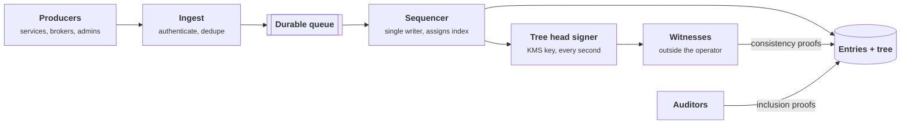
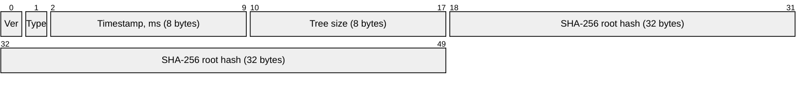
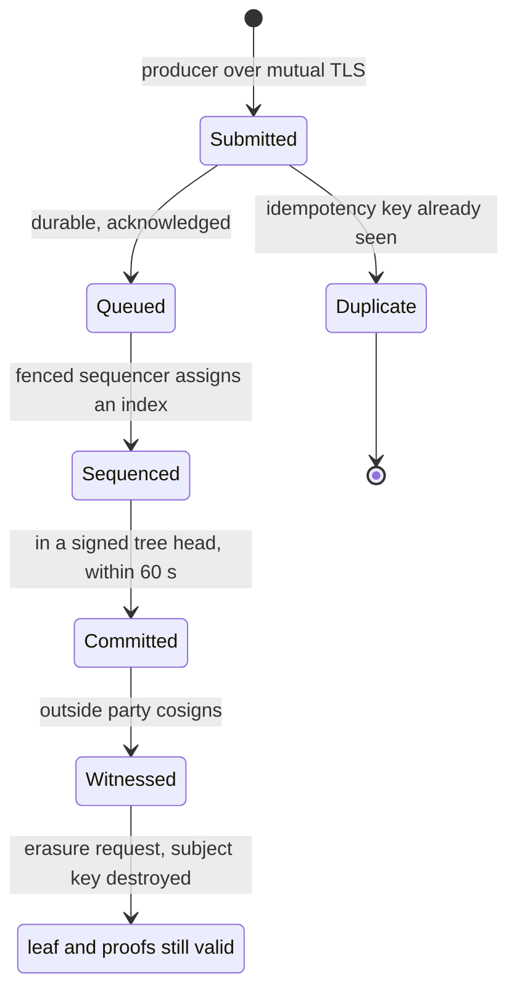

+++
title = 'A tamper-evident audit log'
description = 'An audit log cannot stop its operator from editing it, but it can make every edit detectable by anyone holding an earlier signed tree head. Hash chains, Merkle trees, and outside witnesses are how.'
question = 'How do you build an audit log whose history cannot be rewritten without someone noticing?'
weight = 3
difficulty = 4
prerequisites = ['/notes/systems-design/thinking-in-invariants/01-what-a-design-promises', '/notes/systems-design/concurrency-and-consistency/02-locks-leases-and-fencing', '/notes/systems-design/failure-modes/02-retries-and-idempotency', '/notes/systems-design/reliability-in-production/04-backup-and-disaster-recovery']
date = 2026-10-22
lastmod = 2026-10-22
verified = 2026-10-22
+++

## The idea in one minute

An audit log exists for the day something went wrong, and on that day the
people with the most reason to edit it may be the people who run it, or an
attacker who has become them. Access control on the log helps, but whoever
holds the keys can still rewrite history. **Tamper evidence** changes the goal:
the operator *can* change the log, but cannot do so without breaking a
cryptographic commitment that other people already hold.

The structure that does this is the one Certificate Transparency uses: a
**Merkle tree** over every entry, a **signed tree head** published at regular
intervals, **inclusion proofs** that show an entry is in the log, and
**consistency proofs** that show today's log extends yesterday's without
rewriting it. Proofs are logarithmic, so checking one entry in a billion takes
30 hashes. The consequence to act on: **the evidence is only as good as the
copies of the tree head held outside the operator's control**, so the design
must include who holds them and who checks.

## A picture



## How it really works

### Requirements

- **Volume:** 1,500 events per second on average, 5,000 at peak, about 1 KB
  each: credential issues, role grants, configuration changes, admin logins.
- **Latency:** an acknowledged event is committed to a signed tree head within
  1 s normally and within 60 s at worst.
- **Evidence:** anyone holding an earlier tree head can detect modification,
  deletion, reordering, or insertion in the past, and can detect the log
  showing different histories to different people.
- **Retention:** seven years for most events; personal data in events must be
  erasable on request without destroying the evidence for everything else.

### Invariants

| # | Invariant |
| --- | --- |
| I1 | **Append-only.** Every tree the log publishes is an extension of every tree it published before |
| I2 | **Bounded merge delay.** Every acknowledged entry appears in a signed tree head within 60 s |
| I3 | **Detectability.** Any violation of I1 is detectable by a party holding an earlier signed tree head |
| I4 | **Separation.** The operator of the log is not the only party holding its tree heads |
| I5 | **Attribution.** Every entry records which authenticated producer submitted it |

Notice what is not here: "the log cannot be modified". Nothing a log operator
controls can promise that. I3 is a **detection** guarantee, and I4 is what
makes I3 meaningful.

### Hash chains and their limit

The simplest tamper-evident log is a **hash chain**: each entry stores
h_i = H(h_{i-1} || entry_i). Changing entry 2 changes h_2 and every hash after
it. But an operator who rewrites entry 2 can simply recompute every later hash;
the chain is then internally consistent and wrong. **A hash chain only detects
tampering by someone who did not also recompute it**, so its last hash must be
published somewhere the operator cannot edit. Schneier and Kelsey's 1999 design
for secure audit logs added evolving MAC keys so that an attacker who
compromises the machine cannot forge entries written before the compromise.

In the picture, the operator has rewritten entry 2 and recomputed every hash
after it. Each link checks out; only the comparison with the outside copy fails.

```mermaid {title="A recomputed chain is consistent with itself, not with the published head"}
flowchart LR
  H0["<b>h0</b>"] --> H1["<b>h1</b>"]
  H1 --> H2["<b>h2</b><br/><small>entry 2 rewritten</small>"]
  H2 --> H3["<b>h3 to h6</b><br/><small>recomputed by the operator</small>"]
  H3 --> NH["<b>New head</b>"]
  PH@{ shape: doc, label: "<b>Published head</b><br/><small>held outside the operator</small>" }
  NH -.->|"compare: differs"| PH
  class H0,H1 neutral
  class H2,H3,NH warn
  class PH good
```

Chains have a second problem: proving that entry 5 is in a log of a billion
entries requires the verifier to rehash everything after entry 5. Crosby and
Wallach (USENIX Security 2009) showed that tree-structured logs give the same
tamper evidence with logarithmic proofs, and that the auditor's ability to
check consistency between versions is what closes the gap.

### Merkle trees, as RFC 6962 and RFC 9162 define them

Certificate Transparency (RFC 6962, updated as version 2.0 by RFC 9162) fixes
the details:

- **Leaf hash:** `H(0x00 || entry)`. **Interior node:** `H(0x01 || left || right)`.
  The different prefixes stop an attacker from presenting an interior node as
  a leaf (a second-preimage trick).
- **Shape:** for n entries, split at k, the largest power of two smaller than
  n; the left subtree is always a perfect binary tree. The tree for n entries
  is fully determined by n.
- **Signed tree head (STH):** the log signs (tree size, root hash, timestamp).
  An STH is a commitment to the exact sequence of the first n entries.
- **Inclusion proof:** the sibling hashes on the path from a leaf to the root,
  about log2(n) of them. The verifier recomputes the root and compares it to an
  STH.
- **Consistency proof:** the hashes needed to show that the tree of size m is a
  prefix of the tree of size n. Also about log2(n) hashes.
- **Maximum merge delay (MMD):** CT logs promise to incorporate a submitted
  entry within the MMD; our I2 is the same idea.

Here is the tree for the program's 7 entries, split at 4 and then at 2. To
prove entry 3, the log sends the three green hashes; the verifier hashes its
way up and compares with the signed root.

```mermaid {title="The size-7 tree and the three-hash inclusion proof for entry 3"}
flowchart TB
  R["<b>Root, size 7</b><br/><small>signed in the STH</small>"]
  A["h of entries 0 to 3"]
  B["<b>h of entries 4 to 6</b><br/><small>proof hash 3</small>"]
  C["<b>h of entries 0, 1</b><br/><small>proof hash 2</small>"]
  D["h of entries 2, 3"]
  E["h of entries 4, 5"]
  L2["<b>leaf 2</b><br/><small>proof hash 1</small>"]
  L3["<b>leaf 3</b><br/><small>being proven</small>"]
  L6["leaf 6"]
  R --> A
  R --> B
  A --> C
  A --> D
  D --> L2
  D --> L3
  B --> E
  B --> L6
  class R,A,D,E,L6 neutral
  class B,C,L2 good
  class L3 io
```

**Monitors** watch the log for entries they care about; **auditors** check
inclusion proofs; **witnesses** (gossip, in the RFC's terms) collect STHs and
check consistency between them. Without witnesses, a log could present one
history to you and another to everyone else, a **split view**, and each history
would verify on its own.

A witness's job, drawn: keep the last head it saw and cosign a new one only if
the consistency proof between them verifies.

```mermaid {title="A witness cosigns a new head only if it extends the one it holds"}
sequenceDiagram
  autonumber
  participant L as Log operator
  participant W as Witness
  participant M as Monitor
  L->>W: STH size 7
  W->>W: store as latest head
  L->>W: STH size 10 and consistency proof 7 to 10
  alt proof verifies
    W-->>L: cosignature on size 10
  else entry 2 was rewritten
    W->>M: alert, size 10 does not extend size 7
    Note over W: refuse to cosign
  end
  Note over L,M: comparing heads between witnesses also exposes a split view
```

### Capacity estimate

**Storage.** At the 5,000 per second peak, sustained for a day, that is
5,000 × 86,400 = 432 million events, or 432 GB of entries at 1 KB each. Leaf
hashes are 32 bytes each: 13.8 GB. Interior nodes add about as many again, so
the tree costs about 28 GB per day at peak, around 6 percent of the entry data.

**Hashing.** 5 MB per second of SHA-256 is far below one core's throughput.
Hashing is not the bottleneck.

**Sequencing.** The log needs a total order, so one sequencer per log assigns
indexes. Batching makes this cheap: integrating every 100 ms means 10 batches
per second of about 500 entries each at peak, and 10 durable writes (fsyncs) per
second instead of 5,000.

**Signing.** One STH per second is 86,400 signatures per day, trivial even
through a remote KMS.

**Proof size.** A day at peak is 432 million entries, about 2^28.7, so an
inclusion proof is 29 hashes = 928 bytes. Seven years at the 1,500 per second
average is 1,500 × 86,400 × 365 × 7 ≈ 331 billion entries, about 2^38.3: 39
hashes, 1,248 bytes. Proofs stay small forever.

The bars show the same numbers: a thousand-fold bigger log costs about ten more
hashes in each proof.

```mermaid {title="Inclusion proof length grows with log2 of the log size"}
xychart-beta
  title "Hashes in an inclusion proof, 32 bytes each"
  x-axis "Entries in the log" ["1 thousand", "1 million", "432 million, peak day", "1 billion", "331 billion, 7 years"]
  y-axis "Hashes in the proof" 0 --> 40
  bar [10, 20, 29, 30, 39]
```

### The design

**Ingest authenticates and deduplicates.** Producers submit over mutual TLS;
the producer's identity is recorded in the entry (I5). Each submission carries
an idempotency key so a producer's retry after a timeout does not create a
duplicate, as in
[retries and idempotency](/notes/systems-design/failure-modes/02-retries-and-idempotency/).
The producer gets an acknowledgment once the entry is in the durable queue,
with a promise of inclusion within the MMD, the way CT logs return a signed
certificate timestamp.

**One sequencer, fenced.** A single writer per log assigns indexes, appends
leaves, and computes the new root. It holds a lease; a new sequencer taking
over increments a fencing token that storage checks, so a paused old sequencer
cannot append a second, conflicting entry at the same index. That is the
pattern in
[locks, leases, and fencing](/notes/systems-design/concurrency-and-consistency/02-locks-leases-and-fencing/).

**Sign and publish tree heads.** Every second, the signer signs the current
(size, root) with a KMS-held key and publishes the STH. The publication goes
to places the operator does not control: an independent witness service that
checks consistency with the last STH it saw before cosigning, an object store
in another team's account with retention locks, or a peer organization.

What gets signed is small. RFC 6962 defines the signed structure for a tree
head as 50 bytes: a version, a signature type, the timestamp, the tree size,
and the root hash. (The program signs only size and root.)



**Verifiers actually run.** A monitor fetches each new STH and the consistency
proof from the previous one, and pages someone if a proof fails. Auditors
spot-check inclusion proofs for entries that matter: every admin role grant,
every credential issued to a production database. Tamper evidence that nobody
checks is decoration.

The deployment splits along I4: the write path lives in the operator's
account, and copies of every tree head go to parties the operator cannot edit.

```mermaid {title="The operator runs the write path; tree heads leave its control"}
flowchart TB
  n_producers["Producers"]
  subgraph g_op["Log operator"]
    n_ingest["Ingest"]
    n_queue["Durable queue"]
    n_seq["Sequencer"]
    n_tree[("Entries and tree")]
    n_signer["STH signer with KMS key"]
  end
  subgraph g_outside["Outside the operator"]
    n_witness["Witness"]
    n_archive["Retention locked store"]
    n_peer["Peer organization"]
  end
  n_producers --> n_ingest
  n_ingest --> n_queue
  n_queue --> n_seq
  n_seq --> n_tree
  n_seq --> n_signer
  n_signer --> n_witness
  n_signer --> n_archive
  n_witness --> n_peer
```

**Retention without breaking the tree.** You cannot delete a leaf from a Merkle
tree without changing every root after it. So commit to something deletable:
the leaf is a hash of the event, and personal fields are encrypted with a
per-subject key held elsewhere. Erasure destroys the key (crypto-shredding);
the leaf, the tree, and the proofs remain valid, and the remaining fields still
show that an event of that type happened at that position. Storage of old
entries can move to cheaper write-once media; the tree hashes stay hot.

Put together, one entry moves through these states. The 60 s bound of I2
covers the step from acknowledged to committed.



### Failure modes

| Failure | Effect | Design response |
| --- | --- | --- |
| Sequencer crash | Writes stop | Lease expiry and failover; the queue holds acknowledged entries |
| Two sequencers (split brain) | Two entries at one index, a fork | Fencing tokens checked by storage |
| Backlog exceeds MMD | I2 violated | Alert on queue age; shed non-audit producers first |
| Producer retries | Duplicate entries | Idempotency keys at ingest |
| Storage loss | History gone | Replicated storage plus backups verified against published STHs |
| Signing key compromise | Attacker can sign forked heads | Witnesses detect inconsistency with their stored STHs; rotate the key and publish the old key's final STH |

### Security review

- **Garbage in, faithfully logged.** The log proves that an entry has not
  changed since it was written, not that it was true. A compromised producer
  can log lies. Attribution (I5) at least tells you which producer to distrust.
- **The unprotected window.** Between an entry being acknowledged and the next
  STH reaching a witness, an operator could drop it. Short STH intervals and
  producers that later check inclusion of their own entries close the window.
- **Truncation.** An attacker deletes the last hour and re-signs a smaller
  tree. Any witness holding a later, larger STH sees the log shrink, which a
  consistency proof cannot explain.
- **Injection into fields.** Entries are structured (for example, canonical
  JSON with a schema), never concatenated strings, so a field cannot forge a
  second record or break a parser downstream.
- **Secrets in logs.** Credentials, tokens, and session cookies must never be
  logged; an append-only log makes a leaked secret permanent. Log identifiers
  such as a credential's `jti` instead.
- **Read access is sensitive too.** An audit log describes who has access to
  what. Limit who can query it, and log the queries.

How these logs feed detection is covered in
[audit logs and detection](/notes/infrastructure-security/delivery-and-operations/03-audit-logs-and-detection/).

### What changes at 10x

At 50,000 events per second:

- **Shard the log.** One sequencer per shard (by producer group or tenant),
  each with its own tree. A top-level log records each shard's STH every second,
  so one consistency check at the top covers all shards.
- **Tile-based storage.** Store the tree as immutable fixed-size tiles of
  hashes that can be served from object storage and a CDN; proofs become static
  file reads. Recent CT log implementations take this approach.
- **Bigger batches, not faster fsyncs.** 5,000 entries per 100 ms batch keeps
  the write path at 10 durable writes per second per shard.
- **More witnesses.** At this scale the log is evidence in disputes; several
  independent witnesses make a split view require collusion.

## Code

The program builds a hash chain and an RFC 6962 Merkle tree over the same
entries, issues a signed tree head, proves inclusion and consistency, and then
has the operator rewrite an entry and re-sign. The verification functions are
the algorithms from RFC 9162, section 2.1.

```python {title="auditlog.py"}
"""auditlog.py: a hash chain and an RFC 6962/9162 Merkle tree, then tampering.

Leaf and node hashing, inclusion proofs, and consistency proofs follow
RFC 6962 section 2.1 and the verification algorithms in RFC 9162 section 2.1.
HMAC stands in for the log's signature on its tree head. Standard library only.
"""

from __future__ import annotations

import hashlib
import hmac

LOG_KEY = b"log signing key (simulated)"


def H(b: bytes) -> bytes:
    return hashlib.sha256(b).digest()


def leaf(d: bytes) -> bytes:
    return H(b"\x00" + d)


def node(l: bytes, r: bytes) -> bytes:
    return H(b"\x01" + l + r)


def split(n: int) -> int:
    """Largest power of two strictly less than n."""
    k = 1
    while k * 2 < n:
        k *= 2
    return k


def mth(d: list[bytes]) -> bytes:
    if len(d) == 0:
        return H(b"")
    if len(d) == 1:
        return leaf(d[0])
    k = split(len(d))
    return node(mth(d[:k]), mth(d[k:]))


def path(m: int, d: list[bytes]) -> list[bytes]:
    if len(d) <= 1:
        return []
    k = split(len(d))
    if m < k:
        return path(m, d[:k]) + [mth(d[k:])]
    return path(m - k, d[k:]) + [mth(d[:k])]


def subproof(m: int, d: list[bytes], whole: bool) -> list[bytes]:
    if m == len(d):
        return [] if whole else [mth(d)]
    k = split(len(d))
    if m <= k:
        return subproof(m, d[:k], whole) + [mth(d[k:])]
    return subproof(m - k, d[k:], False) + [mth(d[:k])]


def verify_inclusion(idx: int, size: int, leaf_hash: bytes, proof: list[bytes], root: bytes) -> bool:
    if idx >= size:
        return False
    fn, sn, r = idx, size - 1, leaf_hash
    for p in proof:
        if sn == 0:
            return False
        if fn & 1 or fn == sn:
            r = node(p, r)
            while not fn & 1 and fn != 0:
                fn, sn = fn >> 1, sn >> 1
        else:
            r = node(r, p)
        fn, sn = fn >> 1, sn >> 1
    return sn == 0 and r == root


def verify_consistency(m: int, n: int, old: bytes, new: bytes, proof: list[bytes]) -> bool:
    if m == n:
        return old == new and not proof
    if not proof:
        return False
    if m & (m - 1) == 0:                       # m is a power of two
        proof = [old] + proof
    fn, sn = m - 1, n - 1
    while fn & 1:
        fn, sn = fn >> 1, sn >> 1
    fr = sr = proof[0]
    for c in proof[1:]:
        if sn == 0:
            return False
        if fn & 1 or fn == sn:
            fr, sr = node(c, fr), node(c, sr)
            while not fn & 1 and fn != 0:
                fn, sn = fn >> 1, sn >> 1
        else:
            sr = node(sr, c)
        fn, sn = fn >> 1, sn >> 1
    return fr == old and sr == new and sn == 0


def sth(entries: list[bytes]) -> tuple[int, bytes, str]:
    size, root = len(entries), mth(entries)
    sig = hmac.new(LOG_KEY, size.to_bytes(8, "big") + root, hashlib.sha256).hexdigest()
    return size, root, sig


def chain(entries: list[bytes]) -> list[bytes]:
    out, h = [], bytes(32)
    for e in entries:
        h = H(h + e)
        out.append(h)
    return out


def first_break(entries: list[bytes], hashes: list[bytes]) -> int | None:
    return next((i for i, (a, b) in enumerate(zip(chain(entries), hashes)) if a != b), None)


def main() -> None:
    log = [f"{i:02d} user=u{i % 3} action=role.grant target=r{i}".encode() for i in range(7)]

    print("-- hash chain")
    stored = chain(log)
    published_head = stored[-1]                  # copied somewhere the operator cannot edit
    forged = list(log)
    forged[2] = b"02 user=u2 action=role.grant target=r2 (rewritten)"
    print(f"edit entry 2, keep stored hashes:   first break at {first_break(forged, stored)}")
    recomputed = chain(forged)
    print(f"edit entry 2, recompute all hashes: first break at {first_break(forged, recomputed)}")
    print(f"  ...head still equals the published head: {recomputed[-1] == published_head}")

    print("\n-- Merkle tree, signed tree head at size 7")
    size7, root7, sig7 = sth(log)
    print(f"STH size={size7} root={root7.hex()[:16]}... sig={sig7[:16]}...")
    p = path(3, log)
    print(f"inclusion of entry 3: {len(p)} hashes, valid = "
          f"{verify_inclusion(3, size7, leaf(log[3]), p, root7)}")

    log += [f"{i:02d} user=u{i % 3} action=key.rotate target=k{i}".encode() for i in range(7, 10)]
    size10, root10, _ = sth(log)
    c = subproof(size7, log, True)
    print(f"\n-- log grows to 10; consistency 7 -> 10: {len(c)} hashes, valid = "
          f"{verify_consistency(size7, size10, root7, root10, c)}")

    print("\n-- the operator rewrites entry 2 and re-signs a new head")
    bad = list(log)
    bad[2] = forged[2]
    size_b, root_b, _ = sth(bad)
    cb = subproof(size7, bad, True)
    print(f"consistency old STH(7) -> new STH(10): {verify_consistency(size7, size_b, root7, root_b, cb)}")
    print(f"original entry 2 included in new head: "
          f"{verify_inclusion(2, size_b, leaf(log[2]), path(2, bad), root_b)}")
    print(f"rewritten entry 2 included in old head: "
          f"{verify_inclusion(2, size7, leaf(bad[2]), path(2, bad[:7]), root7)}")
    print(f"untouched entry 9 included in new head: "
          f"{verify_inclusion(9, size_b, leaf(bad[9]), path(9, bad), root_b)}")

    big = 2**30
    depth = (big - 1).bit_length()
    print(f"\nproof size at {big:,} entries: {depth} hashes = {depth * 32} bytes")


if __name__ == "__main__":
    main()
```

Run it with `python3 auditlog.py`:

```text
-- hash chain
edit entry 2, keep stored hashes:   first break at 2
edit entry 2, recompute all hashes: first break at None
  ...head still equals the published head: False

-- Merkle tree, signed tree head at size 7
STH size=7 root=7b36c15ea635d7e0... sig=f193f34ba4404d0b...
inclusion of entry 3: 3 hashes, valid = True

-- log grows to 10; consistency 7 -> 10: 5 hashes, valid = True

-- the operator rewrites entry 2 and re-signs a new head
consistency old STH(7) -> new STH(10): False
original entry 2 included in new head: False
rewritten entry 2 included in old head: False
untouched entry 9 included in new head: True

proof size at 1,073,741,824 entries: 30 hashes = 960 bytes
```

The hash chain section shows the limit of chains: an edit that leaves the
stored hashes alone breaks at entry 2, but an edit with all hashes recomputed
verifies perfectly. Only comparing against the head published earlier exposes
it. The Merkle section shows the same idea made efficient. A three-hash
inclusion proof ties entry 3 to the size-7 STH. After the operator rewrites
entry 2 and signs a new size-10 head, **the consistency proof from the old STH
fails**: the new tree is not an extension of the one witnesses already hold.
Neither the original nor the rewritten entry 2 can be proven against the "wrong"
head. Entry 9, written after the old STH, still verifies against the new head,
because the old STH says nothing about it, which is why witnesses need a steady
stream of fresh STHs.

## Where it breaks

- **No outside copy, no evidence.** If the operator is the only holder of tree
  heads, they can rebuild the whole tree and every proof will verify against
  the new heads. I4 is not optional.
- **Detection is not prevention or recovery.** A failed consistency proof tells
  you history was rewritten, not what the original said. Keep independent
  copies of the entries, as in
  [backup and disaster recovery](/notes/systems-design/reliability-in-production/04-backup-and-disaster-recovery/).
- **Split views need gossip.** Without parties comparing STHs, a log can show
  different histories to different clients.
- **The simulation uses HMAC.** Anyone with the HMAC key can produce a valid
  "signature"; a real log signs with an asymmetric key so verifiers cannot forge
  heads. The program also keeps everything in memory and never fails a write.

## Remember this

- A hash chain detects edits only if its head is held by someone else.
- Merkle trees give logarithmic inclusion and consistency proofs: 30 hashes for
  a billion entries.
- A signed tree head commits to the exact first n entries; a consistency proof
  shows a later head extends it.
- Witnesses outside the operator's control turn "the log says" into evidence,
  and catch split views.
- Retention works by committing to hashes and shredding keys, never by deleting
  leaves.

## Try it

1. Implement truncation: drop the last two entries, re-sign a size-8 head, and
   show how a witness holding the size-10 STH notices.
2. Extend `auditlog.py` with a witness class that stores the latest STH, demands
   a consistency proof for every new one, and refuses to cosign on failure.
   Then show a split view: give two witnesses different size-10 trees.
3. Add crypto-shredding: encrypt a `user=` field with a per-user key (XOR with
   an HMAC-derived keystream is enough for the exercise), commit to the
   ciphertext, then delete the key. Do all proofs still verify?
4. Compute the proof size and daily tree storage for your own audit volume.

## Check yourself

1. Why can an operator rewrite a hash chain undetectably, and what stops them?

   
   Each hash depends only on the previous hash and the entry, so after editing
   an entry the operator can recompute every later hash and the chain verifies
   again. What stops them is a copy of an earlier head held by someone else:
   the recomputed chain no longer ends at that head.
   

2. Why do RFC 6962 leaf and node hashes use different prefixes?

   
   Without them, an interior node's hash input (two child hashes) could be
   presented as a 64-byte leaf, letting an attacker prove inclusion of an
   "entry" that was never logged. Domain separation makes leaf and node hashes
   come from disjoint inputs.
   

3. What does a consistency proof show that an inclusion proof cannot?

   
   That the whole earlier tree is a prefix of the later one: nothing was
   modified, removed, or reordered. An inclusion proof only shows one entry is
   in one tree; it says nothing about the rest of history.
   

4. How can a log honor a request to erase personal data without breaking its
   proofs?

   
   Commit to data that can be made unreadable without changing its hash:
   encrypt personal fields with a per-subject key and include the ciphertext
   (or a hash of the event) in the leaf. Destroying the key erases the data
   while the leaf, tree, and proofs stay valid.
   

5. Why is the sequencer fenced?

   
   A paused old sequencer that resumes after a new one has taken over could
   append a different entry at the same index, forking the log. A fencing token
   checked by storage rejects writes from the stale sequencer.
   

## Sources

- B. Laurie, A. Langley, E. Kasper, [RFC 6962: Certificate Transparency](https://www.rfc-editor.org/rfc/rfc6962), IETF, June 2013.
- B. Laurie, E. Messeri, R. Stradling, [RFC 9162: Certificate Transparency Version 2.0](https://www.rfc-editor.org/rfc/rfc9162), IETF, December 2021.
- S. A. Crosby, D. S. Wallach, Efficient Data Structures for Tamper-Evident Logging, 18th USENIX Security Symposium, August 2009.
- B. Schneier, J. Kelsey, Secure Audit Logs to Support Computer Forensics, ACM Transactions on Information and System Security, 1999.
- R. C. Merkle, A Digital Signature Based on a Conventional Encryption Function, CRYPTO 1987.
- C2SP, [Tiled transparency logs (tlog-tiles)](https://github.com/C2SP/C2SP/blob/main/tlog-tiles.md) and [Witness protocol (tlog-witness)](https://github.com/C2SP/C2SP/blob/main/tlog-witness.md).
