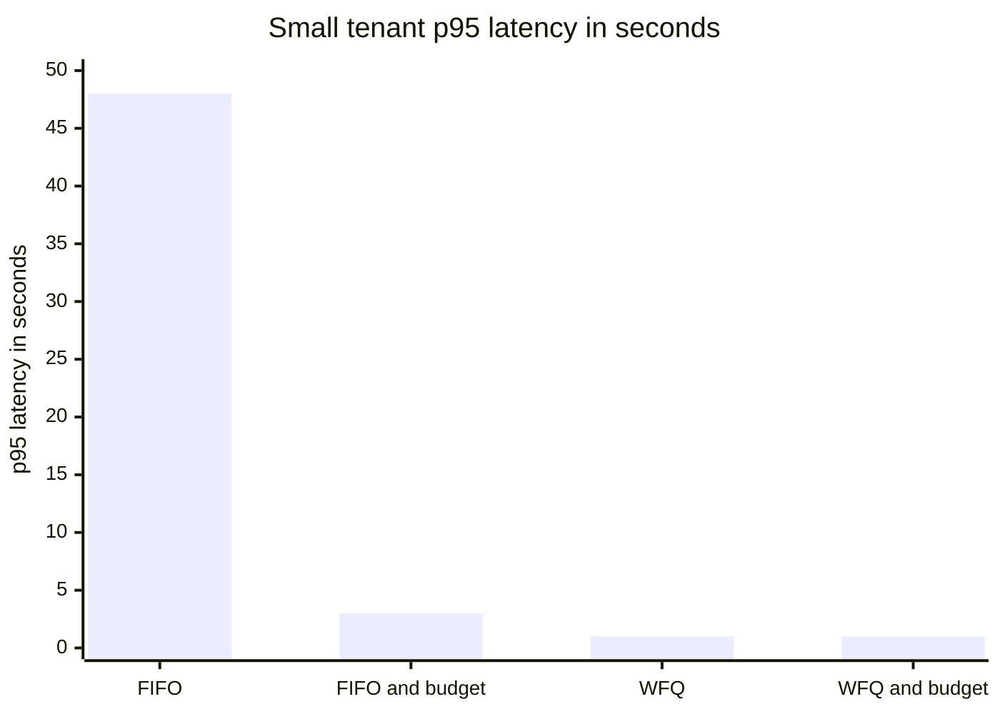

+++
title = 'A multi-tenant inference gateway'
description = 'An LLM gateway shares scarce accelerator memory and time among tenants. It must meter in tokens, schedule fairly, keep one tenant from degrading the others, and never let tenant data cross between them.'
question = "How do you share model capacity among many tenants so that a noisy neighbor stays contained and no tenant sees another tenant's data?"
weight = 4
difficulty = 4
prerequisites = ['/notes/systems-design/worked-designs/01-a-rate-limiter', '/notes/systems-design/thinking-in-invariants/03-back-of-the-envelope-capacity', '/notes/systems-design/failure-modes/04-overload-and-backpressure', '/notes/systems-design/failure-modes/05-blast-radius-and-cells', '/notes/systems-design/reliability-in-production/01-slos-and-error-budgets']
date = 2026-10-24
lastmod = 2026-10-24
verified = 2026-10-24
+++

## The idea in one minute

An inference gateway sits between tenants and pools of model servers. It
authenticates the caller, meters what they use, routes the request to a pool
that serves the model, streams the answer back, and records what happened. That
sounds like any API gateway, but two things are different. The unit of cost is
the **token**, not the request: one request can cost 50 tokens or 200,000. And
the scarce resource is **accelerator memory over time**, because every running
sequence holds a key-value (KV) cache that grows with its context.

A request-per-second rate limiter therefore does not protect anyone. The design
meters tokens at admission, schedules work so each tenant gets its weighted
share, and pushes queueing delay onto the tenant that caused it. On the data
side, prompts and responses are some of the most sensitive data a company
handles, so **isolation and logging policy are as much part of the design as
throughput**. The consequence to act on: budget and schedule in tokens and
memory, and treat every shared cache and log as a potential path between
tenants.

## A picture

```mermaid {title="Admission in tokens, fair scheduling, and isolated data paths"}
flowchart LR
  T["<b>Tenant apps</b>"] --> AU["<b>Auth</b><br/><small>key or OIDC to tenant ID</small>"]
  AU --> AD["<b>Admission</b><br/><small>token budget, max context</small>"]
  AD --> Q[["<b>Per-tenant queues</b>"]]
  Q --> S["<b>Fair scheduler</b><br/><small>weighted by tenant</small>"]
  S --> P1["<b>Pool: model A</b><br/><small>batching, KV cache</small>"]
  S --> P2["<b>Pool: model B</b>"]
  P1 -->|"stream tokens"| T
  AD -.->|"429 + Retry-After"| T
  P1 --> M["<b>Metering</b><br/><small>counts only, no content</small>"]
  P1 -.->|"opt-in, per-tenant key"| L[("<b>Content log</b><br/><small>short retention</small>")]
  class T neutral
  class AU,AD good
  class Q queue
  class S compute
  class P1,P2 compute
  class M io
  class L warn
```

## How it really works

### Requirements

- **Tenants:** about 200 organizations, each with many API keys, sharing pools
  for two models. Peak demand is 2 million output tokens per minute in total.
- **Quotas:** per tenant, input and output tokens per minute, concurrent
  requests, maximum context length, and maximum output tokens per request.
- **Latency SLO:** time to first token under 2 s at p95 for any tenant within
  its quota, regardless of what other tenants are doing.
- **Streaming:** responses stream token by token over server-sent events; a
  client disconnect stops generation.
- **Data:** no tenant can read another's prompts, responses, cached state, or
  logs. Prompt and response content is not stored unless the tenant opts in.

### Invariants

| # | Invariant |
| --- | --- |
| I1 | **Data isolation.** No prompt, response, cached prefix, adapter, or log entry of one tenant is observable by another |
| I2 | **Bounded consumption.** A tenant's admitted tokens per minute, concurrency, and context never exceed its quota |
| I3 | **Performance isolation.** A tenant within quota meets its latency SLO whatever other tenants send |
| I4 | **Attribution.** Every request is metered (tenant, key, model, input and output tokens) without storing content by default |
| I5 | **No orphan work.** A cancelled or disconnected stream releases its accelerator memory within one scheduling step |

I2 and I3 are different promises. Quotas bound what a tenant can take in total;
they do not decide who goes first when the pool is busy. The demonstration below
shows that you need both.

### How serving works, at the level a gateway needs

- **Prefill and decode.** The server first processes the whole prompt in
  parallel (prefill, compute-heavy), then generates one token per step for each
  sequence (decode, limited by memory bandwidth). Long prompts make prefill
  bursts that can stall decoding for everyone in the batch; serving engines
  split prefill into chunks to limit that.
- **Continuous batching.** Engines add and remove sequences from the running
  batch at every step instead of waiting for a whole batch to finish. The Orca
  paper (OSDI 2022) called this iteration-level scheduling.
- **The KV cache.** Each running sequence stores keys and values for every
  token of its context, in every layer. PagedAttention (the vLLM paper, SOSP
  2023) manages this memory in fixed-size blocks, like virtual memory pages,
  which reduces fragmentation and lets sequences share blocks for a common
  prefix.

The KV cache is the capacity constraint a gateway must reason about.

### Capacity estimate

Take a hypothetical 8-billion-parameter model with 32 layers, 8 KV heads
(grouped-query attention), head dimension 128, and 16-bit values. KV cache per
token:

2 (K and V) × 32 layers × 8 heads × 128 × 2 bytes = **131,072 bytes = 128 KiB**.

On an 80 GB accelerator, the weights take 8 × 10^9 × 2 bytes = 16 GB. Assume
50 GB is left for the KV cache after runtime overhead:

50 × 10^9 / 131,072 ≈ **381,000 tokens** of context in memory at once.

At an average context of 4,000 tokens (3,000 prompt, 1,000 output), that is
about **95 concurrent sequences**. At 32,000 tokens it is 11.

Now one tenant sends a 128,000-token prompt: 128,000 × 128 KiB = **16.8 GB**,
a third of the KV budget, displacing about 32 average sequences for as long as
it runs. **A request's cost is context length times duration**, which is why
maximum context belongs in the quota, not just tokens per minute.

Dividing the 381,000-token budget by the average context shows how fast
concurrency collapses as contexts grow.

```mermaid {title="Concurrent sequences that fit in 50 GB of KV cache, by context length"}
xychart-beta
  title "Sequences in memory at once, 128 KiB of KV cache per token"
  x-axis "Average context in tokens" ["4,000", "8,000", "16,000", "32,000", "128,000"]
  y-axis "Concurrent sequences" 0 --> 100
  bar [95, 47, 23, 11, 2]
```

**Replicas.** Suppose measurement shows each stream decodes at about 32 tokens
per second at that batch size, so a replica produces 95 × 32 ≈ 3,040 output
tokens per second. Peak demand is 2,000,000 / 60 ≈ 33,333 tokens per second:
33,333 / 3,040 ≈ 11 replicas. Add two for failures and rolling deploys: **13
replicas**. The same answer falls out of memory: 33,333 tokens per second at 32
per stream is about 1,042 concurrent streams, and 1,042 / 95 ≈ 11. Prefill
competes for the same accelerators, so measure input and output token
throughput separately and budget both.

### The design

**Authenticate to a tenant ID.** API keys are stored hashed, scoped to a tenant
and a set of models, and revocable; enterprise tenants can use OIDC or mutual
TLS. The tenant ID comes from the credential, **never from a header the caller
sets**. Everything downstream (quota, queue, cache scope, log partition) is
keyed on it.

**Admit in tokens.** Tokenize the prompt at the gateway, then charge the
tenant's token bucket for prompt tokens plus the requested `max_tokens` before
any accelerator work starts. When the response finishes, refund the unused
output tokens. Reject with 429 and `Retry-After` when the bucket is empty, and
reject outright any request over the tenant's maximum context. The token bucket
mechanics are those of [the rate limiter](/notes/systems-design/worked-designs/01-a-rate-limiter/),
with tokens as the cost.

**Queue per tenant, schedule fairly.** Admitted requests wait in per-tenant
queues. The scheduler picks the next request by **weighted fair queueing**
(Demers, Keshav, and Shenker, SIGCOMM 1989): each request gets a virtual finish
tag of max(tenant's last tag, virtual time) + cost / weight, and the smallest
tag runs first. A tenant that floods the gateway builds a long queue of large
tags; a tenant that sends one request gets a small tag and goes ahead of the
flood. Weights express contract tiers. Sheng et al. (OSDI 2024) adapt the idea
to LLM serving with a virtual token counter that counts input and output tokens
served per client.

With equal weights and virtual time at zero, the tags work out as below. The
small tenant's 300-token request is tagged 300 and runs before the flood's
first request, tagged 2,000.

```mermaid {title="Weighted fair queueing: the smallest virtual finish tag runs next"}
flowchart LR
  subgraph NQ["Noisy tenant queue"]
    N1["<b>2,000 tokens</b><br/><small>tag 2,000</small>"]
    N2["<b>2,000 tokens</b><br/><small>tag 4,000</small>"]
    N3["<b>2,000 tokens</b><br/><small>tag 6,000</small>"]
  end
  subgraph SQ["Small tenant t1 queue"]
    S1["<b>300 tokens</b><br/><small>tag 300</small>"]
  end
  P@{ shape: diam, label: "Smallest tag?" }
  POOL["<b>Model pool</b>"]
  N1 --> P
  S1 --> P
  P -->|"t1 first, then tag 2,000"| POOL
  class N1,N2,N3 warn
  class S1 good
  class P compute
  class POOL io
```

**Route to pools.** A pool serves one model (and possibly a set of adapters),
in one region, sized as above. Routing considers model, region, tenant tier,
and pool load. Large tenants with strict SLOs or strict isolation needs get
dedicated pools, which is the cell pattern from
[blast radius and cells](/notes/systems-design/failure-modes/05-blast-radius-and-cells/).

As a deployment: shared pools per model, a dedicated cell for a strict tenant,
and two data stores that never hold the same thing.

```mermaid {title="Gateway region: shared model pools, a dedicated cell, metering apart from content"}
flowchart TB
  n_tenants["Tenant apps"]
  subgraph g_region["Gateway region"]
    n_auth["Auth"]
    n_admit["Admission"]
    n_sched["Fair scheduler"]
    subgraph g_shared["Shared pools"]
      n_poolA["Model A pool"]
      n_poolB["Model B pool"]
    end
    subgraph g_cell["Dedicated cell"]
      n_poolD["Large tenant pool"]
    end
    n_meter["Metering counts only"]
    n_clog["Content log opt in"]
  end
  n_tenants --> n_auth
  n_auth --> n_admit
  n_admit --> n_sched
  n_sched --> n_poolA
  n_sched --> n_poolB
  n_sched --> n_poolD
  n_poolA --> n_meter
  n_poolA --> n_clog
```

**Stream with deadlines.** Responses stream over server-sent events. The
gateway enforces a time-to-first-token deadline and a total deadline, limits
open streams per tenant, and propagates client disconnects to the engine so the
sequence is evicted and its KV memory freed (I5). Bill for tokens actually
generated.

One request end to end. Tokens are charged before the engine does any work,
and refunded or billed by what was actually generated.

```mermaid {title="One streamed request: charge, schedule, stream, cancel or finish, refund"}
sequenceDiagram
  autonumber
  participant C as Tenant client
  participant G as Gateway
  participant E as Model pool
  participant M as Metering
  C->>G: prompt, max_tokens, API key
  G->>G: key to tenant ID, tokenize, check max context
  G->>G: charge prompt plus max_tokens to the tenant bucket
  G->>E: dispatch when the fair scheduler picks it
  E->>E: prefill, allocate KV blocks
  loop each decode step
    E-->>G: next token
    G-->>C: server-sent event
  end
  alt client disconnects
    C--xG: connection closed
    G->>E: cancel, evict sequence, free KV memory
  else output complete
    E-->>G: done, output token count
  end
  G->>G: refund unused output tokens
  G->>M: tenant, key, model, token counts, latency
```

**Meter without content.** Metering records tenant, key, model, input and
output token counts, latency, and status. It never needs the prompt. Content
logging, if a tenant opts in for debugging or abuse review, goes to a separate
store, encrypted with a per-tenant key, with short retention and access by
break-glass only.

### Noisy neighbors

A tenant can be noisy along several dimensions, and each needs its own control.

| Dimension | Effect on others | Control |
| --- | --- | --- |
| Tokens per minute | Consumes pool throughput | Token budget at admission |
| Request bursts | Long queues ahead of others | Per-tenant queues with fair scheduling |
| Long contexts | Occupies KV memory, shrinks batch | Maximum context per tenant; charge context × time |
| Long prompts | Prefill stalls decode for the whole batch | Chunked prefill; separate prefill budget |
| Many open streams | Connection and memory exhaustion | Concurrency limit per tenant |
| Cache churn | Evicts others' cached prefixes | Per-tenant cache partitions or quotas |

### Failure modes

- **Pool loss.** A replica failure drops its in-flight sequences. Clients see a
  stream end early; the gateway returns a retryable error and refunds unused
  tokens. Headroom of two replicas absorbs one loss at peak.
- **Overload beyond quotas.** The sum of quotas exceeds capacity by design.
  When the pool is full, fair scheduling keeps tenants within their weighted
  share; beyond that, shed lowest-priority work first, as in
  [overload and backpressure](/notes/systems-design/failure-modes/04-overload-and-backpressure/).
- **Retry amplification.** A client that retries a 2-minute generation on
  timeout doubles its cost. Return idempotency keys for completed responses and
  make deadlines explicit.
- **Tokenizer mismatch.** If the gateway's token count differs from the
  engine's, quotas drift. Count with the engine's tokenizer and reconcile with
  the engine's reported usage.

Every exit from the request lifecycle, including the failure ones, ends by
releasing KV memory and settling the token charge.

```mermaid {title="Request lifecycle: every path releases memory and settles tokens"}
stateDiagram-v2
  [*] --> Received
  Received --> Rejected: over max context or bucket empty, 429
  Received --> Queued: tokens charged
  Queued --> Prefill: fair scheduler picks it
  Prefill --> Decode: KV blocks allocated
  Decode --> Decode: one token per step
  Decode --> Done: end of output or max_tokens
  Decode --> Cancelled: client disconnect or deadline
  Decode --> Failed: replica lost, retryable error
  Done --> Released
  Cancelled --> Released: KV freed within one step
  Failed --> Released
  Released --> [*]: refund unused tokens, meter counts
  Rejected --> [*]
```

### Security review

- **Cross-tenant prefix caches.** Sharing KV blocks for identical prefixes saves
  memory, but if tenants share a cache, response timing can reveal whether
  someone else recently sent the same prefix. Scope prefix caches per tenant
  (I1), or share only prefixes the platform itself supplies.
- **Content in logs.** Prompts contain customer data, credentials pasted by
  users, and proprietary code. Default to metadata-only logging; see
  [data exfiltration and leakage](/notes/ai-security-engineering/how-attacks-work/02-data-exfiltration-and-leakage/)
  for how logs and caches become leakage paths.
- **Denial of wallet.** Stolen keys and unbounded `max_tokens` turn into large
  bills. Per-key limits under the tenant limit, spend alerts, and maximum output
  per request bound it; the attack patterns are in
  [abuse and resource attacks](/notes/ai-security-engineering/how-attacks-work/04-abuse-and-resource-attacks/).
- **Adapters and fine-tunes are tenant data.** A tenant's adapter weights may
  encode its training data. Load them only for that tenant's requests and keep
  them in the tenant's storage partition.
- **Shared accelerator memory.** Sequences from different tenants share an
  engine process and accelerator memory. The engine must never read KV blocks
  it has not written for that sequence; for tenants that cannot accept that
  residual risk, dedicated pools are the answer.
- **The gateway is a policy point.** It is the natural place for input and
  output guardrails and abuse detection, covered in
  [runtime guardrails](/notes/ai-security-engineering/securing-each-stage/06-runtime-guardrails/),
  but those are additions, not substitutes for isolation.

### What changes at 10x

At 20 million output tokens per minute, about 333,000 tokens per second, the
same assumptions give about 110 replicas.

- **Regions and cells.** Split the fleet into regional cells, each with its own
  gateway, scheduler, and pools; split large tenants' quotas across regions.
- **Scheduling moves into the engine.** Gateway-level fair queueing decides
  admission order; at this scale fairness must also hold inside the batch,
  which is what engine-level schedulers such as the virtual token counter do.
- **Disaggregated prefill and decode.** Running prefill and decode on separate
  replicas removes the stall that long prompts cause and lets each be sized
  separately.
- **KV cache tiers.** Offloading idle sequences' KV blocks to host memory raises
  the effective concurrency, at a latency cost when they resume.

## Code

The simulation has a pool that generates 2,000 tokens per second, at most 500
per sequence. Three small tenants each send one 300-token request per second.
From t = 5 to t = 25 a noisy tenant sends three 2,000-token requests per
second, three times the pool's capacity. Four configurations: FIFO or weighted
fair queueing, with or without a per-tenant token budget of 1,000 tokens per
second (burst 8,000) at admission.

```python {title="gateway.py"}
"""gateway.py: per-tenant token budgets and weighted fair queueing.

A model pool generates 2,000 tokens per second in total; one sequence runs at
most 500 tokens per second. Tenant "noisy" floods the gateway; three small
tenants send steady traffic. Compare FIFO with weighted fair queueing (WFQ),
with and without an admission budget in tokens. Simulated; standard library only.
"""

from __future__ import annotations

from dataclasses import dataclass

CAPACITY = 2000      # tokens per tick (1 tick = 1 s) for the whole pool
PER_SEQ = 500        # tokens per tick for a single sequence
SMALL = ("t1", "t2", "t3")


@dataclass
class Req:
    tenant: str
    arrival: int
    cost: int            # prompt + generated tokens
    left: int = 0
    tag: float = 0.0     # WFQ virtual finish tag
    done: int = -1


def workload() -> list[Req]:
    reqs = []
    for t in range(60):
        for name in SMALL:                       # 3 x 300 tokens every second
            reqs.append(Req(name, t, 300))
        if 5 <= t < 25:                          # noisy: 3 x 2,000 tokens per second
            reqs += [Req("noisy", t, 2000) for _ in range(3)]
    return reqs


class Budget:
    """Token bucket per tenant, counted in model tokens, charged at admission."""

    def __init__(self, rate: int, burst: int) -> None:
        self.rate, self.burst, self.level, self.last = rate, burst, {}, {}

    def admit(self, r: Req) -> bool:
        lvl = min(self.burst, self.level.get(r.tenant, self.burst)
                  + (r.arrival - self.last.get(r.tenant, r.arrival)) * self.rate)
        self.last[r.tenant] = r.arrival
        ok = lvl >= r.cost
        self.level[r.tenant] = lvl - r.cost if ok else lvl
        return ok


def simulate(policy: str, budget: Budget | None, weights: dict[str, float]) -> dict:
    pending = sorted(workload(), key=lambda r: r.arrival)
    queue: list[Req] = []
    finished: list[Req] = []
    rejected = {"noisy": 0, "small": 0}
    last_tag: dict[str, float] = {}
    vtime, i, tick = 0.0, 0, 0
    while (i < len(pending) or queue) and tick < 1000:
        while i < len(pending) and pending[i].arrival == tick:
            r = pending[i]
            i += 1
            if budget and not budget.admit(r):
                rejected["noisy" if r.tenant == "noisy" else "small"] += 1
                continue
            r.left = r.cost
            r.tag = max(last_tag.get(r.tenant, 0.0), vtime) + r.cost / weights[r.tenant]
            last_tag[r.tenant] = r.tag
            queue.append(r)
        order = queue if policy == "fifo" else sorted(queue, key=lambda q: q.tag)
        room = CAPACITY
        for r in order:
            if room == 0:
                break
            if policy == "wfq":
                vtime = max(vtime, r.tag - r.cost / weights[r.tenant])  # start tag in service
            step = min(PER_SEQ, r.left, room)
            r.left -= step
            room -= step
            if r.left == 0:
                r.done = tick
        finished += [r for r in queue if r.left == 0]
        queue = [r for r in queue if r.left > 0]
        tick += 1

    def lat(group: tuple[str, ...]) -> tuple[int, int, int]:
        xs = sorted(r.done - r.arrival + 1 for r in finished if r.tenant in group)
        p = lambda q: xs[min(len(xs) - 1, int(q * len(xs)))] if xs else 0
        return p(0.5), p(0.95), xs[-1] if xs else 0

    return {"small": lat(SMALL), "noisy": lat(("noisy",)), "rejected": rejected,
            "noisy_tokens": sum(r.cost for r in finished if r.tenant == "noisy")}


def main() -> None:
    equal = {"noisy": 1.0, "t1": 1.0, "t2": 1.0, "t3": 1.0}
    print(f"pool: {CAPACITY} tok/s, {PER_SEQ} tok/s per sequence; small tenants offer 900 tok/s,")
    print("noisy offers 6,000 tok/s for 20 s. Latency in seconds (p50 / p95 / max).\n")
    print(f"{'configuration':<26}{'small tenants':>16}{'noisy':>16}{'noisy 429s':>12}{'noisy tok':>11}")
    for label, policy, budget in [
        ("FIFO, no budget", "fifo", None),
        ("FIFO, budget 1,000 tok/s", "fifo", Budget(1000, 8000)),
        ("WFQ, no budget", "wfq", None),
        ("WFQ, budget 1,000 tok/s", "wfq", Budget(1000, 8000)),
    ]:
        s = simulate(policy, budget, equal)
        sm, nz = s["small"], s["noisy"]
        print(f"{label:<26}{'%d / %d / %d' % sm:>16}{'%d / %d / %d' % nz:>16}"
              f"{s['rejected']['noisy']:>12}{s['noisy_tokens']:>11,}")


if __name__ == "__main__":
    main()
```

Run it with `python3 gateway.py`:

```text
pool: 2000 tok/s, 500 tok/s per sequence; small tenants offer 900 tok/s,
noisy offers 6,000 tok/s for 20 s. Latency in seconds (p50 / p95 / max).

configuration                small tenants           noisy  noisy 429s  noisy tok
FIFO, no budget               36 / 48 / 49    28 / 50 / 52           0    120,000
FIFO, budget 1,000 tok/s         1 / 3 / 3       6 / 7 / 7          47     26,000
WFQ, no budget                   1 / 1 / 1    48 / 65 / 68           0    120,000
WFQ, budget 1,000 tok/s          1 / 1 / 1       8 / 9 / 9          47     26,000
```

With **FIFO and no budget**, the small tenants' median latency goes from 1 s
to 36 s: they queue behind the flood, and I3 is broken for tenants who did
nothing wrong. **WFQ alone** restores them to 1 s at every percentile while
the noisy tenant still gets all 120,000 tokens served, just slowly: its own
latency rises to 48 s median because the queueing delay now lands on the tenant
that caused it. **A budget alone** limits the noisy tenant to 26,000 tokens and
rejects 47 requests, which mostly protects the others, but the small tenants'
p95 is still 3 s, because the admitted noisy requests still go first when they
arrive first. **Both together** give the small tenants 1 s at every percentile
and bound what the noisy tenant can consume. Quotas bound totals (I2);
scheduling bounds who waits (I3).

The small tenants' p95 column as bars: scheduling, not the budget, is what
brings it down to 1 s.



Where the tokens go with the budget on: the three small tenants offer 54,000
tokens and all are served; of the noisy tenant's 120,000, the 47 rejected
requests account for 94,000.

```mermaid {title="With a 1,000 token per second budget, most of the flood is rejected at admission"}
sankey-beta
Small tenants,Served,54000
Noisy tenant,Served,26000
Noisy tenant,Rejected with 429,94000
```

## Where it breaks

- **Fairness is in the units you choose.** Weighting by tokens treats a 128k
  context and 128k separate short requests the same, but their KV memory cost
  is not the same. Real schedulers need a cost model that includes memory and
  time.
- **Admission charges are estimates.** Charging `max_tokens` up front blocks a
  tenant who sets it high but uses little; charging actual tokens afterwards
  lets a tenant overshoot. Refund-on-completion is a compromise, not an exact
  answer.
- **Fair queueing cannot create capacity.** If every tenant is within quota and
  the sum still exceeds the pool, everyone's latency grows. That is a capacity
  plan problem, managed with SLOs and error budgets.
- **The simulation has no KV memory, no prefill, and no batching dynamics.** It
  models throughput as a fixed token rate. It shows why per-tenant scheduling
  matters, not what latency a real engine achieves.

## Remember this

- Meter and budget in tokens, and cap context length: cost is context × time.
- Quotas bound how much a tenant takes; fair queueing bounds who waits. You need
  both.
- KV cache memory is the capacity constraint: 2 × layers × KV heads × head
  dimension × bytes per token.
- The tenant ID comes from the credential, and keys every queue, cache, and log.
- Prompts and responses are not logged by default; prefix caches are scoped per
  tenant.

## Try it

1. Give `t1` weight 3 in `gateway.py` and make it send 900-token requests.
   Does it get three times the throughput of `t2` during the flood?
2. Add a maximum of 8 concurrent sequences to the pool and a noisy tenant that
   sends a few very long requests instead of many. Which control from the noisy
   neighbor table do you need?
3. Implement refund-on-completion: charge `cost + 1000` at admission and refund
   the difference when the request finishes. How does it change the noisy
   tenant's 429 count?
4. Redo the capacity estimate for a model you use, from its published layer
   count, KV heads, and head dimension. How many 32k-token sequences fit?

## Check yourself

1. Why does a requests-per-second limit fail to protect an LLM pool?

   
   Requests vary in cost by orders of magnitude. A tenant within a requests
   limit can send a few very long prompts or ask for very long outputs and
   consume most of the pool's tokens and KV memory. The limit must be in tokens,
   with a cap on context length.
   

2. In the simulation, why did a token budget alone leave the small tenants'
   p95 at 3 s?

   
   The budget limits how much the noisy tenant is admitted, but admitted
   requests still run in arrival order under FIFO. When a burst of admitted
   noisy requests arrives just ahead of a small request, the small request
   waits. Fair scheduling decides order; budgets do not.
   

3. How much KV cache does one token take for a model with 40 layers, 8 KV
   heads, head dimension 128, and 16-bit values?

   
   2 × 40 × 8 × 128 × 2 bytes = 163,840 bytes, or 160 KiB per token.
   

4. Why should prefix caches be scoped per tenant?

   
   A shared cache makes a cache hit faster than a miss, so a tenant can probe
   whether a given prefix was recently sent by someone else by measuring time to
   first token. Scoping caches per tenant removes that cross-tenant signal.
   

5. Where should the tenant ID used for quotas and cache scoping come from?

   
   From the verified credential (the API key record or the OIDC token), never
   from a request header or body field the caller controls. Otherwise a caller
   could spend another tenant's quota or reach another tenant's cache.
   

## Sources

- A. Demers, S. Keshav, S. Shenker, Analysis and Simulation of a Fair Queueing Algorithm, ACM SIGCOMM, 1989.
- P. Goyal, H. M. Vin, H. Cheng, Start-time Fair Queueing: A Scheduling Algorithm for Integrated Services Packet Switching Networks, ACM SIGCOMM, 1996.
- G.-I. Yu et al., [Orca: A Distributed Serving System for Transformer-Based Generative Models](https://www.usenix.org/conference/osdi22/presentation/yu), USENIX OSDI, 2022.
- W. Kwon et al., [Efficient Memory Management for Large Language Model Serving with PagedAttention](https://arxiv.org/abs/2309.06180), ACM SOSP, 2023.
- Y. Sheng et al., [Fairness in Serving Large Language Models](https://arxiv.org/abs/2401.00588), USENIX OSDI, 2024.
- J. Ainslie et al., [GQA: Training Generalized Multi-Query Transformer Models from Multi-Head Checkpoints](https://arxiv.org/abs/2305.13245), 2023.
- WHATWG, [HTML Living Standard: Server-sent events](https://html.spec.whatwg.org/multipage/server-sent-events.html).
- M. Nottingham, R. Fielding, [RFC 6585: Additional HTTP Status Codes](https://www.rfc-editor.org/rfc/rfc6585), IETF, April 2012.
